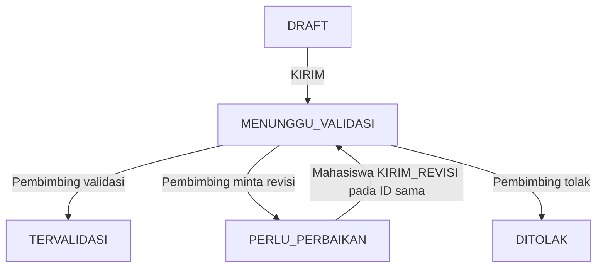
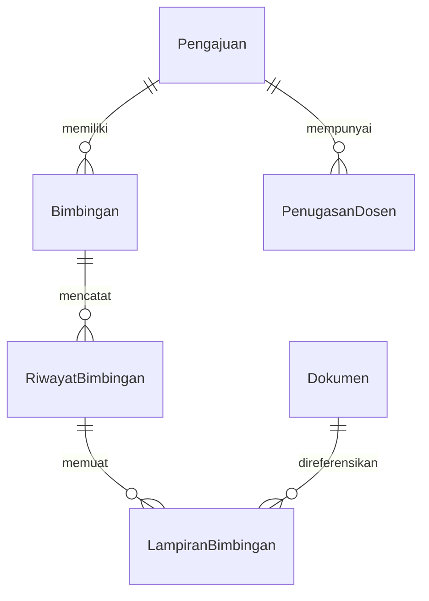

# PRD FASE I — Backend Bimbingan KP Offline & Online | SIPKITA

**Proyek:** Sistem Informasi Pengelolaan KP, ISCP, dan TA (SIPKITA)  
**Status dokumen:** Spesifikasi implementasi Fase I — siap dipakai agent Codex  
**Pemilik proses:** Mahasiswa dan Dosen Pembimbing  
**Target implementasi:** REST API Express + Prisma + PostgreSQL, penyimpanan PDF privat  
**Prasyarat:** Backend Pengajuan KP D–H telah diimplementasikan dan diuji; pengajuan administratif `ACC`, serta Pembimbing resmi sudah ditetapkan oleh Kaprodi.  
**Prioritas:** menghasilkan fitur yang berjalan dan diuji; **tidak mengulang audit database atau Fase D–H**.

> **Instruksi kepada agent:** Dokumen ini adalah sumber keputusan bisnis dan ruang lingkup Fase I. Gunakan `server/prisma/schema.prisma` *aktual* sebagai sumber kebenaran nama field/relasi dan gunakan service D–H yang berjalan sebagai kontrak integrasi. Jangan menafsirkan contoh request di sini sebagai bukti bahwa endpoint tersebut sudah ada. Jika ada ketidaksinkronan dengan dokumen lama, aturan **Fase I dalam PRD ini** berlaku untuk bimbingan KP, tanpa mengubah domain lain.
---

## 1. Masalah, tujuan, dan hasil yang diharapkan

Saat Fase H selesai, Kaprodi telah menetapkan Pembimbing pada pengajuan KP yang sah. Namun belum ada jalur operasional backend untuk merekam kegiatan bimbingan, memeriksa catatan oleh dosen, mengirim koreksi, dan menghitung bimbingan yang benar-benar tervalidasi.

**Tujuan:** Mahasiswa dapat mencatat **bimbingan offline** atau mengirim **bimbingan online**, Pembimbing aktif dapat memeriksa dan memvalidasi, riwayat dan lampiran tiap versi tersimpan, serta tersedia ringkasan bimbingan sah untuk proses ACC penyelesaian KP pada **Fase J**. Mesin aturan dibuat cukup generik agar kelak dapat dipakai ISCP/TA, tetapi **endpoint dan pengujian Fase I berfokus pada KP**.

**Definisi selesai Fase I:**
- Mahasiswa dapat membuat/mengedit draft, mengirim offline/online, melihat daftar/detail/riwayat, dan memperbaiki catatan berstatus `PERLU_PERBAIKAN` pada `Bimbingan.id` yang sama.
- Dosen yang mempunyai role dan penugasan `PEMBIMBING` aktif dapat memeriksa catatan secara individual dan melakukan **Validasi Semua** terhadap bimbingan *terpilih*.
- Lampiran PDF opsional diakses secara privat, berelasi dengan **riwayat pengiriman yang tepat**, bukan langsung dengan record utama Bimbingan.
- Status `TERVALIDASI` dihitung **satu kali per Bimbingan**; proses ini **tidak** membuat ACC penyelesaian atau meluluskan mahasiswa.
- Seluruh mutasi aman dari akses lintas mahasiswa, akses dosen yang tidak ditugaskan, perubahan versi saat sedang diperiksa, dan request paralel.

## 2. Batas proses bisnis dan kewenangan aktor

| Aktor | Boleh | Tidak boleh |
|---|---|---|
| **Mahasiswa** | Membuat draft sendiri, mengirim catatan bimbingan, melihat hasil, mengirim koreksi hanya bila diminta, melihat/unduh lampiran yang diizinkan | Memvalidasi sendiri, mengubah bimbingan terkunci, melihat pengajuan mahasiswa lain |
| **Dosen Pembimbing** | Melihat catatan dari pengajuan yang menjadi penugasan aktifnya, memeriksa materi, memberi keputusan dan catatan, validasi beberapa catatan terpilih | Memberi keputusan tanpa penugasan `PEMBIMBING` aktif; mengubah catatan seolah berasal dari mahasiswa |
| **Dosen Reviewer** | Tidak memiliki hak tambahan pada bimbingan hanya karena ditugaskan Reviewer | Melakukan validasi bimbingan atas nama Pembimbing |
| **Kaprodi** | Melihat perkembangan sesuai kewenangan di masa depan; penetapan/penggantian Pembimbing tetap dikelola Fase H | Mengambil alih pemeriksaan Pembimbing melalui endpoint Fase I |
| **Admin Prodi/Admin Sistem** | Tidak memiliki peran pemeriksa isi bimbingan dalam Fase I | Memberikan `TERVALIDASI` atas nama dosen |

**Gate kegiatan:** `Pengajuan` yang benar (KP), diterima untuk pelaksanaan (`ACC` administratif), punya `PenugasanDosen` berjenis `PEMBIMBING` dan `AKTIF`, belum selesai/ditutup menurut status operasional yang berlaku. Kesesuaian Mahasiswa, Pengajuan, Pembimbing, dan Prodi diperiksa **di backend**, bukan berdasarkan data dari frontend. Tidak perlu memeriksa apakah **jadwal pendaftaran Pengajuan KP** masih dibuka: pelaksanaan bimbingan boleh berlanjut setelah masa pendaftaran ditutup, selama tahap tersebut masih sah untuk dilaksanakan.

**Interaksi dengan Fase H:** Penggantian Pembimbing sudah dilarang ketika terdapat **record `Bimbingan` apa pun, termasuk `DRAFT`**. Jangan melemahkan guard itu. UI harus nantinya menyadari bahwa membuat draft pertama dapat mengunci penggantian Pembimbing. Kegiatan offline yang sama sekali tidak dicatat di sistem belum dapat dideteksi; keterbatasan operasional ini tetap berlaku.

## 3. Aturan bisnis final Fase I

| ID | Aturan final | Konsekuensi teknis |
|---|---|---|
| I-01 | Offline = pertemuan tatap muka yang **sudah berlangsung**, dicatat mahasiswa. | Saat kirim, tanggal pertemuan dan ringkasan wajib; bukti file opsional. |
| I-02 | Online = pengiriman materi/progres untuk ditinjau **asinkron** oleh Pembimbing. | Ringkasan/materi teks wajib saat kirim, lampiran opsional; bukan chat/video call. |
| I-03 | Satu kegiatan = satu baris `Bimbingan`, terlepas dari berapa kali revisi. | Update record yang sama; buat satu `RiwayatBimbingan` baru setiap pengiriman dan pemeriksaan. |
| I-04 | Keputusan Pembimbing: `TERVALIDASI`, `PERLU_PERBAIKAN`, `DITOLAK`. | Catatan wajib untuk `PERLU_PERBAIKAN`/`DITOLAK`, opsional untuk `TERVALIDASI`. |
| I-05 | Revisi hanya jika `PERLU_PERBAIKAN`. | `TERVALIDASI` dan `DITOLAK` terkunci; `MENUNGGU_VALIDASI` tidak boleh berubah sepihak. |
| I-06 | Semua keputusan mengacu pada **versi pengiriman terbaru**. | Optimistic version/snapshot wajib pada endpoint pemeriksaan; stale request ditolak. |
| I-07 | Validasi massal = **beberapa bimbingan terpilih**, bukan validasi otomatis seluruh daftar tanpa pemeriksaan. | Konfirmasi eksplisit bahwa item dipilih dan diperiksa; transaksi *all-or-nothing*. |
| I-08 | Hanya `TERVALIDASI` yang dihitung sebagai bimbingan sah. | `COUNT(Bimbingan.id)` terfilter per `pengajuan_id`, **bukan** jumlah riwayat/lampiran. |
| I-09 | Minimal bimbingan mengikuti konfigurasi `AturanPenyelesaianTahap` menurut tahap dan periode. | Tidak hardcode 10; jika aturan belum tersedia, tampilkan ketidaktersediaan target tanpa membuat ACC otomatis. |
| I-10 | Bimbingan tiap tahap/periode tidak digabung. | Pengajuan KP sekarang dan pengajuan perpanjangan/semester berikutnya punya hitungan masing-masing. |
| I-11 | Keputusan bimbingan tidak otomatis menyetujui penyelesaian KP. | Tidak membuat/mengubah `PenyelesaianTahap` pada Fase I. |
| I-12 | Lampiran menempel pada **riwayat pengiriman spesifik**. | File revisi tetap terpisah dari file kiriman lama; riwayat lama tidak dihapus. |

**Kontrak status dan aksi yang ditetapkan PRD untuk Fase I** (field Prisma bertipe `String`, bukan enum otomatis):

```text
Bimbingan.jenis_bimbingan: OFFLINE | ONLINE
Bimbingan.status_bimbingan: DRAFT | MENUNGGU_VALIDASI | TERVALIDASI | PERLU_PERBAIKAN | DITOLAK
RiwayatBimbingan.aksi: KIRIM | KIRIM_REVISI | PERIKSA
PenugasanDosen.jenis_penugasan: PEMBIMBING
PenugasanDosen.status_penugasan: AKTIF
```

Agent boleh memakai **konstanta terpusat**, dengan tetap memeriksa panjang `VarChar` dan pola kode existing. Jangan mengubah tipe Prisma menjadi enum atau membuat tabel status baru tanpa alasan yang dapat dibuktikan.

### 3.1 State machine



- Draft boleh diubah oleh pemilik sampai dikirim. Draft yang belum dikirim belum dihitung sah.
- Setelah `MENUNGGU_VALIDASI`, mahasiswa tidak dapat mengubah isi/lampiran yang sedang diperiksa.
- Revisi atas `PERLU_PERBAIKAN` dilakukan lewat aksi kirim-revisi yang menyimpan versi baru **dalam satu transaksi**; tidak ada periode ketika revisi tak terkirim diam-diam menggantikan isi yang sedang dilihat dosen.
- `TERVALIDASI` dan `DITOLAK` adalah status akhir pada catatan tersebut. Tidak ada fitur override/pembukaan kembali di Fase I.
- Untuk offline, tidak menetapkan batas mundur hari secara spekulatif. Validasi tanggal harus sah dan tidak melebihi tanggal server saat submit, karena merupakan pertemuan yang telah terjadi; kebijakan batas pelaporan lebih jauh di luar scope.
- Untuk online, `tanggal_bimbingan` boleh `null` karena tidak merepresentasikan pertemuan fisik; waktu kirim dibaca dari `diajukan_pertama_at` dan `RiwayatBimbingan.created_at` (waktu server). Jangan mengisi tanggal pertemuan fiktif.

## 4. Contoh dua alur utama

### 4.1 Bimbingan Offline

1. Mahasiswa membuka daftar bimbingan dari **Pengajuan KP aktif miliknya**; backend memeriksa ACC dan Pembimbing aktif.
2. Mahasiswa membuat draft offline (tanggal pertemuan dan ringkasan dapat dilengkapi sebelum kirim).
3. Mahasiswa menekan **Kirim Bimbingan**; sistem memvalidasi tanggal dan ringkasan, membuat riwayat pengiriman versi 1, lalu mengubah status menjadi `MENUNGGU_VALIDASI`.
4. Dosen Pembimbing melihat daftar tugas menunggu validasi, membuka detail tanggal dan ringkasan, serta melihat lampiran jika ada.
5. Jika `TERVALIDASI`, kegiatan terkunci dan dihitung satu; jika `PERLU_PERBAIKAN`, catatan tampil pada mahasiswa dan boleh dikirim ulang dengan `Bimbingan.id` tetap; jika `DITOLAK`, tidak dihitung dan tidak dapat direvisi.

### 4.2 Bimbingan Online

1. Mahasiswa membuat draft online berisi materi/ringkasan progres, boleh melampirkan PDF.
2. Mahasiswa mengirim; backend membuat versi pengiriman dan lampiran terkait riwayat itu.
3. Dosen membaca materi secara asinkron, memberi komentar dan salah satu keputusan.
4. Jika `PERLU_PERBAIKAN`, mahasiswa mengirim revisi materi dan mungkin file baru **pada kegiatan yang sama**. Dosen harus memeriksa versi baru; versi sebelumnya tetap dapat dilihat sebagai riwayat.
5. `TERVALIDASI` dihitung satu kali meskipun terjadi beberapa putaran review.

### 4.3 Contoh data revisi

| Model | Isi konseptual |
|---|---|
| `Bimbingan` | `id=301`, `pengajuan_id=101`, jenis `ONLINE`, status terkini `TERVALIDASI`, versi terakhir `2` |
| `RiwayatBimbingan` | `(301, KIRIM, v1)`, `(301, PERIKSA, PERLU_PERBAIKAN, v1)`, `(301, KIRIM_REVISI, v2)`, `(301, PERIKSA, TERVALIDASI, v2)` |
| `LampiranBimbingan` | Jika ada: lampiran kiriman v1 menunjuk riwayat v1; lampiran revisi v2 menunjuk riwayat v2 |
| Hitungan sah | **1**, bukan 2 atau 4 |

ID contoh bukan data aktual dan tidak boleh di-hardcode.

## 5. Pemetaan database dan kesiapan schema

Rancangan memanfaatkan struktur existing yang sudah ditemukan dalam schema SIPKITA. **Ini kesiapan struktural, bukan klaim bahwa endpoint Fase I sudah ada atau database runtime telah diaudit ulang.** Agent cukup mencocokkan model dan kolom relevan dengan `server/prisma/schema.prisma` aktual sebelum coding.

| Model | Tanggung jawab | Field penting / relasi |
|---|---|---|
| `Pengajuan` | Konteks mahasiswa, KP, periode, dan state pelaksanaan. | `id`, `mahasiswa_id`, `tahap_akademik_id`, `periode_akademik_id`, `status_pengajuan`, `status_pengerjaan` |
| `PenugasanDosen` | Otorisasi Pembimbing yang ditetapkan Kaprodi. | `pengajuan_id`, `dosen_id`, `jenis_penugasan`, `status_penugasan` → profil Dosen/User |
| `Bimbingan` | Satu kegiatan dan state terkini. | `id`, `pengajuan_id`, `jenis_bimbingan`, `tanggal_bimbingan`, `ringkasan`, `status_bimbingan`, `versi_pengiriman_terakhir`, `catatan_pembimbing_terakhir`, `diperiksa_oleh_user_id`, `diperiksa_at`, `diajukan_pertama_at`, timestamps |
| `RiwayatBimbingan` | Semua peristiwa kirim/putusan dan snapshot tiap versi. | `bimbingan_id`, `dilakukan_oleh_user_id`, `aksi`, `versi_pengiriman`, `status_sebelum`, `status_sesudah`, `tanggal_bimbingan_snapshot`, `ringkasan_snapshot`, `catatan`, `created_at` |
| `LampiranBimbingan` | Tautan lampiran pada **peristiwa pengiriman**. | `riwayat_bimbingan_id`, `dokumen_id`, `jenis_lampiran`, `keterangan`, `urutan_tampil` |
| `Dokumen` | Metadata file PDF privat. | `diunggah_oleh_user_id`, `storage_key`, `mime_type`, `ukuran_bytes`, `nama_file_asli` (sesuaikan field aktual) |
| `AturanPenyelesaianTahap` | Target jumlah bimbingan menurut tahap/periode. | `tahap_akademik_id`, `periode_akademik_id`, `minimal_bimbingan`, `is_aktif` |
| `PenyelesaianTahap` | ACC penyelesaian pada **Fase J**, bukan objek tulis Fase I. | `pengajuan_id`, `jumlah_bimbingan_saat_acc`, `disetujui_oleh_user_id` |



**Hal teknis penting:** `RiwayatBimbingan.id` bertipe `BigInt`. Serializer JSON Express harus mengonversi BigInt sesuai pola proyek (misalnya string), tidak langsung `JSON.stringify` atas BigInt. Jangan membuat FK lampiran langsung ke `Bimbingan`; keterikatan versi akan hilang. Gunakan constraint/index yang sudah ada; jangan menciptakan indeks baru secara refleks. Tidak diharapkan migrasi untuk inti Fase I bila schema runtime sesuai.

## 6. Kontrak endpoint — siap untuk kebutuhan UI

**Rancangan path:** memisahkan endpoint mahasiswa yang berbasis pengajuan dari workspace dosen. Cocokkan route nyata agar tidak bertabrakan dengan Fase D/E/F/G/H. Pemilihan path boleh diselaraskan, tetapi **kemampuan dan aturan harus tetap sama**.

### 6.1 Endpoint Mahasiswa

| Method | Path usulan | Tujuan |
|---|---|---|
| `GET` | `/api/pengajuan/:pengajuanId/bimbingan` | Daftar/filter/pagination bimbingan sendiri beserta progres |
| `POST` | `/api/pengajuan/:pengajuanId/bimbingan` | Membuat draft `OFFLINE` atau `ONLINE` |
| `GET` | `/api/pengajuan/:pengajuanId/bimbingan/:id` | Detail status terkini, catatan dosen, ringkasan riwayat |
| `PATCH` | `/api/pengajuan/:pengajuanId/bimbingan/:id` | Memperbarui draft **sebelum** pengiriman saja |
| `POST` | `/api/pengajuan/:pengajuanId/bimbingan/:id/kirim` | Kirim pertama; dapat menerima lampiran opsional |
| `POST` | `/api/pengajuan/:pengajuanId/bimbingan/:id/revisi` | Kirim ulang konten versi baru **hanya** ketika `PERLU_PERBAIKAN` |
| `GET` | `/api/pengajuan/:pengajuanId/bimbingan/:id/riwayat` | Riwayat kirim/periksa dan versi lampiran |
| `GET` | `/api/pengajuan/:pengajuanId/bimbingan/:id/lampiran/:lampiranId/file` | Unduh file terotorisasi (untuk versi/riwayat yang sah) |
| `GET` | `/api/pengajuan/:pengajuanId/bimbingan/progres` | Ringkasan jumlah sah, menunggu, perlu perbaikan, ditolak, dan target bila terkonfigurasi |

**Catatan urutan route:** rute literal seperti `/progres` harus didefinisikan sebelum rute `/:id` agar tidak tertangkap sebagai ID. Endpoint daftar/detail dan progres boleh digabung jika mempertahankan kebutuhan frontend tanpa duplikasi respons berat.

### 6.2 Endpoint Dosen Pembimbing

| Method | Path usulan | Tujuan |
|---|---|---|
| `GET` | `/api/pembimbing/bimbingan` | Workspace tugas: filter mahasiswa/pengajuan, jenis, status, periode, pencarian, pagination |
| `GET` | `/api/pembimbing/bimbingan/:id` | Detail kegiatan terbaru, riwayat/lampiran, metadata versi untuk keputusan |
| `POST` | `/api/pembimbing/bimbingan/:id/keputusan` | Putusan individual (`TERVALIDASI`, `PERLU_PERBAIKAN`, `DITOLAK`) |
| `POST` | `/api/pembimbing/bimbingan/bulk-validasi` | **Validasi Semua terpilih** dengan transaksi atomik |
| `GET` | `/api/pembimbing/bimbingan/:id/lampiran/:lampiranId/file` | Unduh materi/bukti secara privat menurut penugasan aktif |

Endpoint bulk diposisikan sebelum `/:id`. Tidak perlu endpoint batch `PERLU_PERBAIKAN`/`DITOLAK`; kedua keputusan itu membutuhkan catatan spesifik tiap kegiatan.

### 6.3 Contoh request/response kontrak (ilustratif)

**Buat draft:**

```http
POST /api/pengajuan/101/bimbingan
Content-Type: application/json

{"jenis_bimbingan":"OFFLINE","tanggal_bimbingan":"2026-11-10","ringkasan":"Pembahasan ERD dan proses bisnis KP"}
```

**Kirim pertama:** `POST .../bimbingan/301/kirim` menerima request tanpa file atau `multipart/form-data` dengan lampiran PDF opsional. Wajib autentikasi, validasi state `DRAFT`, dan simpan riwayat kirim versi pertama. Identitas pengunggah selalu diambil dari sesi.

**Keputusan individual:**

```json
{
  "expected_versi_pengiriman": 1,
  "hasil": "PERLU_PERBAIKAN",
  "catatan": "Tambahkan rangkuman hasil diskusi dan revisi rancangan ERD."
}
```

**Validasi massal:**

```json
{
  "konfirmasi_sudah_diperiksa": true,
  "items": [
    { "bimbingan_id": 301, "expected_versi_pengiriman": 2 },
    { "bimbingan_id": 305, "expected_versi_pengiriman": 1 }
  ]
}
```

**Respons sukses massal (contoh bentuk):**

```json
{
  "data": {
    "hasil": "BERHASIL",
    "total_dipilih": 2,
    "total_diperbarui": 2,
    "total_idempotent": 0
  }
}
```

**Respons progres (contoh bentuk):**

```json
{
  "data": {
    "pengajuan_id": 101,
    "jumlah": { "tervalidasi": 7, "menunggu_validasi": 2, "perlu_perbaikan": 1, "ditolak": 0 },
    "minimal_bimbingan": null,
    "target_terkonfigurasi": false,
    "memenuhi_minimum": null,
    "zona_waktu": "Asia/Jakarta"
  }
}
```

Nilai di atas ilustratif. Jika aturan minimal bimbingan belum terkonfigurasi, **jangan mengisi angka 10 secara diam-diam**.

### 6.4 Kontrak pencarian dan UI

- Daftar mahasiswa dan dosen mendukung `page`, `limit`, `jenis_bimbingan`, `status_bimbingan`, serta filter pengajuan/mahasiswa/periode sesuai scope aktor.
- Respons menyertakan `data`, `pagination`, dan metadata ringkas yang diperlukan untuk menampilkan badge/status, tanggal, judul pengajuan, jenis bimbingan, versi, catatan terbaru, serta apakah aksi kirim/revisi/validasi diperbolehkan.
- Backend **menegakkan** aksi yang diperbolehkan; flag UI hanyalah bantuan presentasi.
- Detail menyediakan `expected_versi_pengiriman` terkini agar dosen dapat mengirim keputusan yang tidak basi; bila riwayat/keputusan berubah sejak GET, respon `409` atau kode konflik standar proyek.
- Download file adalah respons biner; nama file dari server harus aman dan tidak membocorkan `storage_key`/bucket privat.

## 7. Pemetaan proses → transaksi Prisma

### 7.1 Create dan update draft

1. `authenticate`, `authorizeRoles('MAHASISWA')`, lalu baca profil mahasiswa dari user sesi.
2. Validasi kepemilikan `Pengajuan`, tahap `KP`, status administratif/operasional, dan keberadaan Pembimbing aktif.
3. `create(Bimbingan)` dengan `status_bimbingan='DRAFT'`, `versi_pengiriman_terakhir=0`; edit draft hanya untuk pemilik dan status DRAFT.
4. Belum membuat `RiwayatBimbingan` pengiriman saat draft baru dibuat, kecuali pola audit proyek secara eksplisit memerlukan peristiwa draft. **Versi pengiriman** meningkat hanya saat `kirim` atau `revisi`.

### 7.2 Kirim pertama / revisi

1. Validasi mahasiswa, pengajuan dan versi/status terkini; syarat offline/online.
2. Jika unggah lampiran, validasi tipe dan struktur PDF menggunakan validator yang telah dipakai pada modul Data Diri/Pengajuan KP, lalu simpan **privat** menggunakan storage service existing.
3. Dalam **satu transaksi database**, perbarui `Bimbingan` ke `MENUNGGU_VALIDASI`, tetapkan `diajukan_pertama_at` saat kirim pertama, tingkatkan `versi_pengiriman_terakhir` secara aman, buat `RiwayatBimbingan` snapshot pengiriman, lalu tautkan `LampiranBimbingan` ke `RiwayatBimbingan.id` baru.
4. Untuk revisi, syarat awal `PERLU_PERBAIKAN`, `Bimbingan.id` tetap. Riwayat dan lampiran lama tidak dihapus. Konten yang sedang diperiksa tidak bisa diganti tanpa putaran baru.
5. Jika transaksi DB gagal setelah upload berhasil, lakukan **kompensasi cleanup file** sebisa mungkin dan laporkan kegagalan cleanup untuk penanganan; jangan mengklaim storage cloud berada di transaksi atomik PostgreSQL.

**Keputusan penyederhanaan untuk MVP:** lampiran baru ditransfer pada aksi **KIRIM** atau **KIRIM_REVISI**; draft pada server menyimpan teks/tanggal saja. Frontend kelak dapat memilih file sebelum dikirim, tetapi belum diperlukan fitur "simpan lampiran draft" yang rawan menghasilkan file orphan dan tidak memiliki `RiwayatBimbingan` pengiriman. Jika implementasi existing menyediakan staging file yang sudah aman, boleh digunakan tanpa membentuk relasi ganda.

### 7.3 Pemeriksaan dosen

1. Role aktif `PEMBIMBING`; profil Dosen/user sesi harus cocok dengan `PenugasanDosen` aktif pada pengajuan bimbingan.
2. Status wajib `MENUNGGU_VALIDASI`, dan `expected_versi_pengiriman` sama dengan state server terkini.
3. Validasi `hasil` dan kewajiban catatan; tulis perubahan status, pemeriksa, `diperiksa_at`, dan catatan terbaru pada `Bimbingan`.
4. Tambah `RiwayatBimbingan` aksi `PERIKSA` yang menunjuk versi dinilai serta menyimpan hasil dan catatan dosen; transaksi atomik.
5. Request identik pada versi dan keputusan yang sama dapat menjadi no-op idempotent **tanpa audit ganda**, tetapi tidak boleh menimpa keputusan berbeda atau pemeriksa lain. Gunakan mekanisme locking/concurrency existing yang terbukti pada Fase E–H.

### 7.4 Bulk TERVALIDASI

- Input harus berisi sejumlah terbatas ID berbeda (saran default maksimum **20** per request, bisa menjadi konstanta server); tidak menerima item ganda/empty/ID asing.
- Semua item harus berada pada status `MENUNGGU_VALIDASI`, versi yang cocok, serta di bawah pembimbing aktif yang sama dengan user sesi; hanya hasil `TERVALIDASI`.
- Dosen mengonfirmasi bahwa **semua item terpilih telah diperiksa**. Backend tidak memvalidasi otomatis berdasarkan jumlah file atau status daftar.
- Kunci dan validasi seluruh item dengan **urutan ID stabil** dalam transaksi agar request bersamaan tidak menghasilkan dua audit. Gunakan isolasi/locking sesuai PostgreSQL adapter dan pola existing.
- **All-or-nothing:** bila satu ID tidak sah, sudah direvisi, tidak ditugaskan, atau mempunyai status bertentangan, tidak ada item berubah; kembalikan konflik terstruktur tanpa membocorkan data milik orang lain.
- Pengulangan permintaan identik boleh menjadi idempotent jika hasil, dosen pemeriksa, dan versi sama; jangan menambah `RiwayatBimbingan` duplikat. Perubahan berbeda pada item tervalidasi ditolak.
- Tidak ada fitur **"validasi semua tanpa dipilih"** secara mutatif; tombol "pilih semua" di frontend menghasilkan daftar ID + versi eksplisit, sehingga backend tidak pernah memvalidasi data hasil filter yang bergeser diam-diam.

## 8. Lampiran: batasan dan keamanan

- Gunakan **Supabase Storage bucket privat** yang sudah digunakan SIPKITA, atau fallback lokal existing sesuai konfigurasi server; jangan mengekspos `storage_key` maupun membuat bucket publik.
- Kebijakan teknis MVP yang disarankan: hanya `application/pdf`, maksimum **5 MiB per file** dan maksimal **3 lampiran per pengiriman**. Ini **usulan kebijakan baru Fase I**, bukan aturan yang telah dibuktikan oleh dokumen akademik; jika repo sudah mempunyai policy lampiran spesifik, ikuti policy yang lebih kuat/ketentuan terkonfirmasi dan catat perbedaan. Jangan otomatis menggunakan limit proposal KP 10 MiB untuk bimbingan.
- Periksa MIME, magic bytes, PDF parser, ukuran, jumlah file, nama aman, dan ownership. Tolak PDF palsu/rusak sesuai validator yang sudah diuji.
- `Dokumen` menyimpan metadata, `LampiranBimbingan` menunjuk `RiwayatBimbingan` **versi pengiriman** yang benar. Saat review, tidak menambah lampiran baru kecuali disepakati jenis lampiran balasan dosen.
- Autorisasi download dilakukan per file: pemilik Pengajuan atau Pembimbing aktif yang ditugaskan; jangan mengizinkan hanya karena ID file valid.
- Beri waktu server yang konsisten untuk peristiwa. Untuk tanggal pertemuan offline gunakan semantik tanggal kalender `YYYY-MM-DD`, bukan memperlakukan tanggal lokal sebagai timestamp UTC yang dapat bergeser satu hari.

## 9. Integrasi dengan backend Fase D–H dan Fase J

- **Fase D–E:** status pengajuan administratif sudah `ACC` dan konteks mahasiswa sah; status catatan bimbingan tidak mengubah Status Berkas, Nilai, atau Pengajuan.
- **Fase F–G:** Reviewer tetap tidak memiliki hak bimbingan hanya karena memiliki role Reviewer atau pernah memberi `LAYAK`.
- **Fase H:** keabsahan Pembimbing memakai penugasan aktif yang ditetapkan Kaprodi. Menambahkan Bimbingan (bahkan draft) berarti guard penggantian Pembimbing yang sudah ada harus tetap bekerja. Jangan mengizinkan mutasi Reviewer/revisi proposal awal yang telah dikunci setelah penetapan Pembimbing.
- **Fase J:** `AturanPenyelesaianTahap` menentukan minimal bimbingan; `PenyelesaianTahap` hanya akan ditulis saat ACC penyelesaian diputuskan pada modul terpisah. Fase I menyediakan **read-only agregat**; tidak meluluskan tahap secara otomatis.
- **KP ke ISCP:** belum dibuat pada Fase I. Kelak engine dapat digunakan kembali setelah pengajuan ISCP sah dan memiliki Pembimbing sendiri.
- **Perpanjangan:** kelak membuat Pengajuan semester baru; riwayat bimbingan lama tidak dihapus, hitungan pada pengajuan baru dimulai dari data pengajuan baru, bukan disalin.

## 10. Arsitektur kode dan batas desain

Ikuti organisasi aktual `server/src` (pilih penamaan berdasarkan konvensi existing):

```text
server/src/
├── routes/
│   ├── bimbingan-mahasiswa.routes.js         (usulan)
│   └── bimbingan-pembimbing.routes.js        (usulan)
├── controllers/
│   ├── bimbingan-mahasiswa.controller.js     (usulan)
│   └── bimbingan-pembimbing.controller.js    (usulan)
├── services/
│   └── bimbingan.service.js                  (usulan, core rules reusable)
└── ... reuse middleware auth, upload validator, storage service, errors, Prisma client
```

- **Route:** peran, multipart/rate limit, pemasangan path di `app.js`.
- **Controller:** parse/allowlist payload, params/query, validasi ukuran/format dasar, serialisasi response, HTTP status, tanpa logika domain yang kompleks.
- **Service:** validasi ownership/role/penugasan/tahap/status, state machine, transaksi, concurrency, riwayat, agregat, dan kontrol akses download.
- **Prisma/model:** gunakan model existing, query/filter minimal yang efisien, jangan memuat seluruh PDF ke response daftar, batasi pagination.
- **File:** reuse modul PDF validation, private storage, stream/buffer download serta cleanup yang ada. Hindari service baru yang menduplikasi validator.
- **Kinerja:** bulk maksimum ditetapkan; daftar/filter dipaginasi di query bila memungkinkan; indeks tambahan hanya jika ditemukan bukti bottleneck nyata.
- **Error contract:** ikuti `docs/api-conventions.md` dan error middleware: `400/422` input invalid, `401` tanpa login, `403` tanpa izin, `404` tidak ditemukan dalam scope, `409` transisi/versi konflik, `413` file terlalu besar. Jangan membocorkan keberadaan objek lintas mahasiswa dalam pesan respons.

## 11. Pengujian dan acceptance criteria

**Semua operasi tulis integrasi memakai PostgreSQL TEST terisolasi.** Cukup satu suite integrasi Fase I yang membuktikan alur, bukan audit ulang seluruh schema atau Fase D–H. Gunakan fixture yang menyiapkan Pengajuan KP `ACC`, Reviewer/hasil LAYAK yang diperlukan, serta Pembimbing aktif; bersihkan data fixture sesuai pola existing. Jalankan regresi Fase H khusus guard penggantian Pembimbing bila terdampak.

| ID | Uji | Hasil wajib |
|---|---|---|
| I-T01 | OFFLINE dikirim dengan tanggal/ringkasan tanpa file | `MENUNGGU_VALIDASI`, satu `Bimbingan`, satu riwayat kirim |
| I-T02 | ONLINE dikirim hanya materi teks, tanpa file | Valid; tanggal kegiatan boleh null, timestamp kirim tersimpan |
| I-T03 | Mengirim file PDF valid | File privat, metadata `Dokumen`, lampiran terhubung ke versi yang benar |
| I-T04 | PDF palsu/rusak dan file di atas limit | Ditolak; tidak ada metadata, riwayat, atau file orphan yang tidak tertangani |
| I-T05 | Pembimbing yang sah memilih `TERVALIDASI` | Terhitung satu kali dan terkunci |
| I-T06 | Pembimbing memilih `PERLU_PERBAIKAN` dengan catatan | Mahasiswa dapat membaca catatan dan mengirim revisi ID yang sama |
| I-T07 | Revisi dua putaran dan akhirnya tervalidasi | `Bimbingan.id` tidak berubah; riwayat versi utuh; hitungan tetap satu |
| I-T08 | Pembimbing memilih `DITOLAK` dengan catatan | Tidak dihitung dan tidak boleh direvisi |
| I-T09 | Catatan wajib kosong pada PERLU_PERBAIKAN/DITOLAK | Ditolak tanpa mutasi |
| I-T10 | Mahasiswa mencoba mengubah MENUNGGU_VALIDASI/TERVALIDASI/DITOLAK | Ditolak |
| I-T11 | Mahasiswa lain mengakses ID/riwayat/file | Ditolak dengan mekanisme anti-enumerasi sesuai proyek |
| I-T12 | Reviewer-only / Pembimbing tidak ditugaskan memeriksa | Ditolak |
| I-T13 | Keputusan dosen dengan versi lama | `409`; tidak menimpa versi/putusan terbaru |
| I-T14 | Bulk validasi dua kegiatan valid | Dua status berubah atomik dan dua audit sesuai kebutuhan |
| I-T15 | Bulk berisi satu item tidak sah/stale | Rollback seluruh item, konflik tidak membocorkan data asing |
| I-T16 | Bulk dipanggil paralel/berulang | Tidak ada status/audit ganda; idempotent yang sah |
| I-T17 | Lampiran kirim pertama dan revisi | Riwayat v1 tetap berkas lama, riwayat v2 memiliki berkas baru |
| I-T18 | Progres memiliki 7 TERVALIDASI, 2 menunggu, 1 ditolak | Hitungan sah 7; riwayat revisi tidak menambah hitungan |
| I-T19 | Tidak ada konfigurasi minimal bimbingan | `minimal_bimbingan=null`, tidak hardcode 10 atau ACC otomatis |
| I-T20 | Aktivitas Bimbingan dibuat lalu Fase H mencoba ganti Pembimbing | Ditolak sesuai guard existing, termasuk draft |
| I-T21 | Pengajuan belum ACC/tidak ada Pembimbing aktif/sudah selesai | Tidak dapat memulai bimbingan baru |
| I-T22 | Pengajuan berbeda atau semester perpanjangan berbeda | Hitungan dan akses tidak saling tercampur |
| I-T23 | Tidak ada token, role salah, payload invalid, pagination/filter | Respons `401/403/4xx`, format konsisten |
| I-T24 | Pengiriman/keputusan saat request concurrent | Satu transisi sah, state/versi/riwayat konsisten |

**Bukti selesai:** integrasi HTTP/PostgreSQL TEST lulus untuk alur utama, uji otorisasi/versi/bulk lulus, regresi kecil Fase H tidak rusak, `prisma validate` dan `git diff --check` sesuai script repo lulus; laporan menyebut PASS/FAIL/SKIP jujur. Jangan mengklaim pengujian manual frontend atau `sipkita_dev` jika tidak dilakukan.

## 12. Scope yang dilarang melebar

**Termasuk:** API bimbingan KP Mahasiswa dan Pembimbing, lampiran PDF privat, revisi/riwayat versi, validasi massal terpilih, progres, test integrasi dan perubahan kecil pada service bersama yang diperlukan.

**Tidak termasuk:** frontend, Scalar/OpenAPI, chat/video conference, notifikasi otomatis, penjadwalan seminar, perubahan judul, ACC penyelesaian KP, bimbingan ISCP/TA (belum ada pengajuan sah), perpanjangan/pengajuan ulang, penilaian akademik final, fitur override dosen, penghapusan permanen histori, refactor besar lintas proyek.

**Larangan eksekusi tanpa izin:** ubah schema/migrasi dan terapkan migrasi, write/seed/reset/drop pada `sipkita_dev`, `prisma db push`, `prisma migrate reset`, membuka akses file publik, merombak modul D–H. Bila **gap schema nyata** ditemukan, sebutkan tepat tabel/field/constraint dan usulkan perubahan paling kecil; lanjutkan bagian aman, hentikan hanya bagian yang membutuhkan izin baru.

**Masalah teknis kecil** seperti path CLI, adapter, validator, atau test fixture boleh diperbaiki langsung dalam scope tanpa meminta konfirmasi berulang. Jangan membuat investigasi panjang atas hal yang sudah PASS.

## 13. Skill dan referensi agent (selektif agar hemat token)

**Baca hanya file yang diperlukan dan ada di repo; cek path dengan `rg --files` bila berbeda:**

1. `AGENTS.md` — standar kerja dan batas akses proyek.
2. `.agents/skills/feature-implementation/SKILL.md` — implementasi backend vertikal route → controller → service → Prisma; bila ada pilih sebagai skill utama.
3. `.agents/skills/code-change-verification/SKILL.md` — pengujian terarah, otorisasi, diff, regresi.
4. `.agents/skills/domain-modeling/SKILL.md` — **hanya** jika transisi bimbingan atau relasi peristiwa tidak jelas; jangan audit ulang semua proses.
5. `.agents/skills/prisma-schema-change/SKILL.md` — **hanya jika** gap schema terbukti dan ada persetujuan untuk membuat draft perubahan.
6. `docs/business-rules/bimbingan.md` — sumber rincian konsep offline/online, revisi, dan hitungan. Jika belum menyebut keputusan bulk/konfirmasi atau format status terbaru, gunakan keputusan PRD Fase I ini.
7. `docs/roles-permissions.md`, `docs/api-conventions.md`, `docs/architecture.md` — **bagian terkait** role Pembimbing, HTTP contract, pola modular.
8. `server/prisma/schema.prisma` **aktual** — model `Bimbingan`, `RiwayatBimbingan`, `LampiranBimbingan`, `Dokumen`, `PenugasanDosen`, `AturanPenyelesaianTahap`.
9. Kode Fase D–H yang relevan (`finalisasi-kp.service.js`, `pengajuan-kp.service.js`, `review-proposal-kp.service.js`) dan service privat storage/PDF (`data-diri.service.js`, `storage.service.js`); reuse guard/status/storage, **jangan membaca seluruh repo**.

**Prioritas saat ada konflik:** (1) keputusan bisnis PRD Fase I, (2) `AGENTS.md` untuk standar kerja, (3) schema Prisma aktual untuk tipe dan relasi, (4) kode existing sebagai kontrak yang harus dijaga, (5) dokumentasi domain lama sebagai penjelas tambahan. Konflik struktural yang membutuhkan schema baru **tidak** diselesaikan dengan membuat data palsu atau mengubah aturan bisnis diam-diam.