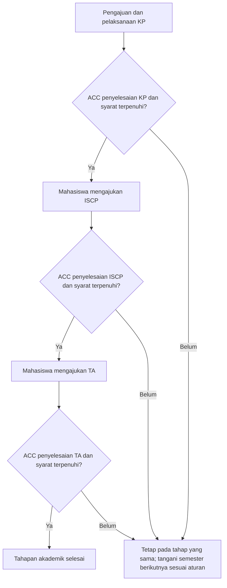

# Academic Lifecycle — SIPKITA

Dokumen ini menjelaskan **siklus akademik KP → ISCP → TA**, aturan kelayakan, hubungan pengajuan antar tahap dan semester, serta batas tanggung jawab sistem. Gunakan bersama `docs/glossary.md` dan `server/prisma/schema.prisma` aktual. Ini adalah **referensi proses bisnis**, bukan daftar endpoint atau instruksi menjalankan migrasi.

> **Dasar konteks:** keputusan SIPKITA yang disepakati dan *Roadmap Analisis Aliran Data SIPKITA* (30 Oktober 2026). Untuk kebijakan yang sempat berubah, lihat [Keputusan yang perlu dikunci](#9-keputusan-yang-perlu-dikunci) sebelum mengimplementasikan bagian terkait.

## 1. Prinsip yang tidak boleh dilanggar

1. Tahap akademik berurutan: **KP → ISCP → TA**. Mahasiswa tidak otomatis dianggap lulus KP/ISCP karena sudah berada pada semester yang lebih tinggi.
2. **ACC penyelesaian oleh Dosen Pembimbing** merupakan keputusan kelulusan/penyelesaian tahap berdasarkan bimbingan dan persyaratan yang berlaku. Ini berbeda dari **ACC pengajuan oleh Kaprodi**.
3. Setelah KP/ISCP selesai dan syarat terpenuhi, sistem **otomatis membuka kelayakan** untuk mengajukan tahap berikutnya. Sistem **tidak otomatis membuat `Pengajuan` baru**; mahasiswa tetap harus mengirim permohonan tahap berikutnya.
4. Setiap permohonan mempunyai **record `Pengajuan` tersendiri**, termasuk ketika mahasiswa pindah tahap atau mengajukan lagi pada semester lain. Jangan menimpa atau menghapus record lama.
5. Satu periode akademik dapat menampung **mahasiswa KP, ISCP, dan TA secara bersamaan**. Tahap seorang mahasiswa tidak ditentukan hanya dari semester pada kalender.
6. Pengambilan **KP dan ISCP oleh mahasiswa yang sama secara bersamaan** pada semester yang sama **belum diputuskan**; jangan otomatis mengizinkannya.
7. Persyaratan administrasi/dokumen mengikuti konfigurasi menurut **periode, tahap, jenis pengajuan, dan pilihan topik**. Jangan menyamakan berkas KP, ISCP, dan TA.
8. Jika ketentuan berubah antarperiode, **riwayat dan snapshot lama harus tetap dapat ditelusuri**.

## 2. Alur utama antar tahap

Diagram menggambarkan **kelayakan akademik**, bukan otomatisasi pembuatan pengajuan. Jalur `R` berarti mahasiswa **tidak berpindah** ke tahap berikutnya; proses perpanjangan pada semester selanjutnya dijelaskan di bagian 6.

## 3. Siklus di dalam setiap tahap

KP, ISCP, dan TA memakai pola proses yang dapat digunakan ulang. Pembedanya ialah **syarat akademik, konfigurasi berkas, riwayat prasyarat, topik, serta penugasan dosen**.

| Urutan | Peristiwa | Aktor/keputusan utama | Model utama |
| --- | --- | --- | --- |
| 1 | Sistem menyediakan tahap, periode, jadwal, dan persyaratan | Admin Sistem/pengelola konfigurasi | `TahapAkademik`, `PeriodeAkademik`, `JadwalProses`, `PersyaratanPengajuan` |
| 2 | Mahasiswa memenuhi identitas dan memilih tahap/jalur | Mahasiswa; verifikasi data diri sesuai kewenangan | `Mahasiswa`, `VerifikasiDataDiri`, `Pengajuan` |
| 3 | Mahasiswa melengkapi topik, proposal, dan dokumen | Mahasiswa | `TopikPenelitian`, `VersiTopik`, `DokumenPengajuan` |
| 4 | Persyaratan administratif/akademik diperiksa | Pemeriksa yang berwenang sesuai proses terbaru | `Pengajuan`, `DokumenPengajuan`, `RiwayatStatusPengajuan` |
| 5 | Reviewer ditetapkan; proposal direview dan direvisi bila perlu | Kaprodi menetapkan; Reviewer menilai | `PenugasanDosen`, `ReviewProposal`, `RiwayatReview` |
| 6 | Keputusan akhir pengajuan | **Kaprodi** setelah syarat/review yang berlaku lengkap | `Pengajuan`, `RiwayatStatusPengajuan` |
| 7 | Pembimbing berlaku untuk tahap | Penetapan KP / pewarisan ISCP-TA sesuai aturan | `PenugasanDosen` |
| 8 | Mahasiswa menjalani bimbingan dan seminar jika berlaku | Mahasiswa dan Dosen Pembimbing | `Bimbingan`, `RiwayatBimbingan`, `JadwalSeminar` |
| 9 | Syarat penyelesaian diperiksa dan ACC diberikan | **Dosen Pembimbing** | `AturanPenyelesaianTahap`, `PenyelesaianTahap` |

Pemeriksaan persyaratan pada langkah 4 dan review proposal pada langkah 5 **dapat berlangsung paralel**. Namun keputusan akhir tidak boleh diberikan sebelum seluruh syarat dan review yang diwajibkan memenuhi ketentuan.

## 4. Aturan khusus KP, ISCP, dan TA

### 4.1 Pengajuan dan penyelesaian KP

- KP merupakan tahap awal; mahasiswa membuat `Pengajuan` untuk periode serta tahap KP yang berlaku.
- Mahasiswa mengisi tema/topik, judul, objek penelitian, proposal, dan persyaratan yang dikonfigurasi untuk KP.
- Kaprodi menetapkan reviewer dan memberikan keputusan akhir pengajuan sesuai hasil pemeriksaan dan review.
- Pembimbing KP ditetapkan untuk pengajuan yang disetujui. Penetapan dapat digabung dengan ACC pengajuan dalam **satu transaksi** bila alur yang dipilih mengharuskannya.
- Setelah bimbingan dan syarat penyelesaian KP terpenuhi, pembimbing memberi ACC penyelesaian; baru kemudian mahasiswa **layak mengajukan ISCP**.

### 4.2 Pengajuan dan penyelesaian ISCP

- ISCP memerlukan **penyelesaian KP** sebagai prasyarat. Bukti keterkaitannya disimpan melalui `Pengajuan.pengajuan_prasyarat_id` yang menunjuk pengajuan KP yang telah selesai.
- Mahasiswa memilih **`LANJUT`** (menggunakan topik KP sebagai isian awal) atau **`BARU`** (topik baru). Riwayat `TopikPenelitian` dan `VersiTopik` harus dipertahankan.
- Persyaratan administrasi mengikuti konfigurasi ISCP, bukan otomatis menyalin seluruh persyaratan KP.
- Pembimbing ISCP **secara prinsip diwariskan dari KP** melalui penugasan baru yang melacak asalnya. Kaprodi dapat menetapkan penggantian sesuai kewenangan.
- Setelah dospem ISCP memberi ACC penyelesaian dan syarat dipenuhi, mahasiswa **layak mengajukan TA**.

### 4.3 Pengajuan dan penyelesaian TA

- TA memerlukan **penyelesaian ISCP**. `Pengajuan.pengajuan_prasyarat_id` menunjuk pengajuan ISCP yang memenuhi ketentuan.
- Mahasiswa memilih `LANJUT` dari topik ISCP atau `BARU`, dengan berkas pengajuan TA sesuai konfigurasi periode dan jalurnya.
- Persyaratan finansial/dokumen seperti bukti pembayaran TA **tidak diasumsikan sama** dengan KP/ISCP; harus muncul dari aturan pengajuan yang berlaku.
- Pembimbing TA pada prinsipnya **diwariskan dari ISCP**, kecuali Kaprodi menetapkan penggantian.
- ACC penyelesaian oleh pembimbing menandai **penyelesaian TA** setelah semua syarat berlaku terpenuhi; tidak ada tahap akademik keempat yang didefinisikan dalam ruang lingkup SIPKITA.

### 4.4 Proposal dan review jalur `LANJUT`

Semua pengajuan reguler KP/ISCP/TA memakai **proposal terbaru dan review Reviewer**, termasuk jalur `LANJUT`. Data topik, judul, dan objek dari tahap sebelumnya menjadi isian awal; penyempurnaan judul diperbolehkan selama dibuat sebagai versi baru dan riwayat lama tidak ditimpa.

## 5. Perbedaan tautan pengajuan dalam database

| Kolom `Pengajuan` | Makna | Contoh |
| --- | --- | --- |
| `pengajuan_prasyarat_id` | Menghubungkan **tahap sekarang ke tahap sebelumnya**. | Pengajuan ISCP menunjuk pengajuan KP yang selesai. |
| `pengajuan_sebelumnya_id` | Menghubungkan **pengajuan baru ke pengajuan historis** dalam jalur lanjutan/pengulangan tahap. | Pengajuan perpanjangan KP semester berikutnya menunjuk KP semester sebelumnya. |
| `topik_penelitian_id` | Menghubungkan pengajuan dengan identitas topik mahasiswa. | ISCP `LANJUT` memakai topik dari KP. |
| `versi_topik_id` | Menentukan versi topik/judul yang dipakai pengajuan itu. | Judul yang berlaku saat pengajuan ISCP dibuat. |
| `periode_akademik_id` | Menentukan semester/tahun ajaran **pengajuan tersebut**. | KP dan ISCP dapat berada pada periode yang berbeda. |
| `tahap_akademik_id` | Menentukan apakah record ini KP, ISCP, atau TA. | Pengajuan TA memiliki tahap TA, bukan mengubah record ISCP menjadi TA. |

**Jangan saling mengganti dua kolom penghubung pertama.** Hubungan prasyarat antar tahap dan riwayat pengajuan dalam satu tahap mempunyai makna berbeda meskipun sama-sama menunjuk tabel `Pengajuan`.

## 6. Belum selesai dalam satu semester: perpanjangan

- Jika mahasiswa **belum menyelesaikan KP/ISCP/TA**, mahasiswa tetap berada pada tahap tersebut; sistem tidak membuka tahap berikutnya hanya karena semester berjalan berakhir.
- Penyelesaian pada semester berikutnya menggunakan **record pengajuan baru** dan menyimpan pengajuan lama sebagai riwayat, bukan memperpanjang tanggal pengajuan lama beberapa minggu.
- **Perpanjangan:** jalur permohonan semester berikutnya untuk kasus yang memenuhi ketentuan perpanjangan. Keputusan akhir perpanjangan berada pada **Kaprodi**; Admin Prodi **tidak memverifikasi perpanjangan**.
- Tidak ada jalur terpisah bernama pengajuan ulang. Mahasiswa yang harus mengulang tahap pada semester berikutnya tetap memakai proses **perpanjangan**.
- Perpanjangan **tidak melibatkan Reviewer**, baik memakai topik lama maupun baru; Kaprodi memeriksa proposal/persyaratan dan mengambil keputusan. Perpanjangan pertama dengan topik lama boleh memakai judul/proposal lama, sedangkan topik baru memerlukan judul/proposal baru. Perpanjangan kedua dan seterusnya wajib topik, judul, serta proposal baru. Batas jumlah perpanjangan mengikuti kebijakan dan `TahapAkademik.maks_perpanjangan` jika dikonfigurasi.
- Kaprodi memeriksa dokumen permohonan semester baru menurut **konfigurasi periode baru**. Pemakaian ulang berkas lama hanya jika `PersyaratanPengajuan.boleh_gunakan_dokumen_sebelumnya` mengizinkan, disertai jejak sumber.
- Jangan menghapus bimbingan, review, dan keputusan semester sebelumnya. Kebijakan pengakuan bimbingan lama pada semester baru harus dinyatakan secara eksplisit sebelum dihitung sebagai syarat.

## 7. ACC penyelesaian dan kelayakan tahap berikutnya

**Kondisi minimal yang perlu diverifikasi oleh service sebelum ACC:**

1. Pengajuan yang dimaksud memang milik mahasiswa dan tahap yang benar, serta berada pada kondisi yang mengizinkan penyelesaian.
2. Dosen yang bertindak merupakan **pembimbing aktif** untuk pengajuan tersebut, bukan hanya pemilik role dosen.
3. Jumlah **bimbingan yang diakui/tervalidasi** memenuhi `AturanPenyelesaianTahap.minimal_bimbingan` pada tahap/periode yang terkait.
4. Persyaratan penyelesaian tambahan yang berlaku telah dipenuhi melalui mekanisme yang memang didukung sistem.
5. Belum ada `PenyelesaianTahap` untuk pengajuan yang sama (relasi satu-ke-satu); catatan ACC baru tidak boleh dibuat berulang.

Pada ACC, `PenyelesaianTahap` mencatat `pengajuan_id`, `aturan_penyelesaian_tahap_id`, jumlah/minimum bimbingan saat ACC, pengguna pemberi ACC, dan waktunya. Kelengkapan syarat tambahan tidak boleh diasumsikan otomatis tervalidasi hanya karena `keterangan_syarat_lain` berisi teks. **Skema rujukan belum mempunyai tabel khusus dokumen penyelesaian** untuk unggah/verifikasi sertifikat; usulkan perubahan schema jika fitur terstruktur tersebut disetujui.

**Setelah ACC KP/ISCP:** tampilkan kelayakan mengajukan tahap berikutnya. Mahasiswa masih harus memilih jalur, melengkapi dokumen, dan mengirim pengajuan baru; Kaprodi **tidak memberikan ACC transisi manual kedua**.

## 8. Simulasi hubungan record (data ilustrasi)

### A. Mahasiswa berhasil melalui KP → ISCP → TA

Semua angka ID dan periode di bawah ini **contoh**, bukan isi database atau urutan semester yang wajib.

| `Pengajuan.id` | `mahasiswa_id` | `tahap_akademik_id` | `periode_akademik_id` | `pengajuan_prasyarat_id` | `pengajuan_sebelumnya_id` |
| --- | --- | --- | --- | --- | --- |
| **101** | 42 | 1 (KP) | 7 | `null` | `null` |
| **205** | 42 | 2 (ISCP) | 8 | **101** | `null` |
| **309** | 42 | 3 (TA) | 9 | **205** | `null` |

Contoh bukti penyelesaian yang membuat hubungan antar tahap **layak**:

| `PenyelesaianTahap.id` | `pengajuan_id` | Makna |
| --- | --- | --- |
| 501 | **101** | ACC penyelesaian KP oleh pembimbing; dapat menjadi prasyarat ISCP. |
| 502 | **205** | ACC penyelesaian ISCP oleh pembimbing; dapat menjadi prasyarat TA. |

Syarat lain tetap harus diperiksa; record di atas **tidak berarti** seluruh syarat otomatis lolos hanya karena ada FK.

### B. Mahasiswa belum selesai KP dan mengajukan lagi semester berikutnya

| `Pengajuan.id` | `mahasiswa_id` | Tahap | Periode | `pengajuan_prasyarat_id` | `pengajuan_sebelumnya_id` |
| --- | --- | --- | --- | --- | --- |
| **110** | 43 | KP | 7 | `null` | `null` |
| **120** | 43 | KP | 8 | `null` | **110** |

Pengajuan **120** merupakan record perpanjangan baru yang merujuk **110**. Karena KP belum selesai, mahasiswa **43** belum bisa mengajukan ISCP melalui jalur normal. Keberadaan `pengajuan_sebelumnya_id` menjaga riwayat, sedangkan kelayakan perpanjangan tetap ditentukan aturan akademik.

## 9. Keputusan yang perlu dikunci

Sebelum mengimplementasikan modul yang bergantung padanya, pastikan:

1. **Pemeriksaan kelayakan akademik:** Admin Prodi memeriksa administrasi pengajuan reguler/awal dan Kaprodi mengambil keputusan akhir; pelaku serta rincian pemeriksaan akademik masih perlu ditetapkan.
2. **Status dan transisi:** tetapkan kode status di setiap model, siapa yang boleh mengubahnya, serta akibatnya pada kelayakan tahap. Field Prisma saat ini sebagian besar bertipe `String`, bukan enum yang otomatis menegakkan state machine.
3. **Batas dan syarat akademik:** IPK, SKS, nilai DE, jumlah bimbingan, serta syarat tambahan harus mengacu konfigurasi/kebijakan akademik yang disetujui, bukan angka asumsi dalam kode.
4. **Pengakuan pekerjaan semester lama:** tetapkan apakah bimbingan atau dokumen lama dapat digunakan pada perpanjangan, beserta jejak sumbernya. Review lama tetap histori dan tidak menimbulkan proses Reviewer baru pada perpanjangan.

## 10. Batas implementasi saat ini dan penggunaan oleh Codex

- **Semester ISCP sekarang:** fokus autentikasi/akun, data diri dan verifikasi, pengajuan KP/ISCP/TA (`BARU`/`LANJUT`), pemeriksaan persyaratan, penugasan reviewer, review/revisi proposal, ACC pengajuan, serta penetapan pembimbing dan konfigurasi wajib. Kelayakan antar tahap dapat disiapkan tanpa membangun modul penyelesaian secara penuh.
- **Lanjutan bila waktu cukup:** bimbingan. **Semester berikutnya:** perubahan judul, perpanjangan, pelaksanaan dan penyelesaian tahap secara lebih lengkap, kecuali pengguna mengubah prioritas.
- Untuk analisis proses, gunakan `domain-modeling`; perubahan skema gunakan `prisma-schema-change`; pengembangan fitur gunakan `feature-implementation`; pengujian gunakan `code-change-verification`.
- Jangan membuat status, nilai enum, FK, tabel, atau API fiktif berdasarkan penjelasan ilustratif dokumen ini. **Validasi terhadap `schema.prisma` dan kode aktual**, lalu catat perbedaan/ketidakpastian sebelum menulis solusi.
