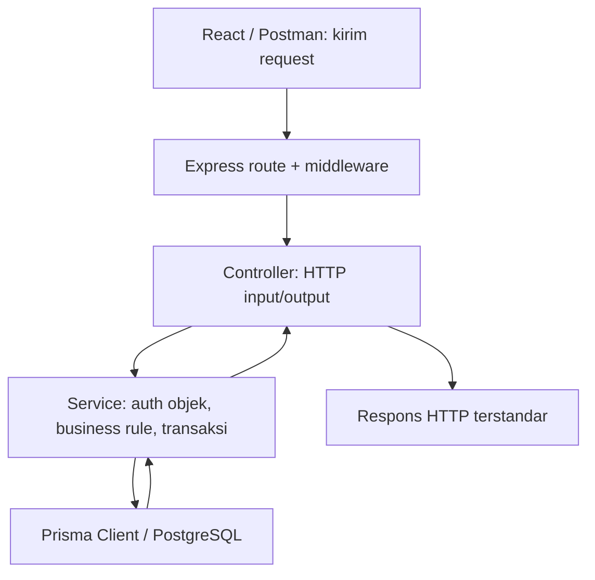

# Konvensi REST API SIPKITA — Panduan Kontrak untuk Codex

> **Jenis berkas:** standar desain dan implementasi API pada `server/` untuk SIPKITA. **Bukan** daftar endpoint yang sudah pasti berjalan, bukan dokumentasi OpenAPI/Scalar yang sudah diterbitkan, dan bukan instruksi langsung mengubah route lama.

> **Status:** **konvensi usulan untuk endpoint baru** yang harus diselaraskan dengan implementasi aktual. Sebelum menulis kode, periksa route/controller/service, autentikasi, validasi, dan respons yang **benar-benar ada**. Jika kontrak lama berbeda, **jangan melakukan breaking change massal** tanpa permintaan dan rencana kompatibilitas. Nilai `status_*` bisnis yang belum final tetap mengikuti keputusan domain terbaru.

**Rujukan utama:** `AGENTS.md`, `docs/architecture.md`, `docs/database.md`, `docs/roles-permissions.md`, `docs/academic-lifecycle.md`, dan `docs/business-rules/` yang sesuai fitur. Skill `feature-implementation` digunakan untuk membangun endpoint; `code-change-verification` untuk memeriksa hasil. Referensi OpenAI dan `mattpocock/skills` adalah acuan **cara menulis konteks yang bisa dipakai agent**, bukan sumber aturan akademik SIPKITA maupun kontrak HTTP aplikasi.

## 1. Tujuan dan prinsip kontrak

SIPKITA memakai **React sebagai client**, **Express sebagai REST API**, **service untuk aturan bisnis**, serta **Prisma/PostgreSQL untuk data**. API merupakan batas kepercayaan: semua permintaan client bisa dimodifikasi, dipanggil dari Postman, atau dikirim tanpa menggunakan UI.

Konvensi ini bertujuan:

1. Membuat setiap endpoint mudah dipahami dan konsisten oleh React, Postman, dan Codex.
2. Memisahkan **HTTP dan format data** dari **keputusan akademik**.
3. Menjamin validasi input, authentication, authorization objek, status proses, dan histori dilakukan di server.
4. Menyediakan respons sukses/error yang dapat ditangani frontend tanpa menebak-nebak pesan backend.
5. Menghindari endpoint yang menduplikasi aturan KP/ISCP/TA atau mengubah data secara tidak sengaja.

**Prioritas semester ISCP:** auth/akun/role, master dan konfigurasi minimum, data diri/verifikasi, pengajuan KP/ISCP/TA (`BARU`/`LANJUT`), persyaratan, penugasan reviewer, review/revisi proposal, ACC akhir, dan penetapan Pembimbing. Bimbingan dikerjakan bila diminta/progres cukup; modul perpanjangan, perubahan judul, penyelesaian, dan seminar penuh mengikuti roadmap berikutnya.

## 2. Pola endpoint dan metode HTTP

### Aturan nama URL

- Gunakan **prefix dasar yang sudah ada pada repo**. `/api` adalah contoh yang dipakai di dokumen ini; **jangan otomatis menambah `/v1`** atau mengganti endpoint yang sudah digunakan client tanpa keputusan.
- Gunakan nama resource yang jelas, konsisten, dan **kebab-case** untuk segmen multi-kata. Pilih satu bahasa penamaan API dalam satu modul; contoh dokumen ini memakai istilah bisnis bahasa Indonesia.
- Gunakan **ID stabil** pada path untuk objek individual: `/api/pengajuan/:id`; verifikasi bahwa ID benar-benar merujuk record yang boleh diakses user.
- Gunakan **query parameter** untuk daftar, pencarian, filter, sort, dan pagination; jangan membuat endpoint baru untuk setiap jenis filter.
- Hindari URL yang memuat NIM, email, atau informasi pribadi apabila ID internal sudah mencukupi; jangan gunakan path sebagai bukti ownership.
- **GET tidak boleh memutasi status, membuat penugasan, menandai ACC, atau mengubah flag secara tersembunyi.**

| HTTP | Makna | Contoh penerapan |
| --- | --- | --- |
| `GET` | Membaca data tanpa efek samping bisnis. | Daftar pengajuan, detail persyaratan, status review, profil sendiri. |
| `POST` | Membuat resource atau menjalankan aksi bisnis yang sengaja dikirim user. | Membuat pengajuan, mengirim draft, memberi keputusan, membuat penugasan. |
| `PATCH` | Mengubah **sebagian field** resource yang statusnya masih mengizinkan pengeditan. | Merevisi data form draft atau informasi profil yang diizinkan. |
| `PUT` | Penggantian representasi **penuh** apabila kontraknya memang ditetapkan demikian. | Pakai hanya bila diperlukan; jangan menjadikan PUT dan PATCH sinonim. |
| `DELETE` | Menghapus resource sesuai aturan yang diizinkan. | Untuk data akademik bersejarah, **umumnya tidak disarankan hard delete**; pertimbangkan perubahan status yang sah. |

**Aksi bisnis** (submit, ACC, Tolak, validasi) sebaiknya menjadi aksi eksplisit, bukan sekadar `PATCH {"status_pengajuan":"DISETUJUI"}` dari frontend. Client tidak berwenang memilih status final tanpa service mengecek seluruh prasyarat.

### Contoh rancangan URL — **BUKAN endpoint yang sudah terimplementasi**

| Domain | Contoh | Fungsi dan pembatasan |
| --- | --- | --- |
| Auth | `POST /api/auth/login`, `GET /api/auth/me`, `POST /api/auth/logout` | Strategi session/cookie vs bearer token mengikuti kode aktual/keputusan berikutnya. |
| Profil mahasiswa | `GET /api/mahasiswa/me`, `PATCH /api/mahasiswa/me` | User mengubah profil milik sendiri sesuai field yang diizinkan. |
| Verifikasi data diri | `GET /api/verifikasi-data-diri/:id`, `POST /api/verifikasi-data-diri/:id/keputusan` | Pemeriksaan oleh aktor berwenang; aksi massal hanya jika diminta. |
| Persyaratan | `GET /api/pengajuan/persyaratan?tahap=KP&...` | Memilih konfigurasi `PersyaratanPengajuan` menurut periode/tahap/jenis/jalur yang sah. |
| Pengajuan | `GET /api/pengajuan`, `POST /api/pengajuan`, `GET /api/pengajuan/:id`, `PATCH /api/pengajuan/:id` | Satu pola resource untuk KP/ISCP/TA; mutasi draft saja jika status mengizinkan. |
| Pengiriman | `POST /api/pengajuan/:id/kirim` | Perintah submit dengan validasi dokumen dan prasyarat. |
| Keputusan akhir | `POST /api/pengajuan/:id/keputusan-akhir` | Aksi Kaprodi setelah seluruh pemeriksaan/review wajib terpenuhi. |
| Penugasan reviewer | `POST /api/pengajuan/:id/penugasan-reviewer` | Kaprodi menetapkan satu atau lebih reviewer jika jalur mensyaratkan. |
| Review proposal | `GET /api/review-proposal/:id`, `POST /api/review-proposal/:id/keputusan` | Dosen Reviewer yang ditugaskan memberi hasil dan catatan. |
| Pembimbing | `POST /api/pengajuan/:id/penugasan-pembimbing` | Kaprodi menetapkan pembimbing atau service mewarisi sesuai aturan; satu aktif per pengajuan. |
| Dokumen | `POST /api/pengajuan/:id/dokumen`, `GET /api/dokumen/:id/unduh` | Unggah/unduh berkas melalui pemeriksaan izin dan storage aman. |

**Tidak wajib** membuat semua endpoint pada tabel. Tentukan satu *vertical slice* yang diminta pengguna, lalu sesuaikan contoh path dengan route aktual tanpa membuat duplikat. Untuk bimbingan, perpanjangan, perubahan judul, penyelesaian tahap, dan seminar, gunakan business rule khusus ketika modul itu benar-benar dikerjakan.

## 3. Batas tanggung jawab backend



| Komponen | Tanggung jawab | Larangan |
| --- | --- | --- |
| Route | Method/path dan middleware spesifik. | Menulis query Prisma panjang di route. |
| Middleware | Authentication, validasi bentuk input, role awal, error handling. | Menganggap role saja membuktikan izin terhadap semua record. |
| Controller | Normalisasi params/body/query, identitas request yang sudah diautentikasi, pemanggilan service, kode HTTP. | Menghitung kelulusan KP, memilih hasil review, atau membuat transaksi lintas model. |
| Service | Ownership, penugasan aktif, status, syarat akademik/dokumen, approval, concurrency, transaksi dan audit. | Mempercayai `user_id` atau role yang dikirim client. |
| Prisma | Query/relasi berdasarkan `schema.prisma`, transaksi, constraint. | Menggantikan validasi proses bisnis. |

**Sumber identitas:** `user.id` diperoleh dari proses autentikasi server. Jangan memakai `created_by`, `mahasiswa_id`, `dosen_id`, `diperiksa_oleh_user_id`, atau `disetujui_oleh_user_id` dari request sebagai bukti siapa pelakunya. Relasi dan izin didapat melalui lookup pengguna/role/penugasan yang valid.

## 4. Format respons JSON untuk endpoint baru

**Keputusan desain yang direkomendasikan:** gunakan *envelope* yang konsisten agar React cukup mempunyai satu pola penanganan. **Jika API yang sudah ada memakai format lain, catat perbedaannya dan sepakati perubahan sebelum memigrasikan client.**

**Kondisi aktual:** endpoint `/api/health` dan `/api/health/db` yang sudah ada memakai payload health sederhana berbasis field `status`, bukan envelope `success/data` di bawah. Pertahankan kompatibilitas endpoint tersebut kecuali ada tugas migrasi kontrak; format bagian ini berlaku sebagai acuan endpoint baru.

### 4.1 Respons sukses — satu resource

**HTTP `201 Created`** (contoh setelah membuat draft pengajuan):

```json
{
  "success": true,
  "data": {
    "id": 101,
    "status_pengajuan": "DRAFT",
    "tahap": "KP"
  }
}
```

`data` berisi **DTO respons** yang diperlukan UI, bukan seluruh baris Prisma beserta relasi internal. Jangan pernah mengirim `password_hash`, token reset, metadata internal sensitif, atau data mahasiswa lain. Nama field seperti `status_pengajuan` adalah contoh yang mengikuti schema; **nilai status selain default perlu diperiksa pada aturan bisnis aktual**.

### 4.2 Respons sukses — daftar dan pagination

**HTTP `200 OK`**:

```json
{
  "success": true,
  "data": [
    { "id": 101, "tahap": "KP", "status_pengajuan": "DRAFT" },
    { "id": 102, "tahap": "ISCP", "status_pengajuan": "DRAFT" }
  ],
  "meta": {
    "pagination": {
      "page": 1,
      "limit": 20,
      "total_items": 2,
      "total_pages": 1
    }
  }
}
```

Gunakan `meta.pagination` **hanya bila endpoint memakai pagination**. Request list yang berhasil tetapi kosong dapat mengembalikan **`data: []`**; bukan `404` hanya karena belum ada hasil.

### 4.3 Respons gagal — satu bentuk error

Contoh **HTTP `409 Conflict`** ketika form tidak boleh dikirim dari status sekarang:

```json
{
  "success": false,
  "error": {
    "code": "PENGAJUAN_STATUS_CONFLICT",
    "message": "Pengajuan tidak dapat dikirim pada status saat ini.",
    "details": []
  }
}
```

Contoh **HTTP `422 Unprocessable Content`** untuk kesalahan isian:

```json
{
  "success": false,
  "error": {
    "code": "VALIDATION_ERROR",
    "message": "Periksa kembali data yang dikirim.",
    "details": [
      { "field": "judul_penelitian", "message": "Judul wajib diisi." },
      { "field": "dokumen_proposal", "message": "Proposal wajib dilampirkan pada jalur ini." }
    ]
  }
}
```

**Makna setiap properti:**

- `success`: penanda sukses/gagal yang konsisten pada endpoint yang memakai konvensi ini.
- `data`: payload aman yang memang boleh diakses pengguna.
- `meta`: informasi tambahan opsional seperti pagination.
- `error.code`: **kode mesin stabil** untuk React/test; bukan string exception mentah.
- `error.message`: pesan ringkas yang bisa ditampilkan kepada pengguna.
- `error.details`: daftar detail field/masalah bila relevan; kosong atau dihilangkan bila tidak diperlukan.

Untuk **`204 No Content`**, respons **tidak memiliki body JSON**. Jangan mengirim `{ "success": true }` bersama status 204.

## 5. Panduan HTTP status code

| Status | Kapan digunakan | Contoh SIPKITA |
| --- | --- | --- |
| `200 OK` | Pembacaan/perubahan sukses dengan body. | Daftar pengajuan, keputusan yang menampilkan status terbaru. |
| `201 Created` | Resource baru berhasil dibuat. | Draft pengajuan atau record dokumen baru. |
| `202 Accepted` | Proses diterima tetapi **belum selesai** dan punya mekanisme tindak lanjut. | Hanya untuk impor/proses asinkron jika benar-benar diimplementasikan. |
| `204 No Content` | Sukses tanpa payload. | Operasi tertentu yang kontraknya memang tidak memerlukan body. |
| `400 Bad Request` | Struktur request/path/query malformed atau tidak dapat diparse. | JSON rusak, format parameter tidak valid. |
| `401 Unauthorized` | Belum login atau kredensial tidak valid/kedaluwarsa. | Mengakses `/api/auth/me` tanpa autentikasi. |
| `403 Forbidden` | Sudah login tetapi tidak berhak. | Reviewer mencoba ACC penyelesaian tahap. |
| `404 Not Found` | Resource tidak ada atau diperlakukan tidak boleh diketahui keberadaannya. | ID pengajuan tidak ditemukan/tersembunyi sesuai kebijakan privasi. |
| `409 Conflict` | State, duplikasi, versi, atau unique constraint bertentangan. | ACC ganda, Pembimbing aktif kedua, submit pada status yang salah. |
| `413 Content Too Large` | Ukuran file/body melampaui batas yang diizinkan. | Proposal melebihi `JenisDokumen.maks_ukuran_mb`. |
| `415 Unsupported Media Type` | Tipe media tidak didukung oleh endpoint. | Upload dengan tipe berkas yang tidak diizinkan. |
| `422 Unprocessable Content` | Struktur terbaca tetapi field/aturan validasi input belum memenuhi syarat. | NIM/isi form salah; wajib proposal belum dilampirkan. |
| `429 Too Many Requests` | Pembatasan request/percobaan login bila diterapkan. | Terlalu banyak percobaan autentikasi. |
| `500 Internal Server Error` | Error backend yang tidak terduga. | Kesalahan internal; **jangan bocorkan** stack trace/SQL. |

**Konsistensi penting:** ketidaklengkapan form dapat menghasilkan `422`, sedangkan **perubahan status yang tidak boleh karena objek sudah final** lazim menjadi `409`. Pilih mapping berdasarkan kontrak endpoint yang stabil; jangan menggunakan `500` untuk kegagalan yang dapat diprediksi.

## 6. Validasi input dan mapping error

### Validasi di batas HTTP

1. **Path**: `:id` harus bertipe/bernilai sesuai primary key; tolak nilai tidak valid sebelum query.
2. **Query**: `page`, `limit`, filter, dan sort dibatasi pada field yang diizinkan; cegah parameter acak dipakai sebagai query database langsung.
3. **Body JSON**: periksa tipe, panjang teks, format, nilai wajib, dan properti yang diperbolehkan. Tolak atau buang field tak dikenal **secara konsisten**; jangan meneruskan `req.body` langsung sebagai objek `data` Prisma.
4. **Tanggal/waktu**: validasi tanggal, periode dan timezone; simpan sesuai tipe Prisma/PostgreSQL aktual.
5. **File**: validasi ukuran, tipe/konten, kepemilikan, dan syarat `JenisDokumen`/`PersyaratanPengajuan`.
6. **Role/status**: `status_*`, keputusan akademik, penguji, dan user pengambil keputusan **tidak boleh dapat dipilih bebas** dari payload.

### Validasi di service

Validasi domain **harus diulang/dilengkapi** di service menggunakan data terbaru dari database:

- Mahasiswa hanya mengubah `Pengajuan` miliknya ketika statusnya mengizinkan.
- Pembimbing/Reviewer hanya bertindak pada pengajuan dengan penugasan aktif dan jenis penugasan yang benar.
- Kaprodi tidak memberi ACC akhir sebelum seluruh syarat akademik, administrasi, dan review yang **memang diwajibkan** selesai.
- Revisi satu dokumen tidak mengubah status dokumen lain tanpa alasan bisnis yang sah.
- Tahap KP → ISCP → TA mengikuti prasyarat ACC penyelesaian oleh Pembimbing, tetapi pengajuan tahap baru **tetap dilakukan mahasiswa**.
- Pengajuan pada periode yang sama dapat berasal dari mahasiswa KP, ISCP, dan TA secara paralel.
- Pembatasan jumlah Pembimbing aktif, dokumen terkini, dan jadwal seminar aktif tetap mematuhi unique index di schema.

**Prisma errors:** service/controller dapat menerjemahkan konflik unique, record hilang, atau kegagalan transaksi menjadi `409`, `404`, atau error lain sesuai kasus. Jangan menampilkan kode exception Prisma, detail SQL, nama constraint internal, atau stack trace kepada client. Log internal boleh mencatat konteks non-sensitif sesuai kebijakan keamanan.

## 7. Authentication dan authorization

**Mekanisme login** (session/cookie atau bearer token) mengikuti pilihan/implementasi aktual; file ini **tidak menetapkan JWT sebagai kewajiban**.

| Pemeriksaan | Lokasi | Hal penting |
| --- | --- | --- |
| Authentication | Middleware | Verifikasi kredensial/sesi dan `User.status_akun`; identitas dari server. |
| Role | Middleware + service bila kontekstual | `UserRole` dapat memuat beberapa role; mode UI dosen bukan izin. |
| Ownership | Service | `Pengajuan.mahasiswa_id`, `Mahasiswa.user_id`, dan hubungan data harus cocok. |
| Dosen assignment | Service | `PenugasanDosen` pada `pengajuan_id` yang benar, `jenis_penugasan`, `status_penugasan`. |
| Status | Service | Hanya transisi yang sah; status bertipe `String` bukan bukti semua transisi sudah boleh. |
| Prodi/scope | Service | Akses Admin Prodi/Kaprodi hanya dalam cakupan sah menurut kebijakan terbaru. |

**Aturan keamanan:**

- Jangan mengirim `password_hash`, reset token, secret, credential, atau URL privat yang memberi akses langsung ke dokumen.
- Konfigurasi CORS mengikuti origin yang dipercaya. Jika memakai cookie lintas origin, perhatikan credentials, SameSite, Secure, HttpOnly, dan perlindungan CSRF secara konsisten.
- Login, reset password, dan upload perlu pembatasan abuse yang sesuai; gunakan mekanisme yang sudah ada sebelum menambah dependensi.
- Bila aktor tidak berhak membaca record, pilih kebijakan `403`/`404` yang mencegah kebocoran informasi pribadi.
- Logging apa pun yang digunakan aplikasi tidak boleh mencetak password, token, dokumen pribadi, body sensitif, atau stack yang memuat data request. `morgan` belum terpasang pada snapshot audit.

## 8. Pagination, filtering, sorting, dan pencarian

Untuk endpoint daftar, gunakan pola yang konsisten, misalnya:

```http
GET /api/pengajuan?page=1&limit=20&status=DRAFT&tahap=KP
```

**Default yang direkomendasikan untuk endpoint baru:** `page=1`, `limit=20`, batas maksimal `limit=100`. Angka ini **konvensi desain**, bukan konfigurasi runtime yang sudah diperiksa. Jangan mengubah pagination endpoint lama tanpa kesepakatan.

- Batasi nilai/field sort berdasarkan **allowlist**, dan tentukan urutan sekunder stabil (misalnya `id`) agar perpindahan halaman konsisten.
- Hitung `total_items` dan `total_pages` ketika endpoint menjanjikannya; jangan mengisi total palsu dari panjang satu halaman saja.
- Filter daftar selalu diterapkan **setelah/bersamaan dengan scope otorisasi**. Filter `mahasiswa_id` dari user tidak boleh mengalahkan ownership server.
- Pencarian nama/NIM harus menghormati privasi; jangan menyediakan pencarian mahasiswa global kepada role yang tidak berwenang.
- Gunakan `select`/`include` Prisma secukupnya, hindari N+1 nyata, dan jangan otomatis mengembalikan seluruh histori untuk setiap item list.

## 9. Upload, revisi, dan unduh dokumen

**Mekanisme file fisik belum final.** Kontrak tetap harus memisahkan **file binary** dari **metadata dan relasi bisnis**.

1. Unggah menggunakan `multipart/form-data` atau pola upload aman lain yang **sudah disepakati/tersedia**. Jangan memasukkan berkas besar sebagai string base64 JSON tanpa alasan.
2. Server memeriksa user, resource tujuan, jenis dokumen yang diperbolehkan, ukuran/format, serta batas tahapan.
3. Simpan metadata ke `Dokumen`; hubungkan ke `DokumenDataDiri`, `DokumenPengajuan`, `LampiranBimbingan`, `PerubahanJudul`, atau relasi lain **sesuai konteks**, bukan semuanya dipaksa masuk ke `DokumenPengajuan`.
4. Saat revisi, pertahankan histori; `is_terkini` dan `nomor_versi` pada dokumen data diri/pengajuan dijaga oleh transaksi dan constraint database.
5. Untuk unduh, server wajib memeriksa izin, lalu memberi akses melalui alur file delivery yang aman. Jangan menjadikan `storage_key` sebagai URL publik.
6. Perlakukan upload dan database sebagai dua sistem berbeda: jika satu langkah gagal, lakukan cleanup/retry yang tidak menyisakan referensi yatim.

**Contoh respons metadata upload yang aman (usulan):**

```json
{
  "success": true,
  "data": {
    "dokumen_id": 601,
    "nama_file_asli": "proposal-kp.pdf",
    "mime_type": "application/pdf",
    "ukuran_bytes": 245760
  }
}
```

Jangan mengirim lokasi file server, secret, atau data pribadi lain tanpa kebutuhan akses yang jelas.

## 10. Endpoint aksi, status, idempotensi, dan transaksi

**Berbeda dari CRUD biasa**, beberapa aksi SIPKITA adalah keputusan akademik:

| Aksi | Pemeriksaan wajib sebelum menulis | Risiko yang harus dicegah |
| --- | --- | --- |
| Kirim pengajuan | Owner, periode terbuka, tahap/jalur sah, data dan dokumen wajib lengkap. | Mengirim draft dua kali, submit di semester/tahap salah. |
| Verifikasi dokumen | Role verifikator, dokumen terkini, hasil pemeriksaan sesuai konteks. | Dokumen lama/berkas mahasiswa lain diberi ACC tanpa sah. |
| Penugasan reviewer | Hak Kaprodi, pengajuan benar, kebutuhan review dan calon dosen sah. | Duplikasi reviewer, penugasan pada pengajuan tak berhak. |
| Simpan review | Role Reviewer dan penugasan, versi dokumen/proposal yang diperiksa, status putaran. | Hasil review lama tertimpa, reviewer lain mengambil keputusan. |
| ACC akhir pengajuan | Kaprodi berwenang; semua syarat akademik, administrasi, dan review wajib terpenuhi. | Status terverifikasi padahal salah satu pemeriksaan masih tertunda. |
| Penetapan Pembimbing | Hak Kaprodi atau pewarisan sah, pengajuan benar, unique satu Pembimbing aktif. | Dua Pembimbing aktif, histori penugasan lama hilang. |
| ACC penyelesaian tahap (fase berikutnya) | Pembimbing aktif, syarat kelulusan lengkap. | Menganggap lulus hanya dari angka bimbingan, ACC ganda. |
| ACC perubahan judul (fase berikutnya) | ACC Pembimbing dulu, baru keputusan Kaprodi; proposal perubahan wajib. | Judul lama ditimpa sebelum ACC akhir. |

**Kebijakan implementasi:**

- Operasi multirecord yang wajib konsisten menggunakan transaksi Prisma. Contoh: `Pengajuan` + `RiwayatStatusPengajuan`, keputusan review + riwayat, revisi dokumen + penanda terkini, penugasan ulang Pembimbing.
- Request ulang, double-click, atau dua operator bersamaan tidak boleh membuat dua keputusan final atau menggandakan record dengan status aktif. Gunakan status guard, constraint, dan transaksi; pertimbangkan *idempotency key* **hanya bila dibutuhkan dan disepakati**.
- Response sukses hanya dikirim setelah **transaksi database berhasil commit**. Jangan menyatakan ACC selesai jika salah satu bagian transaksi gagal.
- Aksi batch (verifikasi semua dokumen seorang mahasiswa atau penugasan banyak mahasiswa ke satu dospem) boleh dirancang sebagai API tersendiri **jika diminta**. Tentukan lebih dulu apakah batch **semua sukses atau rollback** atau **sukses parsial per item**, lalu laporkan hasil setiap item tanpa membuat data setengah sah.
- Jangan membuat `Pengajuan` tahap selanjutnya di background ketika ACC penyelesaian tahap. Yang otomatis adalah **kelayakan/transisi status** menurut aturan; mahasiswa tetap mengajukan tahap baru.

## 11. Dokumentasi endpoint dan pengujian

Setiap endpoint yang **benar-benar diimplementasikan** minimal terdokumentasi dengan:

| Informasi | Yang dicatat |
| --- | --- |
| Method dan path aktual | Misalnya `POST /api/pengajuan` **jika route tersebut memang dibuat**. |
| Aktor dan izin | Role, ownership, penugasan, status yang diperbolehkan. |
| Request | Body/query/params, field wajib, batas tipe, file jika ada. |
| Response | Status HTTP, payload sukses, dan kemungkinan error. |
| Aliran bisnis | Tabel dibaca/ditulis, transaksi, histori, dampak terhadap tahap. |
| Skenario uji | Positif, validasi, unauthorized, forbidden, konflik status, duplikasi. |

Swagger/Scalar **boleh dipakai sebagai antarmuka dokumentasi** apabila dipilih/dipasang, tetapi file ini tidak mengklaim library atau OpenAPI spec tersebut sudah tersedia.

### Matriks uji minimal API

| ID | Skenario | Harapan |
| --- | --- | --- |
| API-01 | Pengguna sah mengambil data miliknya | `200` dengan DTO aman. |
| API-02 | Tanpa login mengakses data terlindungi | `401`; tidak ada data sensitif. |
| API-03 | Role salah memanggil aksi ACC | `403` atau kebijakan non-disclosure yang disepakati. |
| API-04 | Mahasiswa meminta pengajuan mahasiswa lain | Akses ditolak; tidak bocor relasi/dokumen. |
| API-05 | Field wajib salah/kosong | Error validasi konsisten; tidak ada write parsial. |
| API-06 | Mengirim draft saat persyaratan wajib belum lengkap | Ditolak; alasan yang aman dan bisa ditindaklanjuti. |
| API-07 | Kaprodi ACC ketika review wajib masih tertunda | Ditolak; status tetap sah. |
| API-08 | Reviewer dengan penugasan valid mengirim hasil | Keputusan dan riwayat tersimpan untuk proposal/versi tepat. |
| API-09 | Dua request ACC/submit bersamaan | Tidak ada dua keputusan final/record aktif ganda. |
| API-10 | Revisi satu berkas | Hanya versi berkas terkait yang berubah; berkas lain tetap sah. |
| API-11 | Upload melebihi batas jenis dokumen | Ditolak tanpa metadata/file yatim. |
| API-12 | Daftar kosong dan pagination | `200` dengan `data: []`, meta akurat bila paginated. |

Gunakan test runner, Postman collection, lint, dan build yang **memang ada** di repo. Jangan mengaku tes berjalan jika belum dijalankan. Bagi test per alur prioritas dan pertahankan data uji terisolasi.

## 12. Aturan khusus membaca schema Prisma

1. **`UserRole`** memiliki composite key; satu user dapat memiliki lebih dari satu role.
2. **`Pengajuan`** memuat `periode_akademik_id`, `tahap_akademik_id`, `jenis_pengajuan`, `pilihan_topik`, `topik_penelitian_id?`, `versi_topik_id?`, dan relasi pengajuan sebelumnya. Jangan mewajibkan FK topik yang nullable pada seluruh draft.
3. **`PersyaratanPengajuan`** menentukan jenis dokumen per periode + tahap + jenis pengajuan + pilihan topik. Jangan hardcode daftar upload KP/ISCP/TA di frontend.
4. **`DokumenPengajuan`** dan **`DokumenDataDiri`** memiliki unique index parsial pada versi `is_terkini=true`; revisi perlu transaksi.
5. **`PenugasanDosen`** mempunyai unique parsial satu Pembimbing aktif, tetapi memungkinkan banyak Reviewer. Seluruh Reviewer aktif yang ditugaskan harus `LAYAK` pada proposal terbaru sebelum prasyarat review terpenuhi; ACC tetap keputusan Kaprodi.
6. **`RiwayatReview`** merekam putaran, proposal dan `VersiTopik` yang benar-benar diperiksa; lembar review dapat opsional.
7. **`PenyelesaianTahap`** satu per pengajuan, dengan snapshot jumlah/minimum bimbingan; dokumen sertifikasi kelulusan tambahan belum punya model bukti verifikasi khusus.
8. **`JadwalSeminar`** membatasi satu `TERJADWAL` per pengajuan saat ini; desain seminar lengkap **PROVISIONAL** dan mungkin berubah setelah semester sekarang.
9. Beberapa model memakai `BigInt` serta `Decimal`. Jangan mengubah nilai presisi tanpa alasan; saat serialisasi JSON, tangani `BigInt` secara eksplisit dan `Decimal` secara konsisten.

**Catatan:** schema rujukan terakhir memakai PostgreSQL dan mencatat Prisma ORM 7/`prisma.config.ts`; periksa versi dan konfigurasi **repository aktual** sebelum menjalankan generate, validate, atau migrasi. Jangan menggunakan petunjuk dari latihan Express/MySQL terpisah untuk SIPKITA.

## 13. Hal yang masih memerlukan keputusan

| Topik | Belum final | Instruksi untuk Codex |
| --- | --- | --- |
| Format API lama vs rekomendasi baru | Implementasi endpoint lama belum diaudit dari repo di dokumen ini. | Prioritaskan kompatibilitas; ajukan perubahan format bila breaking. |
| Session/cookie vs bearer/JWT | Strategi auth final belum diputuskan lewat dokumen ini. | Ikuti kode aktual atau minta keputusan sebelum menambah mekanisme baru. |
| Kode status bisnis | Banyak status di schema bertipe `String`. | Jangan menciptakan enum status/transition sendiri. |
| Pemeriksaan kelayakan akademik | Administrasi pengajuan reguler/awal oleh Admin Prodi dan ACC akhir oleh Kaprodi sudah final; pelaku pemeriksaan akademik belum ditetapkan. | Ikuti `docs/business-rules/pengajuan.md`; jangan menyatukan pemeriksaan akademik dengan administrasi atau ACC akhir. Perpanjangan diperiksa Kaprodi. |
| Bulk endpoint | UI bulk verifikasi/penugasan bisa dibuat, tetapi cakupan dan rollback/partial belum final. | Rancang kontrak batch hanya jika fitur diminta. |
| Storage file dan notifikasi eksternal | Provider dan mekanisme asinkron belum final. | Jangan mengarang URL publik, email, WhatsApp, atau provider cloud. |
| Seminar | Masih provisional; skema mungkin berkembang. | Jangan mengunci endpoint/hasil/penguji sebelum mekanismenya final. |

## 14. Checklist tugas API untuk Codex

- [ ] Endpoint yang diminta berada dalam scope semester dan fitur yang disetujui.
- [ ] Route, middleware, controller, service, schema, dan kontrak **aktual** telah diperiksa.
- [ ] Nama method/path dan payload konsisten dengan endpoint terkait yang sudah ada.
- [ ] Request params/query/body/file divalidasi; `req.body` tidak diteruskan mentah ke Prisma.
- [ ] Pengguna, role, ownership, penugasan dosen, prodi, dan status diperiksa di backend.
- [ ] Service menegakkan aturan bisnis yang tepat untuk KP/ISCP/TA, jalur, periode, dan kelengkapan dokumen.
- [ ] Response tidak membocorkan hash password, token, storage key privat, stack trace, atau data orang lain.
- [ ] HTTP status, format sukses/error, dan DTO konsisten pada fitur yang dibangun.
- [ ] Operasi multirecord memakai transaksi dan menangani retry/konflik tanpa duplikasi.
- [ ] Revisi mempertahankan versi, histori, snapshot keputusan, dan dokumen lainnya yang masih valid.
- [ ] Minimal satu skenario sukses dan beberapa skenario gagal/otorisasi telah diuji.
- [ ] Bila kontrak lama perlu breaking change atau skema perlu migrasi, pengguna dikonfirmasi lebih dahulu.

**Penutup:** API SIPKITA harus dapat dipahami oleh React dan Postman, tetapi **keputusan akademik tetap milik service yang memeriksa database dan hak akses pada saat aksi terjadi**. Dokumen ini memandu konsistensi implementasi; spesifikasi route yang benar-benar berjalan harus bersumber dari kode dan pengujian aktual.

## Referensi pendekatan dokumentasi untuk Codex

- [OpenAI — Skills](https://developers.openai.com/plugins/concepts/skills): konteks tugas yang dapat dipakai ulang melalui skill dengan instruksi yang jelas.
- [OpenAI — Build skills](https://developers.openai.com/plugins/build/skills): struktur, kejelasan instruksi, dan hubungan skill dengan sumber pendukung.
- [mattpocock/skills](https://github.com/mattpocock/skills): inspirasi memisahkan prosedur engineering agent dari pengetahuan domain dan dokumen pendukung.

Referensi tersebut mendasari **cara menyusun panduan untuk agent**. Ketentuan API dan proses akademik **tidak diambil langsung** dari referensi tersebut, melainkan dari keputusan SIPKITA, arsitektur Express/Prisma, serta kaidah HTTP yang berlaku.
