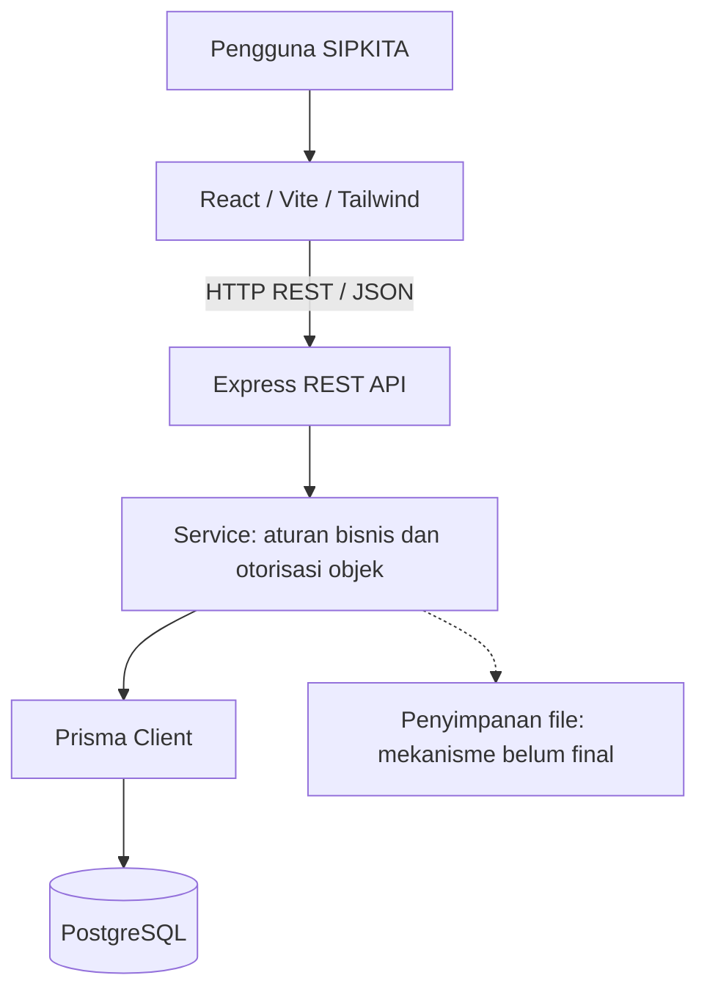
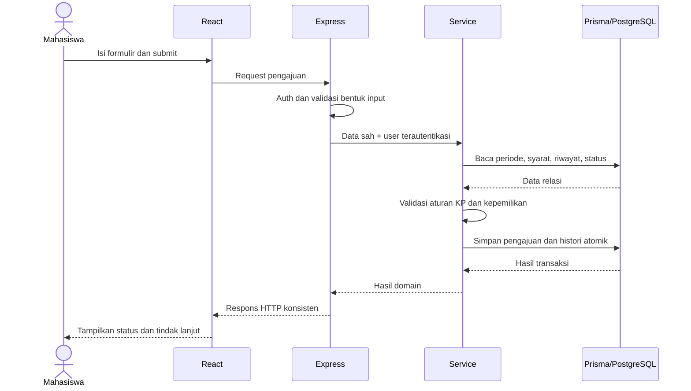
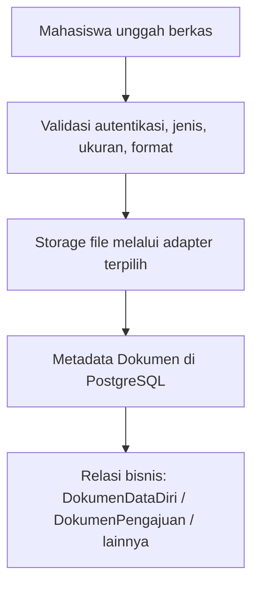

# Arsitektur Aplikasi SIPKITA — Panduan Implementasi untuk Codex

> **Jenis berkas:** dokumentasi arsitektur proyek (`docs/architecture.md`), **bukan** skill mandiri, kontrak API final, atau perintah merestrukturisasi repository. Dokumen ini menjadi acuan saat Codex mengimplementasikan modul menggunakan React, Express, Prisma, dan PostgreSQL.

> **Status:** arsitektur dan prinsip kerja yang **disepakati**, dengan contoh organisasi kode yang bersifat **rekomendasi**. Struktur file, dependensi, skrip, dan versi aktual harus diperiksa di repository sebelum coding. Jangan menganggap folder contoh di dokumen ini sudah ada atau wajib dibuat sekaligus.

**Baca bersama:** `AGENTS.md`, `docs/database.md`, `docs/academic-lifecycle.md`, `docs/roles-permissions.md`, `docs/business-rules/index.md`, dan business rule modul yang sedang dikerjakan. Detail HTTP akan dijabarkan di `docs/api-conventions.md`, sedangkan format dan penamaan di `docs/coding-standards.md`.

## 1. Tujuan dan batas sistem

SIPKITA adalah **satu aplikasi web** untuk mengelola tahapan **Kerja Praktik (KP) → Information Systems Capstone Project (ISCP) → Tugas Akhir (TA)** di Program Studi Sistem Informasi. Ketiga tahap menggunakan fondasi akun, pengajuan, persyaratan, dokumen, review, pembimbing, dan status akademik yang sama, dengan aturan bisnis berbeda menurut tahap, jalur, dan periode.

Arsitektur dipilih untuk kebutuhan proyek akademik yang bisa dikembangkan bertahap: **modular, mudah dipahami, dapat diuji, dan tidak berlebihan**. Hindari pemecahan menjadi microservices, message broker, atau infrastruktur tambahan tanpa kebutuhan nyata.

### Yang telah disepakati

- **Monorepo npm workspaces**: satu proyek dengan `client/` dan `server/`.
- **Frontend:** React + Vite + Tailwind CSS.
- **Backend:** Node.js + Express dengan REST API.
- **Akses data:** Prisma ORM → PostgreSQL.
- **Pola utama backend:** **route → controller → service → Prisma Client → database**.
- **Pemisahan UI dari API** di React; keputusan akademik dan izin berada pada backend.
- **Belum terintegrasi SIKADU**; sumber master mahasiswa/dosen melalui input manual atau import sesuai hak akses.
- **Pengembangan bertahap** sesuai prioritas semester ISCP dan TA; tidak semua model database harus langsung mempunyai modul berjalan.

### Bukan keputusan yang sudah final

Mekanisme autentikasi persisten (session cookie atau bearer token), penyimpanan file fisik, library validasi spesifik, pengiriman notifikasi eksternal, deployment, dan mekanisme seminar lengkap **belum boleh dianggap final** hanya dari dokumen ini. Jika fitur bergantung pada keputusan tersebut, periksa implementasi aktual atau minta keputusan pengguna.

## 2. Gambaran arsitektur tingkat tinggi



**Catatan:** diagram menunjukkan batas logis, bukan kepastian konfigurasi hosting atau provider file storage. **Frontend tidak terhubung langsung ke PostgreSQL**, dan database tidak menjadi pengganti pemeriksaan business rule.

| Lapisan | Tugas utama | Tidak boleh menjadi tempat |
| --- | --- | --- |
| **React UI** | Menampilkan form, status, daftar, validasi pengalaman pengguna, serta memanggil API. | ACC akademik definitif, query database langsung, menyimpan secret backend. |
| **API client frontend** | Mengatur request HTTP, penanganan respons/error, dan kredensial sesuai strategi auth yang terpilih. | Logika status akademik atau relasi tabel. |
| **Express route** | Mendaftarkan metode HTTP, path, middleware, dan controller. | Query Prisma panjang dan alur bisnis kompleks. |
| **Middleware** | Autentikasi, izin awal, validasi input, handling error, keamanan request. | Semua keputusan bersyarat yang membutuhkan transaksi/relasi domain mendalam. |
| **Controller** | Menerima request yang sudah diproses, memanggil service, menerjemahkan hasil/error menjadi respons. | `prisma.$transaction()` kompleks, penentuan kelulusan, aturan reviewer. |
| **Service** | Menegakkan aturan bisnis, ownership/penugasan/status, koordinasi query dan transaksi, orkestrasinya. | Ketergantungan pada komponen React atau output HTTP langsung. |
| **Prisma Client** | Query model, relasi, dan transaksi database. | Menetapkan sendiri kapan mahasiswa boleh lanjut tahap. |
| **PostgreSQL** | Menjaga FK, unique index, tipe, dan konsistensi penyimpanan. | Otorisasi role dan keputusan akademik lintas proses yang tidak dinyatakan sebagai constraint. |

## 3. Organisasi repository dan batas kepastian

### Direktori yang telah menjadi keputusan arsitektur

| Path | Fungsi |
| --- | --- |
| `client/` | Aplikasi web React/Vite/Tailwind. |
| `server/` | Aplikasi Express dan REST API. |
| `server/prisma/schema.prisma` | Schema model dan relasi utama. |
| `server/prisma/migrations/` | Riwayat perubahan database bila tersedia. |
| `docs/` | Aturan bisnis, rancangan, arsitektur, panduan pengembangan. |
| `.agents/skills/` | Prosedur kerja Codex, bila sudah dipasang ke repo sesuai rancangan skill. |
| `AGENTS.md` | Konteks proyek dan aturan umum saat Codex bekerja. |

**Contoh organisasi source yang dapat digunakan bila pola sejenis belum ada** (bukan instruksi memindahkan file secara massal):

```text
sipkita/
├── AGENTS.md
├── package.json              # npm workspaces / scripts, periksa aktual
├── client/
│   └── src/
│       ├── pages/            # halaman dan navigasi
│       ├── components/       # komponen UI yang dipakai ulang
│       ├── services/         # atau api/: pemanggil REST API
│       └── ...               # struktur disesuaikan dengan kode aktual
├── server/
│   ├── prisma/
│   │   ├── schema.prisma
│   │   └── migrations/
│   └── src/
│       ├── routes/
│       ├── controllers/
│       ├── services/
│       ├── middlewares/
│       └── ...               # validation, utilities, atau module sesuai kebutuhan
├── docs/
│   ├── architecture.md
│   ├── database.md
│   └── business-rules/
└── .agents/skills/
```

**Aturan wajib untuk Codex:** jalankan `rg --files` dan baca implementasi terkait sebelum menentukan path. Bila repo sekarang menggunakan organisasi **per fitur** alih-alih folder global, **ikuti pola aktual**. Jangan membuat dua struktur sekaligus, mengubah semua import, atau menambahkan repository layer hanya demi mengikuti contoh di atas.

## 4. Aliran request satu fitur (*vertical slice*)

Contoh: mahasiswa mengirim formulir pengajuan KP.



**Prinsip:** interface boleh melakukan validasi awal untuk kenyamanan, tetapi server **harus mengulang validasi otoritatif** karena request dapat dikirim langsung lewat Postman/Codex atau dimodifikasi di luar UI.

### Tanggung jawab kode pada alur tersebut

1. **Page/form React:** input topik, objek, persyaratan, status upload dan pesan error; jangan melakukan `fetch` berulang pada banyak komponen tanpa pola API client.
2. **API client:** menjalankan request, menerima status HTTP, menerjemahkan error untuk komponen; tidak memasukkan kredensial rahasia ke bundle frontend.
3. **Route/middleware:** memasangkan autentikasi, pengecekan role dasar, validasi payload, dan handler error.
4. **Controller:** membaca `req.params`, `req.body`, identitas terautentikasi yang sudah disahkan; memanggil service, bukan membuat keputusan akademik sendiri.
5. **Service:** memeriksa mahasiswa pemilik `Pengajuan`, periode/tahap, aturan `BARU`/`LANJUT`, syarat wajib, duplikasi pengajuan, status, serta transaksi pembaruan.
6. **Prisma:** membaca/menulis model yang nyata pada schema, menangani relasi dan transaksi dengan aman.

**Tidak perlu** menambahkan event bus, GraphQL, repository pattern generik, atau state management eksternal hanya untuk alur tersebut bila belum ada kebutuhan dan kesepakatan.

## 5. Desain modul: berbagi fondasi, memisahkan aturan bisnis

| Modul/domain | Model/tanggung jawab inti | Hubungan antarfitur |
| --- | --- | --- |
| **Auth dan akun** | `User`, `Role`, `UserRole`, reset sandi | Semua request terproteksi memakai identitas user dan izin. |
| **Master/prodi/semester** | `ProgramStudi`, `Mahasiswa`, `Dosen`, `PeriodeAkademik`, `TahapAkademik`, `JadwalProses`, `ImportBatch` | Menyediakan referensi; tidak memproses pengajuan akademik atas nama mahasiswa. |
| **Data diri dan verifikasi** | `VerifikasiDataDiri`, `DokumenDataDiri`, `Dokumen` | Kelayakan identitas sebelum langkah berikutnya sesuai aturan. |
| **Pengajuan akademik** | `Pengajuan`, `TopikPenelitian`, `VersiTopik`, `RiwayatStatusPengajuan` | Satu engine untuk KP/ISCP/TA dan jalur baru/lanjut, dibedakan konfigurasi/rule. |
| **Persyaratan pengajuan** | `JenisDokumen`, `PersyaratanPengajuan`, `DokumenPengajuan`, `Dokumen` | Syarat mengikuti tahap, periode, jenis pengajuan, pilihan topik. |
| **Reviewer dan pembimbing** | `PenugasanDosen`, `ReviewProposal`, `RiwayatReview` | Banyak reviewer dimungkinkan, hanya satu Pembimbing aktif pada pengajuan. |
| **Bimbingan** | `Bimbingan`, `RiwayatBimbingan`, `LampiranBimbingan` | Mahasiswa submit, Pembimbing memeriksa; implementasi sesuai prioritas. |
| **Penyelesaian dan transisi** | `AturanPenyelesaianTahap`, `PenyelesaianTahap`, `Pengajuan` | ACC Pembimbing membuka kelayakan tahap berikutnya, bukan membuat pengajuan baru otomatis. |
| **Perubahan judul/perpanjangan** | `PerubahanJudul`, `KeputusanPerubahanJudul`, `VersiTopik`, `Pengajuan` | Fondasi semester berikutnya; histori tidak ditimpa. |
| **Seminar/notifikasi/template** | `JadwalSeminar`, `RiwayatJadwalSeminar`, `Notifikasi`, `NotifikasiPenerima`, `TemplateDokumen` | Jadwal minimal; mekanisme seminar lengkap masih provisional. |

**Jangan membuat tiga salinan controller/service lengkap** untuk pengajuan KP, ISCP, dan TA bila operasi inti identik. Gunakan alur bersama dan aturan eksplisit berdasarkan konfigurasi tahap/jalur, dengan cabang domain terpisah **hanya bila memang berbeda**. Hindari service raksasa yang menangani seluruh modul sekaligus.

## 6. Autentikasi, role, dan otorisasi objek

Satu akun dosen dapat mempunyai role **Reviewer** serta **Pembimbing**. Pemilihan mode kerja di UI membantu navigasi, tetapi **tidak memberikan izin tambahan**. Backend harus memeriksa bahwa akun benar-benar memiliki role tersebut dan sedang berhak atas record yang diproses.

| Lapis pemeriksaan | Pertanyaan server | Contoh |
| --- | --- | --- |
| **Authentication** | Siapa user terautentikasi? Apakah akun aktif? | Login mahasiswa/dosen/admin. |
| **Role** | Apakah user mempunyai role untuk aksi? | Hanya Kaprodi berhak ACC akhir perubahan judul. |
| **Ownership / scope** | Apakah record milik user atau berada dalam lingkup yang diizinkan? | Mahasiswa tidak dapat mengambil dokumen pengajuan mahasiswa lain. |
| **Assignment** | Apakah dosen ditugaskan pada pengajuan tersebut untuk jenis peran yang tepat? | Reviewer hanya memeriksa proposal yang ditugaskan; Pembimbing hanya memvalidasi bimbingannya. |
| **State** | Apakah aksi valid pada status sekarang? | Kaprodi tidak boleh meng-ACC pengajuan yang masih kurang syarat wajib. |

**Mekanisme token/session:** ikuti implementasi keamanan yang sudah ada. Jika belum diputuskan, minta pilihan sebelum membuat login production-ready. Jangan mencampur pola autentikasi berbasis cookie dengan bearer token tanpa rancangan jelas. Jika memakai cookie, terapkan perlindungan CSRF sesuai kebutuhan; jika memakai token, desain penyimpanan dan pencabutannya secara aman.

**Password:** simpan `password_hash` melalui algoritma hashing yang sesuai; jangan menyimpan plaintext, menulis password/token pada log, atau memasukkan credential ke repository. Akses dan pembacaan `.env` sebatas proses lokal yang sah, bukan untuk dicetak ke respons.

## 7. Status, persyaratan, keputusan, dan transaksi

### Aturan domain lintas modul

1. **ACC akhir pengajuan** oleh Kaprodi **berbeda dari ACC penyelesaian tahap** oleh Dosen Pembimbing.
2. **Pemeriksaan administratif/akademik** dan **review proposal** dapat diproses paralel bila proses mengizinkan; keputusan akhir baru sah setelah semua prasyarat wajib selesai.
3. **ISCP/TA jalur `LANJUT`** menarik data topik yang relevan dari tahap sebelumnya sebagai isian awal, tetapi tetap wajib memakai proposal terbaru dan menjalani review.
4. Pembimbing untuk ISCP/TA pada prinsipnya diwariskan dari tahap sebelumnya dengan **penugasan baru** pada pengajuan baru, kecuali Kaprodi mengganti.
5. Revisi satu dokumen tidak otomatis memaksa unggah ulang semua dokumen lain. Riwayat versi lama harus dipertahankan.
6. Satu pengajuan boleh memiliki beberapa Reviewer. Seluruh Reviewer aktif yang ditugaskan wajib memberi hasil `LAYAK` pada proposal terbaru sebelum prasyarat review terpenuhi; hasil itu tidak otomatis menjadi ACC Kaprodi.
7. Tahap akademik dan riwayat semester tidak disimpan sebagai satu field global mahasiswa; gunakan `Pengajuan` berikut relasi tahap, periode, dan prasyarat.

### Operasi yang memerlukan konsistensi kuat

| Operasi | Contoh transaksi/guard |
| --- | --- |
| Revisi dokumen | Menonaktifkan `is_terkini` versi lama dan mencatat versi baru, tanpa merusak dokumen lain. |
| Penetapan ulang Pembimbing | Menonaktifkan penugasan lama lalu mengaktifkan yang baru, mematuhi unique index Pembimbing aktif. |
| ACC pengajuan | Memeriksa dokumen, akademik, review, status; menulis keputusan serta riwayat secara konsisten. |
| ACC penyelesaian tahap | Menghitung bimbingan sah, memastikan syarat, menyimpan snapshot ACC satu kali per pengajuan. |
| ACC akhir perubahan judul | Menulis keputusan Kaprodi, membuat `VersiTopik` baru, dan memperbarui `Pengajuan.versi_topik_id` secara atomik. |
| Penjadwalan seminar | Menghormati unique jadwal `TERJADWAL`; riwayat dan notifikasi diselaraskan sesuai keputusan mekanisme. |

Gunakan **Prisma transaction** untuk beberapa perubahan database yang tidak boleh terpisah. **File storage dan pengiriman notifikasi eksternal bukan bagian dari transaksi SQL**, sehingga perlu rencana validasi, staging, kompensasi/cleanup, atau idempotensi bila fitur membutuhkannya. Jangan menaruh panggilan jaringan lambat di transaksi database tanpa alasan kuat.

## 8. Arsitektur upload dan penyajian dokumen

`Dokumen` menyimpan **metadata file** (pengunggah, nama, `storage_key`, MIME, ukuran, checksum bila tersedia), sedangkan file fisiknya memerlukan mekanisme penyimpanan yang dipilih proyek. Penggunaan lokal vs object storage cloud **belum final**.



**Persyaratan keamanan dan konsistensi:**

- Nama file asli tidak boleh langsung dipakai sebagai path aman. Simpan `storage_key` yang dikontrol server, validasi konten/MIME/ukuran dan batas jenis file sesuai konfigurasi.
- Pengecekan hak **download** harus dilakukan di server; mengetahui ID atau `storage_key` bukan berarti diizinkan membaca file.
- Revisi file membuat versi/relasi historis yang benar. Hindari menghapus file versi lama ketika masih direferensikan riwayat review/bimbingan.
- Bila metadata DB gagal ditulis setelah file terunggah, tentukan cleanup file yatim; bila penyimpanan file gagal, jangan membuat referensi `Dokumen` seolah unggahan berhasil.
- `JenisDokumen` dan `PersyaratanPengajuan` menentukan **katalog dan aturan**; komponen React dapat menampilkan form dinamis dari respons konfigurasi backend.

## 9. Pemisahan antarmuka dan komunikasi API

### Frontend

- **Page** bertanggung jawab pada skenario layar dan data yang ditampilkan, **component** pada elemen UI yang dapat dipakai ulang, dan **API service/client** pada komunikasi server.
- Buat state yang jelas untuk `loading`, `success`, `validation error`, `forbidden`, dan `server error`. Hindari satu notifikasi generik untuk semua kegagalan.
- Menu dapat mengikuti mode dosen (Reviewer/Pembimbing), tetapi setiap endpoint tetap memvalidasi akses di server.
- Tampilkan kondisi **read-only** pada catatan bimbingan yang telah ACC, dokumen versi lama, dan permohonan final sesuai aturan. Jangan hanya mengandalkan tombol *disabled* untuk mencegah mutasi.
- Gunakan data dari API sebagai sumber kebenaran status; jangan menghitung kelulusan/ACC akhir hanya dari komponen atau local storage.

### API backend

- Gunakan REST yang konsisten; endpoint berorientasi resource/action bisnis yang jelas, bukan query database arbitrer.
- Validasi payload di batas request; service tetap memeriksa aturan berbasis relasi dan status saat eksekusi.
- Controller tidak mengembalikan error mentah Prisma, stack trace, atau data sensitif.
- Centralized error handler mengubah kegagalan menjadi respons yang konsisten (validasi, belum login, tidak berhak, tidak ditemukan, konflik status, kesalahan internal).
- Pastikan daftar/lookup mempunyai paginasi/filter dan pembatasan data sesuai role bila jumlah mahasiswa/dosen besar. Hindari query N+1 yang nyata dengan strategi include/select Prisma secara terukur.
- Kontrak HTTP, nama endpoint, pagination, dan shape error final **ditetapkan di `docs/api-conventions.md`**; jangan menganggap contoh dalam dokumen ini sebagai endpoint yang sudah ada.

## 10. Operasional pengembangan lokal

Riwayat setup yang sudah berhasil: menjalankan root `npm run dev` dengan **`concurrently`** untuk server dan client. Dalam setup sebelumnya:

| Komponen | Alamat development yang pernah dipakai | Catatan |
| --- | --- | --- |
| Express API | `http://localhost:5000` | Port dan entrypoint cek kembali pada script/config aktual. |
| Vite frontend | `http://127.0.0.1:5173` | Ini alamat development; bukan URL deployment. |
| PostgreSQL | Melalui Prisma | Koneksi mengikuti konfigurasi lingkungan; jangan cetak `DATABASE_URL`. |

**Prisma:** schema rujukan terakhir menyebut **Prisma ORM 7** dan pemuatan koneksi lewat `prisma.config.ts`. Periksa versi runtime, generator, migration history, dan skrip root/server yang **benar-benar ada** sebelum `generate`, `validate`, atau `migrate`. Jangan menyimpulkan aplikasi latihan Express/MySQL pengguna mempunyai setup yang sama.

**Pengaturan server yang terverifikasi saat audit** mencakup `dotenv`, CORS, parser JSON, route health, not-found handler, dan centralized error handler. `helmet` serta `morgan` belum ada pada manifest/source yang diaudit. Error handler saat ini masih memanggil `console.error(error)`, sehingga sebelum menangani payload sensitif perlu dipastikan log tidak merekam password, token, body dokumen pribadi, atau informasi mahasiswa.

## 11. Testing dan verifikasi per fitur

| Lapisan | Jenis verifikasi yang relevan | Contoh SIPKITA |
| --- | --- | --- |
| **Service/unit** | Rule domain, penghitungan syarat, fungsi transisi, edge case. | Tidak dapat ACC pengajuan bila dokumen wajib belum terverifikasi. |
| **Backend integration/API** | Middleware role, Prisma relasi, transaksi dan error. | Dosen Reviewer tidak boleh mengubah bimbingan dosen lain. |
| **Database/migration** | Struktur constraint, indeks parsial, FK, compatibility data lama. | Dua Pembimbing aktif pada pengajuan sama gagal; histori tetap ada. |
| **Frontend** | Form, validasi UX, status loading/error, navigasi per role. | Mahasiswa melihat dokumen yang masih perlu perbaikan. |
| **End-to-end kritis** | Alur lintas lapisan dengan data terisolasi. | Pengajuan KP → pemeriksaan → review → ACC Kaprodi → penetapan Pembimbing. |

Gunakan Postman untuk pengujian manual/automated API bila relevan. Periksa dulu apakah test runner, lint, formatter, dan build script sudah dikonfigurasi; jangan mengklaim test berjalan hanya karena dokumentasi menyebutnya. Uji status **sukses dan gagal**, ownership, revisi, dan request simultan untuk alur sensitif.

## 12. Prioritas implementasi dan pembagian fase

| Fase | Modul | Status lingkup |
| --- | --- | --- |
| **Semester ISCP sekarang — wajib** | Login/role dan konfigurasi pendukung, akun/master data, data diri dan verifikasi, pengajuan KP/ISCP/TA `BARU`/`LANJUT`, dokumen, pemeriksaan, penugasan Reviewer, review/revisi proposal, ACC akhir pengajuan, dan penentuan Pembimbing. | Prioritas utama prototipe dan implementasi yang diminta. |
| **Semester ISCP — opsional bila cukup** | Sebagian modul bimbingan offline/online dengan alur validasi penting. | Dikerjakan bila pengguna mengonfirmasi progres/scope. |
| **Semester berikutnya** | Bimbingan lanjutan, perubahan judul, perpanjangan, penyelesaian tahap, seminar lengkap, serta penyempurnaan modul lain. | Jangan memulai hanya karena tabel sudah ada. |

**Catatan seminar:** mekanisme akhir belum ditentukan. `docs/business-rules/seminar.md` berstatus **PROVISIONAL**; perubahan schema wajar terjadi setelah keputusan bisnis final. Perubahan harus memakai workflow migrasi yang aman dan memelihara data terdahulu.

## 13. Hal yang masih membutuhkan keputusan teknis/bisnis

| Keputusan | Kondisi saat ini | Perilaku Codex |
| --- | --- | --- |
| Auth session/cookie vs token | Belum ditetapkan melalui dokumen ini. | Ikuti implementasi repo, atau ajukan pilihan jika memblokir fitur. |
| Storage berkas lokal/cloud | `Dokumen.storage_key` tersedia; provider belum final. | Jangan menambah integrasi cloud atau kredensial tanpa permintaan. |
| Notifikasi | Ada tabel internal; kanal eksternal belum final. | Hindari mengklaim pengiriman email/WA sudah otomatis. |
| Kode status dan state transition | Banyak status database `String`; sebagian aturan detail terbuka. | Validasi terhadap nilai yang disetujui; tanyakan jika menentukan alur utama. |
| Pemeriksaan kelayakan akademik | Administrasi pengajuan reguler/awal oleh Admin Prodi dan ACC akhir oleh Kaprodi sudah final; pelaku pemeriksaan akademik belum ditetapkan. | Jangan mencampur pemeriksaan akademik dengan administrasi, review, atau ACC akhir. Perpanjangan diperiksa Kaprodi. |
| Seminar penuh | Baru jadwal/informasi minimum; konsep masih provisional. | Tunda detail penguji, penilaian, hasil, dan migrasi besar sampai diputuskan. |

## 14. Checklist Codex sebelum mengimplementasikan fitur

- [ ] Scope fitur dan prioritas semester sudah jelas; tidak membangun seluruh sistem sekaligus.
- [ ] Meninjau struktur kode **aktual**, tidak mengarang path atau refaktor global.
- [ ] Membaca business rule, roles/permissions, dan schema Prisma yang terkait.
- [ ] Menentukan input, output, aktor, ownership, status valid, serta tabel yang dibaca/ditulis.
- [ ] Menaruh aturan dan transaksi pada **service**, bukan React/controller.
- [ ] Menegakkan otorisasi server: authentication + role + object scope + assignment + state.
- [ ] Mempertahankan histori versi dokumen/topik, review, dan keputusan.
- [ ] Memisahkan kode UI dan API client tanpa duplikasi logic.
- [ ] Tidak menambah dependensi, tabel, folder, atau abstraksi besar tanpa kebutuhan nyata.
- [ ] Memeriksa keamanan upload, token, secret, akses dokumen, dan logging.
- [ ] Menguji jalur berhasil/gagal dengan script yang benar-benar tersedia dan data uji aman.
- [ ] Melaporkan perubahan, test yang dijalankan, asumsi, keterbatasan, dan pekerjaan berikutnya.

**Prinsip penutup:** frontend mengelola **pengalaman pengguna**, backend/service menegakkan **aturan akademik**, Prisma/PostgreSQL menjamin **integritas penyimpanan**, dan dokumen/skill Codex menjaga **konsistensi keputusan**. Setiap perubahan harus dibatasi pada kebutuhan nyata dan tetap dapat dikembangkan untuk semester berikutnya.
