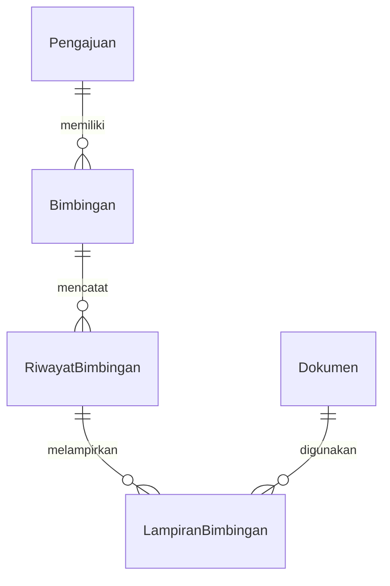
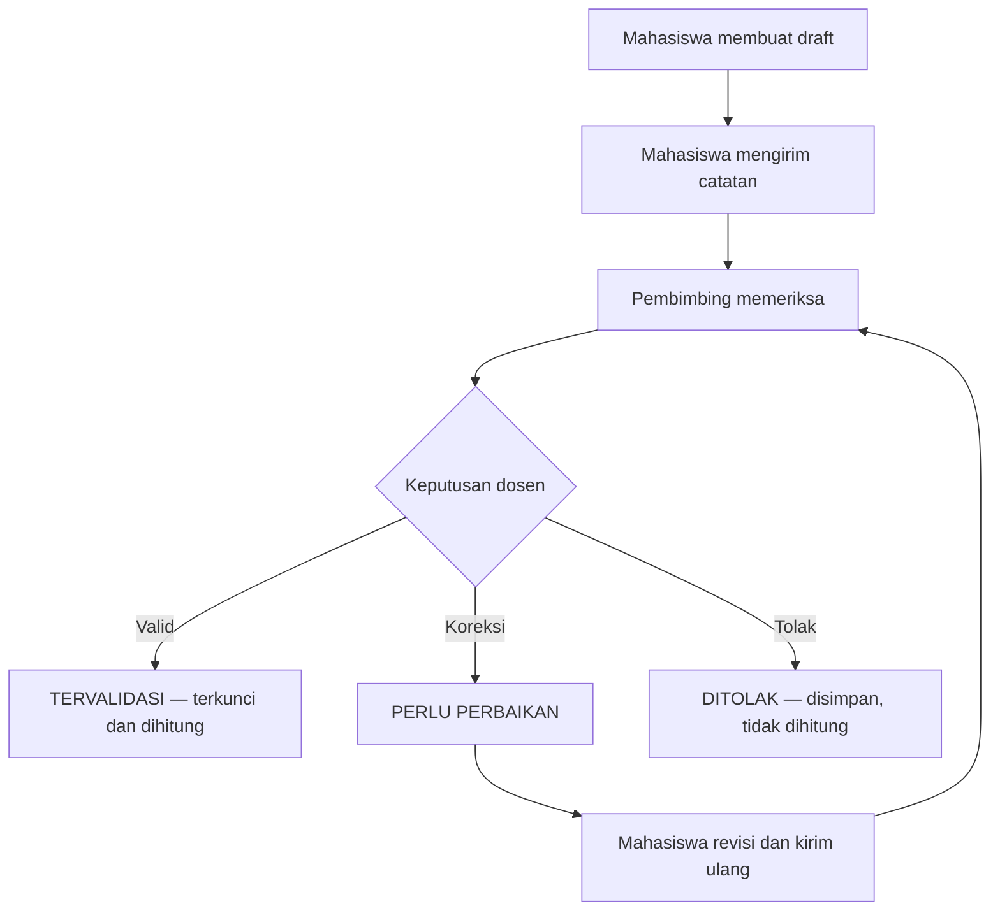

# Aturan Bisnis Bimbingan Offline dan Online — SIPKITA

Dokumen ini menjadi acuan **pencatatan, pengiriman, pemeriksaan, revisi, dan penghitungan bimbingan KP/ISCP/TA** oleh Mahasiswa dan Dosen Pembimbing. Offline dan online menggunakan **model data yang sama** dengan perbedaan input dan tujuan kegiatan. Setiap catatan tetap terikat pada **satu `Pengajuan`** untuk tahap dan periode tertentu.

**Status pengembangan:** dokumentasi domain disiapkan sekarang; implementasi bimbingan dapat dicicil jika waktu semester ISCP mencukupi. Prioritas utama semester ini tetap pengajuan, pemeriksaan, reviewer, dan ACC pengajuan.

**Rujukan:** `AGENTS.md`, `docs/business-rules/index.md`, `docs/academic-lifecycle.md`, `docs/roles-permissions.md`, dan `server/prisma/schema.prisma` aktual. Pembahasan ACC **penyelesaian tahap** secara lengkap berada di `docs/business-rules/penyelesaian-tahap.md` (jika sudah dibuat).

> **Aturan terpenting:** catatan bimbingan yang sudah **TERVALIDASI** tidak boleh diedit. Setelah ditinjau dosen, hanya catatan berstatus **PERLU PERBAIKAN** yang boleh direvisi pada record bimbingan yang sama. Catatan **DITOLAK** tetap disimpan sebagai riwayat dan **tidak dihitung** sebagai bimbingan sah.

## 1. Aturan bisnis yang sudah disepakati

| ID | Aturan | Implikasi |
| --- | --- | --- |
| **BR-BIM-01** | Bimbingan tersedia pada pengajuan KP, ISCP, dan TA yang sudah mempunyai **Dosen Pembimbing aktif** serta berada dalam kondisi pelaksanaan yang sah. | Periksa `Pengajuan` dan `PenugasanDosen`, bukan semester mahasiswa saja. |
| **BR-BIM-02** | **Offline:** mahasiswa mencatat tanggal pertemuan dan ringkasan materi/hasil diskusi; lampiran/bukti pendukung **opsional**. | Tidak boleh mewajibkan file hanya karena jenisnya offline. |
| **BR-BIM-03** | **Online:** mahasiswa mengirim materi atau ringkasan yang ingin ditinjau pembimbing; lampiran juga dapat **opsional**. Dosen memberi hasil pemeriksaan/catatan. | Bukan chat atau konferensi video langsung; pengiriman dan review tersimpan sebagai record. |
| **BR-BIM-04** | Dosen Pembimbing memberi salah satu keputusan bisnis: **TERVALIDASI, PERLU PERBAIKAN, atau DITOLAK**. | Identitas dosen, catatan, waktu, dan status harus tercatat. |
| **BR-BIM-05** | Hanya **PERLU PERBAIKAN** yang boleh diajukan ulang/revisi **pada `Bimbingan.id` yang sama** setelah pemeriksaan dosen. | Riwayat versi pengiriman bertambah; tidak membuat bimbingan baru untuk revisi yang sama. |
| **BR-BIM-06** | **TERVALIDASI** terkunci, tidak bisa diubah oleh mahasiswa. **DITOLAK** tidak boleh digunakan sebagai cara revisi ulang dan tidak dihitung. | Riwayat keputusan lama tidak boleh ditimpa. |
| **BR-BIM-07** | Hanya catatan **TERVALIDASI** yang dihitung ke minimal bimbingan untuk ACC penyelesaian. | Jumlah input/unggahan ≠ jumlah bimbingan sah. |
| **BR-BIM-08** | Jumlah minimum bimbingan mengikuti **tahap dan periode**, bukan angka `10` yang di-*hardcode*. | Gunakan `AturanPenyelesaianTahap.minimal_bimbingan`. |
| **BR-BIM-09** | Mencapai minimal bimbingan **tidak otomatis** meluluskan KP/ISCP/TA. ACC penyelesaian tetap keputusan pembimbing setelah seluruh syarat terpenuhi. | Jangan otomatis membuat `PenyelesaianTahap` saat hitungan minimum tercapai. |
| **BR-BIM-10** | Saat perpanjangan pada **semester berikutnya**, hitungan bimbingan untuk pengajuan semester baru **dimulai lagi dari nol**; riwayat semester sebelumnya tetap tersimpan. | Hitung berdasarkan `pengajuan_id` yang berlaku; jangan menghapus record lama. |

**Istilah status di atas adalah istilah bisnis.** Field `Bimbingan.status_bimbingan` bertipe `String` dengan default `DRAFT`; ejaan kode final untuk *menunggu validasi*, *tervalidasi*, *perlu perbaikan*, dan *ditolak* harus diseragamkan di konstanta/service sebelum implementasi. Jangan mengasumsikan Prisma telah memberi enum/transisi otomatis.

## 2. Aktor dan batas kewenangannya

| Aktor | Boleh melakukan | Tidak boleh melakukan |
| --- | --- | --- |
| **Mahasiswa** | Membuat draft, mencatat offline, mengirim online, melihat status/catatan sendiri, merevisi catatan yang diminta perbaikan. | Menyetujui bimbingan sendiri, mengubah keputusan dosen, mengedit catatan yang sudah tervalidasi/ditolak, mengakses catatan mahasiswa lain. |
| **Dosen Pembimbing** | Melihat catatan pada pengajuan yang dibimbing, memberi keputusan dan catatan, memeriksa revisi, menghitung catatan sah untuk syarat penyelesaian. | Memvalidasi pengajuan tanpa penugasan Pembimbing aktif, mengubah catatan seolah dikirim mahasiswa. |
| **Kaprodi** | Memantau proses sesuai kewenangan; menetapkan/mengganti pembimbing melalui alur penugasan. | Menggantikan keputusan validasi bimbingan pembimbing hanya karena menjadi Kaprodi. |
| **Dosen Reviewer** | Tidak mempunyai kewenangan khusus bimbingan hanya karena menjadi Reviewer. | Memvalidasi bimbingan tanpa role dan penugasan Pembimbing yang sah. |
| **Admin Prodi / Admin Sistem** | Administrasi dan konfigurasi sesuai tanggung jawab masing-masing. | Memberikan ACC bimbingan akademik atas nama dosen. |

Satu akun dosen boleh memiliki dua role, tetapi **mode Reviewer tidak memberi izin validasi bimbingan**. Service wajib mengecek `Dosen.user_id`, role Pembimbing, dan penugasan **`PEMBIMBING` yang masih `AKTIF` untuk `pengajuan_id` itu**.

## 3. Satu struktur database untuk kedua jenis bimbingan

| Model | Peran dalam aliran data | Field penting yang tersedia |
| --- | --- | --- |
| `Pengajuan` | Mengikat bimbingan pada mahasiswa, tahap KP/ISCP/TA, dan periode. | `id`, `mahasiswa_id`, `tahap_akademik_id`, `periode_akademik_id`, `status_pengajuan`, `status_pengerjaan` |
| `PenugasanDosen` | Menentukan dosen pembimbing yang sah. | `pengajuan_id`, `dosen_id`, `jenis_penugasan`, `status_penugasan` |
| `Bimbingan` | **Record utama satu kegiatan** dan kondisi terkininya. | `id`, `pengajuan_id`, `jenis_bimbingan`, `tanggal_bimbingan`, `ringkasan`, `status_bimbingan`, `versi_pengiriman_terakhir`, `catatan_pembimbing_terakhir`, `diperiksa_oleh_user_id`, `diperiksa_at`, `diajukan_pertama_at` |
| `RiwayatBimbingan` | Peristiwa pengiriman, pemeriksaan, dan revisi beserta **snapshot** isi/status. | `bimbingan_id`, `dilakukan_oleh_user_id`, `aksi`, `versi_pengiriman`, `status_sebelum`, `status_sesudah`, `tanggal_bimbingan_snapshot`, `ringkasan_snapshot`, `catatan`, `created_at` |
| `LampiranBimbingan` | Lampiran **per peristiwa/riwayat bimbingan**, bukan langsung per `Bimbingan`. | `riwayat_bimbingan_id`, `dokumen_id`, `jenis_lampiran`, `keterangan`, `urutan_tampil` |
| `Dokumen` | Metadata berkas pendukung bila diunggah. | `id`, `diunggah_oleh_user_id`, `nama_file_asli`, `storage_key`, `mime_type`, `ukuran_bytes` |
| `AturanPenyelesaianTahap` | Konfigurasi minimal bimbingan menurut tahap dan periode. | `tahap_akademik_id`, `periode_akademik_id`, `minimal_bimbingan`, `is_aktif` |
| `PenyelesaianTahap` | Bukti ACC penyelesaian pada proses **terpisah** setelah semua syarat selesai. | `pengajuan_id`, `jumlah_bimbingan_saat_acc`, `minimal_bimbingan_saat_acc`, `disetujui_oleh_user_id` |

Relasi utama:

**Jangan menambah FK `lampiran_bimbingan.bimbingan_id`** hanya karena UI menampilkan lampiran dalam satu kartu bimbingan; skema sekarang menghubungkan lampiran ke **`RiwayatBimbingan`** agar bukti tiap pengiriman tetap dapat dibedakan.

## 4. Perbedaan form dan perlakuan offline vs online

| Unsur | Bimbingan offline | Bimbingan online |
| --- | --- | --- |
| Kegiatan nyata | Mahasiswa sudah bertemu dosen secara langsung, lalu mengajukan pencatatan pertemuan untuk divalidasi. | Mahasiswa mengirim materi/ringkasan untuk ditinjau secara asinkron oleh dosen. |
| Input utama mahasiswa | **Tanggal pertemuan** dan ringkasan/topik/hasil bimbingan. | **Materi/ringkasan** yang ingin diperiksa atau dibahas. |
| Dokumen pendukung | **Opsional**, misalnya bukti konsultasi atau materi tambahan. | **Opsional**, misalnya file draft/laporan; isi teks dapat menjadi materi yang ditinjau. |
| Peran dosen | Memastikan catatan pertemuan sah, memberi catatan/keputusan. | Meninjau materi yang dikirim, memberi catatan/koreksi/keputusan. |
| Penentuan valid | Hanya saat dosen memberi **TERVALIDASI**. | Hanya saat dosen memberi **TERVALIDASI**. |
| Revisi setelah pemeriksaan | Hanya jika **PERLU PERBAIKAN**, memakai record bimbingan yang sama. | Sama: hanya jika **PERLU PERBAIKAN**, memakai record bimbingan yang sama. |

Karena `Bimbingan.tanggal_bimbingan` bersifat nullable, **jangan menganggap setiap online harus punya tanggal pertemuan offline**. Untuk offline, tanggal menjadi syarat pengiriman sesuai proses yang disepakati. Aturan apakah tanggal kegiatan online harus diisi manual atau cukup memakai timestamp server **belum ditetapkan secara khusus**; jangan menciptakan kewajiban tambahan.

## 5. Siklus status dan keputusan pembimbing

Diagram ini menggambarkan **transisi bisnis**, bukan nilai enum Prisma yang telah final. Keputusan dosen harus dilakukan pada versi pengiriman yang memang dia periksa.

### Ketentuan pengeditan berdasarkan status

| Kondisi | Mahasiswa boleh mengedit? | Perlakuan |
| --- | --- | --- |
| **Draft, belum dikirim** | Ya, pada data miliknya. | Koreksi draft belum memerlukan putaran pemeriksaan baru. |
| **Sudah dikirim, menunggu pemeriksaan** | Tidak bebas mengubah isi yang sedang dinilai. | Tunggu keputusan pembimbing; hindari pergantian materi di belakang dosen. |
| **PERLU PERBAIKAN** | **Ya**, sesuai catatan dan status revisi yang diizinkan. | Simpan pengiriman ulang dengan **`Bimbingan.id` tetap** dan riwayat baru. |
| **TERVALIDASI** | **Tidak**. | Terkunci; menjadi satu catatan sah yang dapat dihitung. |
| **DITOLAK** | **Tidak** melalui jalur revisi catatan itu. | Tetap dalam histori dan tidak dihitung. Pembahasan ulang memerlukan kegiatan/catatan baru yang sah, bukan mengubah keputusan lama. |

Kebijakan pembukaan kembali oleh otoritas khusus, pembatalan keputusan dosen, atau banding **belum termasuk** alur yang disepakati. Jangan menambahkan tombol *override* tanpa keputusan baru.

## 6. Aliran data bimbingan offline

Contoh: mahasiswa mengajukan catatan pertemuan pada pengajuan KP `id=101`.

| Langkah | Aktor dan aksi | Data dibaca | Data ditulis/diubah |
| --- | --- | --- | --- |
| 1 | Mahasiswa membuka form offline | `Mahasiswa`, `Pengajuan`, `PenugasanDosen` | Tidak ada mutasi wajib. |
| 2 | Mahasiswa mengisi tanggal dan ringkasan, menyimpan draft | `Pengajuan` miliknya | `Bimbingan` jenis offline dengan status draft. |
| 3 | Mahasiswa mengirim catatan untuk diperiksa | `Bimbingan` dan penugasan pembimbing | Update ringkasan/status/`versi_pengiriman_terakhir` dan `diajukan_pertama_at` bila pertama; buat `RiwayatBimbingan`. |
| 4 | Mahasiswa menyertakan bukti (jika ada) | `RiwayatBimbingan` pengiriman | `Dokumen` dan `LampiranBimbingan` yang menunjuk **riwayat pengiriman tersebut**. |
| 5 | Dosen memeriksa catatan pengajuan bimbingannya | `PenugasanDosen`, `Bimbingan`, `RiwayatBimbingan`, lampiran | Update keputusan/catatan di `Bimbingan`; buat peristiwa pemeriksaan di `RiwayatBimbingan`. |
| 6 | Jika Perlu Perbaikan, mahasiswa mengoreksi catatan lama | Versi terakhir dan catatan dosen | Update **`Bimbingan` yang sama**, tambah versi pengiriman dan `RiwayatBimbingan` baru. |
| 7 | Jika Tervalidasi atau Ditolak | Hasil pemeriksaan terakhir | Status akhir sesuai keputusan; tidak membuat bimbingan kedua hanya karena keputusan dosen. |

**Lampiran bukti offline tidak wajib**. Ketiadaan file tidak otomatis membuat catatan gagal; dosenlah yang memeriksa kesahihan pertemuannya sesuai aturan akademik.

## 7. Aliran data bimbingan online

Contoh: mahasiswa mengirim materi untuk meminta arahan dospem pada pengajuan ISCP `id=205`.

| Langkah | Aktor dan aksi | Perubahan data penting |
| --- | --- | --- |
| 1 | Mahasiswa membuka form online dari pengajuan ISCP yang aktif. | Verifikasi kepemilikan pengajuan dan keberadaan pembimbing aktif. |
| 2 | Mahasiswa memasukkan materi/ringkasan, boleh menambah lampiran. | Buat draft `Bimbingan` dengan jenis online; jika ada unggahan simpan metadata `Dokumen`. |
| 3 | Mahasiswa mengirim untuk ditinjau. | Tambah versi pengiriman dan `RiwayatBimbingan` yang menangkap materi/ringkasan; tautkan lampiran melalui `LampiranBimbingan` jika ada. |
| 4 | Pembimbing membuka materi dan memberi catatan. | Catat pemeriksaan dan keputusan pada `Bimbingan` serta `RiwayatBimbingan`. |
| 5 | Jika perlu perbaikan, mahasiswa mengirim materi yang telah diperbaiki. | Pertahankan `Bimbingan.id`, buat versi/riwayat pengiriman berikutnya; lampiran lama tetap berada pada riwayat lama. |
| 6 | Jika tervalidasi, catatan terkunci dan dihitung satu kali. | Hitungan sah berasal dari **record `Bimbingan` tervalidasi**, bukan banyaknya putaran atau lampiran. |

**Bimbingan online adalah pola kirim → review → umpan balik → revisi bila diminta**. Tidak perlu menambahkan tabel chat, percakapan real-time, atau integrasi panggilan video untuk memenuhi alur yang sudah disepakati.

## 8. Contoh isi database untuk revisi dan validasi

Semua ID, tanggal, nama kegiatan, dan nilai berikut adalah **ilustrasi**, bukan data sebenarnya. Nilai hasil seperti `TERVALIDASI` dipakai sebagai **label bisnis**; kode status final harus distandardkan sebelum implementasi.

### A. Tabel `Bimbingan` — kondisi terkini

| `id` | `pengajuan_id` | `jenis_bimbingan` | `tanggal_bimbingan` | `ringkasan` | `status_bimbingan` | `versi_pengiriman_terakhir` |
| --- | --- | --- | --- | --- | --- | --- |
| **301** | 101 | `OFFLINE` | 2026-10-14 | Pembahasan diagram UML yang diperbaiki | `TERVALIDASI` | 2 |
| **302** | 101 | `OFFLINE` | 2026-10-21 | Evaluasi rancangan database | `DITOLAK` | 1 |
| **303** | 205 | `ONLINE` | `null` | Konsultasi rancangan antarmuka dan prototipe | `PERLU_PERBAIKAN` | 1 |

Catatan 301 pernah diperbaiki setelah diminta revisi, tetapi **tetap satu kegiatan**. Catatan 302 disimpan tanpa menambah hitungan sah. Catatan 303 boleh diperbaiki oleh mahasiswa pemiliknya karena berstatus perlu perbaikan.

### B. Tabel `RiwayatBimbingan` — perjalanan catatan 301

| `id` | `bimbingan_id` | `aksi` (contoh) | `versi_pengiriman` | `status_sesudah` (contoh) | `ringkasan_snapshot` |
| --- | --- | --- | --- | --- | --- |
| 1001 | **301** | `KIRIM` | 1 | Menunggu validasi | Pembahasan diagram UML |
| 1002 | **301** | `PERIKSA` | 1 | `PERLU_PERBAIKAN` | Pembahasan diagram UML |
| 1003 | **301** | `KIRIM_REVISI` | 2 | Menunggu validasi | Pembahasan diagram UML yang diperbaiki |
| 1004 | **301** | `PERIKSA` | 2 | `TERVALIDASI` | Pembahasan diagram UML yang diperbaiki |

`RiwayatBimbingan.aksi` dan status setelahnya menyimpan `String`; label aksi/tahap di tabel adalah **contoh perilaku**, bukan kontrak kode yang sudah diputuskan. Dosen dapat memberikan `catatan` pada record pemeriksaan, dan pelakunya dicatat di `dilakukan_oleh_user_id`.

### C. Tabel lampiran — opsional per pengiriman

| `LampiranBimbingan.id` | `riwayat_bimbingan_id` | `dokumen_id` | `jenis_lampiran` (contoh) | Artinya |
| --- | --- | --- | --- | --- |
| 701 | 1001 | 901 | `BUKTI` | Lampiran pada kiriman pertama bimbingan 301. |
| 702 | 1003 | 902 | `MATERI` | Materi diperbaiki pada kiriman kedua. |

File lampiran versi pertama tetap tersedia sesuai izin akses, walaupun versi kedua menjadi isi terkini. Catatan tanpa lampiran **juga valid sebagai record pengiriman** jika syarat input lainnya terpenuhi.

## 9. Hitungan bimbingan dan hubungannya dengan penyelesaian tahap

Misalkan aturan KP periode tertentu mensyaratkan **minimal 10 bimbingan**, hanya sebagai contoh angka konfigurasi.

| Kondisi data pengajuan KP `101` | Jumlah | Dihitung? |
| --- | ---: | --- |
| `Bimbingan` dengan status TERVALIDASI | 8 | Ya, **8** kegiatan sah. |
| `Bimbingan` PERLU PERBAIKAN | 1 | Tidak. |
| `Bimbingan` DITOLAK | 1 | Tidak. |
| Pengiriman revisi dari kegiatan yang sama | 3 putaran tambahan | Tidak menambah jumlah kegiatan. |
| **Total bimbingan sah** | **8** | Belum memenuhi contoh minimal 10. |

Walaupun mahasiswa memiliki 10 record bimbingan dan beberapa revisi, **hitungan yang memenuhi syarat hanya 8**. Bila kemudian 10 kegiatan menjadi tervalidasi, jumlah minimum tercapai, tetapi **ACC penyelesaian tahap tetap memerlukan keputusan dospem serta pemeriksaan syarat lainnya**.

Pola penghitungan yang diharapkan pada service adalah menghitung **satu kali per `Bimbingan.id`** yang memenuhi status tervalidasi dalam `pengajuan_id` terkait, bukan menjumlah baris `RiwayatBimbingan` atau `LampiranBimbingan`. Filter status harus mengikuti kode final yang disahkan.

### Tahap dan semester berbeda

- Setiap `Pengajuan` memiliki relasi bimbingannya sendiri, sehingga KP, ISCP, dan TA **tidak berbagi penghitung** hanya karena mahasiswanya sama.
- Saat pembimbing diwariskan KP → ISCP atau ISCP → TA, bimbingan tahap lama tetap berada di `Pengajuan` lama; tahap baru membuat catatan bimbingan untuk `Pengajuan` baru.
- Pada **perpanjangan semester berikutnya**, termasuk ketika mahasiswa mengulang tahap, hitungan syarat bimbingan **dimulai dari nol** pada pengajuan baru; riwayat lama tetap untuk histori. Ketentuan lengkap dibahas di dokumen perpanjangan.
- Jangan menghitung otomatis bimbingan lama sebagai pemenuhan syarat periode baru hanya karena `Pengajuan.pengajuan_sebelumnya_id` terisi.

## 10. Validasi service, transaksi, dan keamanan

### Mahasiswa mengirim atau merevisi

1. User terautentikasi mempunyai role Mahasiswa dan `Pengajuan.mahasiswa_id` adalah miliknya.
2. Pengajuan sudah disetujui untuk pelaksanaan dan berada pada kondisi yang masih mengizinkan bimbingan.
3. Ada dosen pembimbing yang **ditugaskan aktif** pada pengajuan.
4. Saat **offline**, tanggal pertemuan dan ringkasan memenuhi validasi isian. Saat **online**, materi/ringkasan memenuhi validasi; file tidak wajib jika kebijakan yang disepakati memperbolehkannya.
5. Untuk pengiriman pertama, draft dibolehkan; setelah diperiksa, **hanya status PERLU PERBAIKAN** yang boleh diperbarui oleh mahasiswa.
6. Revisi harus menunjuk **`Bimbingan.id` lama**, bukan `create` kegiatan baru; versi pengiriman bertambah dengan aman.
7. Perbarui `Bimbingan` dan buat `RiwayatBimbingan` terkait secara **atomik**; lampiran yang dikirim saat itu harus menunjuk `RiwayatBimbingan.id` yang tepat.

### Dosen memberi hasil pemeriksaan

1. User memiliki role Pembimbing dan profil `Dosen` yang ditugaskan **PEMBIMBING aktif** pada pengajuan pemilik bimbingan.
2. Catatan berada pada status menunggu pemeriksaan; tidak terkunci karena tervalidasi/ditolak.
3. Keputusan memuat salah satu hasil bisnis yang disepakati, dan catatan bila dibutuhkan untuk menjelaskan perbaikan/penolakan.
4. Pemeriksaan mengacu pada **versi pengiriman terbaru** yang benar-benar diperiksa; cegah keputusan terlambat terhadap versi lama.
5. Catat `Bimbingan.catatan_pembimbing_terakhir`, `diperiksa_oleh_user_id`, `diperiksa_at`, status kini, serta baris `RiwayatBimbingan` baru dalam transaksi konsisten.
6. Mencegah klik/submit ganda, perubahan bersamaan oleh mahasiswa dan dosen, serta perubahan pada catatan yang sudah terkunci.

### Keamanan file dan riwayat

- `Dokumen.diunggah_oleh_user_id` dan `RiwayatBimbingan.dilakukan_oleh_user_id` berasal dari user **server**, bukan dari payload browser.
- Akses download lampiran diproteksi dengan ownership mahasiswa atau penugasan pembimbing; mengetahui `storage_key` tidak memberikan izin.
- Riwayat lama tidak dihapus untuk mempercantik tampilan. Tampilan utama boleh menunjukkan kondisi terbaru, dengan detail histori di halaman riwayat.
- Jangan membuat status baru, endpoint real-time, atau tabel tambahan tanpa kebutuhan yang disepakati dan pemeriksaan terhadap skema aktual.

## 11. Skenario pengujian minimum

| ID | Skenario | Hasil yang diharapkan |
| --- | --- | --- |
| BIM-01 | Mahasiswa mencatat offline dengan tanggal/ringkasan dan **tanpa lampiran** | Bisa dikirim bila prasyarat lain sah; menunggu validasi pembimbing. |
| BIM-02 | Mahasiswa mengirim materi online dalam teks **tanpa file** | Bisa dikirim; bukan fitur chat. |
| BIM-03 | Pembimbing yang ditugaskan memilih TERVALIDASI | Satu `Bimbingan` menjadi sah dan dihitung satu kali. |
| BIM-04 | Pembimbing meminta PERLU PERBAIKAN | Catatan dosen terlihat; mahasiswa dapat revisi **record yang sama**. |
| BIM-05 | Mahasiswa mengirim revisi dua kali pada catatan sama | Tidak membentuk dua kegiatan; versi/riwayat konsisten. |
| BIM-06 | Mahasiswa mencoba mengubah bimbingan TERVALIDASI | Ditolak; data historis tidak berubah. |
| BIM-07 | Mahasiswa mencoba mengubah bimbingan DITOLAK | Ditolak melalui jalur revisi; tetap tidak dihitung. |
| BIM-08 | Mahasiswa lain mengganti `bimbingan_id` di URL | Ditolak; tidak dapat membaca/menulis data orang lain. |
| BIM-09 | Dosen yang bukan pembimbing aktif memvalidasi catatan | Ditolak walaupun ia memiliki role dosen. |
| BIM-10 | User punya role Reviewer dan Pembimbing tetapi tidak ditugaskan sebagai pembimbing pengajuan X | Tidak dapat memvalidasi bimbingan X. |
| BIM-11 | Satu kegiatan mempunyai tiga putaran revisi dan akhirnya tervalidasi | Hitungan sah tetap **satu** kegiatan. |
| BIM-12 | Minimal bimbingan terpenuhi tanpa persyaratan tahap lain | Tidak membuat ACC penyelesaian otomatis. |
| BIM-13 | Perpanjangan pada semester baru merujuk pengajuan lama | Hitungan mulai nol; bimbingan lama tidak dihapus. |
| BIM-14 | Dua keputusan dosen untuk versi pengiriman berbeda masuk berurutan terbalik | Keputusan basi tidak menimpa hasil versi terbaru. |
| BIM-15 | Dokumen dilampirkan pada revisi online | Terhubung ke `RiwayatBimbingan` revisi, bukan salah versi. |

## 12. Keputusan teknis yang masih perlu dikunci

1. **Kode status dan aksi pasti:** tentukan representasi `MENUNGGU_VALIDASI`/padanannya, `TERVALIDASI`, `PERLU_PERBAIKAN`, `DITOLAK`, serta `RiwayatBimbingan.aksi`. Field sekarang bertipe `String`.
2. **Syarat detail online:** materi/ringkasan menjadi inti; lampiran opsional. Tentukan bila perlu format minimal materi dan apakah tanggal khusus online ditampilkan.
3. **Wajib atau opsional catatan dosen:** disarankan catatan jelas pada PERLU PERBAIKAN/DITOLAK; kebijakan wajibnya belum dikunci sebagai constraint.
4. **Batas putaran dan tenggat revisi:** belum ada maksimum perbaikan atau deadline khusus bimbingan yang disepakati.
5. **Audit pembatalan/override:** tidak ada alur membuka kembali bimbingan TERVALIDASI/DITOLAK yang disetujui; jangan implementasikan override sementara.
6. **Syarat penyelesaian tambahan:** skema `AturanPenyelesaianTahap` memiliki `keterangan_syarat_lain`, tetapi belum punya mekanisme terstruktur untuk dokumen sertifikat kelulusan. Bahas terpisah sebelum menganggapnya tervalidasi otomatis.

Keputusan belum final tidak boleh dijawab oleh Codex dengan menebak atau menambah field. Jika tugas implementasi bergantung padanya, jelaskan titik keputusan dan minta arahan pengguna.

## 13. Panduan penggunaan untuk Codex

Ketika pengguna meminta fitur bimbingan:

1. Periksa **jenis tugas** yang diminta (form offline, online, kirim, validasi dosen, revisi, riwayat, hitung sah). Implementasikan hanya bagian itu beserta pendukung wajibnya.
2. Baca dokumen ini bersama `docs/roles-permissions.md`, `docs/academic-lifecycle.md`, schema Prisma, dan kode backend aktual.
3. Tetapkan aliran **aktor → validasi role/penugasan/ownership/status → input → `Bimbingan` → `RiwayatBimbingan` → lampiran opsional → respons/riwayat**.
4. Gunakan model `Bimbingan` untuk kondisi terkini; `RiwayatBimbingan` untuk peristiwa/versi; `LampiranBimbingan` untuk file yang terkait **riwayat tertentu**.
5. Pastikan revisi memperbarui catatan lama dan menambah riwayat; TERVALIDASI/DITOLAK tetap terkunci. Hitung satu kali hanya status sah.
6. Tambahkan pengujian izin pengguna lain, dosen tanpa penugasan, status terkunci, revisi ganda, lampiran beda versi, dan hitungan sah.
7. Laporkan apa yang benar-benar diuji dan kebijakan yang belum ditetapkan. **Jangan menjalankan migrasi atau membuat model/status baru** tanpa permintaan pengguna.

**Batas dokumen:** file ini adalah spesifikasi bisnis untuk mengarahkan Codex, bukan tanda bahwa modul bimbingan sudah selesai diimplementasikan.
