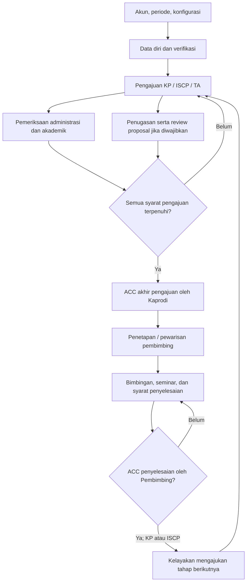

# Business Rules — SIPKITA (Indeks Aturan Bisnis)

Dokumen ini adalah **pintu masuk aturan bisnis** SIPKITA untuk Codex. Tujuannya menentukan dokumen mana yang perlu dibaca saat menganalisis atau mengimplementasikan fitur, mengikat aturan lintas proses yang sudah disepakati, dan mencatat **keputusan yang belum final** agar tidak berubah menjadi asumsi di kode.

> **Jenis berkas:** dokumentasi domain (`docs/`), **bukan** skill operasional (`.agents/skills/`). Skill `domain-modeling` dapat menggunakan dokumen ini saat menganalisis proses; `feature-implementation` menggunakannya saat membangun fitur.

## 1. Sumber rujukan dan cara memakainya

Urutan pemeriksaan untuk pekerjaan implementasi:

1. **Permintaan pengguna saat ini**: cakupan dan keputusan terbaru yang eksplisit.
2. **Aturan bisnis yang sudah dikonfirmasi** dalam dokumen proses terkait, beserta catatan keputusan/revisinya.
3. `docs/academic-lifecycle.md`: urutan tahap KP → ISCP → TA dan hubungan antarsemester.
4. `docs/roles-permissions.md`: batas aktor, hak akses, dan penugasan.
5. `docs/glossary.md`: istilah agar implementasi tidak mencampur konsep.
6. `server/prisma/schema.prisma` dan kode aktual: **fakta struktur database, field, relasi, serta implementasi yang benar-benar tersedia**.

**Penting:** dokumen aturan bisnis tidak menggantikan pemeriksaan skema Prisma aktual. Jika dokumen menyebut aturan yang belum didukung oleh tabel/field, **jelaskan celahnya**; jangan diam-diam membuat tabel atau mengklaim fiturnya sudah tersedia. Jika sumber lama dan baru bertentangan, **tandai konflik dan minta keputusan** sebelum menulis logika yang bergantung padanya.

## 2. Peta dokumen aturan bisnis

Seluruh berkas proses di bawah merupakan **rencana dokumentasi**. Keberadaan namanya di tabel ini **tidak berarti file sudah dibuat**. Saat membuka salah satu berkas, cek keberadaannya terlebih dahulu.

| File dalam `docs/business-rules/` | Fokus | Implementasi |
| --- | --- | --- |
| **`index.md`** | Prinsip bersama, peta proses, referensi, dan keputusan terbuka. | Referensi umum. |
| `pengajuan.md` | Form KP/ISCP/TA; `BARU`/`LANJUT`; persyaratan dinamis; pemeriksaan administrasi/akademik; ACC pengajuan. | **Prioritas sekarang.** |
| `review-proposal.md` | Penugasan reviewer, putaran review, revisi proposal, lembar hasil review, dan keputusan multi-reviewer. | **Prioritas sekarang.** |
| `bimbingan.md` | Catatan offline/online, lampiran, validasi pembimbing, revisi, dan riwayat. | Jika progres cukup; dapat menyusul. |
| `penyelesaian-tahap.md` | Syarat kelulusan tahap, ACC Dosen Pembimbing, dan kelayakan KP→ISCP→TA. | Disiapkan sebagai aturan; implementasi lengkap menyusul. |
| `perpanjangan-pengajuan-ulang.md` | Perpanjangan semester berikutnya, termasuk kondisi mengulang tahap, riwayat, dan batas kesempatan. Nama file adalah path historis; tidak ada proses pengajuan ulang terpisah. | Semester berikutnya. |
| `perubahan-judul.md` | Pengajuan perubahan judul, proposal wajib, pemeriksaan pembimbing, keputusan akhir Kaprodi. | Semester berikutnya. |
| `seminar.md` | Pembuatan jadwal seminar oleh pembimbing, pengumuman, dan perubahan jadwal. | Semester berikutnya. |

**Berkas lintas proses di luar folder ini:**

- `docs/academic-lifecycle.md` — lifecycle akademik dan prasyarat tahap.
- `docs/roles-permissions.md` — wewenang dan pemeriksaan akses.
- `docs/glossary.md` — kosakata domain.
- `docs/database.md` — rancangan dan alasan struktur data, **jika sudah dibuat**.
- `docs/api-conventions.md` — kontrak HTTP dan validasi API, **jika sudah dibuat**.

Jangan menyalin seluruh isi dokumen lintas proses ke tiap berkas bisnis; **rujuk bagian relevan saja** agar kebijakan tidak bercabang menjadi beberapa versi.

## 3. Aturan inti lintas proses yang sudah disepakati

ID aturan pada tabel ini adalah **penanda dokumentasi**, bukan ID tabel, enum, atau konstanta yang wajib ditambahkan ke database.

| ID | Aturan bisnis | Bukti/model terkait |
| --- | --- | --- |
| **BR-CORE-01** | Satu sistem menangani KP, ISCP, dan TA secara bersamaan pada periode yang sama; tahap setiap mahasiswa ditentukan dari pengajuan/riwayat, bukan semata semester kuliah. | `TahapAkademik`, `PeriodeAkademik`, `Pengajuan` |
| **BR-CORE-02** | Urutan akademik adalah **KP → ISCP → TA**. Lanjut tahap membutuhkan ACC penyelesaian dan syarat berlaku; mahasiswa tetap membuat pengajuan berikutnya. | `Pengajuan.pengajuan_prasyarat_id`, `PenyelesaianTahap` |
| **BR-CORE-03** | **ACC akhir pengajuan** oleh Kaprodi berbeda dari **ACC penyelesaian tahap** oleh Dosen Pembimbing. Reviewer tidak berwenang meluluskan tahap. | `Pengajuan`, `PenyelesaianTahap`, `ReviewProposal` |
| **BR-CORE-04** | Persyaratan dokumen pengajuan dapat berbeda menurut **periode, tahap, jenis pengajuan, dan pilihan topik**; tidak di-*hardcode* per tahap pada UI/service. | `JenisDokumen`, `PersyaratanPengajuan` |
| **BR-CORE-05** | Riwayat pengajuan, dokumen, topik, dan review harus terpelihara. Revisi membuat versi/riwayat yang dapat dilacak, bukan mengganti bukti lama tanpa jejak. | `Pengajuan`, `VersiTopik`, `DokumenPengajuan`, `RiwayatReview` |
| **BR-CORE-06** | Pemeriksaan administratif/akademik dan review proposal dapat diproses paralel bila alur mengizinkan; **ACC akhir** menunggu seluruh prasyarat yang diwajibkan terpenuhi. | `Pengajuan`, `DokumenPengajuan`, `ReviewProposal` |
| **BR-CORE-07** | Satu pengajuan boleh memiliki **lebih dari satu Reviewer**; seluruh Reviewer aktif yang ditugaskan harus memberi hasil `LAYAK` pada proposal terbaru sebelum prasyarat review terpenuhi. Kondisi ini tidak otomatis menjadi ACC. Hanya **satu Pembimbing aktif** diperbolehkan. | `PenugasanDosen`, `ReviewProposal`, `RiwayatReview` |
| **BR-CORE-08** | Dosen bisa mempunyai role Reviewer dan Pembimbing sekaligus, tetapi aksi memerlukan **role yang sesuai, penugasan aktif, objek yang benar, dan status yang sah**. | `UserRole`, `Dosen`, `PenugasanDosen` |
| **BR-CORE-09** | Pembimbing ISCP/TA pada prinsipnya diwariskan dari pengajuan tahap sebelumnya kecuali Kaprodi mengubahnya; penugasan untuk pengajuan baru tetap dicatat tersendiri. | `PenugasanDosen.asal_penugasan_id`, `Pengajuan.pengajuan_prasyarat_id` |
| **BR-CORE-10** | Pengajuan baru antar tahap dan pengajuan baru semester berikutnya **tidak menimpa record sebelumnya**; kaitannya dibedakan secara eksplisit. | `Pengajuan.pengajuan_prasyarat_id`, `pengajuan_sebelumnya_id` |
| **BR-CORE-11** | Perpanjangan bukan tambahan satu-dua minggu pada semester yang sama; diajukan sebagai `Pengajuan` baru pada **semester berikutnya** dan ditautkan ke pengajuan lama. Perpanjangan tidak melibatkan Reviewer atau Admin Prodi; pemeriksaan dan keputusan oleh Kaprodi. | `Pengajuan`, `TahapAkademik.maks_perpanjangan` |
| **BR-CORE-12** | Verifikasi data diri/dokumen identitas oleh pihak administratif terkait berbeda dari pemeriksaan dokumen pengajuan dan review substansi proposal. Revisi satu dokumen tidak otomatis mengulang seluruh dokumen lain yang sudah valid. | `VerifikasiDataDiri`, `DokumenDataDiri`, `DokumenPengajuan` |
| **BR-CORE-13** | Jadwal pengajuan serta syarat semester berjalan berasal dari konfigurasi periode/tahap; jangan memaksakan satu kalender atau satu paket dokumen untuk seluruh mahasiswa. | `PeriodeAkademik`, `JadwalProses`, `PersyaratanPengajuan` |
| **BR-CORE-14** | SIPKITA belum terhubung ke SIKADU; data akademik/mahasiswa/dosen yang dibutuhkan berasal dari proses manual/impor dan pemeriksaan yang disepakati. | `Mahasiswa`, `Dosen`, `ImportBatch`, snapshot dalam `Pengajuan` |
| **BR-CORE-15** | Semua pengajuan reguler KP/ISCP/TA, termasuk jalur `LANJUT`, wajib memakai proposal terbaru dan menjalani review. Jalur `LANJUT` mengambil data tahap sebelumnya sebagai isian awal tanpa menimpa riwayat. | `Pengajuan`, `TopikPenelitian`, `VersiTopik`, `ReviewProposal` |

**Catatan pembatasan:** tabel ini menyatakan prinsip domain. Detail **kapan** status berubah, siapa memeriksa komponen tertentu, dan kode nilai `String` harus dikunci pada dokumen proses sebelum implementasi.

## 4. Alur bisnis utama dan posisi tiap modul

Diagram adalah **gambaran konseptual**. Review berlaku bagi seluruh pengajuan reguler, termasuk `LANJUT`; alur perpanjangan menjadi pengecualian karena tidak melibatkan Reviewer. Kembali ke `C` pada kasus perbaikan berarti mahasiswa melengkapi/merevisi **pengajuan yang sama selama aturan mengizinkan**, bukan selalu membuat record `Pengajuan` baru.

## 5. Cara membedakan aturan, status, dan penyimpanan data

Sebelum menulis aturan di service, pisahkan tiga hal berikut:

| Lapisan | Pertanyaan | Contoh SIPKITA |
| --- | --- | --- |
| **Aturan bisnis** | Kapan tindakan boleh dilakukan dan siapa pemutusnya? | Pengajuan belum dapat di-ACC Kaprodi selama syarat wajib belum terpenuhi. |
| **Status proses** | Kondisi apa yang disimpan dan perubahan mana yang legal? | `Pengajuan.status_pengajuan`, `status_pemeriksaan_akademik`, `DokumenPengajuan.status_pemeriksaan`. |
| **Riwayat/bukti** | Record mana menunjukkan tindakan, pelaku, versi, dan waktunya? | `RiwayatStatusPengajuan`, `RiwayatReview`, `DokumenPengajuan`, field `*_oleh_user_id`. |

**Jangan** menyimpulkan aturan hanya dari nilai default field Prisma. Banyak field status berupa `String`; default seperti `DRAFT` atau `BELUM_DIPERIKSA` **bukan state machine lengkap**.

### Pola yang dipakai di dokumen proses selanjutnya

Setiap file proses (`pengajuan.md`, `review-proposal.md`, dan seterusnya) sebaiknya menjabarkan:

1. **Tujuan dan ruang lingkup**, termasuk prioritas semester.
2. **Aktor dan wewenang** (rujuk `roles-permissions.md`).
3. **Prasyarat** (periode, tahap, riwayat, status, dan konfigurasi).
4. **Alur utama dan alur pengecualian** (revisi, tolak, penugasan ulang, pengajuan lintas semester).
5. **Aturan serta status**; tandai keputusan belum final.
6. **Pemetaan baca/tulis tabel dan transaksi**, berdasarkan schema sebenarnya.
7. **Contoh record** yang konsisten untuk menelusuri aliran data.
8. **Kriteria selesai dan skenario tes**, termasuk penolakan akses dan integritas riwayat.

## 6. Keputusan terbuka — jangan diselesaikan oleh Codex sendiri

| ID | Topik | Sudah diketahui | Butuh keputusan |
| --- | --- | --- | --- |
| **BR-OPEN-02** | Pemeriksaan akademik pengajuan | Admin Prodi memeriksa administrasi pengajuan reguler/awal; Kaprodi memegang ACC akhir. | Pelaku, data, bukti audit, dan transisi pemeriksaan kelayakan akademik. |
| **BR-OPEN-04** | Kelayakan dan batas perpanjangan | Pengajuan ulang bukan proses terpisah; kondisi mengulang tahap pada semester berikutnya memakai perpanjangan. Alur topik/proposal dan pengecualian Reviewer sudah ditetapkan. | Kondisi formal serta nilai/batas kesempatan perpanjangan menurut kebijakan prodi dan konfigurasi. |
| **BR-OPEN-05** | Dokumen penyelesaian tahap | `AturanPenyelesaianTahap` menyimpan minimal bimbingan dan deskripsi syarat lain. | Jika sertifikat/dokumen kelulusan tambahan harus diunggah serta diverifikasi, perlu rancangan penyimpanan yang terstruktur. |
| **BR-OPEN-06** | Detail kode status/transisi | Model `Pengajuan`, `ReviewProposal`, `DokumenPengajuan`, dan lainnya memiliki field status bertipe `String`. | Daftar status final, aktor transisi, kondisi revisi, dan efek setiap keputusan. |
| **BR-OPEN-07** | Pemeriksaan master/impor | Tidak ada integrasi langsung SIKADU. | Siapa yang boleh melakukan impor dan koreksi master mahasiswa/dosen: Admin Prodi, Admin Sistem, atau pembagian tertentu? |

Status **terbuka** tidak berarti fitur mustahil. Artinya **desain service yang memerlukan pilihan tersebut harus menunggu keputusan**, sedangkan pekerjaan lain yang tidak bergantung padanya boleh dilanjutkan.

## 7. Ruang lingkup dan urutan penulisan aturan bisnis

### Fokus semester ISCP sekarang

1. Konfigurasi wajib untuk menjalankan sistem, login/role, dan master pengguna.
2. Data diri, unggah dokumen identitas, pemeriksaan, dan revisi.
3. Pengajuan KP/ISCP/TA dengan jalur `BARU`/`LANJUT`, termasuk pengisian topik serta paket dokumen yang berbeda.
4. Pemeriksaan persyaratan akademik dan dokumen, penugasan Reviewer, review/revisi, ACC pengajuan, serta penetapan Pembimbing.

**File proses yang ditulis lebih dulu:** `pengajuan.md`, kemudian `review-proposal.md`. Bimbingan boleh dicicil jika progres memungkinkan. Proses perpanjangan, perubahan judul, dan implementasi tahap lanjutan dilakukan pada periode pengembangan berikutnya kecuali pengguna mengubah prioritas.

### Prinsip efisiensi penjelasan

- Pengajuan KP, ISCP, dan TA memakai **satu konsep `Pengajuan`** dengan variasi aturan yang terkonfigurasi. Jangan membuat dokumen alur hampir identik untuk tiga tahap tanpa kebutuhan nyata.
- Pemeriksaan berkas dan verifikasi data diri berbeda, tetapi keduanya memakai pola **versi, status, pemeriksa, dan catatan**. Bedakan model penyimpanannya.
- Penugasan Dosen Reviewer dan Pembimbing memakai model `PenugasanDosen`, tetapi **jenis penugasan dan hak tindakannya berbeda**.
- ACC pengajuan, review proposal, ACC perubahan judul, dan ACC penyelesaian tidak boleh disamakan karena **aktor, prasyarat, serta akibatnya berbeda**.

## 8. Instruksi praktis untuk Codex

Ketika diminta membangun suatu fitur SIPKITA:

1. Tentukan file aturan proses yang tepat dari bagian 2; **baca hanya yang relevan**. Jika belum tersedia, laporkan dan gunakan keputusan yang telah dikonfirmasi.
2. Tentukan ID aturan inti dan keputusan terbuka yang memengaruhi fitur itu.
3. Cocokkan tabel, field, relasi, dan indeks di **`server/prisma/schema.prisma` aktual**, bukan dari contoh dokumentasi saja.
4. Jelaskan jalur data: **aktor → input → validasi → model baca/tulis → keputusan/status → respons/riwayat**.
5. Letakkan pemeriksaan peran/penugasan/kepemilikan/status dan operasi transaksi yang konsisten pada lapisan service. Jangan menyerahkan aturan final kepada React atau controller semata.
6. Implementasikan hanya modul yang diminta, uji jalur sukses dan gagal, lalu laporkan perbedaan dokumentasi dengan kode.

**Batas dokumen ini:** tidak menetapkan endpoint, tidak menciptakan status baru, tidak mengubah schema Prisma, dan tidak mengeksekusi migrasi. File ini menjadi **indeks dan kontrak pemahaman**; rincian yang siap diimplementasikan berada di file proses masing-masing setelah dibuat dan dikonfirmasi.
