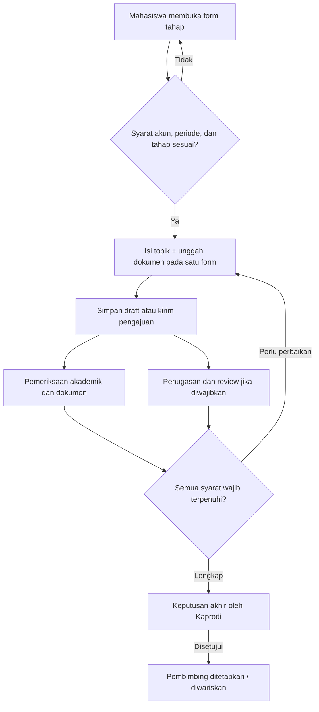

# Aturan Bisnis Pengajuan KP ISCP dan TA — SIPKITA

Dokumen ini menjelaskan **satu mekanisme pengajuan** yang dipakai bersama oleh Kerja Praktik (KP), Information Systems Capstone Project (ISCP), dan Tugas Akhir (TA): persiapan formulir, pilihan topik, syarat akademik, berkas, pemeriksaan, review proposal, ACC akhir, dan penetapan pembimbing. Perbedaan tahap diatur melalui **prasyarat dan konfigurasi**, bukan dengan membuat tiga alur database yang terpisah.

**Status:** referensi domain untuk implementasi bertahap. Diselaraskan dengan keputusan bisnis final terbaru; keputusan yang memang belum ditetapkan tetap ditandai terbuka dan tidak boleh diisi dengan asumsi Codex.

**Gunakan bersama:** `AGENTS.md`, `docs/business-rules/index.md`, `docs/academic-lifecycle.md`, `docs/roles-permissions.md`, `docs/glossary.md`, dan `server/prisma/schema.prisma` **aktual**. Dokumen ini tidak membuat endpoint, tabel, status, atau migrasi baru.

## 1. Cakupan dan aktor

### Dicakup pada semester ISCP sekarang

1. Persiapan periode, jadwal, syarat dokumen, serta data mahasiswa dan dosen yang dibutuhkan.
2. Pengajuan **KP**, **ISCP** (`BARU`/`LANJUT`), dan **TA** (`BARU`/`LANJUT`).
3. Satu formulir pengajuan yang memuat informasi topik/judul/objek **beserta** unggahan dokumen.
4. Pemeriksaan persyaratan akademik dan berkas; pencatatan catatan/perbaikan.
5. Penugasan reviewer dan review/revisi proposal **jika diwajibkan oleh kebijakan yang dikunci**.
6. Keputusan akhir pengajuan oleh Kaprodi dan penetapan/pewarisan pembimbing.

### Bukan fokus dokumen ini

- Rincian putaran review, lembar hasil review, dan pemenuhan hasil seluruh Reviewer aktif: `review-proposal.md` (dokumen terpisah).
- Mekanisme bimbingan dan ACC **penyelesaian** tahap: `bimbingan.md`, `penyelesaian-tahap.md` (dokumen terpisah).
- Perpanjangan semester berikutnya, termasuk kondisi mengulang tahap: `perpanjangan-pengajuan-ulang.md` (nama path historis). Kaitan riwayatnya tetap disebut di sini; tidak ada proses pengajuan ulang terpisah.
- Perubahan judul setelah pengajuan berlaku: `perubahan-judul.md` (dokumen terpisah).

### Kewenangan aktor

| Aktor | Kewenangan dalam pengajuan |
| --- | --- |
| **Mahasiswa** | Membuat/mengirim pengajuan sendiri, memilih jalur, mengisi topik, mengunggah dan merevisi berkas, membaca status/catatan. |
| **Admin Prodi** | Memverifikasi data diri/berkas identitas serta memeriksa administrasi pengajuan reguler/awal. Tidak memeriksa perpanjangan dan tidak memberi ACC akhir. |
| **Kaprodi** | Menentukan reviewer, memeriksa/memutuskan perpanjangan, dan menetapkan atau mengganti pembimbing. Pelaku pemeriksaan kelayakan akademik pengajuan reguler masih perlu dikunci. |
| **Dosen Reviewer** | Memeriksa proposal yang ditugaskan, mencatat koreksi/hasil, serta opsional mengunggah lembar review. **Tidak** memberi ACC akhir pengajuan. |
| **Dosen Pembimbing** | Menangani pengajuan yang menjadi bimbingannya **setelah penugasan sah**; ACC penyelesaian tahap dilakukan pada proses lain. |
| **Admin Sistem** | Mengelola konfigurasi master, periode/jadwal, pengguna/role, dan jenis/persyaratan dokumen; bukan pemutus akademik pengajuan. |

> **Pemisahan keputusan:** ACC akhir **pengajuan** menentukan apakah mahasiswa boleh menjalankan tahap yang diajukannya. ACC **penyelesaian tahap** oleh pembimbing menandai tahapan itu selesai/lulus. Jangan memakai satu status atau satu endpoint untuk kedua keputusan tersebut.

## 2. Prasyarat sebelum mahasiswa boleh mengajukan

| Pemeriksaan | Aturan bisnis | Sumber data |
| --- | --- | --- |
| Identitas akun | Pengguna login sebagai mahasiswa aktif dan pengajuan hanya untuk profil sendiri. | `User`, `UserRole`, `Mahasiswa` |
| Data diri | Identitas dan dokumen data diri yang diwajibkan telah diperiksa/disahkan sesuai alur. | `VerifikasiDataDiri`, `DokumenDataDiri` |
| Tahap | Tahap KP/ISCP/TA tersedia dan aktif. | `TahapAkademik` |
| Periode dan waktu | Pengajuan hanya boleh dikirim untuk periode serta jadwal proses yang memang terbuka. | `PeriodeAkademik`, `JadwalProses` |
| Prasyarat lintas tahap | ISCP membutuhkan KP selesai; TA membutuhkan ISCP selesai. Status semester yang lebih tinggi **bukan** bukti kelulusan tahap. | `Pengajuan.pengajuan_prasyarat_id`, `PenyelesaianTahap` |
| Akademik | IPK, SKS, nilai DE, atau batas akademik lainnya diverifikasi berdasarkan ketentuan resmi yang berlaku. Jangan menebak angka batasnya. | Snapshot `Pengajuan` dan aturan akademik yang disahkan |
| Konfigurasi dokumen | Paket syarat ditentukan dari kombinasi periode, tahap, jenis pengajuan, dan pilihan topik. | `JenisDokumen`, `PersyaratanPengajuan` |
| Riwayat tahap yang sama | Cegah pengajuan aktif/bertabrakan yang tidak dibolehkan; pertahankan riwayat permohonan terdahulu. | `Pengajuan` dan status/aturan yang diputuskan |

**Khusus pengambilan KP dan ISCP bersamaan dalam satu semester:** kebijakan belum diputuskan. Jangan otomatis mengizinkan maupun menolak atas nama keputusan akademik yang belum ada. Jika memengaruhi validasi submit, hentikan implementasi aturan itu dan minta konfirmasi.

## 3. Satu formulir untuk topik dan dokumen

Mahasiswa tidak perlu mengisi formulir topik lalu mengulang proses pendaftaran hanya untuk berkas. Secara UI boleh satu halaman dengan beberapa seksi, *stepper*, atau simpan draft; secara database data tetap disimpan pada model masing-masing.

| Bagian formulir | Contoh input yang terlihat | Model/field utama |
| --- | --- | --- |
| Identitas | Nama, NIM, prodi, status verifikasi | `Mahasiswa`, `VerifikasiDataDiri` (umumnya ditampilkan dari profil, bukan diisi ulang bebas) |
| Periode dan tahap | Semester aktif; KP/ISCP/TA | `Pengajuan.periode_akademik_id`, `tahap_akademik_id` |
| Jenis pengajuan | Pengajuan awal atau jalur semester berikutnya sesuai aturan | `Pengajuan.jenis_pengajuan` |
| Pilihan topik | `BARU`/`LANJUT` jika tahap membolehkan | `Pengajuan.pilihan_topik` |
| Tema dan penelitian | Tema, judul, objek, lokasi | `TemaPenelitian`, `TopikPenelitian`, `VersiTopik` |
| Usulan pembimbing (jika tersedia pada form) | Dosen yang diusulkan | `Pengajuan.usulan_pembimbing_id`; **belum** merupakan penugasan sah |
| Persyaratan akademik | IPK, SKS, ada/tidak nilai DE | `Pengajuan.ipk_saat_pengajuan`, `jumlah_sks_saat_pengajuan`, `memiliki_nilai_de`, `daftar_mk_nilai_de` |
| Persyaratan dokumen | Proposal, surat izin orang tua, bukti bayar, atau syarat lain **sesuai konfigurasi** | `JenisDokumen`, `PersyaratanPengajuan`, `Dokumen`, `DokumenPengajuan` |

**Prinsip formulir:** perubahan tampilan atau jumlah seksi UI **tidak** mengubah hubungan entitas. Pada server, simpan record yang terkait secara konsisten; jika bagian gagal disimpan, jangan meninggalkan pengajuan seolah lengkap.

### Contoh konfigurasi dokumen — ilustrasi, bukan peraturan akademik final

| Periode | Tahap | `jenis_pengajuan` | `pilihan_topik` | Syarat contoh | Wajib? |
| --- | --- | --- | --- | --- | --- |
| 2026/2027 Ganjil | KP | Pengajuan awal | `BARU` | Proposal KP | Ya |
| 2026/2027 Ganjil | ISCP | Pengajuan awal | `BARU` | Proposal ISCP, surat izin orang tua | Sesuai konfigurasi |
| 2026/2027 Ganjil | TA | Pengajuan awal | `LANJUT` | Bukti pembayaran TA dan proposal terbaru | Sesuai konfigurasi; proposal wajib |

Baris contoh di atas diterjemahkan menjadi **record konfigurasi** `PersyaratanPengajuan` yang menunjuk `JenisDokumen`, bukan daftar `if (tahap === 'TA')` yang mengunci berkas selamanya. `jenis_pengajuan` contoh adalah **label bisnis**, bukan klaim nilai enum yang sudah final di database.

## 4. Aturan khusus tiap tahap dan pilihan topik

| Tahap/jalur | Pengajuan prasyarat | Perilaku topik | Dokumen/review | Pembimbing |
| --- | --- | --- | --- | --- |
| **KP awal** | Tidak ada tahap sebelum KP | Mahasiswa memilih tema, judul, objek, lokasi; membuat topik/versi yang terkait. | Proposal dan syarat KP sesuai konfigurasi; review mengikuti kebijakan pengajuan KP. | Ditetapkan Kaprodi pada pengajuan yang disetujui. |
| **ISCP `LANJUT`** | KP dengan ACC penyelesaian | Isi awal tema, judul, objek, dan referensi topik dari KP; penyempurnaan judul dibuat sebagai versi baru dan tidak menimpa riwayat KP. | Proposal terbaru dan review wajib. | Pada prinsipnya diwariskan dari KP; Kaprodi bisa mengganti. |
| **ISCP `BARU`** | KP dengan ACC penyelesaian | Membuat topik baru; relasi ke riwayat KP tetap ada. | Proposal baru dan review; reviewer KP dapat menjadi rekomendasi, Kaprodi menetapkan reviewer final. | Pada prinsipnya diwariskan dari KP. |
| **TA `LANJUT`** | ISCP dengan ACC penyelesaian | Isi awal tema, judul, objek, dan referensi dari ISCP; perubahan judul dicatat sebagai versi baru. | Proposal terbaru, review, bukti pembayaran, dan berkas TA lain sesuai konfigurasi. | Pada prinsipnya diwariskan dari ISCP. |
| **TA `BARU`** | ISCP dengan ACC penyelesaian | Membuat topik baru dengan keterkaitan prasyarat ke ISCP. | Proposal baru, review, dan berkas TA menurut konfigurasi. | Pada prinsipnya diwariskan dari ISCP. |

Aturan khusus tidak boleh diturunkan dari nomor semester. Contohnya, mahasiswa semester 8 dapat mengajukan TA sementara mahasiswa lain pada periode yang sama sedang mengajukan KP.

### Makna `LANJUT` pada data

- `Pengajuan.pengajuan_prasyarat_id` menunjuk **pengajuan tahap sebelumnya yang selesai** (ISCP → KP, TA → ISCP).
- `Pengajuan.topik_penelitian_id` menautkan identitas topik yang dipakai; untuk `LANJUT`, topik sebelumnya menjadi sumber pengisian awal.
- `Pengajuan.versi_topik_id` menunjuk versi judul/objek yang berlaku bagi pengajuan baru. Jika ada perubahan substansial, **jangan mengubah versi yang sudah menjadi bukti historis secara diam-diam**.
- `Pengajuan.pengajuan_sebelumnya_id` digunakan untuk hubungan **pengajuan historis pada tahap yang sama** ketika ada permohonan semester berikutnya; **bukan** pengganti `pengajuan_prasyarat_id`.
- Pada `BARU`, topik penelitian baru boleh dibuat tetapi hubungan prasyarat tahap sebelumnya **tetap wajib** jika tahapnya ISCP atau TA.

## 5. Urutan proses utama

Diagram ini menggambarkan jalur berhasil dan jalur revisi; penolakan akhir pengajuan tetap merupakan kemungkinan keputusan Kaprodi. `E` dan `F` **boleh berlangsung paralel** sesuai alur. Jika suatu jalur memang dibebaskan dari review setelah kebijakan final dipilih, cabang `F` dilewati tanpa menciptakan `ReviewProposal` fiktif.

### Langkah terperinci dan operasi data

| Tahap kerja | Baca (SELECT) | Tulis/ubah (INSERT/UPDATE) | Validasi inti |
| --- | --- | --- | --- |
| 1. Buka formulir | `User`, `Mahasiswa`, `VerifikasiDataDiri`, `PeriodeAkademik`, `TahapAkademik`, `JadwalProses`, prasyarat sebelumnya | Belum perlu menulis | Kepemilikan, verifikasi data diri, jadwal, eligibility tahap. |
| 2. Muat paket syarat | `PersyaratanPengajuan` + `JenisDokumen` sesuai **empat parameter konfigurasi** | Belum perlu menulis | Hanya syarat aktif dan sesuai jalur; jangan menggabungkan syarat KP/ISCP/TA. |
| 3. Simpan topik dan draft | `TemaPenelitian`, topik/versi sebelumnya jika `LANJUT` | `TopikPenelitian` dan `VersiTopik` bila perlu; `Pengajuan` sebagai draft | Versi topik milik mahasiswa; prasyarat stage tepat; tidak ada perubahan historis tak sah. |
| 4. Unggah berkas | `PersyaratanPengajuan`, dokumen versi terkini | `Dokumen`, `DokumenPengajuan` | Jenis file, ukuran, pemilik, syarat benar, pengurutan versi. |
| 5. Kirim pengajuan | Draft, syarat wajib terkini, data diri, jadwal | `Pengajuan.diajukan_at`, `status_pengajuan`, `RiwayatStatusPengajuan` | Lengkap untuk **submit** sesuai aturan; idempotensi; status sesuai transisi. |
| 6. Pemeriksaan | `Pengajuan`, snapshot akademik, dokumen terkini | `Pengajuan.status_pemeriksaan_akademik` dan field pemeriksa; `DokumenPengajuan.status_pemeriksaan` dan catatan; riwayat status yang relevan | Administrasi oleh Admin Prodi; pemeriksa akademik masih terbuka; catatan dan keputusan tidak hilang. |
| 7. Penugasan/review | Pengajuan, dosen, dokumen proposal dan versi topik | `PenugasanDosen`, `ReviewProposal`, `RiwayatReview` | Hanya reviewer aktif yang ditugaskan; jumlah reviewer dapat lebih dari satu. |
| 8. Perbaikan | Catatan pemeriksa/reviewer dan dokumen terkini | Versi `DokumenPengajuan` baru atau pembaruan draft yang masih boleh diubah; riwayat tetap | Revisi tepat pada syarat yang bermasalah; **dokumen lain tidak otomatis diunggah ulang**. |
| 9. ACC akhir/tolak | Semua hasil pemeriksaan dan review yang diwajibkan | `Pengajuan.status_pengajuan`, `catatan_keputusan`, `diputuskan_oleh_user_id`, `diputuskan_at`, `RiwayatStatusPengajuan` | Hanya Kaprodi; prasyarat wajib lengkap; keputusan tidak ganda. |
| 10. Pembimbing | Pengajuan disetujui, penugasan tahap sebelumnya untuk ISCP/TA | `PenugasanDosen` bertipe `PEMBIMBING` | Maksimal satu pembimbing aktif; simpan asal penugasan jika diwariskan. |

**Tiga hal yang jangan dicampur:** (1) proses kelengkapan administrasi, (2) hasil review substansi proposal, (3) ACC akhir pengajuan. Statusnya dapat berjalan terpisah sampai Kaprodi memberi keputusan akhir.

## 6. Aturan dokumen, versi, dan revisi

1. Jenis dokumen didefinisikan pada `JenisDokumen`; kewajibannya untuk pengajuan tertentu didefinisikan pada `PersyaratanPengajuan`.
2. Setiap file fisik/metadata disimpan melalui `Dokumen`; keterikatannya ke pengajuan dan syarat melalui `DokumenPengajuan`.
3. Saat suatu berkas direvisi, buat **versi baru** dan set versi sebelumnya menjadi `is_terkini=false` **di dalam transaksi yang sama**. Skema memiliki keunikan parsial untuk memastikan maksimal satu dokumen terkini per `(pengajuan_id, persyaratan_pengajuan_id)`.
4. Catatan pemeriksa dan versi lama dipertahankan. Berkas lain yang sudah sah **tidak otomatis direset** hanya karena satu berkas direvisi.
5. Untuk memakai berkas tahap/semester sebelumnya, periksa `PersyaratanPengajuan.boleh_gunakan_dokumen_sebelumnya`. Jika diizinkan, catat asal melalui `DokumenPengajuan.sumber_dokumen_pengajuan_id` dan informasi sumber; jangan menautkan sembarang file ke persyaratan baru.
6. Saat kebijakan mewajibkan proposal terbaru, referensi file proposal harus benar-benar menuju versi yang akan direview. Jangan menyatakan proposal baru hanya karena formulir judul sudah terisi otomatis.
7. Saat pengajuan telah berada pada status yang mengunci dokumen, perubahan harus mengikuti **jalur revisi resmi**, bukan membebaskan UPDATE semua kolom tanpa validasi.

### Contoh revisi satu dokumen tanpa mengulang semuanya

Semua ID dan data berikut **ilustrasi**, bukan hasil query database:

| `DokumenPengajuan.id` | `pengajuan_id` | `persyaratan_pengajuan_id` | `nomor_versi` | `is_terkini` | Kondisi |
| --- | --- | --- | --- | --- | --- |
| 501 | 101 | 21 (Proposal) | 1 | `false` | Proposal awal dikoreksi; tetap tercatat. |
| 508 | 101 | 21 (Proposal) | 2 | `true` | Proposal revisi yang diperiksa berikutnya. |
| 502 | 101 | 22 (Surat syarat lain) | 1 | `true` | Berkas lain tetap memakai versi yang sama. |

Tidak boleh ada dua baris `is_terkini=true` untuk kombinasi pengajuan dan persyaratan yang sama.

## 7. Pemeriksaan dan persetujuan akhir

### Pemeriksaan administratif/akademik

- Pemeriksaan berkas/akademik harus bisa menghasilkan **catatan**, kebutuhan revisi, status pemeriksaan, serta identitas pemeriksa.
- `Pengajuan` menyediakan snapshot IPK, SKS, nilai DE serta `status_pemeriksaan_akademik`, `catatan_pemeriksaan_akademik`, `akademik_diperiksa_oleh_user_id`, dan `akademik_diperiksa_at`.
- `DokumenPengajuan` menyediakan `status_pemeriksaan`, `catatan_pemeriksaan`, `diperiksa_oleh_user_id`, dan `diperiksa_at`.
- Pemeriksaan administrasi pengajuan reguler/awal dilakukan **Admin Prodi**. Pelaku dan rincian pemeriksaan kelayakan akademik masih harus dikunci sebelum membuat guard/API khusus. Verifikasi **data diri** tetap proses berbeda, review proposal dilakukan Dosen Reviewer, dan ACC akhir oleh Kaprodi. Permohonan semester berikutnya adalah perpanjangan yang diperiksa Kaprodi tanpa Admin Prodi atau Reviewer.
- Snapshot akademik harus mempunyai asal data yang dapat dipertanggungjawabkan; jangan menerima angka IPK/SKS yang dikirim browser sebagai satu-satunya bukti kelayakan.

### Kondisi minimum ACC akhir pengajuan

Sebelum Kaprodi melakukan ACC akhir:

1. `Pengajuan` yang dituju ada, berada pada tahap/periode/jalur yang benar, dan boleh diputuskan.
2. Data diri serta persyaratan akademik yang diwajibkan telah sah sesuai aturan.
3. Semua **dokumen wajib terkini** telah memenuhi status pemeriksaan yang disyaratkan.
4. Pada pengajuan reguler, seluruh Reviewer aktif yang ditugaskan sudah memberi hasil `LAYAK` pada proposal terbaru. Pemenuhan ini bukan ACC otomatis; Kaprodi tetap mengambil keputusan akhir.
5. Tidak ada kekurangan yang sedang menunggu revisi; tidak ada keputusan akhir yang telah dibuat sebelumnya tanpa prosedur pembukaan ulang yang sah.
6. Role/ruang lingkup Kaprodi diverifikasi di server; `diputuskan_oleh_user_id` berasal dari sesi autentikasi.

**Penyimpanan:** status, catatan keputusan, identitas pemutus, waktu keputusan, dan riwayat perubahan harus tetap konsisten. ACC akhir boleh digabung dengan penetapan pembimbing pada **satu transaksi** jika alur UI itu dipilih; alternatifnya, ada langkah penugasan pembimbing setelah ACC. Kedua cara harus mencegah pengajuan tampak siap bimbingan tanpa pembimbing aktif.

### Pembimbing KP dan penerusan ke tahap berikutnya

- Dospem **KP** ditetapkan Kaprodi (penetapan banyak pengajuan sekaligus diperbolehkan melalui UI, dengan validasi per record).
- Dospem **ISCP/TA** pada prinsipnya mengikuti dospem aktif tahap sebelumnya; Kaprodi dapat mengganti. Rekam penugasan **baru untuk pengajuan baru**, bukan sekadar menampilkan FK lama di UI.
- `Pengajuan.usulan_pembimbing_id` adalah **usulan**, sedangkan penugasan yang berlaku disimpan pada `PenugasanDosen` dengan `jenis_penugasan='PEMBIMBING'`, `status_penugasan='AKTIF'`.
- Skema memberi batas maksimal **satu pembimbing aktif per pengajuan** melalui indeks unik parsial. Jangan menukar nilai `User.id` dengan `Dosen.id`.

## 8. Simulasi aliran data dari KP menuju ISCP

### A. Mahasiswa membuat pengajuan KP

Contoh mahasiswa dengan `Mahasiswa.id=42` sudah lolos verifikasi data diri. Pada periode `7`, ia mengajukan KP. Seluruh angka ID, nama tahap dan berkas di bawah adalah **ilustrasi**.

| Model | Data contoh | Artinya |
| --- | --- | --- |
| `Pengajuan` | `id=101`, `mahasiswa_id=42`, `periode_akademik_id=7`, `tahap_akademik_id=1` (KP), `pilihan_topik='BARU'`, `status_pengajuan='DRAFT'` | Record pengajuan tahap KP. |
| `TopikPenelitian` | `id=301`, `mahasiswa_id=42`, `tema_penelitian_id=8` | Topik milik mahasiswa yang dipakai KP. |
| `VersiTopik` | `id=401`, `topik_penelitian_id=301`, `nomor_versi=1`, `judul_penelitian='Sistem Informasi Arsip'` | Judul/objek versi pengajuan KP. |
| `Pengajuan` (tautan) | `id=101`, `topik_penelitian_id=301`, `versi_topik_id=401`, `pengajuan_prasyarat_id=null` | KP tahap awal tidak bergantung pada pengajuan ISCP. |
| `DokumenPengajuan` | `pengajuan_id=101`, `persyaratan_pengajuan_id=21`, `dokumen_id=601`, `nomor_versi=1`, `is_terkini=true` | File proposal terhubung ke syarat KP. |

Ketika Mahasiswa mengirim, `Pengajuan.diajukan_at` diisi, status berpindah sesuai **state machine yang disepakati**, dan perubahan dicatat pada `RiwayatStatusPengajuan`. Pemeriksaan serta review boleh berjalan paralel. Kaprodi memutuskan setelah syarat yang berlaku terpenuhi; lalu pembimbing ditetapkan.

### B. Mahasiswa selesai KP dan mengajukan ISCP `LANJUT`

Setelah `PenyelesaianTahap` tercatat untuk pengajuan **101** oleh pembimbing dan seluruh syarat terpenuhi, mahasiswa layak mengajukan ISCP pada periode `8`. Kelayakan otomatis **bukan** pembuatan pengajuan otomatis.

| Model | Data contoh | Artinya |
| --- | --- | --- |
| `PenyelesaianTahap` | `pengajuan_id=101` | Bukti ACC penyelesaian KP. |
| `Pengajuan` | `id=205`, `mahasiswa_id=42`, `periode_akademik_id=8`, `tahap_akademik_id=2` (ISCP), `pilihan_topik='LANJUT'` | Pengajuan ISCP **baru** yang dibuat mahasiswa. |
| `Pengajuan` (tautan) | `id=205`, `pengajuan_prasyarat_id=101`, `pengajuan_sebelumnya_id=null` | Menghubungkan ISCP dengan KP yang selesai. |
| `Pengajuan` (topik) | `id=205`, `topik_penelitian_id=301` | Topik KP menjadi sumber isi awal ISCP; versi yang benar ditentukan sesuai aturan perubahan. |
| `PenugasanDosen` | Record penugasan `PEMBIMBING` pada `pengajuan_id=205` dengan `asal_penugasan_id` menunjuk penugasan KP | Pembimbing diwariskan dengan jejak, bukan menempel pada pengajuan KP saja. |

Paket dokumen pengajuan **205** tetap dibaca dari konfigurasi **ISCP periode 8**, tidak menyalin paket KP periode 7. Mahasiswa wajib mengunggah proposal terbaru dan menjalani review meskipun memilih `LANJUT`.

### C. Jika mahasiswa memilih ISCP `BARU`

Hubungan `pengajuan_prasyarat_id=101` **tetap sama**, tetapi buat `TopikPenelitian`/`VersiTopik` baru dan unggah proposal menurut syarat ISCP. Reviewer KP dapat muncul sebagai **rekomendasi**; reviewer final dipilih Kaprodi. Pembimbing tetap dapat diwariskan dari KP tanpa menjadikan reviewer otomatis sebagai pembimbing.

## 9. Integritas, otorisasi, dan kasus gagal

- **Ownership:** mahasiswa hanya boleh melihat/mengubah pengajuannya sendiri. Jangan percaya `mahasiswa_id` dari payload jika bisa diturunkan dari sesi.
- **Status:** draft, submit, koreksi, review, ACC, dan penolakan adalah transisi **berkondisi**. Jangan izinkan update generik pada status dan field keputusan.
- **Konsistensi FK:** `pengajuan_prasyarat_id` harus menunjuk pengajuan mahasiswa yang sama dan **tahap sebelum** tahap yang diajukan; `pengajuan_sebelumnya_id` tidak digunakan untuk melewati prasyarat KP→ISCP→TA.
- **Kesesuaian syarat:** `DokumenPengajuan.persyaratan_pengajuan_id` harus benar-benar sesuai periode, tahap, jenis pengajuan, dan pilihan topik `Pengajuan` yang memilikinya.
- **Idempotensi:** menekan tombol kirim/ACC dua kali tidak boleh membuat pengajuan, versi dokumen, review, atau keputusan final ganda.
- **Konkruensi:** operasi versi dokumen dan pembimbing aktif harus memperhitungkan dua request bersamaan; gunakan transaksi/constraint yang tersedia.
- **Riwayat:** tidak menghapus pengajuan, review, atau dokumen lama hanya karena revisi/pengajuan semester baru.
- **Batas periode:** tidak menerima submit di luar jadwal hanya karena pengguna mengganti request dari browser.
- **Keamanan dokumen:** memeriksa akses pada unduhan file dan metadata, tidak hanya pada menu daftar pengajuan.

### Kriteria pengujian minimum

| Skenario | Hasil yang diharapkan |
| --- | --- |
| Mahasiswa dengan data diri belum memenuhi prasyarat mengirim pengajuan | Ditolak dengan alasan validasi yang relevan. |
| Mahasiswa lain memodifikasi `pengajuan_id=101` | Ditolak; tidak ada perubahan data. |
| Mahasiswa mencoba mengajukan ISCP tanpa ACC penyelesaian KP | Ditolak; eligibility belum terbuka. |
| KP dan TA aktif dalam satu periode untuk mahasiswa yang **berbeda** | Diperbolehkan sesuai syarat masing-masing. |
| Paket berkas KP berbeda dari TA pada periode yang sama | Form dan validasi memuat aturan konfigurasi yang tepat. |
| Satu dokumen ditolak, dokumen lain telah sah | Revisi hanya berkas bermasalah; yang sah tidak otomatis diulang. |
| Dua revisi dokumen secara bersamaan | Maksimal satu versi terkini; data tetap konsisten. |
| Reviewer tanpa penugasan sah menilai proposal | Ditolak. |
| Reviewer mencoba ACC akhir pengajuan | Ditolak; hanya Kaprodi. |
| Kaprodi ACC ketika masih ada syarat wajib belum terpenuhi | Ditolak; keputusan akhir tidak tercatat. |
| ACC akhir dikirim dua kali | Tidak menimbulkan keputusan/riwayat ganda. |
| Pembimbing aktif kedua ditambahkan pada pengajuan yang sama | Ditolak oleh aturan service/database. |
| ISCP `LANJUT` memakai riwayat topik KP | Pengajuan baru terbentuk tanpa menimpa topik/dokumen historis KP. |
| Dua Reviewer aktif: satu `LAYAK`, satu belum menilai atau bukan `LAYAK` | Prasyarat review belum terpenuhi; Kaprodi belum boleh ACC. |

## 10. Keputusan yang masih harus dikunci

1. **BR-OPEN-02 — Pemeriksa kelayakan akademik.** Admin Prodi memeriksa administrasi pengajuan reguler/awal dan Kaprodi memutuskan hasil akhir; pelaku, data, bukti audit, dan transisi pemeriksaan akademik belum final.
2. **BR-OPEN-06 — Kode status/transisi final.** `jenis_pengajuan`, `pilihan_topik`, `status_pengajuan`, `status_pemeriksaan_akademik`, `status_pemeriksaan`, dan hasil review berupa string dalam skema; tetapkan kode valid dan transisi sah sebelum implementasi terikat status.
3. **Sumber validasi IPK/SKS/nilai DE.** Belum ada integrasi SIKADU; perlu dipastikan siapa menyediakan data akademik dan siapa mengesahkan snapshotnya.
4. **Duplikasi pengajuan dalam periode.** Tentukan aturan maksimum pengajuan aktif per mahasiswa/tahap/periode serta kebijakan KP dan ISCP bersamaan sebelum menambahkan unique constraint atau penolakan service yang mengikat.

Jika salah satu keputusan memblokir implementasi, Codex harus **menjelaskan pilihan dan dampaknya** lalu meminta pengguna memutuskan. Jangan mengubah alur final, melakukan migrasi, atau membuat field tambahan untuk menutupi ketidakpastian.

## 11. Instruksi pelaksanaan untuk Codex

Saat pengguna meminta fitur pengajuan:

1. **Baca subset relevan** dari dokumen ini, `docs/roles-permissions.md`, `docs/academic-lifecycle.md`, dan skema/kode aktual.
2. Tentukan **satu use case implementasi**: misalnya formulir draft KP, submit, pemeriksaan dokumen, penugasan reviewer, atau ACC; hindari mengerjakan seluruh roadmap sekaligus.
3. Buat daftar **aktor → data input → validasi → query → mutasi tabel → status/riwayat → respons**.
4. Pastikan business logic di service, kontrol akses di server, skema/transaction Prisma sesuai fakta repo, dan UI hanya menampilkan opsi yang diizinkan.
5. Uji jalur berhasil serta kasus gagal yang relevan (ownership, status, periode, prasyarat, versi berkas, ACC ganda).
6. Laporkan apa yang benar-benar dibuat/diuji, aturan yang diasumsikan sementara, dan bagian yang sengaja belum diimplementasikan.

**Jangan mengubah `schema.prisma` atau menjalankan migrasi hanya karena membaca dokumen ini.** Usulkan perubahan terpisah dan minta persetujuan saat implementasi benar-benar memerlukannya.
