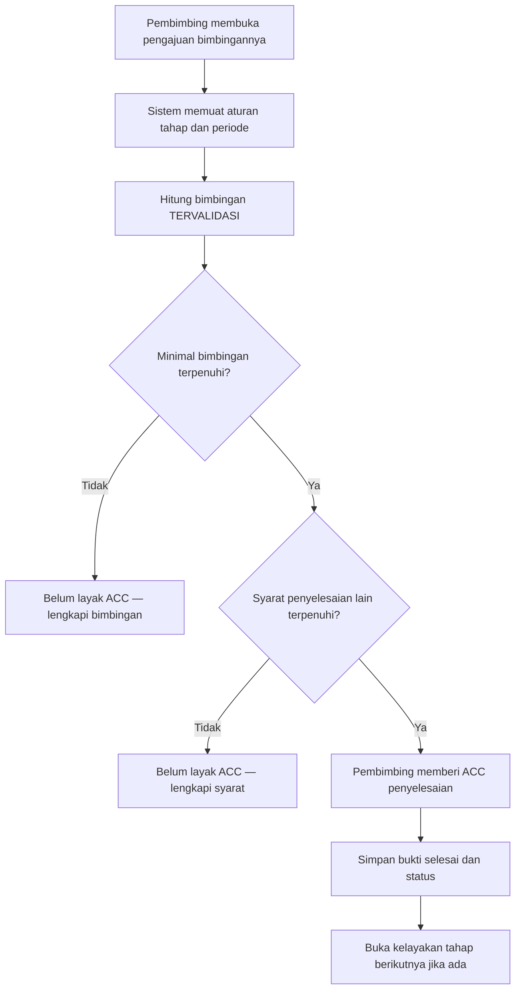

# Aturan Bisnis ACC Penyelesaian Tahap KP ISCP dan TA — SIPKITA

Dokumen ini mengatur **pemeriksaan syarat penyelesaian, ACC akhir Dosen Pembimbing, pencatatan kelulusan tahap, dan pembukaan kelayakan untuk mengajukan tahap berikutnya** pada SIPKITA. Tahap akademik selalu mengikuti urutan **KP → ISCP → TA**, tetapi setiap tahap mempunyai `Pengajuan` dan persyaratannya sendiri.

**Status pengembangan:** spesifikasi bisnis untuk implementasi lanjutan. Semester ISCP sekarang diprioritaskan pada akun/data diri, pengajuan, review, ACC **pengajuan**, serta penugasan dosen; modul bimbingan dan ACC **penyelesaian** dikerjakan penuh setelah modul utama siap atau jika progres memungkinkan.

**Rujukan:** `AGENTS.md`, `docs/business-rules/index.md`, `docs/business-rules/bimbingan.md`, `docs/business-rules/pengajuan.md`, `docs/academic-lifecycle.md`, `docs/roles-permissions.md`, dan `server/prisma/schema.prisma` **aktual**.

> **Batas penting:** ACC **penyelesaian tahap** diberikan oleh **Dosen Pembimbing aktif**, berbeda dari ACC **pengajuan** oleh Kaprodi. Setelah ACC penyelesaian KP/ISCP, sistem otomatis **membuka kelayakan** tahap selanjutnya, tetapi **tidak otomatis membuat `Pengajuan` baru**. Mahasiswa masih harus mengajukan ISCP/TA melalui alur pengajuan yang berlaku.

## 1. Aturan inti yang harus dijaga

| ID | Aturan bisnis | Kondisi |
| --- | --- | --- |
| **BR-SEL-01** | ACC penyelesaian adalah keputusan **lulus/selesai satu tahap akademik**, bukan keputusan penerimaan proposal/pengajuan. | Disepakati |
| **BR-SEL-02** | Hanya **Dosen Pembimbing aktif** pada pengajuan terkait yang dapat melakukan ACC penyelesaian. | Disepakati |
| **BR-SEL-03** | Hanya kegiatan `Bimbingan` yang **TERVALIDASI** dihitung; satu kegiatan dihitung **sekali**, meski mempunyai banyak riwayat revisi/lampiran. | Disepakati |
| **BR-SEL-04** | Minimal bimbingan ditentukan **per tahap dan periode** melalui `AturanPenyelesaianTahap.minimal_bimbingan`, bukan angka `10` tetap. | Disepakati |
| **BR-SEL-05** | Mencapai minimal bimbingan **belum berarti lulus otomatis**. Pembimbing memeriksa persyaratan lain dan memberi keputusan ACC secara eksplisit. | Disepakati |
| **BR-SEL-06** | Jika ACC diberikan, sistem menyimpan `PenyelesaianTahap` dan menandai pengerjaan tahap selesai sesuai status yang disahkan. | Disepakati |
| **BR-SEL-07** | Setelah KP selesai, mahasiswa layak **mengajukan ISCP**; setelah ISCP selesai, layak **mengajukan TA**. Kelayakan bukan pembuatan/ACC pengajuan otomatis. | Disepakati |
| **BR-SEL-08** | **Kaprodi memantau** transisi KP→ISCP/ISCP→TA; tidak ada ACC transisi manual tambahan oleh Kaprodi atau Admin Prodi. | Disepakati |
| **BR-SEL-09** | `PenyelesaianTahap` hanya boleh ada **satu record per `Pengajuan`**. Dua klik atau request bersamaan tidak boleh meluluskan dua kali. | Didukung constraint |
| **BR-SEL-10** | Pada permohonan perpanjangan semester berikutnya, pengajuan baru memiliki **hitungan bimbingan baru dari nol**, sedangkan sejarah bimbingan pengajuan lama tetap tersimpan. | Disepakati dalam pembahasan bimbingan |
| **BR-SEL-11** | Sertifikat, laporan akhir, atau dokumen kelulusan tambahan dapat menjadi syarat bila ditetapkan akademik. **Skema rujukan belum menyediakan model unggah/verifikasi syarat penyelesaian terstruktur.** | Kebutuhan ada; desain bukti **TERBUKA** |

**Jangan menambah tabel atau enum secara otomatis** hanya karena ada aturan bisnis yang belum terwakili di skema. Tandai celah, usulkan opsi perubahan secara terpisah, dan tunggu keputusan pengguna.

## 2. Empat keputusan yang berbeda

| Keputusan | Waktu dalam lifecycle | Pemberi keputusan | Penyimpanan utama | Dampak |
| --- | --- | --- | --- | --- |
| **Review proposal** | Sebelum ACC pengajuan, jika jalur mewajibkan review. | Dosen Reviewer yang ditugaskan. | `ReviewProposal`, `RiwayatReview` | Menyatakan penilaian proposal, **bukan** izin mulai tahap atau kelulusan. |
| **ACC pengajuan** | Sesudah syarat masuk dan review wajib terpenuhi. | **Kaprodi**. | `Pengajuan`, `RiwayatStatusPengajuan` | Pengajuan tahap diterima; mahasiswa dapat melaksanakan tahap sesuai ketentuan. |
| **Validasi bimbingan** | Selama pelaksanaan KP/ISCP/TA. | **Dosen Pembimbing aktif**. | `Bimbingan`, `RiwayatBimbingan` | Satu kegiatan menjadi sah dan dapat dihitung, **bukan** kelulusan tahap. |
| **ACC penyelesaian tahap** | Setelah pelaksanaan dan semua syarat kelulusan terpenuhi. | **Dosen Pembimbing aktif**. | `PenyelesaianTahap`, kondisi/riwayat `Pengajuan` | Tahap selesai; kelayakan tahap berikutnya terbuka jika ada. |

Empat tindakan di atas tidak boleh memakai satu keputusan/status global yang menimbulkan efek sama. Misalnya `ReviewProposal.hasil_review='LAYAK'` tidak boleh membuat `PenyelesaianTahap`.

## 3. Siapa melakukan apa?

| Aktor | Aksi dalam penyelesaian tahap | Batas izin |
| --- | --- | --- |
| **Mahasiswa** | Melihat jumlah bimbingan sah, kekurangan syarat, keputusan penyelesaian, dan kelayakan tahap berikutnya. | Tidak membuat ACC atas namanya sendiri. |
| **Dosen Pembimbing** | Memeriksa pengajuan yang dibimbing, bimbingan tervalidasi, syarat akademik lain, lalu memberi ACC penyelesaian. | Wajib punya role Pembimbing dan **penugasan `PEMBIMBING` aktif** pada pengajuan itu. |
| **Kaprodi** | Memantau status dan transisi; dapat menetapkan pergantian dosen melalui proses penugasan yang sah. | **Tidak** memberi ACC transisi manual KP→ISCP/ISCP→TA. |
| **Admin Prodi** | Mendukung administrasi sesuai kewenangan yang disepakati. | **Tidak** memberi ACC penyelesaian atau transisi akademik. |
| **Reviewer** | Tidak memiliki tindakan penyelesaian hanya karena ia pernah mereview proposal. | Tidak bisa memberi ACC penyelesaian tanpa menjadi Pembimbing aktif. |
| **Admin Sistem** | Mengelola konfigurasi master/aturan penyelesaian sesuai mandat. | Tidak boleh mengesahkan tahap akademik hanya karena memiliki hak admin sistem. |

Satu akun dosen dapat mempunyai beberapa role. **Role saja tidak cukup**: dosen yang valid untuk pengajuan A belum tentu berwenang memberi ACC pada pengajuan B.

## 4. Pemetaan tabel yang sudah ada

| Model | Fungsi | Field/constraint penting |
| --- | --- | --- |
| `Pengajuan` | Menentukan mahasiswa, tahap, periode, status penerimaan dan pengerjaan. | `id`, `mahasiswa_id`, `tahap_akademik_id`, `periode_akademik_id`, `status_pengajuan`, `status_pengerjaan`, `pengajuan_prasyarat_id`, `pengajuan_sebelumnya_id` |
| `TahapAkademik` | Mengidentifikasi urutan KP/ISCP/TA. | `id`, `kode_tahap`, `urutan`, `is_aktif` |
| `PeriodeAkademik` | Menentukan periode tempat pengajuan berada. | `id`, `tahun_ajaran`, `semester`, `status_periode` |
| `PenugasanDosen` | Membuktikan dosen yang memberi ACC adalah pembimbing pengajuan saat itu. | `pengajuan_id`, `dosen_id`, `jenis_penugasan`, `status_penugasan` |
| `Dosen` + `UserRole` | Menghubungkan pengguna login, profil dosen, dan role Pembimbing. | `Dosen.user_id`, `UserRole.user_id`, `Role.kode_peran` |
| `Bimbingan` | Sumber hitungan **kegiatan tervalidasi** untuk satu pengajuan. | `id`, `pengajuan_id`, `status_bimbingan` |
| `RiwayatBimbingan` | Audit pengiriman, revisi, dan keputusan dosen; **bukan** unit hitungan minimal. | `bimbingan_id`, `versi_pengiriman`, `status_sesudah`, `created_at` |
| `AturanPenyelesaianTahap` | Master minimal bimbingan dan deskripsi syarat penyelesaian untuk kombinasi tahap/periode. | `id`, `tahap_akademik_id`, `periode_akademik_id`, `minimal_bimbingan`, `keterangan_syarat_lain`, `is_aktif`, `ditetapkan_oleh_user_id` |
| `PenyelesaianTahap` | Bukti keputusan **ACC selesai** untuk satu pengajuan beserta snapshot hitungan saat ACC. | `pengajuan_id @unique`, `aturan_penyelesaian_tahap_id`, `jumlah_bimbingan_saat_acc`, `minimal_bimbingan_saat_acc`, `catatan_penyelesaian`, `disetujui_oleh_user_id`, `disetujui_at` |
| `RiwayatStatusPengajuan` | Jejak perubahan status pengerjaan/pengajuan sesuai state machine resmi. | `pengajuan_id`, `jenis_status`, `status_sebelum`, `status_sesudah`, `diubah_oleh_user_id` |

**Constraint penting:** `PenyelesaianTahap.pengajuan_id` bersifat **unik**. Artinya ada maksimal satu bukti ACC penyelesaian per pengajuan. **Tidak** berarti mahasiswa hanya boleh menyelesaikan satu tahap selama kuliah; KP, ISCP, dan TA memakai pengajuan yang berbeda.

## 5. Alur pemeriksaan dan keputusan ACC



**Catatan:** cabang `J` **tidak berlaku untuk membuat tahap keempat** setelah TA. Untuk KP/ISCP, kelayakan berikutnya dibaca sistem saat mahasiswa ingin mengajukan tahap selanjutnya; **tidak** membuat `Pengajuan` baru dalam transaksi ACC penyelesaian.

### Langkah terperinci berdasarkan aliran data

| Langkah | Pembacaan (SELECT) | Penulisan (INSERT/UPDATE) | Business logic |
| --- | --- | --- | --- |
| 1. Buka menu penyelesaian | `User`, `UserRole`, `Dosen`, `PenugasanDosen`, `Pengajuan` | Tidak ada | Role Pembimbing + penugasan aktif + status pelaksanaan yang sah. |
| 2. Muat aturan | `AturanPenyelesaianTahap` untuk tahap/periode `Pengajuan` | Tidak ada | Aturan aktif harus ada; jangan fallback ke angka contoh jika konfigurasi hilang. |
| 3. Hitung bimbingan sah | `Bimbingan` terikat **pengajuan yang sama** dengan status TERVALIDASI | Tidak ada | Hitung satu kali per `Bimbingan.id`; jangan hitung revisi/riwayat/lampiran. |
| 4. Periksa syarat lain | Konfigurasi syarat penyelesaian dan bukti yang **memang didukung** sistem | Tidak ada | Jika bukti wajib belum mempunyai mekanisme verifikasi, jangan klaim telah lulus otomatis. |
| 5. Periksa keputusan terdahulu | `PenyelesaianTahap` pada `pengajuan_id` yang sama | Tidak ada | Cegah ACC ganda/idempotensi. |
| 6. Dosen memutuskan ACC | Semua data di atas, termasuk penugasan aktif terkini | `PenyelesaianTahap`; `Pengajuan.status_pengerjaan` jika status resmi diputuskan; `RiwayatStatusPengajuan` | Simpan **atomik** identitas pemberi ACC, aturan, snapshot hitungan, catatan dan waktu. |
| 7. Sistem memperbarui kelayakan | Pengajuan selesai dan urutan tahap | **Tidak otomatis INSERT `Pengajuan` berikutnya** | Tampilkan akses/form pengajuan berikutnya jika tahap KP atau ISCP dan syarat terkait terpenuhi. |

Saat layanan lain membutuhkan status selesai, gunakan sumber data yang konsisten: bukti `PenyelesaianTahap` serta status pengerjaan sesuai state machine yang disepakati. **Jangan hanya membaca nilai `Pengajuan.status_pengajuan` sebagai kelulusan**, karena field tersebut juga dipakai untuk keputusan penerimaan pengajuan.

## 6. Penghitungan bimbingan tervalidasi

### Aturan hitung

1. Tentukan **`pengajuan_id`** yang sedang diperiksa, bukan sekadar `mahasiswa_id`.
2. Ambil `AturanPenyelesaianTahap` yang sesuai **`tahap_akademik_id` + `periode_akademik_id`** dan aktif.
3. Hitung **baris `Bimbingan` yang kondisi terkininya TERVALIDASI** pada `pengajuan_id` tersebut.
4. **Jangan** menghitung `RiwayatBimbingan`: tiga putaran revisi dalam satu bimbingan bukan tiga pertemuan.
5. Bandingkan jumlah sah dengan `minimal_bimbingan`. Lulus pemeriksaan jumlah bila **jumlah sah ≥ minimal**, bukan harus tepat sama.
6. Lanjutkan memeriksa syarat lain dan meminta keputusan eksplisit dosen; jangan otomatis ACC ketika ambang tercapai.

### Contoh hitungan (angka ilustrasi)

| Kondisi kegiatan pada `Pengajuan.id=101` (KP) | Jumlah record `Bimbingan` | Dihitung sebagai sah |
| --- | ---: | ---: |
| Tervalidasi | 10 | **10** |
| Perlu Perbaikan | 1 | 0 |
| Ditolak | 1 | 0 |
| Revisi tambahan pada kegiatan yang sama | 4 baris histori | **0 tambahan** |
| **Jumlah bimbingan sah** | **12 kegiatan** | **10** |

Jika konfigurasi KP periode tersebut `minimal_bimbingan=10`, maka **syarat jumlah terpenuhi**. Namun keputusan ACC tetap menunggu pembimbing memastikan syarat lainnya sudah sah.

Jumlah minimum berbeda antarperiode atau tahap bila konfigurasi akademik berubah; **jangan menimpa snapshot** pada penyelesaian yang sudah disetujui di periode lalu ketika aturan saat ini diperbarui.

## 7. Persyaratan lain selain bimbingan — batas dukungan database

User menginginkan kemungkinan syarat kelulusan **lebih dari jumlah bimbingan**, contohnya sertifikat, laporan akhir, atau dokumen akademik lain. Kebutuhan ini masuk akal sebagai **aturan proses penyelesaian**, tetapi jangan disamakan dengan persyaratan **masuk/pengajuan**.

### Yang sudah tersedia

- `AturanPenyelesaianTahap` menampung `minimal_bimbingan` per **tahap dan periode**.
- `AturanPenyelesaianTahap.keterangan_syarat_lain` dapat **mendeskripsikan** persyaratan tambahan sebagai teks.
- `PenyelesaianTahap` menampung siapa memberi ACC, aturan yang berlaku, hitungan bimbingan saat ACC, dan catatan keputusan.

### Yang belum didukung secara terstruktur pada skema rujukan

- Daftar **jenis syarat penyelesaian** yang bisa diaktifkan/nonaktifkan per tahap/periode seperti daftar syarat dokumen pengajuan.
- Record unggah **dokumen penyelesaian** yang mengikat sertifikat/laporan akhir ke pengajuan dan syarat spesifik.
- Status pemeriksaan masing-masing dokumen penyelesaian, versi revisi, identitas verifikator, dan jejak catatan per syarat.

`PersyaratanPengajuan` dan `DokumenPengajuan` sudah disiapkan untuk **persyaratan pengajuan**, bukan otomatis mencakup **persyaratan kelulusan tahap**. Jangan memakai keduanya secara diam-diam untuk proses penyelesaian dengan makna yang berbeda.

**Jika fitur dokumen penyelesaian disetujui untuk dibangun:** lakukan kajian skema melalui `prisma-schema-change`, misalnya mempertimbangkan entitas semacam `PersyaratanPenyelesaianTahap` dan `DokumenPenyelesaianTahap` (ini **nama kandidat, belum ada di skema**). Tentukan dahulu aktor pengunggah/verifikator, kewajiban, versi, status, serta dampaknya pada ACC; **jangan melakukan migrasi tanpa permintaan eksplisit**.

**Sampai mekanisme bukti disepakati dan tersedia, sistem tidak boleh mengklaim dokumen tambahan sudah tervalidasi hanya karena kolom deskripsi berisi teks.**

## 8. Contoh isi tabel saat mahasiswa KP selesai

Seluruh ID, tanggal, status, dan angka di bawah adalah **ilustrasi untuk memahami relasi**, bukan data sungguhan atau kode status final.

### A. Data sebelum ACC

| Tabel | Contoh data | Artinya |
| --- | --- | --- |
| `Mahasiswa` | `id=42`, `nim='5220XXXX'` | Pemilik pengajuan. |
| `Pengajuan` | `id=101`, `mahasiswa_id=42`, `tahap_akademik_id=1` (KP), `periode_akademik_id=7` | Pengajuan KP yang telah disetujui dan sedang dilaksanakan. |
| `PenugasanDosen` | `id=71`, `pengajuan_id=101`, `dosen_id=4`, `jenis_penugasan='PEMBIMBING'`, `status_penugasan='AKTIF'` | Pembimbing aktif KP. |
| `Dosen` | `id=4`, `user_id=9` | Akun user pemberi ACC adalah `User.id=9`. |
| `AturanPenyelesaianTahap` | `id=11`, `tahap_akademik_id=1`, `periode_akademik_id=7`, `minimal_bimbingan=10`, `is_aktif=true` | Aturan KP periode 7. |
| `Bimbingan` | 10 kegiatan TERVALIDASI, 1 PERLU PERBAIKAN, 1 DITOLAK pada `pengajuan_id=101` | Jumlah sah **10**, bukan 12. |

### B. Data ketika dospem memberi ACC

| Tabel | Nilai contoh | Keterangan |
| --- | --- | --- |
| `PenyelesaianTahap` | `id=501`, `pengajuan_id=101`, `aturan_penyelesaian_tahap_id=11` | Bukti penyelesaian KP. |
| `PenyelesaianTahap` | `jumlah_bimbingan_saat_acc=10`, `minimal_bimbingan_saat_acc=10` | Snapshot hitungan dan ambang saat ACC. |
| `PenyelesaianTahap` | `disetujui_oleh_user_id=9`, `disetujui_at='2026-10-31T08:00:00+07:00'` | Identitas dan waktu pemberi ACC. |
| `Pengajuan` | `id=101`, `status_pengerjaan` menjadi kondisi **selesai** sesuai kode final | Status operasional diselaraskan dengan bukti ACC. |
| `RiwayatStatusPengajuan` | Catatan perubahan status pengerjaan oleh `User.id=9` | Riwayat perubahan yang dapat diaudit. |

Jangan menganggap label **selesai** pada tabel contoh sudah pasti bernilai string `SELESAI` di kode. Tentukan nilai resmi terlebih dahulu. Catatan tambahan dapat disimpan pada `PenyelesaianTahap.catatan_penyelesaian`.

### C. Mahasiswa kemudian mengajukan ISCP

| `Pengajuan.id` | Mahasiswa | Tahap | Periode | `pengajuan_prasyarat_id` | Makna |
| --- | --- | --- | --- | --- | --- |
| **101** | 42 | KP | 7 | `null` | KP telah selesai (`PenyelesaianTahap` 501). |
| **205** | 42 | ISCP | 8 | **101** | Pengajuan **baru** yang dibuat mahasiswa setelah layak mengajukan ISCP. |

Keberadaan `PenyelesaianTahap` pada KP **tidak** otomatis membuat record **205**. Mahasiswa harus memilih `LANJUT` atau `BARU`, memenuhi dokumen ISCP periode baru, lalu menjalani proses pemeriksaan/ACC **pengajuan** sebagaimana `docs/business-rules/pengajuan.md`.

## 9. Efek ACC untuk setiap tahap

| Tahap diselesaikan | Setelah ACC Dosen Pembimbing | Aksi selanjutnya |
| --- | --- | --- |
| **KP** | KP ditandai selesai; mahasiswa **layak mengajukan ISCP** jika prasyarat lain sesuai. | Mahasiswa membuat `Pengajuan` ISCP baru; `pengajuan_prasyarat_id` menunjuk KP selesai. |
| **ISCP** | ISCP ditandai selesai; mahasiswa **layak mengajukan TA** jika prasyarat lain sesuai. | Mahasiswa membuat `Pengajuan` TA baru; `pengajuan_prasyarat_id` menunjuk ISCP selesai. |
| **TA** | TA ditandai selesai; riwayat akademik SIPKITA untuk tahap TA tersimpan. | Tidak ada tahap keempat atau pengajuan berikutnya yang ditetapkan oleh SIPKITA. |

**Kaprodi tidak menekan tombol ACC transisi kedua**. Penetapan reviewer/pembimbing dan ACC **pengajuan** tahap yang baru tetap mengikuti alur pengajuan biasa; hal itu berbeda dari keputusan kelulusan tahap sebelumnya.

## 10. Jika mahasiswa belum selesai pada semester berjalan

- Belum memenuhi syarat atau belum mendapat ACC dospem berarti mahasiswa **belum menyelesaikan tahap**, sehingga **tidak otomatis dapat lanjut** ke ISCP/TA.
- Bila mengajukan lagi semester berikutnya, gunakan jalur perpanjangan, buat **record `Pengajuan` baru**, dan hubungkan riwayat tahap yang sama memakai `pengajuan_sebelumnya_id`.
- **Perpanjangan bukan tambahan waktu 1–2 minggu pada semester yang sama.** Keputusan akhir perpanjangan berada pada **Kaprodi**, bukan Admin Prodi.
- Pada perpanjangan, hitungan bimbingan periode baru **dimulai dari nol**. Bimbingan, hasil review, dan keputusan semester sebelumnya **tetap tersimpan** sebagai histori, bukan dihitung ulang diam-diam untuk memenuhi syarat baru.
- Jika mahasiswa **tidak lulus/harus mengulang tahap**, gunakan jalur **perpanjangan** pada semester berikutnya. Tidak ada proses pengajuan ulang terpisah.

## 11. Otorisasi, transaksi, dan integritas data

### Sebelum ACC penyelesaian

1. Validasi user terautentikasi dan role Pembimbing.
2. Pastikan `Dosen.user_id` mengarah ke user tersebut serta `PenugasanDosen` berjenis `PEMBIMBING`, berstatus `AKTIF`, dan menunjuk **`pengajuan_id` yang sama**.
3. Validasi pengajuan memang sudah diterima untuk pelaksanaan, belum selesai, dan tahap/periode sesuai.
4. Ambil `AturanPenyelesaianTahap` aktif yang tepat; jangan menggunakan aturan tahap lain atau periode baru untuk pengajuan lama.
5. Hitung bimbingan tervalidasi **pada pengajuan itu saja** dan verifikasi seluruh syarat lain yang diwajibkan.
6. Pastikan belum ada `PenyelesaianTahap` pada pengajuan yang sama.

### Saat menyimpan ACC

Operasi yang harus konsisten sebagai **satu transaksi bisnis**:

```text
Periksa ulang pengajuan + pembimbing aktif + aturan periode/tahap
Periksa ulang jumlah bimbingan sah dan syarat lain yang benar-benar dapat diverifikasi
Pastikan belum ada PenyelesaianTahap untuk pengajuan ini
INSERT PenyelesaianTahap (aturan, jumlah saat ACC, minimum saat ACC,
                         disetujui_oleh_user_id, disetujui_at, catatan)
UPDATE Pengajuan.status_pengerjaan sesuai kode status selesai yang resmi
INSERT RiwayatStatusPengajuan untuk mencatat perubahan terkait
COMMIT sebagai satu kesatuan; jika gagal, perubahan tidak boleh parsial
```

Pseudocode ini **bukan endpoint atau migrasi**. Implementasi perlu memastikan dua request ACC bersamaan tidak menghasilkan keputusan ganda atau status yang tidak sinkron; manfaatkan constraint unik `PenyelesaianTahap.pengajuan_id` serta perlindungan transaksi/idempotensi yang sesuai konfigurasi Prisma dan PostgreSQL aktual.

### Sesudah ACC

- Mahasiswa dapat membaca bukti selesai dan status kelayakan pengajuan tahap berikutnya.
- Kaprodi dapat memantau transisi tanpa memutuskan ulang.
- Sistem tidak menyalin bimbingan/aturan KP ke ISCP atau ISCP ke TA; tahap berikutnya memakai pengajuan serta konfigurasi periode/tahapnya sendiri.
- Histori `PenyelesaianTahap` dan snapshot jumlah bimbingan tidak boleh dihapus atau ditimpa jika aturan minimum suatu saat berubah.
- Akses daftar/detail keputusan dan data mahasiswa tetap dibatasi oleh role, ownership, dan penugasan aktif.

## 12. Skenario pengujian minimum

| ID | Skenario | Ekspektasi |
| --- | --- | --- |
| SEL-01 | Pembimbing aktif ACC KP dengan bimbingan sah **di bawah minimal** | Ditolak; belum ada `PenyelesaianTahap`. |
| SEL-02 | Minimal 10; ada 10 TERVALIDASI dan 3 riwayat revisi tambahan | Jumlah sah **10**, bukan 13. |
| SEL-03 | Jumlah sah sama dengan minimal dan seluruh syarat lain lengkap | ACC dapat diberikan oleh pembimbing aktif. |
| SEL-04 | Jumlah sah melebihi minimal | Tidak ditolak hanya karena jumlahnya lebih besar. |
| SEL-05 | Reviewer atau Admin Prodi mencoba memberi ACC penyelesaian | Ditolak; bukan kewenangannya. |
| SEL-06 | Dosen Pembimbing pengajuan lain mencoba ACC | Ditolak meskipun punya role Pembimbing. |
| SEL-07 | Dosen tidak lagi menjadi pembimbing aktif mencoba ACC | Ditolak sesuai penugasan yang berlaku. |
| SEL-08 | Aturan minimum tahap/periode tidak tersedia | ACC diblokir dan dilaporkan sebagai konfigurasi belum lengkap; **jangan default ke 10**. |
| SEL-09 | Syarat tambahan wajib (misal sertifikat) belum punya bukti/verifikasi sah | Tidak boleh dianggap terpenuhi hanya karena deskripsi teks terisi. |
| SEL-10 | ACC dikirim dua kali atau dua request bersamaan | Maksimal satu `PenyelesaianTahap`, status dan riwayat konsisten. |
| SEL-11 | KP selesai dan mahasiswa membuka pengajuan ISCP | Kelayakan terbuka; **belum** ada `Pengajuan` ISCP sampai mahasiswa mengirimnya. |
| SEL-12 | Mahasiswa mencoba TA tanpa ACC penyelesaian ISCP | Ditolak; syarat tahap sebelumnya belum terpenuhi. |
| SEL-13 | ISCP selesai lalu mahasiswa mengajukan TA | Pengajuan TA baru mengacu pada ISCP selesai, tanpa menimpa record lama. |
| SEL-14 | TA selesai | Tercatat selesai tanpa membuat tahap akademik baru. |
| SEL-15 | Perpanjangan semester baru dengan histori 10 bimbingan valid semester lama | Hitungan pengajuan baru mulai **nol**, histori lama tetap utuh. |
| SEL-16 | Dua mahasiswa berbeda mengerjakan KP dan TA pada periode sama | Tahap masing-masing diproses sesuai `Pengajuan` dan aturan berbeda. |

## 13. Keputusan yang perlu dikunci sebelum implementasi penuh

1. **Mekanisme bukti syarat penyelesaian tambahan:** jenis dokumen, kewajiban, pengunggah, pemeriksa, status validasi, dan versi. Skema sekarang baru mendukung deskripsi `keterangan_syarat_lain`; perubahan struktur memerlukan tugas skema terpisah.
2. **Kode status pengerjaan dan jejak status:** ejaan nilai selesai, status sebelumnya, dan `RiwayatStatusPengajuan.jenis_status` harus konsisten dengan konstanta aplikasi. Field saat ini bertipe `String`.
3. **Kebijakan ACC saat kalender periode berakhir:** jika penyelesaian terlambat, apakah ACC pada pengajuan periode lama masih diperbolehkan atau wajib melalui perpanjangan? Jangan mengarang batas otomatis.
4. **Penggantian pembimbing di tengah pelaksanaan:** bagaimana bimbingan tervalidasi oleh pembimbing lama diakui setelah Kaprodi mengganti dosen? Riwayat tetap tersimpan; aturan kelayakannya perlu ditegaskan jika kasus itu muncul.
5. **Kelayakan lintas tahap dalam satu semester:** kebijakan mahasiswa mengambil KP dan ISCP bersamaan belum diputuskan; jangan memakai ACC sebagai izin otomatis untuk melewati aturan kurikulum yang belum jelas.

Jika keputusan terbuka memengaruhi tugas, Codex harus menjelaskan masalah dan meminta keputusan pengguna **sebelum** menetapkan aturan service, skema, atau status baru.

## 14. Panduan penerapan untuk Codex

Ketika pengguna meminta implementasi ACC penyelesaian atau kelayakan tahap:

1. Baca `docs/business-rules/bimbingan.md`, `docs/academic-lifecycle.md`, `docs/roles-permissions.md`, dan **schema/kode aktual** selain dokumen ini.
2. Tentukan apakah cakupan tugas adalah **hitung bimbingan sah**, **validasi prasyarat**, **ACC penyelesaian**, **buka kelayakan**, atau **pengajuan tahap berikutnya**. Jangan menggabungkan semua fitur tanpa diminta.
3. Tulis kontrak aliran data: **dospem aktif → Pengajuan → AturanPenyelesaianTahap → bimbingan tervalidasi → syarat lain → PenyelesaianTahap → status/riwayat → kelayakan**.
4. Letakkan seluruh aturan akses, hitungan, dan transaksi pada service/backend; jangan menaruh keputusan kelulusan pada komponen React.
5. Jaga satu bukti ACC per pengajuan, audit identitas pemutus, dan integritas bila dua permintaan berlangsung bersamaan.
6. Uji kasus berhasil/gagal, termasuk periode berbeda, syarat tambahan, multi-role, ACC ganda, dan larangan membuat pengajuan berikutnya otomatis.
7. Laporkan keterbatasan fitur bukti syarat penyelesaian. **Jangan mengubah skema, membuat migrasi, atau menetapkan kebijakan baru** tanpa instruksi eksplisit.

**Batas dokumen:** file ini merupakan panduan domain untuk Codex, bukan bukti bahwa fitur ACC penyelesaian dan seluruh dokumen pendukung sudah diimplementasikan.
