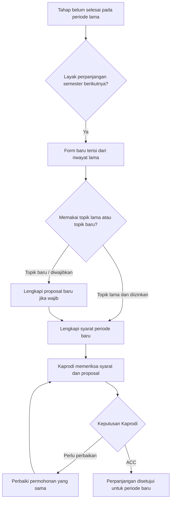

# Aturan Bisnis Perpanjangan KP ISCP TA — SIPKITA

Dokumen ini mengatur **perpanjangan** Kerja Praktik (KP), Information Systems Capstone Project (ISCP), serta Tugas Akhir (TA) ketika mahasiswa melanjutkan atau harus mengulang tahap pada semester berikutnya. **Tidak ada proses pengajuan ulang terpisah**; seluruh kondisi tersebut memakai alur perpanjangan yang sama dan tetap mempertahankan riwayat pengajuan serta pekerjaan semester lama.

> **Catatan path:** nama file `perpanjangan-pengajuan-ulang.md` dipertahankan sementara sebagai path historis dokumentasi. Istilah pengajuan ulang tidak digunakan sebagai konsep, menu, jenis proses, atau kewenangan terpisah.

**Status pengembangan:** acuan domain untuk semester pengembangan berikutnya. Fokus implementasi semester ISCP sekarang tetap akun/data diri, pengajuan awal dan jalur `BARU`/`LANJUT`, pemeriksaan, penugasan reviewer, review proposal, serta ACC akhir pengajuan.

**Rujukan:** `AGENTS.md`, `docs/business-rules/index.md`, `docs/business-rules/pengajuan.md`, `docs/business-rules/review-proposal.md`, `docs/business-rules/bimbingan.md`, `docs/business-rules/penyelesaian-tahap.md`, `docs/academic-lifecycle.md`, `docs/roles-permissions.md`, dan `server/prisma/schema.prisma` aktual.

> **Ketentuan inti:** perpanjangan **bukan tambahan waktu satu-dua minggu pada semester yang sama**. Mahasiswa mengajukan permohonan pada **periode akademik berikutnya**, sistem membuat `Pengajuan` **baru**, dan pengajuan lama tetap tersimpan. Untuk perpanjangan, pemeriksaan serta ACC akhir merupakan **kewenangan Kaprodi**; **Admin Prodi dan Reviewer tidak terlibat**.

## 1. Makna tunggal perpanjangan

| Aspek | Aturan perpanjangan |
| --- | --- |
| **Pemicu akademik** | Mahasiswa belum menyelesaikan atau harus mengulang tahap pada periode berikutnya dan masih memenuhi ketentuan perpanjangan. |
| **Waktu** | **Semester berikutnya**, bukan penambahan hari/minggu semester lama. |
| **Jalur antarmuka** | Satu menu/alur **Perpanjangan**. |
| **Record database** | Buat satu `Pengajuan` baru yang menunjuk histori pengajuan tahap sama. |
| **Pilihan topik** | Berdasarkan urutan perpanjangan sebagaimana bagian 3. |
| **Persyaratan dokumen** | Diperiksa menurut konfigurasi tahap/periode/jalur perpanjangan yang baru. |
| **Pemeriksa/ACC** | **Kaprodi** memeriksa dan memutuskan; **Admin Prodi dan Reviewer tidak terlibat**. |
| **Proposal** | Kaprodi memeriksa proposal ketika proposal baru diwajibkan; tidak ada proses Reviewer. |
| **Bimbingan semester lama** | Tetap sebagai histori; hitungan pada pengajuan baru mulai dari **nol**. |

**Penting:** kata **`BARU`** dapat muncul sebagai konsep **status/jenis pengajuan pertama** maupun sebagai pilihan **topik baru**. Keduanya berbeda. Jangan menafsirkan `Pengajuan.jenis_pengajuan` sama dengan `Pengajuan.pilihan_topik` hanya karena label antarmukanya mirip.

## 2. Ketentuan dasar perpanjangan

| ID | Aturan | Catatan |
| --- | --- | --- |
| **BR-PER-01** | Perpanjangan hanya diajukan **pada periode akademik berikutnya** setelah tahap belum selesai. | Tidak ada perpanjangan minggu pada semester sama. |
| **BR-PER-02** | Mahasiswa harus memiliki pengajuan tahap sama yang memenuhi **kondisi kelayakan perpanjangan**; bukan mahasiswa yang sudah menyelesaikan tahap tersebut. | Status dan riwayat perlu diverifikasi pada service. |
| **BR-PER-03** | Pengajuan perpanjangan menyimpan record `Pengajuan` **baru**, dengan `pengajuan_sebelumnya_id` menunjuk pengajuan terdahulu pada tahap sama. | Jangan UPDATE record semester lalu menjadi semester baru. |
| **BR-PER-04** | Form perpanjangan menggunakan **data pengajuan sebelumnya sebagai isian awal** (identitas, tema/topik, judul, objek, informasi pembimbing jika ada). | Prefill bukan izin mengubah record historis. |
| **BR-PER-05** | Syarat dokumen mengikuti **periode baru**; penggunaan ulang berkas lama hanya jika konfigurasi mengizinkan dan diperiksa Kaprodi. | `PersyaratanPengajuan`, `DokumenPengajuan`. |
| **BR-PER-06** | **Mahasiswa** mengajukan/merevisi; **Kaprodi** memeriksa persyaratan, memberi catatan, dan memutuskan ACC/tolak perpanjangan. | Admin Prodi **tidak** memverifikasi perpanjangan. |
| **BR-PER-07** | Perpanjangan **tidak melibatkan Dosen Reviewer**, baik memakai topik lama maupun baru. Jika proposal baru diwajibkan, Kaprodi memeriksa proposal sekaligus persyaratan perpanjangan. | Berbeda dari pengajuan reguler yang wajib review. |
| **BR-PER-08** | Riwayat bimbingan, review proposal, keputusan, dan dokumen semester lama tetap utuh. | Riwayat tidak boleh dihapus atau dipindahkan dari pengajuan lama. |
| **BR-PER-09** | Bimbingan yang dihitung untuk pemenuhan minimal tahap **dimulai dari nol** pada pengajuan perpanjangan baru. | Satu `Pengajuan.id` = konteks hitungan tahap/periode itu. |
| **BR-PER-10** | Jumlah kesempatan perpanjangan mengikuti aturan tahap dan ketentuan akademik. | `TahapAkademik.maks_perpanjangan` tersedia tetapi nullable; jangan menebak jumlah maksimal. |

### Kelayakan mengakses menu perpanjangan

Sebelum menunjukkan tombol/menerima pengajuan perpanjangan, service perlu memeriksa:

1. Mahasiswa login dan pengajuan terdahulu **milik mahasiswa yang sama**.
2. Tahap terdahulu masih **belum selesai**; tidak ada `PenyelesaianTahap` yang menyatakan tahap itu telah selesai.
3. Mahasiswa memenuhi kategori status akademik yang diperbolehkan perpanjangan. Status **tidak lulus/harus mengulang tahap** tetap diproses melalui perpanjangan, bukan jalur lain.
4. Periode baru yang dipilih memang **berikutnya** menurut kalender akademik dan jadwal `JadwalProses` membuka permohonan terkait.
5. Jumlah perpanjangan sebelumnya belum melewati batas dan pilihan topik sesuai ketentuan perpanjangan ke berapa.
6. Tidak ada pengajuan lain pada tahap/periode yang sama dalam kondisi yang dilarang untuk duplikasi. **Skema belum menjamin keunikan ini secara otomatis**, sehingga perlu aturan service yang disahkan.

**Bila syarat tidak terpenuhi:** jangan membuat record perpanjangan sekadar karena mahasiswa menekan tombol. Sistem harus menjelaskan alasan penolakan berdasarkan status, periode, dan batas kesempatan.

## 3. Aturan perpanjangan pertama dan berikutnya

| Kondisi | Pilihan topik/judul | Proposal/review | Keterangan |
| --- | --- | --- | --- |
| **Perpanjangan pertama, mempertahankan topik lama** | Boleh memakai topik/judul/objek sebelumnya sebagai isian awal. | Boleh memakai proposal lama jika aturan penggunaan ulang dokumen mengizinkan; **tanpa Reviewer**. | Kaprodi memeriksa syarat periode baru dan memutuskan. |
| **Perpanjangan pertama, memilih topik baru** | Buat topik/judul baru dengan sejarah pengajuan lama tetap terhubung. | **Proposal baru wajib, tanpa Reviewer**; Kaprodi memeriksa proposal dan persyaratan. | Opsi perpanjangan pertama. |
| **Perpanjangan kedua dan seterusnya** | **Topik dan judul baru diwajibkan**. | **Proposal baru wajib, tanpa Reviewer**; Kaprodi memeriksa dan memutuskan. | Jumlah kesempatan tetap dibatasi oleh aturan akademik/tahap. |

**Aturan final:** perpanjangan pertama boleh memakai topik lama atau baru; perpanjangan kedua dan seterusnya wajib memakai topik, judul, dan proposal baru. Seluruh perpanjangan tidak melibatkan Reviewer dan keputusan akhirnya berada pada Kaprodi.

Jika sistem memerlukan istilah `LANJUT`/`BARU` di `Pengajuan.pilihan_topik`, cocokkan kode dengan **konfigurasi pengajuan aktual**. Jangan memakai literal dari tabel contoh sebagai enum yang otomatis benar. Tidak ada kolom `perpanjangan_ke` khusus dalam model `Pengajuan` rujukan; urutan perpanjangan perlu ditelusuri dari **rantai `pengajuan_sebelumnya_id` dan jenis/status pengajuan historis**, atau diajukan perubahan skema jika memang diperlukan.

## 4. Aktor dan izin proses

| Aktivitas | Mahasiswa | Kaprodi | Reviewer | Admin Prodi |
| --- | :---: | :---: | :---: | :---: |
| Melihat riwayat pengajuan sendiri | ✓ | ✓ (pengawasan) | — | — |
| Mengisi/mengirim permohonan perpanjangan | ✓ | — | — | — |
| Memperbaiki berkas perpanjangan berdasarkan catatan | ✓ | — | — | — |
| Memeriksa syarat/proposal dan memberi catatan perpanjangan | — | ✓ | — | **Tidak** |
| Memutuskan ACC/tolak akhir perpanjangan | — | ✓ | — | **Tidak** |

Alur perpanjangan hanya melibatkan **Mahasiswa dan Kaprodi**. Ketiadaan Reviewer berlaku untuk topik lama maupun baru; Admin Prodi juga tidak mendapat menu pemeriksaan perpanjangan.

## 5. Aliran proses perpanjangan

**Alur lain:** permohonan dapat **ditolak** atau mahasiswa **tidak memenuhi syarat perpanjangan**. Diagram berfokus pada alur revisi/ACC. Kaprodi baru boleh ACC setelah seluruh syarat dan proposal yang diwajibkan selesai diperiksa.

### Langkah dan pemetaan data

| Langkah | SELECT/validasi | INSERT/UPDATE | Perhatian |
| --- | --- | --- | --- |
| 1. Tentukan kelayakan | `Mahasiswa`, `Pengajuan` lama, `PenyelesaianTahap`, `TahapAkademik`, `PeriodeAkademik`, `JadwalProses` | Belum menulis | Status belum selesai, periode berikutnya, urutan perpanjangan, batas kesempatan. |
| 2. Buka formulir | `Pengajuan`, `TopikPenelitian`, `VersiTopik`, pembimbing dan dokumen lama | Belum menulis | Prefill **tanpa mengubah** data semester lama. |
| 3. Simpan permohonan baru | Tahap dan periode, jenis pengajuan, topik pilihan, record terdahulu | **`Pengajuan` baru** dengan `pengajuan_sebelumnya_id`; topik/versi baru jika diwajibkan | FK harus menunjuk pengajuan **mahasiswa serta tahap yang sama** pada periode sebelumnya. |
| 4. Muat syarat baru | `PersyaratanPengajuan`, `JenisDokumen` untuk kombinasi periode/tahap/jenis/jalur baru | Belum menulis | Jangan memakai konfigurasi periode lama sebagai standar periode baru. |
| 5. Unggah atau gunakan berkas lama | Syarat baru dan `DokumenPengajuan` lama | `Dokumen` jika upload baru; `DokumenPengajuan` untuk pengajuan baru | Pemakaian ulang hanya jika syarat mengizinkan; catat sumber dan riwayat. |
| 6. Lengkapi proposal jika wajib | Pilihan topik, urutan perpanjangan, proposal/versi topik | `Dokumen`, `DokumenPengajuan`, `TopikPenelitian`, `VersiTopik` bila baru | **Tidak** membuat penugasan Reviewer. |
| 7. Pemeriksaan Kaprodi | Dokumen, proposal, dan status permohonan terkini | `DokumenPengajuan` (status/catatan pemeriksaan), `Pengajuan` dan `RiwayatStatusPengajuan` | **Admin Prodi dan Reviewer tidak melakukan verifikasi perpanjangan**. |
| 8. Revisi mahasiswa | Catatan Kaprodi dan versi terbaru | Versi dokumen baru atau revisi pada permohonan yang sama; riwayat tetap | Revisi tidak membuat pengajuan perpanjangan baru setiap kali. |
| 9. ACC/tolak Kaprodi | Semua syarat dan proposal wajib | `Pengajuan.status_pengajuan`, `catatan_keputusan`, `diputuskan_oleh_user_id`, `diputuskan_at`, `RiwayatStatusPengajuan` | Cegah keputusan ganda dan aksi tanpa kewenangan. |
| 10. Mulai periode pengerjaan | Pengajuan perpanjangan yang disetujui dan penugasan dosen | Penugasan `PEMBIMBING` pada **pengajuan baru** sesuai kebijakan penetapan/penerusan | Jangan mengaitkan bimbingan baru langsung ke `Pengajuan` lama. |

## 6. Dokumen persyaratan periode baru

Paket dokumen **bisa berbeda** antara KP, ISCP, TA dan antara semester lama dan semester baru. Model yang dipakai tetap:

- **`JenisDokumen`**: master jenis berkas, format, dan ukuran.
- **`PersyaratanPengajuan`**: paket syarat per `periode_akademik_id`, `tahap_akademik_id`, `jenis_pengajuan`, `pilihan_topik`; berisi `is_wajib` dan `boleh_gunakan_dokumen_sebelumnya`.
- **`Dokumen`**: metadata file.
- **`DokumenPengajuan`**: berkas yang memenuhi syarat tertentu pada pengajuan **baru**, termasuk versi, status pemeriksaan, dan sumber dokumen sebelumnya.

**Contoh (data ilustrasi):**

| Syarat perpanjangan KP periode baru | Kebijakan contoh | Akibat di form |
| --- | --- | --- |
| Identitas atau berkas administrasi yang harus diperbarui | `is_wajib=true`, `boleh_gunakan_dokumen_sebelumnya=false` | Mahasiswa harus mengunggah **berkas baru**. |
| Dokumen yang boleh dipakai ulang | `boleh_gunakan_dokumen_sebelumnya=true` | Mahasiswa dapat memilih berkas lama yang sah dan menghubungkan sumbernya. |
| Proposal ketika mempertahankan topik lama | Boleh digunakan ulang jika konfigurasi syarat aktual mengizinkan | Jangan membuat proses Reviewer; Kaprodi memeriksa penggunaan ulang dan syarat periode baru. |
| Proposal ketika memilih topik baru | Wajib proposal baru | Sediakan upload proposal untuk pemeriksaan Kaprodi, tanpa proses Reviewer. |

Saat memakai dokumen sebelumnya, tetap buat `DokumenPengajuan` untuk **pengajuan baru** yang menunjuk **persyaratan periode baru**, lalu tautkan `sumber_dokumen_pengajuan_id` sesuai izin. File fisik `Dokumen` lama boleh digunakan kembali **hanya** jika kebijakan berkas tersebut mengizinkan. Jangan sekadar menyalin semua `persyaratan_pengajuan_id` dari semester lama.

Saat satu berkas direvisi, pakai **versi baru** `DokumenPengajuan` dan nonaktifkan versi terkini lama secara atomik. Berkas lain yang sudah sah **tidak otomatis reset**. Keputusan Kaprodi atas berkas berlaku untuk versi yang diperiksa, bukan versi historis yang sudah diganti.

## 7. Hubungan pengajuan, topik, dan penugasan dosen

### Pengajuan baru bukan perpindahan tahap

| Field pada `Pengajuan` | Peran pada perpanjangan | Contoh |
| --- | --- | --- |
| `mahasiswa_id` | Pemilik kedua record; harus mahasiswa yang sama. | 42 |
| `tahap_akademik_id` | **Tahap tetap sama** selama mahasiswa melanjutkan/mengulang tahap. | KP → KP, bukan KP → ISCP. |
| `periode_akademik_id` | **Berbeda** untuk periode permohonan baru. | 7 → 8 |
| `pengajuan_sebelumnya_id` | Menunjuk **pengajuan sebelumnya pada tahap yang sama**. | Perpanjangan KP `120` menunjuk KP lama `110`. |
| `pengajuan_prasyarat_id` | Menunjuk **tahap akademik sebelumnya yang telah selesai** bila tahapnya ISCP/TA. | Perpanjangan ISCP tetap membutuhkan prasyarat KP selesai. |
| `jenis_pengajuan` | Menandai pengajuan reguler/awal atau perpanjangan **sesuai kode yang disahkan**. | Bukan otomatis sama dengan `pilihan_topik`; tidak ada kode proses pengajuan ulang terpisah. |
| `pilihan_topik` | Menggambarkan memakai topik lama atau baru, sesuai aturan tahap dan kesempatan. | `LANJUT` atau `BARU` jika itu kode final aplikasi. |
| `topik_penelitian_id` / `versi_topik_id` | Menentukan topik dan versi judul pada permohonan **baru**, dengan sejarah lama tetap terjaga. | Topik lama bisa dipakai sebagai sumber prefill. |

### Topik lama dan topik baru

- **Topik lama:** referensi `TopikPenelitian` dari pengajuan sebelumnya dapat dipakai sebagai sumber, dengan `VersiTopik` yang sesuai; jangan mengubah judul/objek historis hanya karena mahasiswa membuka formulir baru.
- **Topik baru:** buat `TopikPenelitian` dan `VersiTopik` baru milik mahasiswa, dengan `Pengajuan` baru tetap menunjuk pengajuan tahap yang sama sebelumnya. Kaprodi memeriksa proposal/versi topik **baru** tanpa proses Reviewer.
- Perubahan judul **di tengah pengajuan yang sedang berlangsung** adalah proses **`PerubahanJudul`**, bukan cara mengganti pilihan topik saat perpanjangan. Jangan mencampur kedua alur.

### Pembimbing pada periode baru

Form dapat menampilkan pembimbing sebelumnya untuk membantu penetapan, tetapi **penugasan yang sah berada di `PenugasanDosen` pada `Pengajuan` baru**. Jika dosen diteruskan, `asal_penugasan_id` dapat menelusuri penugasan asal. Kaprodi tetap berwenang menetapkan penggantian.

**Kebijakan yang perlu dikunci jika memengaruhi fitur:** apakah pembimbing perpanjangan otomatis diteruskan atau harus dikonfirmasi Kaprodi saat ACC. Jangan membuat dua penugasan aktif pada pengajuan yang sama; skema mempunyai indeks unik parsial untuk satu pembimbing aktif.

## 8. Contoh isi tabel perpanjangan lintas semester

Semua angka, nama tahap, dan nilai berikut **data ilustrasi**, bukan isi database aktual ataupun kode enum final.

### A. Pengajuan KP pertama belum selesai, lalu perpanjangan pertama

| `Pengajuan.id` | `mahasiswa_id` | `tahap_akademik_id` | `periode_akademik_id` | `jenis_pengajuan` (makna) | `pengajuan_sebelumnya_id` | `pengajuan_prasyarat_id` |
| --- | --- | --- | --- | --- | --- | --- |
| **110** | 43 | 1 (KP) | 7 | Pengajuan awal | `null` | `null` |
| **120** | 43 | 1 (KP) | 8 | Perpanjangan pertama | **110** | `null` |

Pengajuan **110 tidak dihapus** dan `status_pengerjaan`-nya tidak diubah menjadi lulus. Mahasiswa tetap belum boleh mengajukan ISCP hanya karena sudah memasuki semester berikutnya.

Untuk **120**, mahasiswa dapat memilih topik lama atau topik baru sesuai aturan perpanjangan pertama. Semua berkas yang wajib pada **periode 8** tetap diperiksa berdasarkan konfigurasi periode itu.

### B. Belum selesai lagi dan mengajukan perpanjangan kedua

| `Pengajuan.id` | Tahap | Periode | Jenis pengajuan (makna) | `pengajuan_sebelumnya_id` | Pilihan topik menurut aturan final |
| --- | --- | --- | --- | --- | --- |
| **110** | KP | 7 | Awal | `null` | Topik awal |
| **120** | KP | 8 | Perpanjangan ke-1 | **110** | Topik lama atau baru |
| **130** | KP | 9 | Perpanjangan ke-2 | **120** | **Topik/judul baru** + proposal baru; tanpa Reviewer |

Record **130** hanya dapat dibuat bila kebijakan akademik **masih membolehkan** kesempatan kedua; `TahapAkademik.maks_perpanjangan` dan status riwayat wajib diperiksa. Jangan mengartikan adanya contoh perpanjangan kedua sebagai izin bahwa **semua program studi selalu membolehkan dua atau lebih perpanjangan**.

### C. Perpanjangan ISCP harus mempertahankan prasyarat KP

| `Pengajuan.id` | Tahap | Periode | `pengajuan_prasyarat_id` | `pengajuan_sebelumnya_id` |
| --- | --- | --- | --- | --- |
| **101** | KP (selesai) | 7 | `null` | `null` |
| **205** | ISCP awal (belum selesai) | 8 | **101** | `null` |
| **215** | ISCP perpanjangan | 9 | **101** | **205** |

**Makna kedua FK:** `215.pengajuan_prasyarat_id=101` menjelaskan **KP sebagai syarat akademik ISCP**, sedangkan `215.pengajuan_sebelumnya_id=205` menjelaskan **riwayat ISCP pada semester sebelumnya**. Keduanya tidak boleh saling menggantikan. Aturan yang sama diterapkan pada perpanjangan TA dengan prasyarat pengajuan ISCP yang telah selesai.

## 9. Bimbingan, review, dan histori semester lama

1. **Bimbingan:** setiap `Bimbingan` melekat pada `pengajuan_id`. Pada perpanjangan semester berikutnya, pengajuan baru mulai dengan **nol bimbingan yang dapat dihitung**; tidak menyalin record bimbingan lama sebagai pertemuan baru.
2. **Review proposal:** hasil review semester lama tetap di `ReviewProposal`/`RiwayatReview` pengajuan lama. Perpanjangan baru tidak membuat penugasan/riwayat Reviewer; proposal baru diperiksa Kaprodi.
3. **Dokumen:** hanya menggunakan ulang file jika `PersyaratanPengajuan.boleh_gunakan_dokumen_sebelumnya` mengizinkan; catat sumber dan gunakan persyaratan baru.
4. **Penugasan dosen:** pembimbing ditautkan ke pengajuan baru sesuai kebijakan; jangan memindahkan record penugasan lama dari pengajuan historis dan jangan membuat penugasan Reviewer untuk perpanjangan.
5. **Keputusan/status:** histori pengajuan lama tidak dibuka ulang hanya untuk mengubah semester/periode; record baru memiliki siklus keputusan tersendiri.

## 10. Mengulang tahap tetap menggunakan perpanjangan

Mahasiswa yang harus **mengulang tahap** pada semester berikutnya menggunakan proses perpanjangan yang sama. Tidak ada menu, jenis proses, pemeriksaan, atau alur keputusan lain bernama pengajuan ulang.

**Alur konseptual:**

1. Sistem membaca riwayat `Pengajuan` tahap yang bersangkutan, status belum selesai/tidak lulus, dan jumlah kesempatan perpanjangan.
2. Mahasiswa masuk melalui menu **Perpanjangan** pada periode berikutnya.
3. Mahasiswa melengkapi formulir topik, proposal, dan berkas sesuai urutan perpanjangan serta konfigurasi periode baru.
4. Simpan **`Pengajuan` baru** dengan `pengajuan_sebelumnya_id` menunjuk riwayat tahap sama; untuk ISCP/TA, pertahankan hubungan prasyarat tahap sebelumnya yang sah.
5. Kaprodi memeriksa persyaratan/proposal dan memberi keputusan; Admin Prodi dan Reviewer tidak terlibat.
6. Jika diterima, tetapkan pembimbing untuk pengajuan baru dan jalankan proses akademik pada record itu; record gagal semester sebelumnya tetap utuh.

**Hak pemeriksaan tetap sama:** hanya Kaprodi yang memeriksa dan memutuskan perpanjangan, termasuk ketika pemicunya adalah status tidak lulus atau harus mengulang tahap.

## 11. Status, audit, dan transaksi

Sistem lama mengenal status perpanjangan dengan makna **Belum Diperiksa → Belum OK/perlu perbaikan → OK Lengkap**, dengan keputusan akhir pada Kaprodi. Dalam skema Prisma rujukan, `Pengajuan.status_pengajuan` dan `status_pengerjaan` masih berupa `String`; **jangan menganggap kode legacy itu sudah menjadi enum/konstanta baru**.

### Pencatatan yang harus konsisten

- `Pengajuan` baru: pemilik, tahap, periode, jenis pengajuan, pilihan topik, tautan riwayat, data/topik versi yang benar.
- `DokumenPengajuan`: versi terkini serta catatan/status pemeriksaan dengan `diperiksa_oleh_user_id` bila sesuai keputusan kewenangan.
- `RiwayatStatusPengajuan`: siapa mengubah status, dari status apa ke apa, dan catatan perubahan.
- `Pengajuan.diputuskan_oleh_user_id`, `diputuskan_at`, `catatan_keputusan`: bukti keputusan akhir Kaprodi.
- `PenugasanDosen`: sumber penugasan bila Pembimbing pada periode baru ditetapkan atau diteruskan; tidak membuat penugasan Reviewer.

**Operasi atomik yang perlu dijaga:** pembuatan `Pengajuan` dengan topik/versi terkait; revisi dokumen yang menonaktifkan versi lama; penetapan penugasan yang tidak boleh duplikat; serta keputusan akhir dengan riwayat status. Validasi kelayakan dan status harus diulang sebelum commit agar dua permohonan bersamaan tidak menghasilkan pengajuan aktif ganda.

### Kontrol akses

- Mahasiswa hanya dapat melihat/mengajukan/merevisi data miliknya sendiri.
- Kaprodi yang berwenang memeriksa dan memutuskan perpanjangan, bukan Admin Prodi.
- Reviewer tidak memiliki tindakan pada perpanjangan, termasuk ketika mahasiswa mengulang tahap karena tidak lulus.
- Tidak boleh memilih `pengajuan_sebelumnya_id` dari mahasiswa lain, tahap lain, atau histori yang bukan miliknya.
- Dokumen harus dilindungi pada API/download; `storage_key` bukan bukti otorisasi.

## 12. Skenario pengujian minimum

| ID | Skenario | Hasil yang diharapkan |
| --- | --- | --- |
| PER-01 | Mahasiswa mengajukan perpanjangan **dalam semester yang sama** | Ditolak; hanya periode berikutnya sesuai jadwal. |
| PER-02 | Mahasiswa belum selesai KP dan memenuhi kelayakan perpanjangan pertama | Form mengambil data lama sebagai **prefill**, lalu membuat `Pengajuan` baru. |
| PER-03 | Mahasiswa yang sudah ACC penyelesaian mencoba perpanjangan tahap sama | Ditolak; tahap tersebut sudah selesai. |
| PER-04 | Mahasiswa yang harus **mengulang tahap** memilih menu Perpanjangan | Diproses sebagai perpanjangan jika memenuhi periode, batas kesempatan, dan syarat yang berlaku. |
| PER-05 | Perpanjangan pertama memakai topik lama | Tidak memaksa reviewer baru hanya karena perpanjangan; persyaratan semester baru tetap diperiksa. |
| PER-06 | Perpanjangan pertama memilih topik baru | Proposal baru wajib, diperiksa Kaprodi, dan tidak membuat proses Reviewer. |
| PER-07 | Perpanjangan kedua (bila diizinkan) memakai topik lama | Ditolak menurut aturan terbaru yang mewajibkan topik/judul baru. |
| PER-08 | Jumlah perpanjangan mencapai batas `maks_perpanjangan` yang berlaku | Tidak mengizinkan kesempatan berikutnya di luar batas. |
| PER-09 | Dokumen lama ingin dipakai ulang tetapi syarat baru melarangnya | Ditolak; mahasiswa harus melengkapi berkas baru. |
| PER-10 | Satu dokumen perpanjangan direvisi | Versi lama tetap, berkas lain tidak otomatis dimuat ulang. |
| PER-11 | Admin Prodi mencoba verifikasi/ACC perpanjangan | Ditolak; tidak memiliki menu/kewenangan perpanjangan. |
| PER-12 | Kaprodi memutuskan perpanjangan dengan syarat wajib belum lengkap | Ditolak; keputusan akhir tidak boleh sukses. |
| PER-13 | Perpanjangan ISCP menunjukkan `pengajuan_sebelumnya_id` ISCP lama dan `pengajuan_prasyarat_id` KP selesai | Kedua relasi benar dan tidak tertukar. |
| PER-14 | Perpanjangan baru memiliki histori 10 bimbingan tervalidasi di semester lama | Hitungan pada `Pengajuan` baru mulai **nol**; histori lama tetap tersedia. |
| PER-15 | Dua request perpanjangan untuk mahasiswa/tahap/periode yang sama | Tidak menghasilkan dua pengajuan aktif yang melanggar aturan. |
| PER-16 | Mahasiswa berstatus tidak lulus mengajukan lagi pada semester berikutnya | Menggunakan **jalur Perpanjangan**, membuat record baru, dan mempertahankan histori sebelumnya. |

## 13. Keputusan terbuka yang tidak boleh ditebak

1. **Kode jenis/status pengajuan:** `jenis_pengajuan`, `pilihan_topik`, `status_pengajuan`, `status_pengerjaan`, dan `RiwayatStatusPengajuan.jenis_status` memakai string. Tetapkan kode final untuk pengajuan reguler/awal, perpanjangan, pemeriksaan, revisi, ACC, dan tolak sebelum coding. Jangan menambah kode pengajuan ulang terpisah.
2. **Syarat formal kategori perpanjangan:** definisi operasional status mahasiswa **"Baru" belum selesai**, kondisi gagal/ulang, dan tenggat perubahan semester harus dikonfirmasi dari kebijakan Prodi. Jangan menetapkan kelayakan hanya berdasarkan tidak adanya `PenyelesaianTahap`.
3. **Batas kesempatan perpanjangan:** `TahapAkademik.maks_perpanjangan` nullable; isi nilai tiap tahap sesuai aturan kampus, bukan mengasumsikan maksimal dua karena roadmap membahas perpanjangan kedua.
4. **Penugasan pembimbing perpanjangan:** apakah otomatis meneruskan pembimbing lama atau memerlukan konfirmasi Kaprodi; skema memungkinkan penugasan baru dengan jejak asal.
5. **Revisi/perubahan topik setelah keputusan final:** bedakan revisi dokumen permohonan dengan **perubahan judul formal** pada pengajuan yang sedang berlangsung.
6. **Pengambilan KP dan ISCP bersamaan:** belum diputuskan; jangan menyatakan keduanya dapat diajukan bersamaan hanya karena satu periode mendukung banyak tahap untuk **mahasiswa yang berbeda**.

**Ringkasan keputusan:** semua permohonan melanjutkan atau mengulang tahap pada semester berikutnya adalah perpanjangan. Gunakan opsi topik lama/baru pada perpanjangan pertama, wajibkan topik/judul/proposal baru pada perpanjangan kedua dan seterusnya, dan jangan membuat proses Reviewer atau Admin Prodi. Yang tetap perlu dikunci adalah kelayakan formal dan batas kesempatan per tahap.

## 14. Instruksi untuk Codex saat implementasi

1. Baca dokumen ini, `docs/business-rules/pengajuan.md`, `docs/roles-permissions.md`, `docs/academic-lifecycle.md`, dan schema/kode repo **aktual**.
2. Tentukan satu tugas: **cek kelayakan**, **prefill formulir**, **simpan perpanjangan**, **periksa berkas/proposal**, atau **ACC Kaprodi**. Jangan membangun semua alur sekaligus tanpa diminta.
3. Jabarkan aliran **aktor → kondisi riwayat/status → periode baru → pilihan topik → syarat dokumen/proposal → keputusan Kaprodi → penugasan pembimbing → riwayat**.
4. Gunakan `Pengajuan` yang sama sebagai **model inti** bagi semua tahap dan permohonan. Buat record baru untuk periode baru, **bukan membuat tabel perpanjangan fiktif** atau mengubah FK lama.
5. Terapkan validasi role/ownership/semester/status/limit perpanjangan di backend, dan gunakan transaksi Prisma untuk penulisan yang harus konsisten.
6. Uji akses Admin Prodi dan Reviewer (keduanya harus ditolak pada perpanjangan), versi dokumen, rangkaian FK, reset hitungan bimbingan, serta duplikasi request.
7. Laporkan keputusan yang belum dikunci. **Jangan mengubah skema, membuat migrasi, atau memaksakan pilihan kebijakan** tanpa instruksi eksplisit dari pengguna.

**Batas dokumen:** spesifikasi ini adalah referensi proses bisnis dan aliran data untuk Codex; bukan tanda modul perpanjangan telah selesai diimplementasikan.
