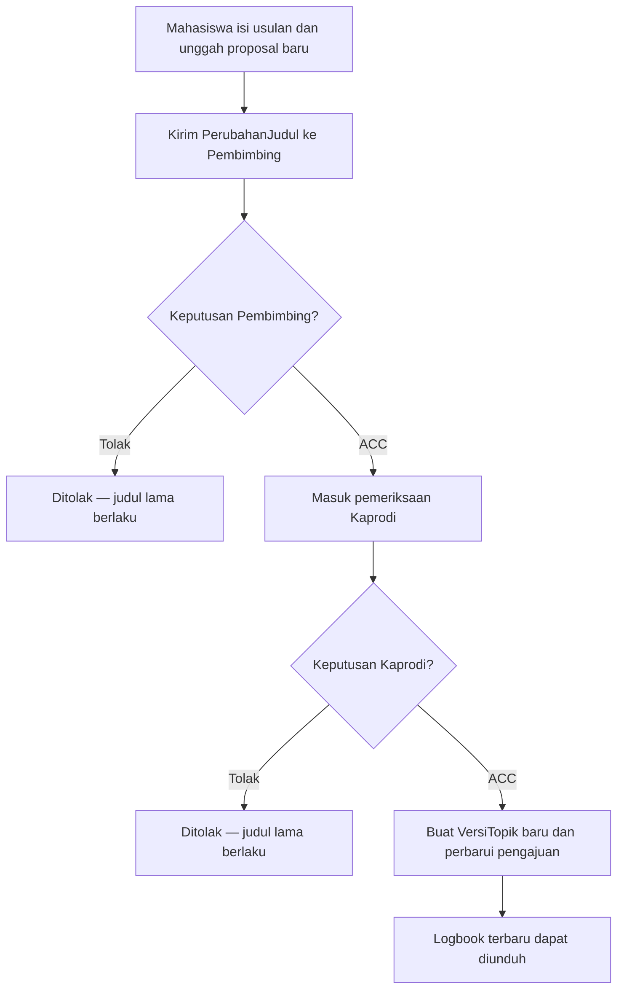

# Aturan Bisnis Perubahan Judul KP ISCP dan TA — SIPKITA

Dokumen ini menjelaskan **pengajuan perubahan judul/objek penelitian ketika mahasiswa sedang menjalankan KP, ISCP, atau TA**. Mahasiswa wajib mengunggah **proposal perubahan**; **Dosen Pembimbing** memeriksa lebih dulu, lalu **Kaprodi** memberi keputusan akhir. Jika disetujui Kaprodi, sistem membuat **versi topik baru**, mempertahankan versi sebelumnya, dan menyediakan **logbook/kartu bimbingan dengan judul terbaru** untuk diunduh.

**Status pengembangan:** spesifikasi domain untuk pekerjaan semester berikutnya. Bukan instruksi agar Codex langsung mengimplementasikan fitur ini sekarang; prioritas semester ISCP tetap modul akun/data diri, pengajuan, pemeriksaan, review proposal, ACC pengajuan, dan penentuan pembimbing.

**Rujukan:** `AGENTS.md`, `docs/business-rules/index.md`, `docs/business-rules/pengajuan.md`, `docs/business-rules/review-proposal.md`, `docs/academic-lifecycle.md`, `docs/roles-permissions.md`, `docs/glossary.md`, dan `server/prisma/schema.prisma` aktual.

> **Pemisahan proses:** perubahan judul **bukan** pemilihan `BARU`/`LANJUT` pada pengajuan ISCP/TA dan **bukan** revisi proposal dari Dosen Reviewer. Proses ini dilakukan pada **pengajuan tahap yang sedang aktif**, diperiksa **Pembimbing → Kaprodi**, dan **proposal perubahan wajib** meskipun topik sebelumnya berasal dari jalur `LANJUT`.

## 1. Aturan bisnis yang sudah disepakati

| ID | Aturan bisnis | Dampak |
| --- | --- | --- |
| **BR-JUD-01** | Mahasiswa dapat mengajukan perubahan judul pada tahap **KP/ISCP/TA yang sedang berlaku**, setelah pengajuan diterima dan pembimbing aktif tersedia. | Pemeriksaan ownership, status pengajuan, dan penugasan pembimbing. |
| **BR-JUD-02** | Mahasiswa mengisi **judul usulan**, **objek usulan**, **alasan perubahan**, dan **proposal perubahan terbaru**; lokasi mengikuti kebutuhan data. | Validasi input dan keterikatan file proposal pada permohonan. |
| **BR-JUD-03** | Proposal perubahan judul **wajib**, termasuk ketika pengajuan ISCP/TA sebelumnya memilih `LANJUT`. | Jangan mewarisi pengecualian proposal pada alur pengajuan awal. |
| **BR-JUD-04** | **Dosen Pembimbing aktif** memeriksa pertama dan memberi keputusan **ACC** atau **Tolak**. | Jika ditolak, alur berhenti dan judul lama tetap berlaku. |
| **BR-JUD-05** | Hanya setelah **ACC Pembimbing**, permohonan masuk ke **Kaprodi** untuk keputusan akhir **ACC** atau **Tolak**. | ACC Pembimbing saja **belum** mengubah judul aktif. |
| **BR-JUD-06** | Jika **Kaprodi menolak**, judul/objek aktif tetap seperti sebelumnya dan permohonan tersimpan sebagai riwayat. | Tidak boleh membuat versi judul berlaku dari usulan ditolak. |
| **BR-JUD-07** | Jika **Kaprodi ACC**, sistem menyimpan **`VersiTopik` baru** dan mengalihkan `Pengajuan.versi_topik_id` ke versi yang disetujui. | Versi lama tetap tersimpan dan dapat ditelusuri. |
| **BR-JUD-08** | Mahasiswa dapat mengunduh **kartu bimbingan/logbook terbaru** setelah ACC akhir dengan judul/objek yang disetujui. | Pembangkitan/penyajian logbook mengikuti mekanisme template aplikasi; tidak ada model `Logbook` khusus di skema rujukan. |
| **BR-JUD-09** | Keputusan tiap pemeriksa menyimpan identitas, waktu, usulan yang dinilai, dan **referensi proposal** yang diperiksa. | Gunakan `KeputusanPerubahanJudul` sebagai audit keputusan. |
| **BR-JUD-10** | Revisi dokumen, pembukaan kembali permohonan yang ditolak, dan putaran keputusan tambahan **belum menjadi alur final**. | Jangan menambahkan tombol `PERLU_PERBAIKAN` atau loop otomatis tanpa konfirmasi. |

## 2. Aktor dan kewenangan

| Aktor | Boleh melakukan | Tidak boleh melakukan |
| --- | --- | --- |
| **Mahasiswa** | Mengajukan perubahan pada pengajuan miliknya, mengunggah proposal, melihat hasil/catatan, mengunduh logbook terbaru setelah ACC. | Mengubah keputusan dospem/Kaprodi atau langsung mengganti judul aktif sebelum ACC final. |
| **Dosen Pembimbing** | Membaca usulan mahasiswa yang dibimbing; memberi **ACC/Tolak tahap pertama** disertai catatan bila ada. | Mengambil keputusan akhir Kaprodi atau mengubah versi judul aktif hanya berdasarkan ACC-nya sendiri. |
| **Kaprodi** | Melihat usulan yang **sudah ACC Pembimbing**; memberi **ACC/Tolak akhir** dan memantau riwayat. | Memproses permohonan yang belum melewati keputusan Pembimbing sesuai alur. |
| **Dosen Reviewer** | Tidak mempunyai tugas review proposal perubahan judul **dalam alur yang disepakati**. | Menggantikan Dosen Pembimbing/Kaprodi pada keputusan perubahan judul hanya karena role Reviewer. |
| **Admin Prodi / Admin Sistem** | Dukungan administrasi/master/template sesuai hak masing-masing. | Menyetujui perubahan judul akademik atas nama Pembimbing/Kaprodi. |

**Otorisasi dosen:** role Pembimbing saja tidak cukup. Server wajib memastikan `Dosen.user_id` terkait user login dan ada `PenugasanDosen` dengan `pengajuan_id` yang sama, `jenis_penugasan='PEMBIMBING'`, dan `status_penugasan='AKTIF'`. Dosen dengan dua role tetap harus memakai kewenangan yang sesuai tindakan.

## 3. Pemetaan model dan field pada schema Prisma

| Model | Fungsi proses perubahan judul | Field/constraint penting |
| --- | --- | --- |
| `Pengajuan` | Pemilik tahap KP/ISCP/TA; menyimpan versi topik yang sedang berlaku. | `id`, `mahasiswa_id`, `topik_penelitian_id`, `versi_topik_id`, `status_pengajuan`, `status_pengerjaan` |
| `TopikPenelitian` | Identitas topik mahasiswa yang mempunyai beberapa versi judul/objek. | `id`, `mahasiswa_id`, `tema_penelitian_id`, `status_topik` |
| `VersiTopik` | Riwayat judul/objek/lokasi sebelum dan sesudah perubahan. | `id`, `topik_penelitian_id`, `nomor_versi`, `judul_penelitian`, `objek_penelitian`, `lokasi_penelitian`, `perubahan_judul_id @unique`, `status_versi`, `berlaku_mulai_at`, `berlaku_selesai_at` |
| `PerubahanJudul` | Permohonan yang diajukan mahasiswa, termasuk usulan serta proposal perubahan. | `id`, `pengajuan_id`, `versi_topik_asal_id`, `judul_usulan`, `objek_usulan`, `lokasi_usulan`, `alasan_perubahan`, `proposal_perubahan_dokumen_id`, `status_perubahan`, `diajukan_at`, `diputuskan_at` |
| `KeputusanPerubahanJudul` | Bukti keputusan Pembimbing dan Kaprodi pada usulan yang dinilai. | `perubahan_judul_id`, `diperiksa_oleh_user_id`, `peran_pemeriksa`, `putaran_ke`, `keputusan`, `catatan`, `judul_diperiksa_snapshot`, `objek_diperiksa_snapshot`, `lokasi_diperiksa_snapshot`, `proposal_dokumen_id`, `diputuskan_at` |
| `Dokumen` | Metadata file proposal perubahan dan file template bila digunakan. | `id`, `diunggah_oleh_user_id`, `storage_key`, `mime_type`, `ukuran_bytes` |
| `PenugasanDosen` | Membuktikan reviewer tahap pertama adalah **Pembimbing aktif** pada pengajuan yang benar. | `pengajuan_id`, `dosen_id`, `jenis_penugasan`, `status_penugasan` |
| `TemplateDokumen` | Dapat menjadi sumber template logbook/kartu bimbingan jika template yang sesuai dikonfigurasi. | `kode_template`, `versi`, `sumber_template`, `renderer_key`, `file_template_dokumen_id`, `is_aktif` |
| `Bimbingan` | Riwayat bimbingan yang nantinya tampil di logbook; tidak dihapus karena judul berubah. | `pengajuan_id`, `tanggal_bimbingan`, `ringkasan`, `status_bimbingan` |

**Dua perbedaan penting:**

1. Proposal perubahan judul direferensikan melalui **`PerubahanJudul.proposal_perubahan_dokumen_id` → `Dokumen`**, bukan otomatis dianggap satu record `DokumenPengajuan` persyaratan pengajuan awal.
2. Setiap keputusan merujuk proposal yang benar-benar diperiksa melalui **`KeputusanPerubahanJudul.proposal_dokumen_id`** dan menyimpan snapshot judul/objek/lokasi. Jangan membiarkan keputusan lama menunjuk isi usulan yang sudah diam-diam diganti.

**Constraint relasi:** `VersiTopik.perubahan_judul_id` unik, sehingga maksimal satu versi hasil dikaitkan pada satu permohonan perubahan. `VersiTopik` juga unik per **`(topik_penelitian_id, nomor_versi)`**. Nomor versi harus ditetapkan secara konsisten ketika Kaprodi memberi ACC final.

## 4. Prasyarat sebelum pengajuan perubahan judul

1. User masuk sebagai **Mahasiswa** dan `Pengajuan.mahasiswa_id` memang miliknya.
2. Pengajuan KP/ISCP/TA **sudah diterima dan dalam tahap pelaksanaan**, bukan draft, permohonan yang ditolak, atau tahap yang telah selesai.
3. Terdapat **Pembimbing aktif** yang sah bagi pengajuan tersebut.
4. `Pengajuan.versi_topik_id` menunjuk versi topik/judul asal yang masih berlaku dan milik mahasiswa itu.
5. Usulan berisi **judul, objek, alasan**, serta **file proposal baru** yang memenuhi batas format/ukuran keamanan upload. `lokasi_usulan` boleh kosong sesuai schema dan aturan form.
6. Tidak ada permohonan perubahan judul lain yang **masih aktif menunggu keputusan** untuk pengajuan yang sama, kecuali kebijakan berikutnya mengatur multi-permohonan. Skema belum punya constraint unik khusus kondisi ini; perlu guard service.

**Perbedaan dengan jalur `BARU`/`LANJUT`:** mahasiswa yang ingin membawa topik KP ke ISCP memilih `LANJUT` saat pengajuan ISCP. Mahasiswa yang **sudah menjalankan ISCP** dan hendak mengganti judul menjalankan **`PerubahanJudul`** pada pengajuan ISCP yang aktif. Keduanya berbeda transaksi dan jejaknya.

## 5. Alur keputusan perubahan judul

Tidak ada cabang **Perlu Perbaikan** pada alur final dua keputusan ini. Model menyimpan `putaran_ke` dan status fleksibel, tetapi **adanya field bukan keputusan bisnis** bahwa pengajuan boleh bolak-balik direvisi setelah pembimbing atau Kaprodi memberi hasil.

### Langkah 1 — Mahasiswa membuat dan mengirim permohonan

| Pembacaan | Penulisan | Validasi |
| --- | --- | --- |
| `User`, `Mahasiswa`, `Pengajuan`, `VersiTopik` aktif, `PenugasanDosen` Pembimbing aktif | Unggah proposal melalui `Dokumen`; buat `PerubahanJudul` berisi `pengajuan_id`, `versi_topik_asal_id`, judul/objek/lokasi/alasan, `proposal_perubahan_dokumen_id`, status draft/pengiriman sesuai kode yang disahkan | Ownership, status tahap, proposal **wajib saat submit**, isi tidak palsu, dokumen milik pengunggah sah, tidak ada permohonan aktif yang bertabrakan. |

Walaupun `proposal_perubahan_dokumen_id` **nullable** di Prisma agar draft bisa disimpan bertahap, bisnis mewajibkannya **sebelum permohonan dikirim**. Jangan membolehkan submit tanpa proposal hanya karena kolomnya nullable.

### Langkah 2 — Dosen Pembimbing memeriksa

1. Server memastikan user yang bertindak memiliki role Pembimbing **dan** `PenugasanDosen` Pembimbing aktif pada pengajuan pemilik perubahan.
2. Dosen membaca **proposal perubahan yang diajukan**, judul/objek lama, judul/objek usulan, dan alasan mahasiswa.
3. Dosen memberi keputusan bisnis **ACC** atau **Tolak**, dengan catatan bila diperlukan.
4. Simpan record `KeputusanPerubahanJudul` berisi `perubahan_judul_id`, `diperiksa_oleh_user_id`, `peran_pemeriksa`, `keputusan`, snapshot judul/objek/lokasi, `proposal_dokumen_id`, dan `diputuskan_at`.
5. Jika **Tolak**, permohonan berhenti; **`Pengajuan.versi_topik_id` tetap menunjuk judul lama**. Jika **ACC**, permohonan menjadi layak diperiksa Kaprodi, **belum** mengubah judul aktif.

### Langkah 3 — Kaprodi memeriksa akhir

1. Server memverifikasi role/cakupan Kaprodi dan bahwa **sudah ada ACC Pembimbing yang sah** untuk usulan/proposal yang sedang diputuskan.
2. Kaprodi melihat keputusan Pembimbing, snapshot usulan, proposal, dan konteks pengajuan.
3. Kaprodi memberi **ACC** atau **Tolak** akhir. Buat `KeputusanPerubahanJudul` kedua yang merekam identitas Kaprodi dan snapshot proposal/judul yang dinilai.
4. **Jika Tolak:** catat status dan waktu akhir `PerubahanJudul`; judul pada `Pengajuan` tetap versi asal.
5. **Jika ACC:** catat keputusan dan lanjutkan pembaruan `VersiTopik` dalam **transaksi konsisten** (lihat bagian 6). Tidak boleh ada kondisi keputusan ACC tersimpan tetapi judul aktif belum berubah karena operasi gagal sebagian.

**Catatan status:** `PerubahanJudul.status_perubahan`, `KeputusanPerubahanJudul.peran_pemeriksa`, dan `keputusan` bertipe `String`. Label ACC/Tolak adalah makna bisnis, bukan bukti enum/status final sudah dikonfigurasi di kode.

## 6. Cara memperbarui versi topik setelah ACC final

Saat Kaprodi menyetujui usulan:

1. Pastikan `PerubahanJudul.versi_topik_asal_id` **masih cocok** dengan `Pengajuan.versi_topik_id` yang berlaku. Bila sudah berganti karena tindakan lain, hentikan dan tangani konflik—jangan menimpa versi baru yang sah.
2. Ambil `VersiTopik` asal dan `topik_penelitian_id` yang benar; perubahan judul **tetap berada di topik penelitian yang sama**, bukan membuat `TopikPenelitian` baru tanpa aturan perubahan topik.
3. Tentukan `nomor_versi` berikutnya secara aman; buat **`VersiTopik` baru** dengan `judul_penelitian`, `objek_penelitian`, `lokasi_penelitian` dari usulan yang di-ACC, dan `perubahan_judul_id` sebagai asal perubahan.
4. Catat batas berlaku versi sebelumnya melalui field status/tanggal yang tersedia, lalu tetapkan kapan versi baru mulai berlaku sesuai kebijakan waktu yang disahkan.
5. Update **`Pengajuan.versi_topik_id`** ke versi baru; `Pengajuan.topik_penelitian_id` tetap mengacu topik yang sama.
6. Update status/tanggal keputusan final `PerubahanJudul`, simpan `KeputusanPerubahanJudul` Kaprodi, dan pastikan seluruh perubahan itu **atomik**.
7. Sesudah commit berhasil, tampilkan judul/objek baru pada antarmuka dan sediakan logbook terbaru berdasarkan versi yang **sekarang berlaku**.

**Jangan:** mengubah `VersiTopik.judul_penelitian` pada baris versi lama secara langsung, menghapus `VersiTopik` asal, atau menulis versi baru hanya setelah ACC Pembimbing.

### Contoh tabel sebelum dan setelah perubahan

Semua ID, judul, tanggal, dan label berikut adalah **data ilustrasi**, bukan isi database sebenarnya.

**Sebelum perubahan:**

| Model | Data contoh | Makna |
| --- | --- | --- |
| `Pengajuan` | `id=101`, `mahasiswa_id=42`, `topik_penelitian_id=301`, `versi_topik_id=401` | KP aktif mahasiswa 42. |
| `VersiTopik` | `id=401`, `topik_penelitian_id=301`, `nomor_versi=1`, `judul_penelitian='Sistem Informasi Arsip'` | Judul yang berlaku sebelum perubahan. |
| `PenugasanDosen` | `pengajuan_id=101`, `dosen_id=4`, `jenis_penugasan='PEMBIMBING'`, `status_penugasan='AKTIF'` | Pembimbing yang berhak memeriksa tahap pertama. |

**Permohonan dan keputusan:**

| Model | Data contoh | Makna |
| --- | --- | --- |
| `Dokumen` | `id=701`, `nama_file_asli='proposal-perubahan.pdf'` | Proposal baru yang **wajib** dilampirkan. |
| `PerubahanJudul` | `id=601`, `pengajuan_id=101`, `versi_topik_asal_id=401`, `judul_usulan='Sistem Informasi Pengelolaan Arsip Digital'`, `objek_usulan='Unit Arsip Prodi'`, `proposal_perubahan_dokumen_id=701` | Permohonan perubahan judul. Field `alasan_perubahan` tetap **wajib** meski tidak ditampilkan penuh pada contoh. |
| `KeputusanPerubahanJudul` | `id=801`, `perubahan_judul_id=601`, `peran_pemeriksa='PEMBIMBING'`*, `diperiksa_oleh_user_id=9`, `keputusan='ACC'`* | Dospem menyetujui usulan; judul aktif **belum** berubah. |
| `KeputusanPerubahanJudul` | `id=802`, `perubahan_judul_id=601`, `peran_pemeriksa='KAPRODI'`*, `diperiksa_oleh_user_id=17`, `keputusan='ACC'`* | Kaprodi memberikan keputusan akhir. |

\*Kode `PEMBIMBING`, `KAPRODI`, `ACC` dalam contoh menjelaskan peran/keputusan secara bisnis; samakan ejaan nilai dengan konstanta status yang akhirnya disetujui. Kedua record keputusan juga harus mengisi **snapshot, `proposal_dokumen_id=701`, dan waktu keputusan** sebagaimana field wajib pada skema.

**Sesudah ACC Kaprodi:**

| Model | Data contoh | Makna |
| --- | --- | --- |
| `VersiTopik` (lama) | `id=401`, `nomor_versi=1`, periode berlaku berakhir | Tetap ada sebagai riwayat judul lama. |
| `VersiTopik` (baru) | `id=402`, `topik_penelitian_id=301`, `nomor_versi=2`, `perubahan_judul_id=601`, `judul_penelitian='Sistem Informasi Pengelolaan Arsip Digital'` | Versi judul yang disetujui. |
| `Pengajuan` | `id=101`, `topik_penelitian_id=301`, **`versi_topik_id=402`** | KP yang sama kini memakai judul versi 2. |
| `PerubahanJudul` | `id=601`, status akhir disetujui, waktu final tercatat | Audit permohonan selesai. |

**Jika Dospem atau Kaprodi menolak:** tidak ada `VersiTopik.id=402` yang dibuat dari permohonan tersebut, dan `Pengajuan.versi_topik_id` tetap **401**.

## 7. Logbook/kartu bimbingan baru setelah persetujuan

**Aturan bisnis yang disepakati:** setelah ACC akhir, mahasiswa dapat **mengunduh logbook terbaru** dengan judul/objek yang telah disetujui. Riwayat bimbingan sebelumnya **tidak boleh dihapus** hanya karena identitas judul yang ditampilkan berubah.

### Dukungan skema yang tersedia

- `TemplateDokumen` dapat mengatur template aktif, versi, sumber file atau renderer jika proyek memilih pola pembuatan dokumen berdasarkan template.
- `VersiTopik` menyimpan judul/objek yang benar untuk tampilan terbaru.
- `Bimbingan`, `RiwayatBimbingan`, dan lampirannya menyediakan data catatan yang dibutuhkan untuk kartu bimbingan.
- `Dokumen` dapat menyimpan metadata file bila implementasi memilih **menyimpan** keluaran dokumen tertentu.

### Yang tidak boleh diasumsikan

- **Tidak ada tabel khusus `Logbook`** atau field `PerubahanJudul.logbook_dokumen_id` pada skema rujukan.
- Belum ada keputusan teknis apakah logbook **digenerate setiap unduhan** atau **disimpan sebagai berkas hasil**. Keduanya mungkin secara arsitektur, tetapi jangan mengklaim sudah diimplementasikan.
- Belum ada format/template logbook baru yang disetujui sebagai kontrak output. Gunakan template resmi jika tersedia sebelum mengunci layout atau struktur file.

**Aturan aman saat coding:** file yang diunduh setelah ACC harus menarik **`Pengajuan.versi_topik_id` terbaru**; tidak boleh tetap menampilkan judul lama. Hak download dibatasi pada mahasiswa pemilik serta aktor yang memang berwenang, bukan berdasarkan URL file yang dapat ditebak.

## 8. Riwayat, revisi, dan batas terhadap proses lain

| Kasus | Penanganan yang benar |
| --- | --- |
| Mahasiswa belum mengirim permohonan | Draft dapat disunting sesuai aturan draft; proposal wajib ketika submit. |
| Pembimbing menolak | Permohonan ditutup/ditandai ditolak menurut status sah; judul lama tetap aktif. |
| Pembimbing ACC, Kaprodi belum memutuskan | Simpan keputusan Pembimbing; **jangan** membuat versi judul baru dulu. |
| Kaprodi menolak | Simpan keputusan final; tidak mengubah judul aktif. |
| Kaprodi ACC | Buat versi baru, update pengajuan, dan sediakan logbook terbaru. |
| Mahasiswa ingin memperbaiki usulan setelah keputusan ditolak | **Belum ada alur final revisi/ajukan kembali yang disepakati**. Jika nanti diperbolehkan, tentukan apakah membuat `PerubahanJudul` baru atau memakai putaran baru; jangan membuka data lama tanpa jejak. |
| Mahasiswa memilih `BARU` saat awal pengajuan ISCP/TA | Itu pemilihan topik **pengajuan baru**, **bukan** `PerubahanJudul` tahap yang sedang berlangsung. |
| Mahasiswa merevisi proposal karena Reviewer meminta koreksi | Gunakan `DokumenPengajuan`/`RiwayatReview` pada alur **review proposal**, bukan keputusan perubahan judul. |
| Mahasiswa mengajukan perubahan judul saat perpanjangan membuat pengajuan baru | Bedakan **pemilihan topik permohonan perpanjangan** dengan perubahan formal judul **pengajuan yang sudah aktif**. |

`KeputusanPerubahanJudul.putaran_ke` menunjukkan bahwa skema **dapat menyimpan beberapa catatan keputusan**, tetapi **tidak otomatis menetapkan** adanya fitur Revisi/Perlu Perbaikan di kedua tahap pemeriksaan. Jika proses itu diminta kemudian, desain state machine dan otorisasinya terlebih dahulu.

## 9. Validasi service, transaksi, dan keamanan

### Saat mahasiswa mengajukan

1. Periksa role Mahasiswa, ownership pengajuan, status tahap, dan Pembimbing aktif.
2. Pastikan `versi_topik_asal_id` sama dengan versi judul aktif pada pengajuan itu saat submit.
3. Wajibkan proposal perubahan **baru** yang sah pada saat submit; simpan `Dokumen.diunggah_oleh_user_id` dari user terautentikasi.
4. Hindari dua permohonan perubahan judul yang masih menunggu keputusan pada pengajuan sama; skema tidak mempunyai keunikan kondisional khusus, sehingga service harus menangani konflik.

### Saat Pembimbing memeriksa

1. Role Pembimbing **dan** penugasan Pembimbing aktif harus cocok dengan `PerubahanJudul.pengajuan_id`.
2. Keputusan hanya boleh pada status menunggu pemeriksaan Pembimbing yang sah.
3. Simpan identitas pelaku **dari sesi server**, waktu keputusan, snapshot usulan, dan `proposal_dokumen_id` yang sama dengan proposal yang diperiksa.
4. Cegah keputusan yang terlambat, ganda, atau bertabrakan saat pengajuan berubah status.

### Saat Kaprodi memutuskan

1. Role/cakupan Kaprodi valid; sudah ada keputusan Pembimbing **ACC** yang mengacu pada usulan/proposal berlaku.
2. Tidak ada keputusan final sebelumnya yang belum dibuka ulang melalui prosedur sah.
3. Jika ACC, lakukan **transaksi atomik**: catat keputusan akhir, buat `VersiTopik` baru, set periode berlaku/status versi jika sesuai aturan, update `Pengajuan.versi_topik_id`, dan selaraskan status `PerubahanJudul`.
4. Pastikan keunikan `VersiTopik.nomor_versi` per topik serta satu `VersiTopik.perubahan_judul_id` per usulan. Tangani *race condition* tanpa menimpa judul yang sudah berubah oleh request lain.
5. Jika Tolak, simpan keputusan/status tanpa memutasi judul aktif.

### Kontrol data dan dokumen

- Hanya pemilik pengajuan boleh membuat permohonan dan melihat informasi pribadi yang terkait.
- Unduh proposal perubahan dan logbook harus memeriksa hak akses di server/file storage; mengetahui `storage_key` atau ID tidak berarti berhak mengunduh.
- `KeputusanPerubahanJudul` harus menyimpan **snapshot** agar jejak keputusan dosen dan Kaprodi tidak berubah ketika judul aktif akhirnya berganti.
- Jangan menghapus `VersiTopik` lama, proposal lama, atau histori bimbingan untuk sekadar menyederhanakan tampilan.
- Jika notifikasi dikirim, `Notifikasi`/`NotifikasiPenerima` boleh digunakan sesuai modul notifikasi yang tersedia, tetapi **tidak boleh dianggap sudah berjalan** tanpa implementasi.

## 10. Skenario pengujian minimum

| ID | Skenario | Hasil yang diharapkan |
| --- | --- | --- |
| JUD-01 | Mahasiswa mengirim perubahan judul KP dengan judul/objek/alasan/proposal lengkap | `PerubahanJudul` tercatat dan menunggu Pembimbing. |
| JUD-02 | Mahasiswa mengirim permohonan **tanpa proposal** | Ditolak saat submit walaupun kolom proposal nullable pada skema. |
| JUD-03 | Mahasiswa jalur ISCP/TA `LANJUT` mengajukan perubahan judul | Tetap **wajib** unggah proposal perubahan baru. |
| JUD-04 | Mahasiswa lain mengakses/mengedit usulan perubahan | Ditolak karena bukan pemilik pengajuan. |
| JUD-05 | Dosen tanpa penugasan Pembimbing aktif mencoba ACC | Ditolak, walaupun punya role Pembimbing atau Reviewer. |
| JUD-06 | Pembimbing memberi Tolak | Status tercatat; **versi judul lama tetap aktif**. |
| JUD-07 | Pembimbing memberi ACC, Kaprodi belum memberi keputusan | Belum ada versi hasil yang berlaku; judul lama tetap ditampilkan. |
| JUD-08 | Kaprodi mencoba memutuskan permohonan sebelum ACC Pembimbing | Ditolak. |
| JUD-09 | Kaprodi memberi Tolak setelah ACC Pembimbing | Catatan kedua keputusan tersimpan; judul lama tidak berubah. |
| JUD-10 | Kaprodi ACC setelah ACC Pembimbing | Satu `VersiTopik` baru terbentuk; `Pengajuan.versi_topik_id` menunjuk versi baru. |
| JUD-11 | Kaprodi ACC dikirim dua kali bersamaan | Tidak ada dua versi judul hasil atau dua keputusan final yang bertabrakan. |
| JUD-12 | Judul aktif berubah antara pengiriman usulan dan ACC akhir | Deteksi konflik `versi_topik_asal_id` agar tidak menimpa versi baru yang sah. |
| JUD-13 | Logbook diunduh sebelum persetujuan akhir | Tidak menampilkan judul usulan yang belum disetujui sebagai judul resmi. |
| JUD-14 | Logbook diunduh setelah ACC Kaprodi | Menggunakan **judul/objek versi terbaru**; data bimbingan lama tetap ada. |
| JUD-15 | Reviewer proposal awal mencoba memberi keputusan perubahan judul | Ditolak bila tidak mempunyai role dan penugasan Pembimbing yang sah. |
| JUD-16 | Kaprodi menolak setelah Pembimbing ACC | Tidak ada perubahan otomatis pada `TopikPenelitian` atau `VersiTopik` aktif. |

## 11. Keputusan yang masih perlu dikunci

1. **Kode status dan peran:** ejaan nilai `status_perubahan`, `KeputusanPerubahanJudul.peran_pemeriksa`, `keputusan`, serta `VersiTopik.status_versi` belum berbentuk enum resmi. Tentukan konstanta/transisi sebelum coding.
2. **Revisi/putusan berulang:** diagram final memakai ACC/Tolak. Jika perlu fitur *Perlu Perbaikan*, re-submit, atau banding, tentukan status, pemeriksa, putaran, dan apakah proposal harus diunggah ulang. `putaran_ke` saja tidak cukup menetapkan aturan.
3. **Logbook:** pilih mekanisme membuat/menyimpan file serta template resmi. Kewajiban **tersedia untuk diunduh setelah ACC** sudah disepakati, tetapi detail teknisnya belum final.
4. **Batas perubahan judul:** jumlah maksimum perubahan per tahap, waktu pengajuan, persetujuan ketika seminar sudah terjadwal, dan perubahan setelah penyelesaian belum ditetapkan. Jangan membuat larangan/izin baru tanpa kebijakan.
5. **Pengaruh ke dokumen proposal pengajuan awal dan reviewer:** `PerubahanJudul` memiliki proposal perubahan sendiri; apakah perubahan judul memerlukan revisi dokumen pengajuan awal atau review ulang oleh Reviewer terpisah **tidak ditetapkan** dalam alur final. Jangan menambah subproses tersebut sendiri.
6. **Ganti tema penelitian vs ganti judul/objek:** skema `PerubahanJudul` tidak menyimpan `tema_penelitian_id` usulan; jika user ingin mengganti **tema/topik penuh**, perlu keputusan apakah memakai alur lain atau perubahan skema.

Jika keputusan terbuka memblokir implementasi, Codex harus **mengemukakan celah dan meminta pilihan pengguna**, bukan memilih status/proses secara diam-diam atau melakukan migrasi sendiri.

## 12. Panduan penggunaan untuk Codex

Saat diminta membangun fitur perubahan judul:

1. Baca dokumen ini, `docs/roles-permissions.md`, `docs/business-rules/pengajuan.md`, dan **schema serta kode aktual**.
2. Tentukan use case spesifik: **form usulan**, **unggah proposal**, **keputusan Pembimbing**, **keputusan Kaprodi**, **versi judul**, atau **logbook**. Kerjakan bagian yang diminta tanpa membangun seluruh roadmap sekaligus.
3. Buat peta aliran **mahasiswa → Pengajuan/VersiTopik asal → PerubahanJudul + Dokumen → Keputusan Pembimbing → Keputusan Kaprodi → VersiTopik baru → Pengajuan versi aktif → logbook**.
4. Letakkan validasi role/penugasan/status/ownership dan operasi transaksi pada service/backend, bukan hanya menyembunyikan tombol pada React.
5. Uji hasil **Tolak vs ACC**, snapshot keputusan, proposal wajib, idempotensi, versi bentrok, dan unduhan logbook yang memuat judul baru.
6. Pertahankan versi/topik/bimbingan historis, dan laporkan status serta mekanisme logbook yang belum disahkan.
7. **Jangan mengubah `schema.prisma`, membuat migrasi, atau menambahkan alur revisi/Reviewer baru** tanpa instruksi eksplisit.

**Batas dokumen:** spesifikasi ini adalah referensi domain untuk Codex, **bukan bukti** bahwa fitur perubahan judul dan logbook sudah diimplementasikan atau diuji pada aplikasi.
