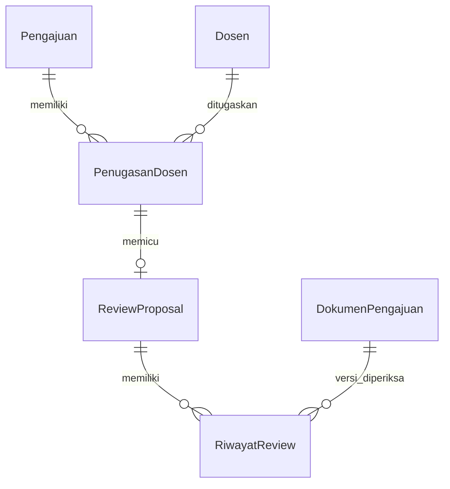
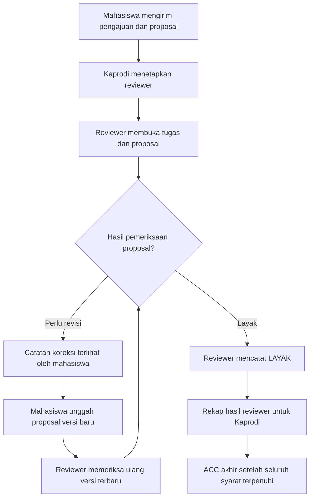
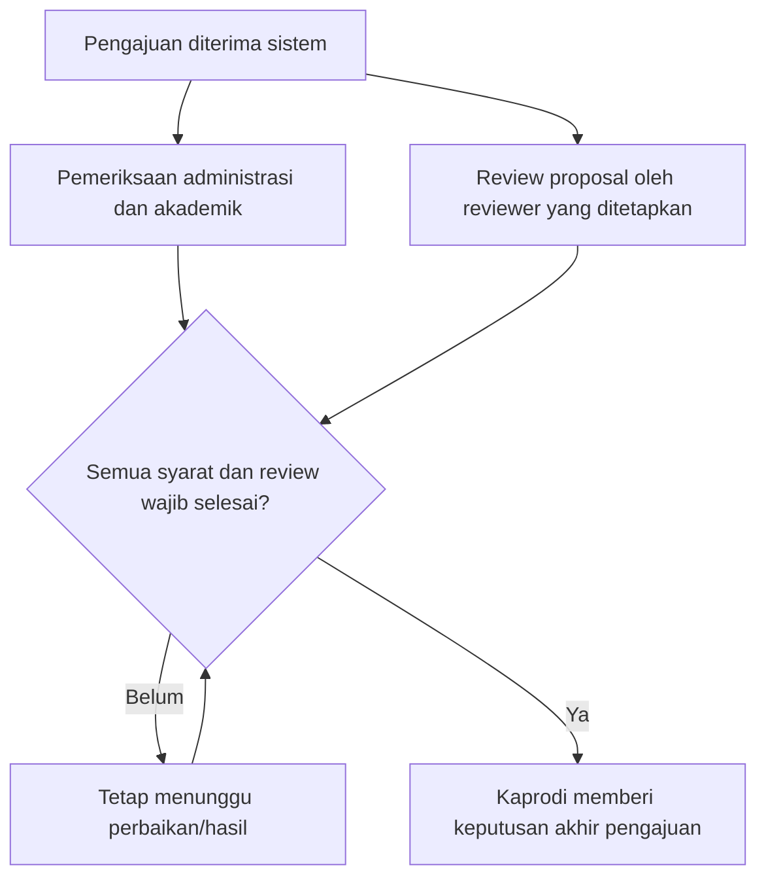

# Aturan Bisnis Penugasan Reviewer dan Review Proposal — SIPKITA

Dokumen ini mengatur **penunjukan Dosen Reviewer oleh Kaprodi, pemeriksaan proposal, komunikasi catatan revisi kepada mahasiswa, unggah versi perbaikan, pencatatan hasil review, dan penggunaan hasilnya pada ACC akhir pengajuan**. Aturan berlaku pada seluruh pengajuan reguler KP, ISCP, dan TA, termasuk `LANJUT`; perpanjangan tidak melibatkan Reviewer.

**Ruang lingkup semester ISCP sekarang:** penugasan reviewer, daftar tugas dosen, pembacaan proposal, catatan koreksi, revisi mahasiswa, putaran pemeriksaan ulang, hasil akhir `LAYAK`, lembar review opsional, dan kesiapan hasil untuk keputusan Kaprodi. Implementasi sistem lain seperti bimbingan dan penyelesaian tahap tidak dibahas di sini.

**Rujukan:** `AGENTS.md`, `docs/business-rules/index.md`, `docs/business-rules/pengajuan.md`, `docs/roles-permissions.md`, `docs/academic-lifecycle.md`, dan `server/prisma/schema.prisma` **aktual**. Nilai kode status selain yang dinyatakan sebagai konsep harus dicocokkan dengan implementasi; skema Prisma menyimpan banyak status sebagai `String`, bukan daftar enum final.

> **Keputusan final:** jalur ISCP/TA `LANJUT` wajib proposal terbaru dan review. Jika ada beberapa Reviewer aktif, semuanya harus memberi hasil `LAYAK` pada proposal terbaru; hasil lengkap tersebut tetap tidak otomatis menjadi ACC. Yang masih terbuka antara lain kode status/transisi, pergantian Reviewer, dan batas putaran revisi.

## 1. Prinsip bisnis yang harus dipertahankan

| ID | Aturan | Status |
| --- | --- | --- |
| **BR-REV-01** | **Kaprodi** menetapkan reviewer final untuk sebuah `Pengajuan`. Dosen atau mahasiswa tidak menetapkan penugasan review sendiri. | Disepakati |
| **BR-REV-02** | Satu pengajuan boleh memiliki **dua atau lebih** reviewer; masing-masing mempunyai penugasan dan proses review sendiri. | Disepakati |
| **BR-REV-03** | Reviewer hanya boleh melihat dan menilai pengajuan yang mempunyai **penugasan `REVIEWER` aktif** atas nama dirinya. | Disepakati |
| **BR-REV-04** | Reviewer boleh memberikan catatan/koreksi; mahasiswa dapat melihatnya dan mengunggah **revisi pada pengajuan yang sama**, tanpa menghapus berkas atau putaran review lama. | Disepakati |
| **BR-REV-05** | Reviewer dapat mencatat keputusan **`LAYAK` tanpa mengunggah lembar review**. Jika lembar disediakan, arsipkan sebagai lampiran pada putaran review yang tepat. | Disepakati |
| **BR-REV-06** | Hasil reviewer merupakan **penilaian/rekomendasi proposal**, bukan ACC akhir pengajuan, ACC penyelesaian tahap, atau izin transisi akademik. | Disepakati |
| **BR-REV-07** | Pemeriksaan syarat akademik/administratif dan review proposal **dapat berjalan paralel**. ACC akhir oleh Kaprodi menunggu seluruh syarat yang diwajibkan selesai. | Disepakati |
| **BR-REV-08** | Pada ISCP `BARU`, reviewer KP sebelumnya dapat dijadikan **rekomendasi**, tetapi Kaprodi tetap menetapkan penugasan final. | Disepakati |
| **BR-REV-09** | Seluruh pengajuan reguler, termasuk ISCP/TA `LANJUT`, wajib memakai proposal terbaru dan menjalani review. | Disepakati |
| **BR-REV-10** | Semua Reviewer aktif yang ditugaskan wajib memberi hasil `LAYAK` pada proposal terbaru agar prasyarat review terpenuhi. Hasil ini tidak otomatis menjadi ACC; Kaprodi tetap memutuskan. | Disepakati |

## 2. Aktor dan kewenangan pada proses review

| Aktor | Boleh melakukan | Tidak boleh melakukan |
| --- | --- | --- |
| **Kaprodi** | Melihat pengajuan dan kebutuhan review, memilih satu atau beberapa reviewer, mengganti penugasan menurut prosedur, memantau hasil, memberi keputusan akhir **pengajuan**. | Memberi ACC ketika ada Reviewer aktif yang belum `LAYAK`, atau menganggap seluruh hasil `LAYAK` sebagai ACC otomatis. |
| **Dosen Reviewer** | Membaca proposal pengajuan yang ditugaskan, memberi catatan langsung untuk mahasiswa, memeriksa versi revisi, menyimpan hasil, opsional mengunggah lembar review. | Mereview pengajuan tanpa penugasan aktif, mengubah dokumen mahasiswa, menetapkan reviewer lain, memberi ACC akhir pengajuan. |
| **Mahasiswa** | Melihat status dan catatan review **miliknya**, mengunggah revisi proposal pada pengajuan yang sama sesuai status yang mengizinkan. | Mengubah penilaian/catatan dosen atau menilai proposal sendiri. |
| **Admin Prodi** | Memeriksa data diri dan administrasi pengajuan reguler/awal. | Mengambil alih penilaian substansi proposal, pemeriksaan perpanjangan, atau ACC akhir pengajuan. |
| **Dosen Pembimbing** | Berwenang sebagai reviewer **hanya jika** akun dosen memiliki role Reviewer **dan** penugasan Reviewer aktif pada pengajuan itu. | Menggunakan role Pembimbing saja untuk mengisi hasil review proposal. |
| **Admin Sistem** | Mengelola akun/role dan konfigurasi sistem sesuai mandatnya. | Mengisi hasil review atau ACC akademik atas nama dosen/Kaprodi hanya karena punya akses admin. |

**Mode kerja dosen** pada UI (Reviewer/Pembimbing) hanya menentukan tampilan. Otorisasi final dilakukan di server terhadap `UserRole`, `Dosen.user_id`, `PenugasanDosen`, pemilik `Pengajuan`, dan status proses.

## 3. Model database yang benar-benar digunakan

| Model | Fungsi | Field/constraint penting |
| --- | --- | --- |
| `Pengajuan` | Pemilik konteks tahap, mahasiswa, periode, dan keputusan pengajuan. | `id`, `mahasiswa_id`, `tahap_akademik_id`, `periode_akademik_id`, `pilihan_topik`, `status_pengajuan` |
| `Dosen` | Identitas akademik dosen yang dihubungkan ke akun. | `id`, `user_id`, `program_studi_id` |
| `UserRole` + `Role` | Menentukan akun mempunyai peran Reviewer. | `UserRole.user_id`, `UserRole.role_id`, `Role.kode_peran` |
| `PenugasanDosen` | **Satu record per penugasan dosen** untuk suatu pengajuan. | `id`, `pengajuan_id`, `dosen_id`, `jenis_penugasan`, `status_penugasan`, `ditetapkan_oleh_user_id`, `mulai_at`, `berakhir_at` |
| `ReviewProposal` | Ringkasan proses dan hasil terkini **per penugasan Reviewer**, bukan per pengajuan secara global. | `id`, `penugasan_dosen_id @unique`, `status_review`, `hasil_review`, `catatan_akhir`, `mulai_review_at`, `selesai_review_at` |
| `RiwayatReview` | Putaran keputusan, catatan, versi berkas/topik yang diperiksa, dan lembar review opsional. | `review_proposal_id`, `putaran_ke`, `dokumen_pengajuan_id`, `versi_topik_id`, `hasil_review`, `catatan_reviewer`, `lembar_review_dokumen_id`, `direview_oleh_user_id`, `reviewed_at` |
| `DokumenPengajuan` | Versi berkas proposal yang terikat pada syarat dokumen dalam satu pengajuan. | `pengajuan_id`, `persyaratan_pengajuan_id`, `dokumen_id`, `nomor_versi`, `is_terkini` |
| `Dokumen` | Metadata berkas proposal mahasiswa atau lembar review dosen. | `id`, `diunggah_oleh_user_id`, `storage_key`, `mime_type`, `ukuran_bytes` |
| `VersiTopik` | Versi judul/objek yang menjadi konteks review. | `id`, `topik_penelitian_id`, `nomor_versi`, `judul_penelitian` |
| `RiwayatStatusPengajuan` | Jejak perubahan status pengajuan bila proses review berdampak pada status pengajuan. | `pengajuan_id`, `jenis_status`, `status_sebelum`, `status_sesudah`, `diubah_oleh_user_id` |

**Relasi inti:**

- `PenugasanDosen` **tidak** mempunyai batas satu Reviewer per pengajuan. Indeks unik parsial yang ada khusus membatasi **satu Pembimbing aktif** per pengajuan, bukan jumlah Reviewer.
- `ReviewProposal.penugasan_dosen_id` bersifat unik: **satu penugasan** memiliki maksimal satu ringkasan review. Dua reviewer membutuhkan **dua penugasan dan dua record `ReviewProposal`**.
- `RiwayatReview` unik pada **`(review_proposal_id, putaran_ke)`**. Nomor putaran dihitung **per reviewer/record `ReviewProposal`**, bukan nomor global untuk semua dosen.
- `RiwayatReview.lembar_review_dokumen_id` **nullable**. Field `RiwayatReview.hasil_review` dan `direview_oleh_user_id` **wajib**. Karena itu hasil `LAYAK` dapat dicatat tanpa berkas lembar review.
- Tidak ada tabel agregasi khusus bernama `HasilAkhirReviewPengajuan`; jangan menciptakannya hanya untuk menjumlahkan hasil review tanpa keputusan desain.

## 4. Kapan review diperlukan pada KP, ISCP, dan TA?

| Jalur | Status kebutuhan review | Catatan |
| --- | --- | --- |
| **KP pengajuan awal** | Review proposal termasuk dalam alur roadmap. | Reviewer ditetapkan Kaprodi; dokumen proposal yang benar harus tersedia. |
| **ISCP `BARU`** | Review proposal diperlukan. | Reviewer KP dapat menjadi rekomendasi, bukan otomatis reviewer final. |
| **TA `BARU`** | Review proposal diperlukan. | Menggunakan proposal dan syarat TA sesuai konfigurasi. |
| **ISCP `LANJUT`** | **Wajib** | Data tahap sebelumnya menjadi isian awal; proposal terbaru tetap diunggah dan direview. |
| **TA `LANJUT`** | **Wajib** | Data tahap sebelumnya menjadi isian awal; proposal terbaru dan syarat TA tetap dipenuhi. |

**Prinsip implementasi:** persyaratan proposal tetap ditentukan melalui `PersyaratanPengajuan` untuk periode/tahap/jalur terkait. Pengecualian Reviewer berlaku pada **perpanjangan**, bukan pada pengajuan reguler `LANJUT`; jangan membuat `PenugasanDosen` Reviewer atau `ReviewProposal` palsu untuk perpanjangan.

## 5. Alur penugasan dan review proposal

Diagram menunjukkan satu jalur reviewer. Bila pengajuan punya beberapa reviewer, **setiap penugasan memiliki alur dan hasil masing-masing**; `I → J` bukan persetujuan otomatis. Hanya Kaprodi yang memutuskan akhir pengajuan, setelah pemeriksaan dokumen/akademik lain juga memenuhi ketentuan.

### Langkah 1 — Kaprodi menugaskan reviewer

1. Baca `Pengajuan` yang membutuhkan review dan pastikan status/proposal memungkinkan penugasan.
2. Pilih satu atau lebih `Dosen` aktif yang memenuhi ketentuan. Untuk ISCP `BARU`, riwayat reviewer KP hanya **saran pilihan**.
3. Buat `PenugasanDosen` per reviewer dengan jenis tugas **`REVIEWER`**, status aktif, pengajuan, dosen, penetap, serta waktu penugasan.
4. Buat/siapkan satu `ReviewProposal` per penugasan reviewer. Nilai awal skema `status_review` adalah `BELUM_DIPERIKSA`.
5. Jika UI mendukung penugasan beberapa reviewer sekaligus, validasi semua record dan simpan secara aman. Jangan membuat duplikasi penugasan aktif untuk dosen yang sama pada pengajuan yang sama.

**Kewenangan:** hanya Kaprodi yang menetapkan reviewer; penugasan bukan operasi yang boleh diminta bebas oleh Reviewer atau Mahasiswa.

### Langkah 2 — Reviewer membuka tugasnya

1. User login mempunyai role Reviewer.
2. `Dosen.user_id` menghubungkan akun ke profil dosen yang benar.
3. Cari `PenugasanDosen` **jenis `REVIEWER`, status `AKTIF`**, dengan `dosen_id` dan `pengajuan_id` yang cocok.
4. Ambil data topik dan **versi proposal yang sah untuk diperiksa** dari `DokumenPengajuan`, `Dokumen`, dan `VersiTopik`.
5. Tampilkan informasi yang diperlukan untuk tugas tersebut; jangan membuka pengajuan mahasiswa lain hanya karena mengetahui `id` atau `storage_key` berkasnya.

### Langkah 3 — Reviewer mengirim catatan atau hasil

- Reviewer dapat memberi catatan koreksi yang **dapat dibaca mahasiswa**.
- Untuk setiap putaran hasil pemeriksaan, buat `RiwayatReview` yang menunjuk **versi dokumen proposal spesifik** (`dokumen_pengajuan_id`) dan versi topik (`versi_topik_id`) yang diperiksa.
- Rekam `hasil_review`, `catatan_reviewer` bila ada, `direview_oleh_user_id` dari user terautentikasi, dan waktu review.
- Update ringkasan `ReviewProposal` (`status_review`, `hasil_review`, `catatan_akhir`, waktu terkait) secara **konsisten** dengan riwayat yang baru dibuat.
- Hasil **`LAYAK`** bisa disimpan **tanpa file**. Jika reviewer mengunggah lembar hasil review, simpan file di `Dokumen` dan tautkan ke `RiwayatReview.lembar_review_dokumen_id`.
- **Jangan** memberi ACC pengajuan saat reviewer memilih `LAYAK`. Berikan informasi hasil tersebut kepada Kaprodi pada halaman monitoring/persetujuan.

**Kode status:** `LAYAK` adalah nilai hasil yang disepakati secara bisnis. Pilihan lain seperti *perlu revisi* atau *tidak layak* menjelaskan **makna keputusan**, tetapi nama kode `String`, transisi, dan apakah catatan wajib pada tiap keputusan harus dikunci sebelum dijadikan konstanta API.

### Langkah 4 — Mahasiswa mengunggah revisi

1. Mahasiswa melihat hasil review/catatan untuk `Pengajuan` miliknya.
2. Jika revisi diizinkan, ia mengunggah proposal baru **pada pengajuan yang sama** (`Pengajuan.id` tidak berubah).
3. Buat `Dokumen` baru dan **`DokumenPengajuan` versi berikutnya** untuk `persyaratan_pengajuan_id` proposal yang sama.
4. Set versi lama `is_terkini=false` dan versi baru `is_terkini=true` **dalam transaksi yang sama**. Constraint unik parsial pada `DokumenPengajuan` menjaga maksimal satu versi terkini per syarat/pengajuan.
5. **Pertahankan** `RiwayatReview` putaran sebelumnya yang menunjuk versi lama. Revisi proposal tidak otomatis menghapus atau memuat ulang berkas persyaratan **lain** yang telah sah.
6. Tampilkan revisi pada daftar seluruh Reviewer aktif agar masing-masing memeriksa proposal terbaru; hasil `LAYAK` atas versi lama tidak memenuhi prasyarat versi baru.

### Langkah 5 — Reviewer memeriksa ulang versi terbaru

- Reviewer yang berwenang membuka proposal versi baru dan catatan terdahulu.
- Buat `RiwayatReview` **putaran baru** yang menunjuk versi revisi tersebut. Jangan mengubah `RiwayatReview` putaran lama agar seolah sejak awal menilai berkas terbaru.
- Saat akhirnya `LAYAK`, ringkasan `ReviewProposal` menunjukkan hasil terkini reviewer tersebut.
- Seluruh Reviewer aktif wajib menilai proposal terbaru. Jumlah putaran revisi maksimal, tenggat, dan perilaku penolakan final proposal **belum ditetapkan**; jangan membuat batas otomatis yang tidak disetujui.

## 6. Contoh hubungan record saat satu proposal direvisi

Contoh berikut **data ilustrasi**, bukan record riil atau kode status yang sudah di-seed. Pengajuan **101** adalah **KP**; prinsip hasil seluruh Reviewer aktif juga berlaku pada pengajuan reguler `LANJUT`.

### A. Kaprodi menugaskan dua reviewer

| Model | Contoh record | Makna |
| --- | --- | --- |
| `Pengajuan` | `id=101`, `mahasiswa_id=42` | Satu pengajuan KP. |
| `PenugasanDosen` | `id=70`, `pengajuan_id=101`, `dosen_id=4`, `jenis_penugasan='REVIEWER'`, `status_penugasan='AKTIF'` | Reviewer A ditetapkan. |
| `PenugasanDosen` | `id=71`, `pengajuan_id=101`, `dosen_id=5`, `jenis_penugasan='REVIEWER'`, `status_penugasan='AKTIF'` | Reviewer B ditetapkan **pada pengajuan yang sama**. |
| `ReviewProposal` | `id=80`, `penugasan_dosen_id=70`, `status_review='BELUM_DIPERIKSA'` | Proses review milik Reviewer A. |
| `ReviewProposal` | `id=81`, `penugasan_dosen_id=71`, `status_review='BELUM_DIPERIKSA'` | Proses review milik Reviewer B. |

Kaprodi boleh melihat keduanya; Reviewer A hanya boleh menulis hasil pada `ReviewProposal.id=80`, Reviewer B pada `id=81`. Keduanya dapat melihat proposal pengajuan **101** sesuai penugasan dan kebijakan akses.

### B. Mahasiswa memperbaiki proposal berdasarkan catatan Reviewer A

| `DokumenPengajuan.id` | `pengajuan_id` | `persyaratan_pengajuan_id` | `nomor_versi` | `is_terkini` | Keterangan |
| --- | --- | --- | --- | --- | --- |
| **501** | 101 | 21 (Proposal) | 1 | `false` | Proposal awal yang diperiksa. |
| **508** | 101 | 21 (Proposal) | 2 | `true` | Proposal revisi yang sekarang berlaku. |
| **502** | 101 | 22 (Berkas lain) | 1 | `true` | Tidak ikut diulang hanya karena proposal direvisi. |

| `RiwayatReview.id` | `review_proposal_id` | `putaran_ke` | `dokumen_pengajuan_id` | `versi_topik_id` | `hasil_review` | `lembar_review_dokumen_id` |
| --- | --- | --- | --- | --- | --- | --- |
| 901 | 80 (Reviewer A) | 1 | **501** | 401 | `PERLU_REVISI`* | `null` |
| 902 | 80 (Reviewer A) | 2 | **508** | 401 | `LAYAK` | `null` |

\*`PERLU_REVISI` di baris contoh hanya **kode ilustratif** untuk makna *perlu perbaikan*; nama status finalnya **belum dikunci**. `LAYAK` menunjukkan hasil bisnis yang sudah disepakati.

**Makna data:** putaran pertama Reviewer A tetap mengacu ke proposal versi 1; putaran kedua ke versi 2. Tidak ada lembar review yang diunggah, namun hasil `LAYAK` tetap tersimpan dengan sah. Record `ReviewProposal.id=81` (Reviewer B) **tetap terpisah**; hasil Review A tidak mengisinya otomatis.

### C. Bagaimana jika dua reviewer berbeda hasil?

Misalnya Reviewer A menilai proposal terbaru **`LAYAK`**, tetapi Reviewer B masih meminta koreksi atau belum memeriksa revisi. Prasyarat review **belum terpenuhi** karena seluruh Reviewer aktif harus menyatakan `LAYAK` atas proposal terbaru. Karena itu:

- Sistem **tidak boleh otomatis memberi ACC akhir** hanya karena hasil Reviewer A `LAYAK`.
- Kaprodi harus dapat melihat **siapa menilai versi berapa dan kapan**, serta status penilaian tiap reviewer.
- Setelah keduanya `LAYAK`, service hanya menandai prasyarat review terpenuhi; Kaprodi tetap mengambil keputusan akhir.

## 7. Hubungan pemeriksaan administrasi dan ACC akhir

Review substansi proposal **bukan** pemeriksaan administrasi dokumen. Dua aktivitas ini dapat berlangsung bersama:

**Perbedaan kewenangan:** Admin Prodi memeriksa administrasi pengajuan reguler/awal; pelaku pemeriksaan kelayakan akademik masih perlu dikunci. **Kaprodi tetap pemutus akhir pengajuan**, dan **Dosen Reviewer bukan pemutus akhir**. Permohonan semester berikutnya memakai perpanjangan dan tidak menjalani proses Reviewer.

Untuk ACC, service minimal memeriksa:

1. `Pengajuan` berada pada status yang membolehkan keputusan akhir; belum memiliki keputusan final yang tidak dapat diulang.
2. Syarat akademik dan **semua dokumen wajib terkini** telah memenuhi pemeriksaan yang berlaku.
3. Untuk pengajuan reguler, seluruh Reviewer aktif yang ditugaskan sudah memberi hasil `LAYAK` pada proposal terbaru.
4. Hasil review yang dipakai harus mengacu pada **versi proposal/topik yang berlaku**, bukan hasil lama untuk file yang sudah diganti.
5. Pemberi keputusan adalah **Kaprodi** dengan kewenangan prodi yang sah, dan riwayat keputusan tersimpan pada `Pengajuan` serta `RiwayatStatusPengajuan`.

**Review `LAYAK` ≠ ACC akhir pengajuan ≠ ACC penyelesaian KP/ISCP/TA.** ACC penyelesaian oleh Dosen Pembimbing merupakan proses setelah mahasiswa menjalankan tahapnya, bukan akibat otomatis dari `ReviewProposal.hasil_review='LAYAK'`.

## 8. Validasi service dan keamanan

### Penugasan reviewer

- Periksa role Kaprodi, pengajuan target, jenis proses, status, kesesuaian prodi yang berwenang, dan dosen aktif.
- Jangan menugaskan reviewer ke pengajuan yang tidak membutuhkan review menurut aturan final.
- Cegah **dua penugasan Reviewer aktif untuk dosen yang sama pada pengajuan yang sama** lewat validasi service/transaksi. Skema referensi **belum mempunyai unique constraint** khusus untuk kombinasi tersebut.
- Pergantian reviewer harus mempertahankan penugasan/review lama sebagai riwayat; pengaruhnya pada hasil yang sudah diberikan harus diatur, bukan menghapusnya.

### Penyimpanan hasil review

- Tentukan reviewer dari **sesi server** dan `Dosen.user_id`, bukan `dosen_id` bebas dari payload.
- Validasi `ReviewProposal.penugasan_dosen_id` menunjuk penugasan aktif **REVIEWER** untuk `Pengajuan` yang sama.
- Validasi `RiwayatReview.dokumen_pengajuan_id` adalah **proposal** yang benar-benar terkait `Pengajuan`, serta `versi_topik_id` berkaitan dengan topik yang sedang diperiksa.
- Pastikan tidak ada hasil review untuk berkas/topik yang tidak pernah ditampilkan/diterima reviewer sebagai versi yang dinilai.
- Simpan ringkasan `ReviewProposal` dan baris `RiwayatReview` secara **atomik** (misalnya transaksi Prisma), termasuk metadata file lembar review jika diunggah.
- Terapkan perlindungan terhadap submit ganda dan **race condition** pada `putaran_ke`: nomor putaran harus bertambah secara konsisten per `ReviewProposal`.
- Ketika mahasiswa mengirim revisi, perubahan versi aktif harus atomik dan dokumen lama serta putaran review lama tetap dapat ditelusuri.

### Akses dokumen dan catatan

- Reviewer hanya membaca dokumen mahasiswa sesuai penugasan dan kebutuhan review.
- Mahasiswa hanya melihat catatan/review **untuk pengajuannya sendiri**, tidak berhak mengubah keputusan reviewer.
- Proteksi download lembar review dan proposal pada **server/file storage**; mengetahui `storage_key` atau URL langsung tidak boleh melewati kontrol akses.
- Perubahan role, penonaktifan penugasan, dan status user nonaktif harus berdampak pada izin selanjutnya; pilihan mode UI tidak mengalahkan kondisi server.

## 9. Skenario tes yang wajib dipertimbangkan

| ID | Skenario | Hasil yang diharapkan |
| --- | --- | --- |
| REV-01 | Kaprodi menugaskan **dua Reviewer** ke satu pengajuan KP | Dua `PenugasanDosen` reviewer dan dua `ReviewProposal`; tidak saling menimpa. |
| REV-02 | Reviewer yang ditugaskan membuka daftar tugas dan proposal | Hanya pengajuan yang sesuai penugasan aktif terlihat/dapat dibaca. |
| REV-03 | Reviewer tanpa penugasan mencoba akses langsung ID review/dokumen | Ditolak. |
| REV-04 | Reviewer memberi catatan koreksi | Tercatat pada putaran review; mahasiswa pemilik dapat melihatnya. |
| REV-05 | Mahasiswa unggah revisi proposal | Versi baru menjadi terkini, versi lama dan riwayat review tetap tersimpan. |
| REV-06 | Mahasiswa merevisi proposal, dokumen administrasi lain sudah sah | Dokumen lain tidak diunggah ulang atau di-reset secara otomatis. |
| REV-07 | Reviewer memeriksa ulang proposal revisi | `RiwayatReview` putaran baru menunjuk **dokumen versi baru**. |
| REV-08 | Reviewer menyatakan `LAYAK` tanpa lembar review | Tersimpan; `lembar_review_dokumen_id=null` diperbolehkan. |
| REV-09 | Reviewer mengunggah lembar review dan hasil `LAYAK` | File tercatat di `Dokumen` dan terhubung ke putaran yang benar. |
| REV-10 | Reviewer A `LAYAK`, Reviewer B belum selesai/hasil berbeda | Prasyarat review belum terpenuhi dan Kaprodi tidak boleh ACC. |
| REV-11 | Reviewer mencoba memberikan ACC akhir pengajuan | Ditolak; hanya Kaprodi yang berwenang. |
| REV-12 | Kaprodi mencoba ACC ketika persyaratan akademik/administrasi belum sah | Ditolak, meskipun reviewer sudah `LAYAK`. |
| REV-13 | Reviewer mengirim hasil dua kali bersamaan | Tidak menghasilkan duplikasi putaran/keputusan yang inkonsisten. |
| REV-14 | Kaprodi menugaskan dosen yang sama sebagai Reviewer aktif dua kali pada pengajuan sama | Ditolak/ditangani aman oleh service; tidak membuat penugasan duplikat. |
| REV-15 | Review berkas versi 1 dicoba dipakai sebagai bukti final versi 2 tanpa pemeriksaan yang diwajibkan | Tidak boleh lolos validasi hasil versi terkini. |
| REV-16 | Dosen punya role Pembimbing dan Reviewer tetapi hanya penugasan Pembimbing di pengajuan X | Tidak bisa mereview X tanpa penugasan Reviewer aktif. |

## 10. Keputusan yang perlu dikonfirmasi sebelum logika terkait dikunci

| Topik | Yang sudah pasti | Keputusan yang masih diperlukan |
| --- | --- | --- |
| **Daftar status review** | `ReviewProposal.status_review` dan `hasil_review` berupa `String`; hasil `LAYAK` disepakati. | Nama kode sah untuk perlu revisi, tolak/tidak layak, selesai, serta transisi antarstatus. |
| **Pergantian reviewer** | Kaprodi penetap; riwayat lama wajib dijaga. | Apakah hasil reviewer lama tetap dihitung jika dosen diganti? Bagaimana aturan membuka ulang review? |
| **Jumlah/tenggat revisi** | Mahasiswa dapat memperbaiki pada pengajuan sama; riwayat tetap terjaga. | Apakah ada maksimum putaran dan batas waktu? |

Keputusan pada tabel di atas **tidak** boleh diselesaikan dengan menebak dari nama field atau membuat enum/model baru tanpa persetujuan. Tandai bagian yang terdampak, jelaskan opsi dan akibatnya, lalu tunggu keputusan pengguna jika implementasinya terblokir.

## 11. Petunjuk untuk Codex saat mengimplementasikan fitur review

1. **Baca hanya rujukan relevan**: dokumen ini, `docs/business-rules/pengajuan.md`, `docs/roles-permissions.md`, serta schema dan kode repo aktual.
2. Identifikasi **satu tugas kecil** yang diminta pengguna: penugasan reviewer, daftar tugas, baca proposal, simpan catatan, revisi, atau catat `LAYAK`.
3. Tuliskan peta **aktor → izin/penugasan → input → record yang dibaca → record yang dibuat/diubah → hasil/riwayat → respons**.
4. Tempatkan pemeriksaan role, `PenugasanDosen` aktif, ownership mahasiswa, status pengajuan, serta konsistensi versi di **service/backend**; UI hanya membantu menampilkan pilihan.
5. Gunakan `PenugasanDosen` + `ReviewProposal` **per reviewer**, `RiwayatReview` **per putaran**, dan `DokumenPengajuan` **per versi**; jangan menyatukannya ke satu baris status global.
6. Implementasikan perubahan minimal, gunakan transaksi untuk mutasi terkait, tambahkan uji positif/negatif dan kasus dua reviewer, lalu laporkan keputusan yang masih terbuka.
7. **Jangan** mengubah schema Prisma, menjalankan migrasi, atau membuat endpoint tanpa permintaan eksplisit.

**Batas penyelesaian:** dokumen ini menetapkan perilaku bisnis dan pemetaan data, bukan bukti bahwa API review, upload file, atau pemenuhan multi-reviewer sudah dikodekan. Pemeriksaan akhir harus dilakukan terhadap codebase dan migrasi aktual pada saat implementasi.
