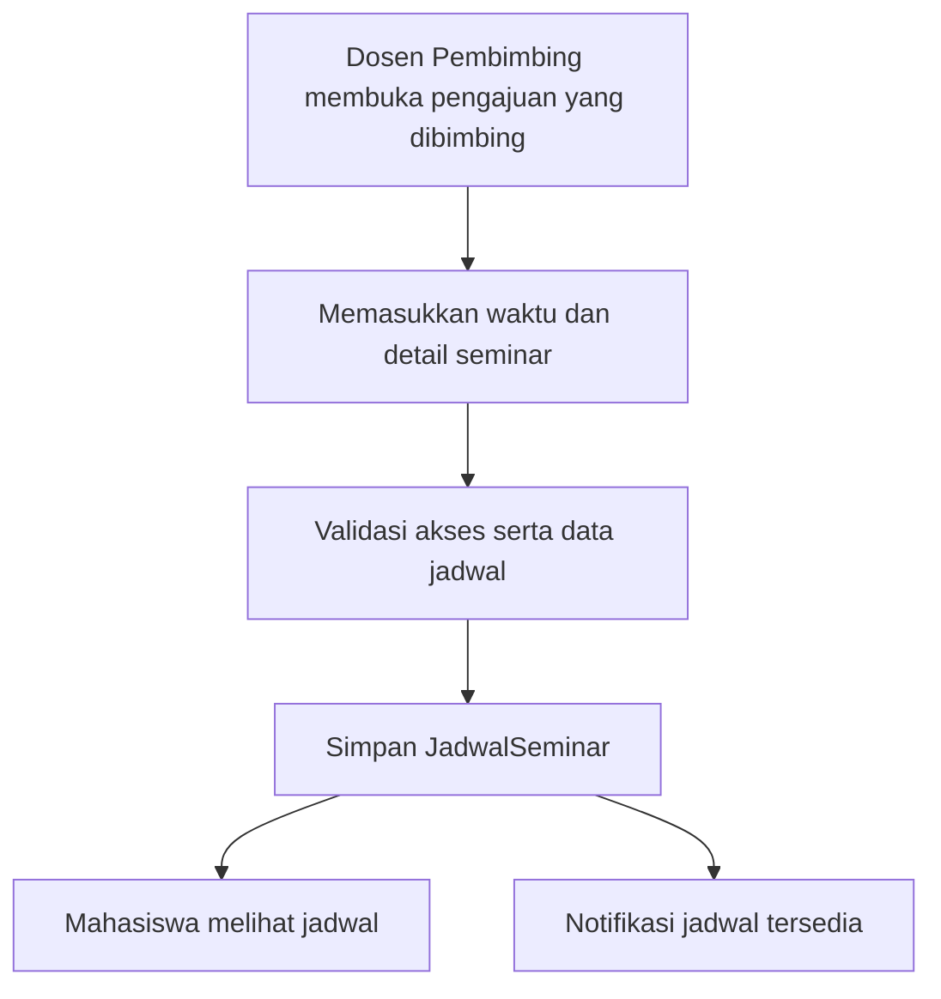

# Aturan Bisnis Seminar KP, ISCP, dan TA — SIPKITA

> **Status: PROVISIONAL / BELUM FINAL.** Dokumen ini hanya mengunci **cakupan minimal yang telah disepakati**, memetakan **schema Prisma saat ini**, dan mendata keputusan yang sengaja ditunda. **Jangan menganggap contoh status, format jadwal, alur perubahan jadwal, atau mekanisme peserta/penguji sebagai kebijakan akademik final.**

> **Prioritas proyek:** seminar merupakan dokumentasi persiapan untuk pengembangan semester berikutnya. Modul inti semester ISCP saat ini tetap akun dan data diri, verifikasi, pengajuan KP/ISCP/TA, pemeriksaan, review proposal, ACC pengajuan, dan penentuan Pembimbing; bimbingan dapat dicicil bila waktu cukup.

**Rujukan kerja:** `AGENTS.md`, `docs/business-rules/index.md`, `docs/academic-lifecycle.md`, `docs/roles-permissions.md`, `docs/glossary.md`, dan **`server/prisma/schema.prisma` aktual**. Ketika ada perubahan keputusan dari pemilik proyek, perbarui aturan bisnis terlebih dahulu sebelum implementasi dan migrasi.

## 1. Hal yang sudah disepakati

| ID | Aturan minimal | Implikasi |
| --- | --- | --- |
| **BR-SEM-01** | Seminar dapat terkait dengan pengajuan tahap **KP, ISCP, atau TA**. | Kaitan jadwal harus melalui `Pengajuan`, bukan mengunci jenis tahap di satu form terpisah. |
| **BR-SEM-02** | **Dosen Pembimbing** memiliki kewenangan membuat jadwal seminar untuk mahasiswa yang dibimbing. | Periksa role dan **penugasan Pembimbing aktif** pada pengajuan terkait, bukan sekadar role dosen. |
| **BR-SEM-03** | **Mahasiswa** dapat melihat jadwal seminar miliknya. | Query harus dibatasi berdasarkan pengajuan milik mahasiswa. |
| **BR-SEM-04** | Mahasiswa menerima **informasi/notifikasi** jadwal yang tersedia. | Skema mendukung notifikasi dalam aplikasi; mekanisme pengiriman, pemicu, dan kanal belum dikunci. |
| **BR-SEM-05** | Detail mekanisme seminar **belum final**, dan akan ditentukan setelah semester ini. | Jangan membuat workflow lengkap penguji, pendaftaran, seminar ulang, berita acara, penilaian, atau hasil secara asumtif. |

**Bukan aturan final:** persyaratan boleh menjadwalkan seminar, kebutuhan ACC Kaprodi, siapa mengelola ruangan, jumlah penguji, jumlah sesi, status pembatalan, seminar online/offline wajib atau opsional, dan hubungan hasil seminar dengan kelulusan tahap.

## 2. Aktor dan batas kewenangan saat ini

| Aktor | Tindakan yang dapat didokumentasikan sekarang | Hal yang masih terbuka |
| --- | --- | --- |
| **Dosen Pembimbing** | Menyusun jadwal seminar bagi pengajuan yang menjadi tanggung jawabnya. | Apakah jadwal membutuhkan pemeriksaan/persetujuan pihak lain sebelum diumumkan. |
| **Mahasiswa** | Melihat informasi jadwal serta notifikasinya. | Apakah mahasiswa perlu mendaftar, mengonfirmasi hadir, atau mengajukan permintaan perubahan jadwal. |
| **Kaprodi** | Belum ada alur persetujuan seminar yang ditetapkan. | Penetapan penguji, persetujuan jadwal, konflik ruangan, dan kewenangan penjadwalan ulang. |
| **Admin Prodi / Admin Sistem** | Tidak otomatis mendapat kewenangan akademik seminar dari pengelolaan data/master. | Apakah akan mengelola ruangan, slot, atau pengumuman seminar. |
| **Dosen Reviewer** | Tidak otomatis menjadi penguji atau pembuat jadwal hanya karena pernah mereview proposal. | Hubungan reviewer proposal dan dosen penguji seminar belum diputuskan. |

**Prinsip akses:** satu dosen boleh memiliki beberapa role, tetapi aksi pada pengajuan tertentu harus tetap berdasarkan **role yang sesuai, cakupan prodi, dan penugasan yang sah**.

## 3. Model database yang sudah ada

| Model | Fungsi | Field/constraint aktual yang relevan |
| --- | --- | --- |
| `Pengajuan` | Induk akademik KP, ISCP, atau TA yang dijadwalkan. | `id`, `mahasiswa_id`, `tahap_akademik_id`, `periode_akademik_id`, `status_pengajuan`, `status_pengerjaan` |
| `PenugasanDosen` | Pemeriksaan Pembimbing aktif untuk pengajuan. | `pengajuan_id`, `dosen_id`, `jenis_penugasan`, `status_penugasan` |
| `JadwalSeminar` | Jadwal seminar suatu pengajuan dan akun pembuatnya. | `id`, `pengajuan_id`, `mulai_at`, `selesai_at?`, `jenis_pelaksanaan`, `lokasi_seminar?`, `tautan_seminar?`, `keterangan?`, `status_jadwal`, `dibuat_oleh_user_id` |
| `RiwayatJadwalSeminar` | Bukti aksi/perubahan jadwal beserta snapshot. | `jadwal_seminar_id`, `aksi`, `mulai_at_snapshot`, `selesai_at_snapshot?`, `jenis_pelaksanaan_snapshot`, `lokasi_snapshot?`, `tautan_snapshot?`, `status_snapshot`, `alasan_perubahan?`, `dilakukan_oleh_user_id` |
| `Notifikasi` | Informasi jadwal yang dapat ditampilkan dalam aplikasi. | `id`, `kategori_notifikasi`, `judul`, `pesan`, `tautan_internal?`, `dibuat_oleh_user_id?` |
| `NotifikasiPenerima` | Hubungan notifikasi ke akun penerima dan status baca. | `notifikasi_id`, `penerima_user_id`, `status_dibaca`, `dibaca_at?` |

**Constraint penting pada schema sekarang:**

```prisma
@@unique([pengajuan_id], where: { status_jadwal: "TERJADWAL" }, map: "uq_seminar_terjadwal")
```

Artinya, untuk **satu `Pengajuan`**, database membatasi **maksimal satu baris `JadwalSeminar` yang berstatus `TERJADWAL`**. Pengajuan lain, termasuk mahasiswa lain pada periode dan tahap berbeda, tetap dapat memiliki jadwal sendiri pada waktu bersamaan. Constraint ini **bukan** pengaturan bentrok ruang atau bentrok waktu dosen.

**Jangan mencampur `JadwalProses` dengan `JadwalSeminar`:** `JadwalProses` mengelola rentang jadwal proses/kalender akademik; `JadwalSeminar` adalah jadwal acara untuk pengajuan mahasiswa tertentu.

### Batas dukungan schema sekarang

- Belum ada relasi khusus untuk **dosen penguji seminar**, **peserta seminar**, **ruangan yang dipesan**, **presensi**, **nilai/berita acara**, atau **hasil seminar**.
- Belum ada entitas yang eksplisit memisahkan **jenis seminar**, **sesi seminar ke-1/ke-2**, atau **seminar ulang** pada satu pengajuan.
- Relasi `JadwalSeminar` ke `Pengajuan` ada, tetapi schema **tidak menjamin** seluruh syarat akademik penjadwalan terpenuhi; validasi tersebut harus diputuskan sebelum coding.
- `RiwayatJadwalSeminar` sudah memungkinkan penyimpanan snapshot aksi, tetapi **tidak berarti** prosedur penundaan, pembatalan, dan penjadwalan ulang telah disahkan.
- `Notifikasi` dan `NotifikasiPenerima` mendukung notifikasi tersimpan; **bukan bukti** fitur email, WhatsApp, push notification, atau pengiriman otomatis sudah tersedia.

## 4. Aliran data minimal — ilustrasi, bukan proses final



Urutan di atas hanya mengilustrasikan **fitur minimal yang disepakati**. Jika nanti penjadwalan harus disetujui Kaprodi atau unit lain, sisipkan alur persetujuan yang baru **setelah ada keputusan resmi**. Jangan lebih dulu menambah status `MENUNGGU_ACC`, aktor penguji, atau prasyarat kelulusan secara diam-diam.

### Peta pembacaan dan penulisan data

| Aksi konseptual | Data dibaca | Data ditulis | Batasan |
| --- | --- | --- | --- |
| Dospem melihat kandidat jadwal | `Pengajuan`, `Mahasiswa`, `PenugasanDosen`, identitas user/role | — | Batasi ke pengajuan dengan Pembimbing aktif yang benar. |
| Membuat jadwal | `Pengajuan`, jadwal aktif saat ini | `JadwalSeminar` | Data waktu valid; jenis pelaksanaan serta lokasi/tautan sesuai aturan yang nanti dikunci. |
| Mencatat aksi jadwal | Jadwal yang sedang diproses | `RiwayatJadwalSeminar` **jika implementasi aksi ini memerlukannya** | Isi snapshot sesuai aksi aktual; kode `aksi` belum final. |
| Mahasiswa membaca jadwal | `Pengajuan` miliknya → `JadwalSeminar` | — | Jangan memberikan jadwal mahasiswa lain tanpa kewenangan. |
| Membuat informasi jadwal | `JadwalSeminar`, identitas penerima | `Notifikasi`, `NotifikasiPenerima` | Penerima adalah akun mahasiswa terkait; ketentuan waktu/pemicu masih menunggu keputusan. |

**Contoh interaksi data:** ilustrasi di bawah memakai ID contoh yang tidak merepresentasikan isi database pengguna.

| Tabel | Contoh record | Arti |
| --- | --- | --- |
| `Pengajuan` | `id=101`, `mahasiswa_id=42`, tahap `KP` | Mahasiswa 42 sedang menjalankan pengajuan KP 101. |
| `PenugasanDosen` | `pengajuan_id=101`, `dosen_id=4`, `jenis_penugasan='PEMBIMBING'`, `status_penugasan='AKTIF'` | Dosen 4 berwenang menjadwalkan seminar pengajuan 101. |
| `JadwalSeminar` | `id=501`, `pengajuan_id=101`, `mulai_at=2027-03-10 09:00 WIB`, `selesai_at=2027-03-10 10:00 WIB`, `jenis_pelaksanaan='OFFLINE'`, `lokasi_seminar='Ruang Seminar A'`, `status_jadwal='TERJADWAL'`, `dibuat_oleh_user_id=9` | Jadwal yang dapat dilihat mahasiswa; user 9 adalah akun dosen 4 pada ilustrasi. |
| `RiwayatJadwalSeminar` | `jadwal_seminar_id=501`, `aksi='DIBUAT'`*, snapshot waktu/lokasi/status, `dilakukan_oleh_user_id=9` | Jika logging dibuat sejak awal, aksi dan data saat itu dapat ditelusuri. |
| `Notifikasi` | `id=9001`, `kategori_notifikasi='SEMINAR'`*, `judul='Jadwal Seminar KP'`, `tautan_internal='/jadwal-seminar/501'`* | Pesan pemberitahuan dalam aplikasi. |
| `NotifikasiPenerima` | `notifikasi_id=9001`, `penerima_user_id=58`, `status_dibaca=false` | Akun mahasiswa penerima notifikasi belum membacanya. |

\* `DIBUAT`, `SEMINAR`, dan format tautan adalah **contoh rancangan**, **bukan** nilai status/route yang sudah diputuskan. Saat implementasi, isi seluruh field wajib pada model (termasuk teks pesan, snapshot, jenis, waktu, dan nilai lain yang relevan), bukan hanya kolom yang ditunjukkan di tabel ringkas.

## 5. Validasi teknis yang aman untuk fitur minimal

Bagian ini adalah **rekomendasi engineering**, bukan penambahan prosedur akademik:

1. **Server-side authorization:** verifikasi akun login, role Pembimbing, dan `PenugasanDosen` Pembimbing aktif yang cocok dengan `pengajuan_id` sebelum menerima aksi penjadwalan.
2. **Data waktu:** `mulai_at` harus valid; jika `selesai_at` diisi, nilainya setelah waktu mulai. Tampilkan zona waktu yang jelas kepada user, sedangkan penyimpanan mengikuti `DateTime @db.Timestamptz(6)`.
3. **Keunikan jadwal aktif:** hormati constraint satu `TERJADWAL` per pengajuan. Tangani error konflik unik secara informatif; jangan menimpa jadwal lain.
4. **Konsistensi:** jika sebuah aksi mengubah jadwal serta membuat snapshot riwayat, kerjakan konsisten dalam satu transaksi Prisma. Pengiriman notifikasi dapat dirancang setelah transaksi; cegah notifikasi ganda saat permintaan diulang.
5. **Privasi dan izin baca:** mahasiswa melihat jadwal miliknya; dosen melihat jadwal pengajuan yang memang boleh diaksesnya. Akses data tidak bergantung pada tombol React yang terlihat/tersembunyi saja.
6. **Tidak mengarang status:** satu nilai `TERJADWAL` sudah ada sebagai default dan dalam constraint; nilai `DIBATALKAN`, `DIUBAH`, `SELESAI`, dan status lain **belum otomatis disahkan** hanya karena field berupa `String`.

## 6. Keputusan yang ditunda sampai konsep seminar final

| Prioritas rancangan nanti | Pertanyaan yang harus diputuskan | Potensi dampak database |
| --- | --- | --- |
| **Hak penjadwalan** | Apakah hanya Pembimbing, perlu ACC Kaprodi, atau ada peran administrasi/penjadwal? | Mungkin perlu entitas keputusan/persetujuan, bukan hanya field pembuat. |
| **Seminar dan sesi** | Satu pengajuan hanya satu seminar aktif, atau bisa beberapa sesi/jenis/ulang secara bersamaan? | Revisi constraint parsial `uq_seminar_terjadwal`; mungkin tambah jenis/sesi. |
| **Penguji** | Siapa menetapkan penguji dan berapa orang? | Relasi penugasan dosen penguji ke seminar bila disepakati. |
| **Tempat serta bentrok** | Apakah ruangan perlu master data, pemesanan slot, dan pemeriksaan tabrakan? | Tabel ruangan/reservasi dan aturan penjadwalan bila disepakati. |
| **Syarat dan pendaftaran** | Apakah ada unggahan dokumen, minimal bimbingan, pendaftaran mahasiswa, atau verifikasi terlebih dahulu? | Entitas persyaratan, dokumen, atau pendaftaran **jika benar dibutuhkan**. |
| **Pelaksanaan dan hasil** | Perlu presensi, nilai penguji, berita acara, status lulus/tidak, dan seminar ulang? | Entitas hasil/penilaian/berkas jika ditetapkan; hubungan ke `PenyelesaianTahap` perlu ditentukan. |
| **Perubahan jadwal** | Siapa yang boleh mengubah/membatalkan, kapan, apakah harus memberi alasan/ACC? | Status dan snapshot riwayat; mungkin perlu permohonan revisi jadwal. |
| **Notifikasi** | Siapa penerima selain mahasiswa? Kapan dikirim dan melalui kanal apa? | `NotifikasiPenerima` sekarang mendukung akun penerima; kanal eksternal memerlukan desain tersendiri. |

**Aturan Codex:** bila task meminta implementasi salah satu baris terbuka di atas, **hentikan asumsi**, paparkan opsi beserta kebutuhan perubahan skema, dan minta keputusan pemilik proyek sebelum coding/migrasi.

## 7. Jika nanti skema seminar perlu diubah

**Prinsip: perubahan skema itu normal dan aman jika migrasinya direncanakan; aman bukan berarti semua perubahan tanpa risiko.** Keharusan migrasi bergantung pada fitur final, kondisi data, dan lingkungan penerapan.

1. **Audit fakta:** baca schema Prisma, migration history, jumlah record seminar yang sudah ada, dependensi service/API/frontend, serta kode status aktual.
2. **Bandingkan requirement final dengan schema:** identifikasi yang cukup dikerjakan di service/UI dan yang benar-benar butuh tabel/kolom/relasi/constraint tambahan.
3. **Pilih perubahan sekecil mungkin:** utamakan penambahan yang kompatibel; jangan menghapus kolom, relasi, atau mengganti constraint aktif tanpa rencana data lama.
4. **Rancang migrasi data:** jika menambah field wajib, sediakan strategi nullable sementara, backfill, kemudian pengetatan setelah data valid. Jika mengubah batas satu jadwal aktif, rancang aturan pengalihan record lama dan constraint baru.
5. **Tinjau SQL migration sebelum dijalankan:** cek potensi penghapusan/konversi data, foreign key, unique index, status lama, dan risiko gagal di PostgreSQL.
6. **Verifikasi di lingkungan pengembangan dulu:** uji migrasi, data historis, penjadwalan minimal, otorisasi, dan kasus bentrok. Cadangkan data nyata sebelum migrasi ke lingkungan berisi data penting.
7. **Koordinasikan kode dan migrasi:** service/backend, API, UI, test, serta dokumen diperbarui sesuai rilis; jangan menjalankan `prisma db push --force-reset` atau reset database sebagai jalan pintas pada data yang perlu dijaga.

**Catatan PostgreSQL/Prisma:** constraint parsial `uq_seminar_terjadwal` harus diperiksa pada migration SQL aktual saat nanti mengubah model multi-sesi. Jangan berasumsi semua perubahan constraint bisa dilakukan tanpa pemeriksaan data lama.

## 8. Skenario validasi minimal dan yang ditunda

| ID | Kasus | Hasil yang diharapkan saat fitur minimal diimplementasikan |
| --- | --- | --- |
| SEM-01 | Dosen Pembimbing aktif membuat jadwal untuk pengajuan yang menjadi bimbingannya | Jadwal tersimpan dengan `pengajuan_id` dan pembuat yang benar. |
| SEM-02 | Dosen yang bukan Pembimbing aktif mencoba membuat jadwal | Ditolak oleh backend. |
| SEM-03 | Mahasiswa melihat jadwal pengajuan miliknya | Jadwal KP/ISCP/TA terkait tampil sesuai hak akses. |
| SEM-04 | Mahasiswa meminta jadwal pengajuan orang lain | Ditolak sesuai aturan kepemilikan/privasi. |
| SEM-05 | Dua jadwal `TERJADWAL` dibuat untuk pengajuan yang sama | Constraint uniqueness ditangani; tidak ada dua jadwal aktif dengan status tersebut. |
| SEM-06 | `selesai_at` sebelum `mulai_at` | Input ditolak. |
| SEM-07 | Pemberitahuan jadwal dibuat sesuai mekanisme notifikasi yang nanti diputuskan | `Notifikasi` dan penerima terkait konsisten; belum mengklaim kanal eksternal. |

**Pengujian yang ditunda:** bentrok dosen/ruang, penugasan penguji, seminar ulang, presensi, hasil/nilai, pembatalan dan penjadwalan ulang. Semua menunggu konsep final agar tidak mengunci kebijakan keliru.

## 9. Instruksi pemakaian dokumen oleh Codex

1. Anggap dokumen ini **sementara**, bukan mandat membangun modul seminar secara penuh pada semester sekarang.
2. Jika diminta pekerjaan seminar, baca aturan bisnis ini lalu **periksa `schema.prisma` aktual** dan kode yang sudah ada; jangan hanya menyalin nama field dari dokumen.
3. Bedakan **aturan yang telah disepakati**, **contoh ilustrasi**, **rekomendasi teknis**, dan **keputusan terbuka**.
4. Untuk task minimal yang disetujui, gunakan relasi `Pengajuan` → `JadwalSeminar` serta otorisasi `PenugasanDosen` dengan benar; notifikasi memakai model tersedia jika pemicunya telah dikonfirmasi.
5. Jangan membuat tabel penguji, hasil, registrasi, ruang, atau menyusun alur ACC seminar tanpa instruksi lanjutan.
6. Jika kebutuhan final mengubah model, gunakan analisis domain dan workflow `prisma-schema-change`; **ajukan dampak dan rencana migrasi terlebih dahulu**, lalu implementasikan hanya sesuai cakupan permintaan.
7. Saat mekanisme seminar sudah disahkan, revisi status dokumen menjadi **FINAL** setelah aturan aktor, tahapan, status, dan perubahan schema yang relevan ditinjau.

**Batas dokumen:** keberadaan model seminar pada schema bukan bukti bahwa halaman seminar, notifikasi, atau workflow lengkap sudah tersedia di aplikasi.
