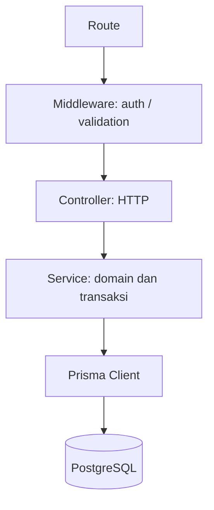

# Coding Standards SIPKITA — JavaScript, React, Express, dan Prisma

> **Jenis berkas:** pedoman penulisan dan peninjauan kode SIPKITA untuk manusia dan Codex. Dokumen ini **bukan** skill mandiri, bukan konfigurasi formatter/linter yang sudah terpasang, dan **bukan perintah merapikan seluruh repository**.

**Rujukan terkait:** `AGENTS.md`, `docs/architecture.md`, `docs/database.md`, `docs/api-conventions.md`, `docs/roles-permissions.md`, `docs/academic-lifecycle.md`, dan dokumen aturan bisnis modul yang dikerjakan. Untuk pekerjaan Codex, gunakan `feature-implementation`, `prisma-schema-change`, atau `code-change-verification` **sesuai jenis tugas**, tidak semuanya otomatis untuk setiap request.

## 1. Prinsip umum

1. **Correctness first:** implementasi harus sesuai aturan akademik KP → ISCP → TA, izin aktor, dan schema yang benar-benar tersedia.
2. **Consistency:** ikuti pola penamaan, pemformatan, error, API, serta test yang sudah ada di repo. Perubahan lokal baru tidak boleh menciptakan gaya kedua tanpa alasan.
3. **Small vertical slice:** selesaikan satu skenario end-to-end yang diminta (misalnya submit pengajuan KP) sebelum membangun semua modul lain.
4. **DRY (*Don't Repeat Yourself*):** satukan logika yang benar-benar sama; jangan membuat tiga salinan kode KP/ISCP/TA bila operasi inti identik.
5. **KISS (*Keep It Simple*):** gunakan solusi paling sederhana yang memenuhi kebutuhan; hindari pola arsitektur baru yang belum perlu.
6. **SRP (*Single Responsibility Principle*):** satu module/function bertanggung jawab pada satu alasan perubahan yang jelas.
7. **YAGNI (*You Aren't Gonna Need It*):** jangan menambahkan tabel, endpoint, dependensi, atau abstraksi hanya untuk kemungkinan semester berikutnya.
8. **Security by default:** jangan percaya data client untuk identitas, izin, status akademik, dan akses dokumen.
9. **Preserve history:** revisi tidak boleh menimpa riwayat pengajuan, versi proposal/topik, bimbingan, atau keputusan yang sudah sah.

**Sumber kebenaran saat bekerja:** permintaan pengguna terbaru dan keputusan bisnis yang dikonfirmasi → kode/schema/migration aktual → dokumen proyek terkait → rekomendasi di dokumen ini. Bila ada konflik yang berdampak pada keputusan akademik atau migrasi, **jelaskan dan minta keputusan**, bukan diam-diam memilih versi sendiri.

## 2. Naming convention — kesepakatan dan pengecualian

| Elemen              | Konvensi                                 | Contoh SIPKITA                                               | Catatan                                                                             |
| ------------------- | ---------------------------------------- | ------------------------------------------------------------ | ----------------------------------------------------------------------------------- |
| Variabel JavaScript | `camelCase`                              | `pengajuanId`, `statusPengajuan`, `daftarDokumen`            | Gunakan nama yang menjelaskan makna bisnis.                                         |
| Fungsi JavaScript   | `camelCase`, kata kerja jelas            | `getPengajuanById`, `validateSubmission`, `assignPembimbing` | Tindakan harus terlihat dari nama.                                                  |
| Boolean             | Nama pertanyaan positif                  | `isActive`, `hasPermission`, `canSubmit`                     | Hindari `flag1`, `statusOk` tanpa konteks.                                          |
| Komponen React      | `PascalCase`                             | `PengajuanForm`, `ReviewProposalPage`, `DokumenUpload`       | Nama file komponen juga PascalCase bila pola repo mengizinkan.                      |
| React hooks         | `use` + `PascalCase`                     | `usePengajuan`, `useAuth`                                    | Buat custom hook hanya untuk perilaku yang benar-benar dipakai ulang.               |
| Konstanta tetap     | `UPPER_SNAKE_CASE`                       | `DEFAULT_PAGE_SIZE`, `MAX_UPLOAD_MB`                         | Bukan untuk semua variabel `const`; hanya konstanta yang sifatnya tetap.            |
| Model Prisma        | `PascalCase` **singular**                | `User`, `Mahasiswa`, `Pengajuan`, `DokumenPengajuan`         | **Jangan rename model eksisting** hanya karena preferensi gaya.                     |
| Field Prisma        | **`snake_case` mengikuti schema aktual** | `mahasiswa_id`, `status_pengajuan`, `periode_akademik_id`    | **Pengecualian dari aturan JS camelCase.** FK/query Prisma harus memakai nama asli. |
| Tabel SQL           | `snake_case` via `@@map`                 | `pengajuan`, `dokumen_pengajuan`, `penugasan_dosen`          | Contoh khusus: model `User` dipetakan ke `users`.                                   |
| Nilai status/role   | Konstanta terpusat setelah disahkan      | `DRAFT`, `AKTIF`, `PEMBIMBING`                               | Banyak status schema masih `String`; jangan menciptakan nilai baru sendiri.         |
| Nama fungsi handler | Sesuai aksi domain                       | `submitPengajuan`, `reviewProposal`, `verifyDataDiri`        | Pilih satu bahasa/domain term yang konsisten dalam modul.                           |

**Aturan batas antarlapisan:** JavaScript lokal boleh memakai `camelCase`, tetapi **Prisma harus memakai field `snake_case` yang benar**. DTO JSON pada `docs/api-conventions.md` memakai contoh `snake_case` untuk sejumlah field domain. Jika ingin mengubah bentuk di frontend, lakukan mapping **eksplisit pada API client/adapter**, bukan mengubah schema atau menulis field Prisma fiktif.

Contoh mapping yang aman:

```js
// DTO dari API memakai nama field domain.
const pengajuanDto = { id: 101, status_pengajuan: 'DRAFT' };

// Komponen JavaScript boleh memakai camelCase secara lokal.
const statusPengajuan = pengajuanDto.status_pengajuan;
```

**Hindari istilah campur aduk:** pilih satu istilah domain untuk konsep yang sama. Misalnya `pengajuan` tidak berganti menjadi `application`, `submission`, dan `registration` secara acak pada tiga service berbeda. Terminologi mengacu `docs/glossary.md`.

## 3. Penamaan file dan folder

### Backend Express — pola yang pernah diusulkan

Gunakan nama file **`module.responsibility.js`** ketika membuat file baru dan belum ada pola berbeda di repo:

```text
pengajuan.route.js
pengajuan.controller.js
pengajuan.service.js
pengajuan.validator.js       # jika memang ada kebutuhan validator terpisah
auth.middleware.js
error.middleware.js
```

Penempatan pada `routes/`, `controllers/`, `services/`, `middlewares/`, atau struktur **per fitur** harus mengikuti repo aktual. **Jangan menduplikasi** direktori global dan feature-based sekaligus. **Repository layer terpisah tidak wajib**; backend SIPKITA memakai route → controller → service → Prisma kecuali kode aktual membuktikan kebutuhan lain.

### Frontend React — rekomendasi

```text
PengajuanPage.jsx
PengajuanForm.jsx
DokumenUpload.jsx
```

Untuk utilitas/API client, ikuti pola yang dipakai repo (misalnya `pengajuan.api.js` atau `pengajuanService.js`); jangan mengubah seluruh file hanya untuk menyeragamkan nama. Ekstensi `.jsx` dipakai jika proyek sudah memilihnya untuk komponen; jangan memaksa migrasi ke TypeScript tanpa instruksi.

**Aturan:** nama file, export, dan import harus konsisten terutama di Windows yang mungkin tidak menonjolkan salah ketik kapitalisasi; periksa kasus sensitif saat membangun di lingkungan Linux/deployment.

## 4. Formatting dengan Prettier

**Kesepakatan:** Prettier menjadi alat formatting yang dipilih. **Tetap periksa** `.prettierrc*`, `prettier.config.*`, `package.json`, serta script `format` aktual sebelum menjalankannya. Jangan membuat konfigurasi kedua jika satu sudah ada.

**Usulan awal dari diskusi sebelumnya** (bukan klaim konfigurasi yang sudah terpasang):

| Opsi           | Rekomendasi awal         | Alasan                                      |
| -------------- | ------------------------ | ------------------------------------------- |
| Indentasi      | 2 spasi                  | Selaras gaya JS/React yang ringkas.         |
| Semicolon      | `true`                   | Akhir statement konsisten.                  |
| Quote JS       | Single quote             | Mengurangi variasi gaya string JS.          |
| Print width    | 100 karakter             | Batas keterbacaan saat review.              |
| Trailing comma | Dipakai secara konsisten | Memudahkan diff pada objek/array multiline. |

Contoh **hanya bila belum ada config dan pengguna menyetujui default ini**:

```json
{
  "tabWidth": 2,
  "semi": true,
  "singleQuote": true,
  "printWidth": 100,
  "trailingComma": "all"
}
```

**Instruksi Codex:** untuk perubahan fitur, format **file yang diedit saja** atau jalankan script project yang sesuai cakupan. Jangan merapikan semua file sehingga diff menjadi besar dan menutupi perubahan fungsional. Jika formatter menghasilkan konflik dengan konfigurasi repo, **konfigurasi repo saat ini lebih berwenang** daripada contoh di sini.

## 5. Linting dengan ESLint

**Kesepakatan:** ESLint digunakan untuk menemukan kesalahan dan menjaga kualitas kode. Implementasi rule/plugin harus mengikuti **versi ESLint serta konfigurasi aktual**; dokumen ini tidak mengasumsikan `.eslintrc` atau `eslint.config.js` tertentu sudah tersedia.

| Rule/kelompok yang pernah diusulkan | Tujuan                                                | Perhatian                                                                 |
| ----------------------------------- | ----------------------------------------------------- | ------------------------------------------------------------------------- |
| `no-unused-vars`                    | Menangkap variabel/import yang tidak dipakai.         | Jangan menyembunyikan error dengan menonaktifkan rule global sembarangan. |
| `no-undef`                          | Menangkap variabel yang tidak didefinisikan.          | Sesuaikan globals browser dan Node untuk masing-masing workspace.         |
| `eqeqeq`                            | Menghindari koersi tak terduga pada perbandingan.     | Pakai perbandingan ketat bila sesuai kebutuhan.                           |
| `no-var`                            | Menghindari deklarasi `var`.                          | Pilih `const` atau `let`.                                                 |
| `prefer-const`                      | Mendorong `const` jika variabel tidak diassign ulang. | Jangan salah mengartikan `const` sebagai objek otomatis immutable.        |
| React Hooks rules                   | Menjaga pemanggilan hooks dan dependency yang sah.    | Aktifkan sesuai plugin/dependensi yang **benar-benar terpasang**.         |

**Jangan** menonaktifkan rule hanya agar build terlihat lulus. Bila ada lint warning/error baru akibat tugas, perbaiki sumber masalahnya. Jika lint repo sudah gagal pada file di luar cakupan, laporkan secara terpisah dan jangan otomatis membenahi semua file.

## 6. Struktur dan tanggung jawab kode Express

**Pola utama yang disepakati:**



| Lapisan    | Lakukan                                                                                | Hindari                                                     |
| ---------- | -------------------------------------------------------------------------------------- | ----------------------------------------------------------- |
| Route      | Mendaftarkan method/path, middleware, controller.                                      | Menghitung syarat akademik dan query panjang.               |
| Middleware | Authentication, cek izin awal, validasi request, error handler.                        | Menganggap role saja cukup untuk objek apa pun.             |
| Controller | Membaca params/body/query yang divalidasi, memanggil service, mengirim HTTP response.  | Menulis transaksi panjang atau keputusan Kaprodi/Reviewer.  |
| Service    | Validasi status, ownership, penugasan, periode, persyaratan, keputusan, dan transaksi. | Menentukan kode HTTP secara tersebar atau tergantung React. |
| Prisma     | Query, relasi, constraint, transaksi database.                                         | Menjalankan business rule hanya dari ada/tidaknya FK.       |

**Aturan praktis:**

- Fungsi service dinamai berdasarkan **aksi bisnis**, misalnya `submitPengajuan`, `verifyDocument`, atau `assignReviewer`.
- Satu fungsi sebaiknya mempunyai tujuan jelas; jika terlalu panjang, ekstrak helper yang benar-benar memiliki tanggung jawab tersendiri.
- Pisahkan **validasi bentuk request** dari **validasi aturan domain berdasarkan data database**.
- Hindari `try/catch` yang hanya menangkap lalu mengembalikan nilai palsu. Gunakan mekanisme propagasi error dan centralized handler sesuai pola Express yang sudah ada.
- Gunakan `select`/`include` Prisma untuk memuat data yang dibutuhkan; jangan memuat seluruh relasi sensitif hanya untuk halaman ringkasan.
- Jangan meneruskan `req.body` secara mentah ke `prisma.model.create/update` sehingga client bisa menyisipkan status, ID dosen, atau keputusan akademik.

**Jangan membuat repository layer, dependency injection framework, atau class hierarchy baru** hanya karena pernah melihat pola tersebut pada proyek lain. Tambahkan lapisan bila kompleksitas nyata dan struktur repo membutuhkannya.

## 7. Standar React dan Tailwind

1. Gunakan **function components** dan React Hooks mengikuti versi/pola aktual. Jangan mencampur class component tanpa alasan.
2. Pisahkan **page**, **komponen UI**, dan **fungsi API client** agar perubahan endpoint tidak memaksa rewrite form.
3. Simpan state pada level yang membutuhkannya; hindari state global untuk satu form kecil. Gunakan state management yang sudah ada sebelum memasang library baru.
4. Untuk data turunan dari props/state, lebih baik hitung langsung bila sederhana daripada menyimpan duplikat state yang berisiko tidak sinkron.
5. `useEffect` digunakan untuk sinkronisasi dengan sistem eksternal atau perilaku yang relevan; jangan menjadikannya tempat seluruh logika bisnis.
6. Form pengajuan KP/ISCP/TA boleh memakai komponen bersama, tetapi **field/dokumen wajib harus berasal dari konfigurasi API** (`PersyaratanPengajuan`) sesuai tahap/periode/jalur, bukan daftar `if` yang di-hardcode dalam JSX.
7. Sediakan UI `loading`, kosong, error validasi, `forbidden`, dan sukses. Cegah submit ganda secara UX; backend tetap mengatasi race/duplikasi.
8. Aksesibilitas minimum: label input, navigasi keyboard, pesan error yang terhubung field, fokus yang masuk akal, dan status tombol jelas.
9. Gunakan kelas Tailwind secara konsisten sesuai pola desain proyek; ekstrak komponen ketika pola UI benar-benar berulang, bukan hanya demi menghindari duplikasi satu-dua kelas.
10. Komponen dapat menyembunyikan menu berdasarkan role/mode dosen, tetapi **backend tetap sumber keputusan izin**.

**Contoh perbedaan concern:** `PengajuanForm` mengelola input dan memanggil API; `pengajuan.service.js` di backend memutuskan apakah mahasiswa boleh submit KP/ISCP/TA pada periode dan status tersebut. React **tidak boleh** menentukan sendiri hasil ACC akademik.

## 8. Validasi, keamanan, dan authorization

### Validasi request dan status

- Validasi params, query, body, ID, tipe, panjang, tanggal, nilai wajib, dan file pada batas request sesuai aturan modul.
- **Validasi ulang di service:** role, ownership, relasi `Pengajuan`, penugasan aktif, status sah, jadwal periode, dan syarat dokumen/akademik.
- Jangan menerima `mahasiswa_id`, `dosen_id`, `dibuat_oleh_user_id`, `diperiksa_oleh_user_id`, `disetujui_oleh_user_id`, atau status final dari client sebagai bukti identitas/otoritas.
- Satu user dosen bisa menjadi Reviewer dan Pembimbing; aksi membutuhkan **role dan jenis `PenugasanDosen` yang cocok dengan pengajuan**.
- Banyak Reviewer bisa ditugaskan pada satu pengajuan, tetapi **hanya satu Pembimbing aktif**. Seluruh Reviewer aktif wajib `LAYAK` pada proposal terbaru sebelum prasyarat review terpenuhi; Kaprodi tetap memberi keputusan akhir.
- Status bisnis bertipe `String` pada Prisma perlu **konstanta dan transisi yang disetujui**, bukan `if (status === 'X')` acak dan tersebar di banyak modul.

### Security dan privacy

- Password disimpan sebagai **hash** (`User.password_hash`); jangan menyimpan/menampilkan password plaintext atau token reset.
- Jangan mencetak `.env`, `DATABASE_URL`, Authorization header, cookie, data pribadi, maupun isi dokumen sensitif di console, log, atau response API.
- Gunakan query dengan Prisma secara benar; hindari raw SQL tak terparameterisasi dari input pengguna.
- Upload perlu batas format/ukuran, validasi konten, storage key yang tidak dapat ditebak, dan kontrol akses unduh pada server.
- CORS, middleware keamanan, logger, session/token, serta error handler harus mengikuti konfigurasi backend yang benar-benar ada; jangan mengklaim paket terpasang atau mematikan keamanan demi melewati error.
- Bila menggunakan cookie untuk auth, perhatikan perlindungan CSRF dan atribut cookie yang sesuai; bila menggunakan bearer, tentukan strategi penyimpanan/pencabutan yang aman.

## 9. Centralized error handling dan standar API

Gunakan pola error yang konsisten dengan `docs/api-conventions.md`. **Controller dan service tidak boleh** mengembalikan error berbentuk acak per endpoint.

| Kategori error              | Sikap kode                                                  | Respons yang diharapkan                                 |
| --------------------------- | ----------------------------------------------------------- | ------------------------------------------------------- |
| Input tidak valid           | Tolak sebelum mutasi; tampilkan field yang salah bila aman. | Error validasi (umumnya 400/422 sesuai kontrak).        |
| Belum login                 | Authentication middleware menolak.                          | 401.                                                    |
| Role/ownership tidak sesuai | Cek di server dan service.                                  | 403 atau 404 jika perlu menyembunyikan keberadaan data. |
| Status/versi bertabrakan    | Jangan update paksa atau menimpa histori.                   | 409 dengan pesan dapat ditindaklanjuti.                 |
| Resource tidak ada          | Pisahkan dari error internal.                               | 404.                                                    |
| Kegagalan tak terduga       | Log internal yang aman; propagasi ke handler pusat.         | 500 tanpa stack trace/SQL ke client.                    |

**Hindari:** `catch (error) { return null; }` untuk semua kegagalan, `res.status(200)` ketika transaksi gagal, atau membuka detail Prisma ke user. Tipe/kelas error utilitas boleh dibuat **seperlunya** dan mengikuti kode aktual, bukan menambah banyak hierarki abstrak.

## 10. Prisma, transaksi, dan versioning

**Schema rujukan saat ini adalah PostgreSQL dengan Prisma**. Model menggunakan `PascalCase`, field banyak memakai `snake_case`, dan model SQL disesuaikan melalui `@@map`. Versi dan konfigurasi Prisma (terakhir disebut Prisma ORM 7/`prisma.config.ts`) harus diverifikasi di repo sebelum perintah DB.

| Kasus                    | Standar implementasi                                                                                                |
| ------------------------ | ------------------------------------------------------------------------------------------------------------------- |
| Revisi dokumen data diri | Tambahkan versi baru, nonaktifkan versi `is_terkini` lama, jaga riwayat dan status pemeriksaan.                     |
| Revisi dokumen pengajuan | Gunakan `DokumenPengajuan.nomor_versi`, `is_terkini`, dan referensi asal bila digunakan ulang.                      |
| Penugasan Pembimbing     | Hormati unique parsial satu `PEMBIMBING` aktif per pengajuan; pergantian harus konsisten.                           |
| Review proposal          | Simpan putaran pada `RiwayatReview`, kaitkan proposal dan versi topik yang diperiksa.                               |
| ACC akhir pengajuan      | Periksa prasyarat, tulis perubahan `Pengajuan` dan histori keputusan secara atomik.                                 |
| Penyelesaian tahap       | Snapshot jumlah/minimal bimbingan; satu `PenyelesaianTahap` per pengajuan.                                          |
| Perubahan judul          | Hanya ACC Kaprodi final membuat `VersiTopik` baru dan mengubah versi aktif pengajuan.                               |
| Seminar                  | Schema minimal tersedia, tetapi konsep final **PROVISIONAL**; jangan menambahkan penguji/penilaian tanpa keputusan. |

**Gunakan transaksi Prisma** untuk perubahan beberapa record yang harus berhasil/gagal bersama. Perhatikan constraint unik dan permintaan simultan: `findFirst` sebelum `create` **tidak cukup sendirian** untuk mencegah race condition. Gunakan unique constraint dan penanganan konflik yang tepat.

**Perubahan schema adalah task terpisah:** analisis dulu, ubah schema hanya jika diminta, review SQL migration, lalu apply hanya pada database yang diizinkan. Jangan menjalankan `prisma migrate reset`, `prisma db push --force-reset`, menghapus migrations, atau seed massal sebagai jalan pintas.

## 11. Testing dan quality gates

**Kesepakatan:** otomatisasi pengujian pada **alur bisnis penting**, didukung pengujian API menggunakan Postman bila sesuai; tool spesifik (Jest/Vitest/Supertest/Playwright) **tidak diputuskan di dokumen ini**. Cek dependensi dan script npm aktual sebelum menambahkan tool atau menjalankan tes.

### Prioritas pengujian

| Prioritas            | Skenario                                                                     | Alasan                                                |
| -------------------- | ---------------------------------------------------------------------------- | ----------------------------------------------------- |
| Tinggi               | Authentication dan authorization (role, ownership, dosen ditugaskan).        | Kebocoran data/aksi akademik tidak sah.               |
| Tinggi               | Submit KP/ISCP/TA sesuai periode, tahap, jalur, dan syarat.                  | Menentukan validitas pengajuan.                       |
| Tinggi               | Pemeriksaan dokumen dan revisi satu berkas.                                  | Menjaga versi terkini dan berkas lain yang sudah sah. |
| Tinggi               | Review satu/lebih dosen dan keputusan akhir pengajuan.                       | Mencegah ACC sebelum review/prasyarat selesai.        |
| Tinggi               | Penetapan Pembimbing serta unique satu Pembimbing aktif.                     | Menghindari dua Pembimbing pada pengajuan yang sama.  |
| Setelah modul dibuat | Bimbingan offline/online, ACC tahap, perubahan judul, perpanjangan, seminar. | Mengikuti fase implementasi berikutnya.               |

Minimal uji **jalur berhasil, input salah, belum login, role salah, bukan pemilik/penugasan, status tidak sah, konflik ganda, dan rollback**. Gunakan fixture/database uji terisolasi. Jangan melonggarkan assertion hanya agar testing terlihat hijau.

### Urutan pemeriksaan setelah perubahan

1. Tinjau diff dan file yang berubah; tidak ada edit tidak relevan/secret.
2. Format/lint **sesuai script yang benar-benar tersedia** dan hanya pada scope yang relevan.
3. Jalankan unit/integration/API tests yang relevan jika disediakan.
4. Jalankan build/Prisma validate bila perubahan memengaruhi area tersebut dan perintah aman tersedia.
5. Uji efek samping: histori, status, authorization, dan integrasi client/backend.
6. Laporkan **hasil tes nyata**; jika tes tidak bisa dijalankan, jelaskan kendalanya, jangan mengklaim lulus.

## 12. Review kode, komentar, dan dokumentasi

- **Code review:** perubahan harus mudah dipahami, berfokus pada task, tidak menghapus pekerjaan lain, dan tidak menghasilkan refactor/formatter massal tanpa alasan.
- **Komentar:** jelaskan **mengapa** aturan non-obvious diperlukan (misalnya mengapa versi lama tidak boleh dihapus), bukan mengulang setiap baris kode.
- **JSDoc:** gunakan jika membantu kontrak fungsi kompleks; tidak wajib untuk helper sederhana dengan nama jelas. Jangan menambah dokumentasi panjang yang segera usang.
- **Error dan log:** pesan jelas untuk pengguna, detail teknis cukup dalam log aman, tanpa password, token, dokumen pribadi, atau dump query sensitif.
- **API:** ketika menambah endpoint, perbarui contoh request/response, hak akses, status HTTP, dan skenario tes sesuai `docs/api-conventions.md`.
- **Business rules:** jika proses bisnis berubah, sinkronkan aturan pada `docs/business-rules/` dan keputusan schema; jangan menyimpan satu kebenaran hanya di komentar source.
- **Dependency:** tambahkan package baru hanya bila ada kebutuhan terukur, kompatibel, dan tidak dapat dipenuhi dengan pola yang telah tersedia.

## 13. Batasan yang relevan dengan SIPKITA

1. **Jangan membuat tiga sistem terpisah** untuk KP, ISCP, dan TA; gunakan domain `Pengajuan` bersama serta aturan tahap/jalur.
2. **Jangan hardcode dokumen wajib** pada React/Express per tahap; ambil dari `JenisDokumen` + `PersyaratanPengajuan` sesuai konfigurasi periode/tahap/jenis/jalur.
3. **Jangan menimpa `VersiTopik` lama** ketika judul berubah; buat versi baru setelah persetujuan akhir yang sah.
4. **Jangan mencampur ACC pengajuan dan ACC penyelesaian**; kewenangan berbeda.
5. **Jangan mengecualikan jalur reguler `LANJUT` dari proposal terbaru dan review**; kewajiban ini sudah menjadi keputusan bisnis final.
6. **Jangan memberi ACC ketika satu Reviewer aktif belum `LAYAK` pada proposal terbaru**, dan jangan menjadikan seluruh hasil `LAYAK` sebagai ACC otomatis.
7. **Jangan memberi Admin Prodi kewenangan ACC perpanjangan**; proses tersebut melibatkan Mahasiswa dan Kaprodi sesuai kesepakatan.
8. **Jangan membuat pengajuan ISCP/TA otomatis** saat KP/ISCP lulus. Sistem membuka kelayakan; mahasiswa tetap mengirim pengajuan berikutnya.
9. **Jangan mengintegrasikan SIKADU** tanpa permintaan. Master mahasiswa/dosen bersumber dari proses import/manual saat ini.
10. **Jangan membangun fitur seminar penuh** dari skema minimal karena mekanismenya belum final.

## 14. Instruksi untuk Codex ketika memakai standar ini

Sebelum coding:

1. Pastikan permintaan **implementasi**, bukan analisis/review saja.
2. Baca `AGENTS.md`, business rule relevan, architecture/API conventions, dan schema saat tugas memerlukan data.
3. Periksa struktur repo dan konfigurasi aktual (ESLint, Prettier, npm scripts, versi Prisma/Express, model terkait).
4. Susun *vertical slice*: aktor, input, output, status awal/akhir, tabel, izin, edge case, dan kriteria selesai.
5. Terapkan perubahan minimal dengan konvensi nama dan lapisan yang konsisten.
6. Uji jalur sukses/gagal, cek diff, dan laporkan hasil verifikasi serta pekerjaan yang belum selesai.

**Jika standar ini bertentangan dengan kode terpasang:** jangan melakukan perubahan besar otomatis; jelaskan perbedaannya dan pilih perubahan terkecil yang menjaga kompatibilitas. Untuk pilihan formatting yang belum disahkan, ikuti konfigurasi repo; untuk konflik aturan akademik, minta keputusan pengguna.

## 15. Checklist cepat sebelum menyerahkan kode

- [ ] Nama JS `camelCase`, React `PascalCase`, konstanta tetap `UPPER_SNAKE_CASE`, dan field Prisma tetap sesuai schema.
- [ ] Nama file serta import konsisten dengan pola repo aktual.
- [ ] Controller tipis; aturan bisnis, ownership, status dan transaksi berada di service.
- [ ] React dan fungsi API client terpisah; tidak ada keputusan akademik kritis di UI.
- [ ] Input divalidasi; status, aktor, dan ID pemutus tidak dipercaya mentah dari request.
- [ ] Autentikasi, role, penugasan dan kepemilikan data dicek di backend.
- [ ] Error ditangani terpusat dan respons mengikuti kontrak yang berlaku.
- [ ] Tidak ada password/token/secret atau URL file privat dalam log/response.
- [ ] Operasi multirecord memakai transaksi dan constraint dengan benar; histori tidak hilang.
- [ ] Prettier/ESLint dijalankan dengan konfigurasi aktual, tanpa reformat massal.
- [ ] Tes relevan benar-benar dijalankan dan hasilnya dilaporkan jujur.
- [ ] Tidak ada fitur/abstraksi/dependensi/migrasi di luar lingkup tugas.

## Referensi pendekatan dokumentasi agent

- [OpenAI — Build skills](https://developers.openai.com/plugins/build/skills): instruksi yang jelas, ruang lingkup dan referensi pendukung yang relevan.
- [OpenAI — Rethinking skills and prompts](https://developers.openai.com/blog/rethinking-skills-and-prompts-for-gpt-6-astra): konteks modular dan *progressive disclosure* agar agent membaca panduan sesuai kebutuhan.
- [mattpocock/skills](https://github.com/mattpocock/skills): inspirasi prosedur engineering yang dapat dipakai ulang dan pemisahan pengetahuan proyek dari pekerjaan agent.

**Batas referensi:** sumber eksternal tersebut adalah acuan **praktik menyusun instruksi untuk Codex**. Aturan penamaan dan standar SIPKITA dalam dokumen ini bersumber dari kesepakatan proyek sebelumnya, sedangkan model/relasi harus diverifikasi pada `schema.prisma` aktual.
