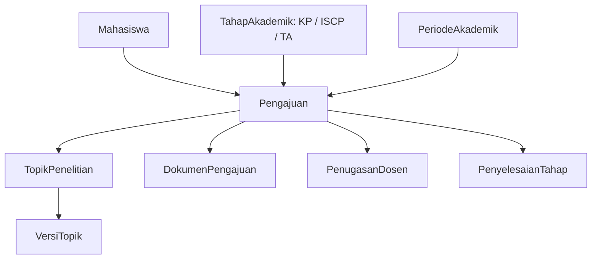
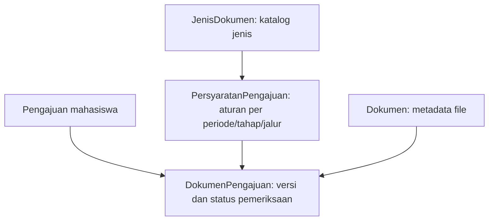

# Database SIPKITA — Peta Model, Relasi, Aliran Data, dan Batas Implementasi

> **Jenis dokumen:** referensi arsitektur data untuk Codex dan pengembang; **bukan** file schema Prisma, migration SQL, atau perintah eksekusi perubahan database. Dokumen ini menjelaskan struktur, makna hubungan data, batas constraint, serta kaitannya dengan proses bisnis yang disepakati.

> **Dasar pemeriksaan:** `server/prisma/schema.prisma`, migrasi `20261029174916_init_sipkita`, dan database development diaudit read-only pada 1 November 2026. Schema 38 model lolos validasi Prisma 7.10.0; database memuat 38 tabel bisnis, 38 primary key, 82 foreign key, dan empat indeks unik parsial. Isi dokumen **bukan bukti** bahwa modul akademik sudah diimplementasikan.

## 1. Tujuan dan aturan penggunaan oleh Codex

Dokumen ini membantu Codex memahami **di mana data disimpan, bagaimana relasinya, dan apa yang tidak boleh diasumsikan hanya karena tabel tersedia**.

Sebelum membuat atau mengubah fitur:

1. Baca `AGENTS.md`, dokumen aturan bisnis spesifik pada `docs/business-rules/`, `docs/academic-lifecycle.md`, dan `docs/roles-permissions.md` yang berkaitan.
2. Verifikasi **nama model, field, foreign key, enum/status, index, dan migration aktual** di repo. Jangan menebak dari contoh dalam dokumen ini.
3. Bedakan tiga lapisan: **constraint database**, **aturan bisnis pada service**, dan **hak akses pada server**.
4. Pertahankan data historis, termasuk percobaan pengajuan per semester, versi dokumen/topik, penugasan, review, dan keputusan.
5. Jangan mengubah `schema.prisma`, membuat atau menjalankan migration, melakukan seed massal, `db push`, atau reset data **hanya karena membaca file ini**. Gunakan workflow `prisma-schema-change` **bila perubahan diminta secara eksplisit**.

## 2. Teknologi dan konvensi schema

| Aspek         | Kondisi pada schema rujukan                                                                        | Konsekuensi                                                                                                                                |
| ------------- | -------------------------------------------------------------------------------------------------- | ------------------------------------------------------------------------------------------------------------------------------------------ |
| Basis data    | **PostgreSQL** melalui Prisma ORM                                                                  | Foreign key, unique index, transaksi, dan tipe PostgreSQL merupakan bagian desain.                                                         |
| Prisma Client | Generator `prisma-client-js`                                                                       | Backend Express mengakses model melalui Prisma Client; jangan menulis query memakai nama tabel SQL jika API membutuhkan nama model Prisma. |
| Koneksi       | `datasource db { provider = "postgresql" }`; komentar schema menunjuk `prisma.config.ts` untuk URL | Lokasi konfigurasi serta versi Prisma pada repo **harus dicek**, jangan menyalin konfigurasi dari proyek latihan MySQL.                    |
| Nama          | **Model PascalCase**, field **snake_case**, tabel SQL memakai `@@map`                              | Contoh: model `Pengajuan` tersimpan sebagai tabel SQL `pengajuan`; model `User` memakai tabel `users`.                                     |
| ID            | Umumnya `Int`; beberapa riwayat/notifikasi memakai `BigInt`; `UserRole` memakai composite key      | Serialisasi BigInt ke JSON perlu ditangani backend secara aman, misalnya ke string jika API memerlukannya.                                 |
| Waktu         | Tanggal akademik dapat memakai `@db.Date`; timestamp memakai `@db.Timestamptz(6)`                  | Simpan waktu konsisten; tampilkan zona waktu Indonesia secara jelas di UI.                                                                 |
| Status        | Banyak kolom status bertipe `String`                                                               | `@default` **bukan state machine**. Daftar nilai dan transisi harus diputuskan serta divalidasi di service.                                |
| Penghapusan   | Relasi utama banyak memakai `onDelete: Restrict`                                                   | Jangan mengandalkan cascade untuk menghapus histori.                                                                                       |
| Index parsial | Schema memakai `previewFeatures = ["partialIndexes"]` dan `@@unique(..., where: ...)`              | Periksa kompatibilitas Prisma dan SQL migration PostgreSQL pada lingkungan aktual sebelum memodifikasi constraint.                         |

**Arsitektur aplikasi yang disepakati:** npm workspaces dengan `client/` (React, Vite, Tailwind) dan `server/` (Express, Prisma, PostgreSQL). Alur standar backend: **route → controller → service → Prisma Client → PostgreSQL**. Validasi rule dan transaksi berada di backend/service, bukan hanya pada form React.

## 3. Inventaris seluruh model (38 model)

Schema rujukan memisahkan model menjadi lima kelompok. **Pengelompokan ini untuk dokumentasi, bukan berarti setiap kelompok adalah database atau schema PostgreSQL terpisah.**

| Kelompok                                         | Model yang ada                                                                                                                                             | Fungsi utama                                                                                             |
| ------------------------------------------------ | ---------------------------------------------------------------------------------------------------------------------------------------------------------- | -------------------------------------------------------------------------------------------------------- |
| **A — Akun, master, verifikasi, audit (11)**     | `User`, `Role`, `UserRole`, `ProgramStudi`, `Mahasiswa`, `Dosen`, `VerifikasiDataDiri`, `DokumenDataDiri`, `PasswordResetToken`, `ImportBatch`, `AuditLog` | Identitas, banyak role, master pengguna, berkas identitas, pemeriksaan, impor CSV, reset sandi, audit.   |
| **B — Akademik, pengajuan, topik (8)**           | `PeriodeAkademik`, `TahapAkademik`, `JadwalProses`, `Pengajuan`, `TemaPenelitian`, `TopikPenelitian`, `VersiTopik`, `RiwayatStatusPengajuan`               | Tahap KP/ISCP/TA, semester, formulir dan histori pengajuan, judul beserta versinya.                      |
| **C — Syarat, dokumen, dosen, reviewer (7)**     | `JenisDokumen`, `PersyaratanPengajuan`, `Dokumen`, `DokumenPengajuan`, `PenugasanDosen`, `ReviewProposal`, `RiwayatReview`                                 | Syarat berbeda per jalur/tahap/periode, file/versioning, penugasan reviewer-pembimbing, review proposal. |
| **D — Bimbingan, perubahan, penyelesaian (6)**   | `Bimbingan`, `RiwayatBimbingan`, `LampiranBimbingan`, `PerubahanJudul`, `KeputusanPerubahanJudul`, `PenyelesaianTahap`                                     | Bimbingan offline/online, jejak penilaian, pergantian judul, ACC selesai tahap.                          |
| **E — Seminar, informasi, template, aturan (6)** | `JadwalSeminar`, `RiwayatJadwalSeminar`, `Notifikasi`, `NotifikasiPenerima`, `TemplateDokumen`, `AturanPenyelesaianTahap`                                  | Jadwal seminar minimal, pesan internal, template dokumen, jumlah bimbingan minimum per tahap/periode.    |

**Entitas pusat adalah `Pengajuan`:** satu mahasiswa dapat mempunyai beberapa pengajuan menurut **tahap, periode, dan kesempatan**. Bimbingan, penugasan dosen, dokumen pengajuan, seminar, perubahan judul, serta ACC penyelesaian **melekat pada pengajuan tertentu**—jangan ditautkan hanya berdasarkan NIM.

## 4. Peta relasi inti

### 4.1 Pengajuan dan perjalanan akademik

Panah merupakan peta hubungan konseptual. **Arah foreign key yang sebenarnya** tetap harus dilihat di `schema.prisma`. Khusus `Pengajuan`, `topik_penelitian_id` dan `versi_topik_id` bersifat **nullable**, terutama saat draft/belum ditetapkan; jangan menyatakan setiap pengajuan pasti sudah memiliki judul aktif.

### 4.2 Dua rantai riwayat `Pengajuan` yang tidak boleh tertukar

| Field pada `Pengajuan`    | Makna domain                                                                                                                     | Contoh                                                           |
| ------------------------- | -------------------------------------------------------------------------------------------------------------------------------- | ---------------------------------------------------------------- |
| `pengajuan_prasyarat_id`  | Mengacu pengajuan dari **tahap sebelumnya** sebagai prasyarat lanjut akademik.                                                   | Pengajuan ISCP mengacu KP yang sudah memenuhi ACC penyelesaian.  |
| `pengajuan_sebelumnya_id` | Mengacu **pengajuan/percobaan sebelumnya** ketika mengulang atau melanjutkan pekerjaan pada periode berikutnya sesuai ketentuan. | Pengajuan KP semester berikutnya terkait KP semester sebelumnya. |
| `topik_penelitian_id`     | Identitas topik yang dipakai pengajuan.                                                                                          | Judul berubah tetapi identitas topik dapat tetap sama.           |
| `versi_topik_id`          | Versi judul/objek yang sedang digunakan pengajuan.                                                                               | Setelah ACC perubahan judul, menunjuk `VersiTopik` yang baru.    |

**Aturan final:** urutan KP → ISCP → TA dan kelayakan lanjut **ditentukan setelah ACC penyelesaian Dosen Pembimbing serta syarat terpenuhi**; sistem menandai kelayakan/menawarkan tahap berikutnya secara otomatis, **bukan berarti membuat `Pengajuan` tahap baru tanpa aksi mahasiswa**. Kaprodi memantau transisi dan **tidak memberikan ACC manual tambahan** untuk perpindahan tahap.

**Lintas semester:** jangan mengubah periode sebuah record pengajuan lama untuk mewakili kesempatan baru. Pertahankan histori record lama dan buat pengajuan periode baru melalui **Perpanjangan**, termasuk ketika mahasiswa harus mengulang tahap. Tidak ada proses pengajuan ulang terpisah dan tidak ada tambahan perpanjangan 1–2 minggu dalam semester yang sama.

## 5. Kelompok A — Akun, master, verifikasi, dan audit

| Relasi/record                                        | Arti                                                                  | Constraint atau perhatian                                                                                                           |
| ---------------------------------------------------- | --------------------------------------------------------------------- | ----------------------------------------------------------------------------------------------------------------------------------- |
| `User` → `UserRole` → `Role`                         | Satu login dapat punya beberapa role.                                 | `UserRole` menggunakan `@@id([user_id, role_id])`, sehingga satu kombinasi role tidak diduplikasi.                                  |
| `User` → `Mahasiswa?` / `Dosen?`                     | Data profil mahasiswa atau dosen terpisah dari kredensial login.      | `Mahasiswa.user_id` dan `Dosen.user_id` masing-masing `@unique`. Tidak berarti mahasiswa dan dosen boleh diubah sembarang lewat UI. |
| `Mahasiswa`/`Dosen` → `ProgramStudi`                 | Keterkaitan profil dengan prodi.                                      | UserRole **tidak** otomatis memuat cakupan prodi; validasi scope perlu ditentukan di backend.                                       |
| `Mahasiswa` → `VerifikasiDataDiri`                   | Satu record status pemeriksaan data diri mahasiswa.                   | `VerifikasiDataDiri.mahasiswa_id @unique`.                                                                                          |
| `VerifikasiDataDiri` → `DokumenDataDiri` → `Dokumen` | Banyak jenis dokumen identitas dengan histori upload dan pemeriksaan. | Per `(verifikasi_data_diri_id, jenis_dokumen_id)`, maksimal **satu `is_terkini=true`**.                                             |
| `User` → `PasswordResetToken`                        | Token reset berupa hash, tanggal kedaluwarsa dan waktu dipakai.       | Jangan menyimpan atau menampilkan token reset mentah di database/log.                                                               |
| `ImportBatch`, `AuditLog`                            | Histori impor mahasiswa/dosen dan pencatatan tindakan.                | Import bukan bukti integrasi real-time dengan SIKADU. Audit hanya efektif jika benar-benar ditulis oleh service.                    |

**Verifikasi identitas:** revisi **satu dokumen** menghasilkan record/versi baru bagi jenis dokumen tersebut, tidak menghapus atau memaksa upload ulang seluruh dokumen lain yang sudah sah. Pemeriksaan per dokumen dapat dilakukan tersendiri atau melalui aksi verifikasi massal **jika diotorisasi dan diimplementasikan**. Status keseluruhan pada `VerifikasiDataDiri` harus konsisten dengan keputusan pemeriksaan.

## 6. Kelompok B — Periode, tahap, pengajuan, dan judul

### Master dan kalender

- `TahapAkademik` menyimpan kode tahap **KP/ISCP/TA** secara konfiguratif, `urutan` unik, dan `maks_perpanjangan?`. Tidak boleh membuat tiga tabel `PengajuanKP`, `PengajuanISCP`, `PengajuanTA` yang menduplikasi konsep `Pengajuan`.
- `PeriodeAkademik` membedakan `(tahun_ajaran, semester)` secara unik. Pada periode yang sama **boleh ada mahasiswa KP, ISCP, dan TA sekaligus**.
- `JadwalProses` menyimpan jendela buka/tutup proses per kombinasi **periode + tahap + jenis proses**. Ini **bukan** jadwal seminar individual.
- `Pengajuan` mencatat `jenis_pengajuan`, `pilihan_topik`, persyaratan akademik saat submit (`ipk_saat_pengajuan`, `jumlah_sks_saat_pengajuan`, nilai D/E), status administratif/akademik, keputusan dan waktunya.

### Judul, objek, dan versi

- `TemaPenelitian`: kategori/tema master.
- `TopikPenelitian`: milik mahasiswa, mengacu `TemaPenelitian`; menyimpan status topik.
- `VersiTopik`: menyimpan `nomor_versi`, `judul_penelitian`, `objek_penelitian`, `lokasi_penelitian`, status dan periode berlaku.
- `VersiTopik` unik per `(topik_penelitian_id, nomor_versi)`; `perubahan_judul_id` unik bila ada.
- **Jalur `LANJUT`** ISCP/TA membawa topik/versi dari tahap sebelumnya sebagai isian awal, tetapi tetap wajib memakai proposal terbaru dan menjalani review. `BARU` mengikuti pengajuan topik baru beserta dokumen/review sesuai aturan jalur.
- `RiwayatStatusPengajuan` merekam status sebelum/sesudah dan aktor pengubah. Perubahan pada `Pengajuan.status_pengajuan` atau `status_pengerjaan` harus punya validasi state yang jelas; jangan menganggap kedua status tersebut identik.

**Perhatian:** relasi FK pada `Pengajuan.versi_topik_id` menjamin versi itu ada, **tetapi tidak dengan sendirinya menjamin** versi tersebut milik `Pengajuan.topik_penelitian_id` atau milik mahasiswa yang benar. Konsistensinya harus dijaga di service.

## 7. Kelompok C — Persyaratan, dokumen, penugasan, dan review

### 7.1 Dokumen persyaratan dinamis

| Model                  | Tanggung jawab                                                                                                                    | Implikasi                                                                                                                 |
| ---------------------- | --------------------------------------------------------------------------------------------------------------------------------- | ------------------------------------------------------------------------------------------------------------------------- |
| `JenisDokumen`         | Mendefinisikan kode/nama/kategori dokumen, format dan batas ukuran.                                                               | **Tidak sendirian** menentukan kewajiban per KP/ISCP/TA.                                                                  |
| `PersyaratanPengajuan` | Menentukan syarat per **`periode_akademik_id` + `tahap_akademik_id` + `jenis_pengajuan` + `pilihan_topik` + `jenis_dokumen_id`**. | Ada `is_wajib`, `boleh_gunakan_dokumen_sebelumnya`, `is_aktif`; kombinasi tersebut unik.                                  |
| `Dokumen`              | Metadata upload: `storage_key`, `nama_file_asli`, `mime_type`, `ukuran_bytes`, checksum, pengunggah.                              | **Bukan penyimpanan byte file**; mekanisme object/file storage dijalankan aplikasi.                                       |
| `DokumenPengajuan`     | Bukti bahwa sebuah pengajuan memenuhi salah satu persyaratan dengan versi file tertentu.                                          | Ada status pemeriksaan, catatan, pemeriksa, `nomor_versi`, `is_terkini`, dan referensi dokumen lama yang digunakan ulang. |

Contoh: pada periode yang sama, konfigurasi dapat mewajibkan **surat izin orang tua** untuk jalur/tahap tertentu dan **bukti pembayaran TA** untuk TA, tanpa menambah kolom per jenis berkas di `Pengajuan`. Service memilih baris `PersyaratanPengajuan` yang tepat untuk pengajuan; perubahan syarat periode mendatang tidak boleh sembarangan mengubah bukti historis periode lama.

**Constraint terpenting:** untuk satu `(pengajuan_id, persyaratan_pengajuan_id)`, hanya **satu** `DokumenPengajuan` boleh `is_terkini=true`. Saat revisi, nonaktifkan versi lama dan tambah versi baru secara konsisten dalam transaksi. **Dokumen lain yang tidak direvisi tetap berlaku**, sepanjang aturan/statusnya mengizinkan.

**Validasi yang tidak otomatis dijamin FK:** kesesuaian `PersyaratanPengajuan` dengan periode/tahap/jalur milik `Pengajuan`; format dan ukuran file asli; ownership; batas revisi; daftar dokumen wajib lengkap. Periksa di backend.

### 7.2 Penugasan Reviewer dan Pembimbing

| Fakta model                                                                                                                                                        | Makna                                                                                                                                             |
| ------------------------------------------------------------------------------------------------------------------------------------------------------------------ | ------------------------------------------------------------------------------------------------------------------------------------------------- |
| `PenugasanDosen` menyimpan `pengajuan_id`, `dosen_id`, `jenis_penugasan`, `status_penugasan`, `sumber_penugasan`, penetap, masa berlaku, dan `asal_penugasan_id?`. | Penugasan pada **pengajuan**, bukan role dosen global. Bisa menelusuri asal penugasan dari tahap sebelumnya.                                      |
| Unique parsial saat `jenis_penugasan='PEMBIMBING'` dan `status_penugasan='AKTIF'`.                                                                                 | Maksimal **satu Pembimbing aktif** per pengajuan pada schema rujukan.                                                                             |
| Tidak ada unique parsial setara untuk `REVIEWER`.                                                                                                                  | Satu pengajuan **dapat memiliki beberapa dosen reviewer**, sesuai keputusan Kaprodi; cegah duplikasi penugasan yang tidak dikehendaki di service. |
| `ReviewProposal.penugasan_dosen_id @unique`.                                                                                                                       | Satu record review proposal per record penugasan dosen; riwayat putaran berada di `RiwayatReview`.                                                |
| `RiwayatReview` unik pada `(review_proposal_id, putaran_ke)`, mengacu `DokumenPengajuan`, `VersiTopik`, dan optional `lembar_review_dokumen_id`.                   | Revisi tidak boleh mengganti bukti proposal yang pernah direview; lembar review **opsional** sesuai desain awal.                                  |

**Kewenangan:** Reviewer memberi catatan/hasil review proposal dan dapat melampirkan lembar review. Reviewer **tidak mengesahkan transisi tahap**. Dosen berperan ganda tetap perlu pemeriksaan **penugasan aktif serta jenis aksi**. Jika ada dua atau lebih Reviewer aktif, semuanya wajib memberi hasil `LAYAK` pada proposal terbaru sebelum prasyarat review terpenuhi; keputusan akhir tetap oleh Kaprodi.

## 8. Kelompok D — Bimbingan, perubahan judul, ACC penyelesaian

| Rantai data                                                                      | Makna proses                                                         | Perlindungan histori                                                                                                   |
| -------------------------------------------------------------------------------- | -------------------------------------------------------------------- | ---------------------------------------------------------------------------------------------------------------------- |
| `Pengajuan` → `Bimbingan` → `RiwayatBimbingan` → `LampiranBimbingan` → `Dokumen` | Catatan offline/online; pengiriman, tanggapan, revisi, lampiran.     | `RiwayatBimbingan` menyimpan snapshot dan `versi_pengiriman`; lampiran terhubung ke riwayat, bukan hanya record induk. |
| `Pengajuan` → `PerubahanJudul` → `KeputusanPerubahanJudul`                       | Usulan judul/objek/proposal baru; ACC/Tolak Pembimbing lalu Kaprodi. | Setiap keputusan menyimpan pemeriksa, snapshot usulan, dan `proposal_dokumen_id`.                                      |
| `PerubahanJudul` → `VersiTopik` hasil → `Pengajuan.versi_topik_id`               | Setelah **ACC Kaprodi**, versi baru menjadi judul resmi.             | Versi asal tidak ditimpa/hapus.                                                                                        |
| `Pengajuan` → `PenyelesaianTahap` → `AturanPenyelesaianTahap`                    | ACC tahap oleh Pembimbing ketika syarat terpenuhi.                   | `PenyelesaianTahap.pengajuan_id @unique`; jumlah/minimum bimbingan direkam sebagai snapshot saat ACC.                  |

**Bimbingan:** offline: mahasiswa mengisi tanggal/ringkasan dengan lampiran opsional, Pembimbing validasi; online: mahasiswa unggah materi dan menerima catatan/keputusan. Status yang disepakati secara bisnis **ACC / Perlu Perbaikan / Tolak**; catatan ACC tidak dapat diedit lagi. Kode status teknis tetap diperiksa pada implementasi.

**Perubahan judul:** proposal perubahan **wajib**, termasuk bila mahasiswa semula memakai jalur `LANJUT`. Hubungkan proposal melalui `PerubahanJudul.proposal_perubahan_dokumen_id` → `Dokumen`, **bukan** otomatis melalui persyaratan pengajuan lama. ACC Pembimbing **belum** mengubah judul; update `VersiTopik` dan `Pengajuan` baru dilakukan saat ACC Kaprodi final, dalam transaksi atomik. Template/logbook terbaru tersedia secara bisnis tetapi **tidak ada tabel `Logbook` khusus** pada schema rujukan.

**Penyelesaian tahap:** `AturanPenyelesaianTahap` unik pada `(tahap_akademik_id, periode_akademik_id)` dan menyimpan `minimal_bimbingan`; `keterangan_syarat_lain` masih berbentuk **teks**. Jika syarat lulus perlu **sertifikat/dokumen tambahan dengan upload serta verifikasi terstruktur**, schema sekarang **belum** menyediakan tabel relasi bukti penyelesaian khusus; jangan menganggap `keterangan_syarat_lain` otomatis memverifikasi dokumen. Butuh analisis domain dan keputusan perubahan skema jika diminta.

## 9. Kelompok E — Seminar, notifikasi, template, aturan selesai

| Model                               | Dukungan yang tersedia                                                             | Belum boleh diasumsikan                                                                          |
| ----------------------------------- | ---------------------------------------------------------------------------------- | ------------------------------------------------------------------------------------------------ |
| `JadwalSeminar`                     | Pengajuan, waktu mulai/selesai, jenis pelaksanaan, lokasi/tautan, status, pembuat. | Belum ada relasi penguji, peserta, reservasi ruang, berita acara, hasil, atau banyak sesi aktif. |
| `RiwayatJadwalSeminar`              | Snapshot aksi/perubahan jadwal dan pelaku.                                         | Alur pembatalan/penjadwalan ulang serta persetujuan perubahan belum final.                       |
| `Notifikasi` + `NotifikasiPenerima` | Pesan dan penerima internal, status sudah dibaca.                                  | Bukan sistem email/WhatsApp/push otomatis tanpa implementasi.                                    |
| `TemplateDokumen`                   | Versi template berdasarkan kode, sumber file/renderer, status aktif.               | Bukan bukti renderer logbook sudah dibuat atau file hasil sudah disimpan.                        |
| `AturanPenyelesaianTahap`           | Aturan bimbingan minimum per tahap dan periode.                                    | Belum menggantikan tabel bukti kelulusan tambahan yang terstruktur.                              |

**Seminar berstatus `PROVISIONAL`:** baru disepakati bahwa Pembimbing membuat jadwal dan Mahasiswa melihat informasi/notifikasi. `JadwalSeminar` memiliki unique parsial **maksimal satu `TERJADWAL` per `pengajuan_id`**. Jika mekanisme final nanti memerlukan lebih dari satu seminar/sesi aktif pada pengajuan sama, constraint dan kemungkinan model terkait perlu dievaluasi; lihat `docs/business-rules/seminar.md`.

## 10. Empat unique index parsial yang wajib dipahami

| Index pada schema              | Kondisi uniqueness                                                       | Perilaku saat operasi data                                                               |
| ------------------------------ | ------------------------------------------------------------------------ | ---------------------------------------------------------------------------------------- |
| `uq_dokumen_diri_terkini`      | `(verifikasi_data_diri_id, jenis_dokumen_id)` **jika `is_terkini=true`** | Nonaktifkan versi identitas sebelumnya sebelum/together dengan versi baru.               |
| `uq_dokumen_pengajuan_terkini` | `(pengajuan_id, persyaratan_pengajuan_id)` **jika `is_terkini=true`**    | Revisi dokumen pengajuan mempertahankan versi lama.                                      |
| `uq_pembimbing_aktif`          | `pengajuan_id` **jika jenis `PEMBIMBING` dan status `AKTIF`**            | Penggantian Pembimbing menonaktifkan penugasan lama dalam transaksi yang konsisten.      |
| `uq_seminar_terjadwal`         | `pengajuan_id` **jika status `TERJADWAL`**                               | Jadwal dengan status `TERJADWAL` kedua pada pengajuan yang sama harus ditolak/ditangani. |

Index tersebut menjaga **keunikan pada kondisi tertentu**, bukan otomatis menjaga seluruh aturan bisnis. Penggunaan transaksi, ownership, kondisi status, dan kemungkinan race condition tetap harus ditangani di service. **Perubahan definisi `where` memerlukan tinjauan migration SQL dan data historis.**

## 11. Contoh aliran data konkret KP → ISCP

Semua ID/nilai di bawah **ilustrasi, bukan record database sebenarnya**. Contoh dipilih agar relasi antartabel bisa ditelusuri.

### 11.1 Master dan pengajuan KP

| Model             | Contoh isi terpilih                                                                                                                                    | Arti                                       |
| ----------------- | ------------------------------------------------------------------------------------------------------------------------------------------------------ | ------------------------------------------ |
| `User`            | `id=11`, `login_id='52200011'`                                                                                                                         | Akun mahasiswa.                            |
| `Mahasiswa`       | `id=41`, `user_id=11`, `nim='52200011'`                                                                                                                | Profil pemilik pengajuan.                  |
| `TahapAkademik`   | `id=1`, `kode_tahap='KP'`, `urutan=1`; `id=2`, `kode_tahap='ISCP'`, `urutan=2`; `id=3`, `kode_tahap='TA'`, `urutan=3`                                  | Satu master tahap dipakai semua mahasiswa. |
| `PeriodeAkademik` | `id=7`, `tahun_ajaran='2026/2027'`, `semester='GANJIL'`                                                                                                | Periode contoh.                            |
| `TopikPenelitian` | `id=301`, `mahasiswa_id=41`, `tema_penelitian_id=5`                                                                                                    | Topik milik mahasiswa 41.                  |
| `VersiTopik`      | `id=401`, `topik_penelitian_id=301`, `nomor_versi=1`, `judul_penelitian='Sistem Informasi Inventaris'`                                                 | Judul awal.                                |
| `Pengajuan`       | `id=101`, `mahasiswa_id=41`, `periode_akademik_id=7`, `tahap_akademik_id=1`, `pilihan_topik='BARU'`\*, `topik_penelitian_id=301`, `versi_topik_id=401` | Pengajuan KP pertama.                      |

\* `BARU` adalah **contoh nilai bisnis**. Gunakan konstanta status/jalur yang sudah disahkan di implementasi, bukan menggantungkan validasi pada teks ilustrasi.

### 11.2 Persyaratan pengajuan dan penugasan dosen

| Model                  | Contoh isi terpilih                                                                                                                                                   | Hubungan                                                               |
| ---------------------- | --------------------------------------------------------------------------------------------------------------------------------------------------------------------- | ---------------------------------------------------------------------- |
| `JenisDokumen`         | `id=21`, `kode_jenis='PROPOSAL'`                                                                                                                                      | Jenis berkas.                                                          |
| `PersyaratanPengajuan` | `id=501`, `periode_akademik_id=7`, `tahap_akademik_id=1`, `jenis_pengajuan='<KODE_PENGAJUAN_AWAL>'`*, `pilihan_topik='BARU'`*, `jenis_dokumen_id=21`, `is_wajib=true` | Persyaratan proposal untuk kombinasi yang dikonfigurasi.               |
| `Dokumen`              | `id=601`, `nama_file_asli='proposal-kp.pdf'`, `storage_key='pengajuan/101/proposal-v1.pdf'`                                                                           | Metadata upload; file fisik disimpan terpisah.                         |
| `DokumenPengajuan`     | `id=701`, `pengajuan_id=101`, `persyaratan_pengajuan_id=501`, `dokumen_id=601`, `nomor_versi=1`, `is_terkini=true`                                                    | Bukti proposal KP pengajuan 101.                                       |
| `PenugasanDosen`       | `id=801`, `pengajuan_id=101`, `dosen_id=4`, `jenis_penugasan='REVIEWER'`\*                                                                                            | Salah satu reviewer proposal KP.                                       |
| `ReviewProposal`       | `id=901`, `penugasan_dosen_id=801`                                                                                                                                    | Review milik penugasan reviewer ini.                                   |
| `RiwayatReview`        | `id=1001`, `review_proposal_id=901`, `putaran_ke=1`, `dokumen_pengajuan_id=701`, `versi_topik_id=401`                                                                 | Hasil review mengacu dokumen dan judul **yang benar-benar diperiksa**. |
| `PenugasanDosen`       | `id=802`, `pengajuan_id=101`, `dosen_id=6`, `jenis_penugasan='PEMBIMBING'`, `status_penugasan='AKTIF'`                                                                | Pembimbing KP aktif setelah penetapan.                                 |

\* `jenis_pengajuan`, `pilihan_topik`, dan `jenis_penugasan` bertipe `String`; `<KODE_PENGAJUAN_AWAL>` adalah **placeholder**, bukan nilai yang boleh disimpan apa adanya. Isi contoh harus disesuaikan dengan kode valid yang digunakan sistem. Baris ini **bukan seed siap pakai** dan tidak menampilkan seluruh field wajib.

### 11.3 ACC KP dan kelayakan pengajuan ISCP

| Model                     | Contoh isi terpilih                                                                                                                                                                    | Makna                                                                                                 |
| ------------------------- | -------------------------------------------------------------------------------------------------------------------------------------------------------------------------------------- | ----------------------------------------------------------------------------------------------------- |
| `AturanPenyelesaianTahap` | `id=1201`, `tahap_akademik_id=1`, `periode_akademik_id=7`, `minimal_bimbingan=10`                                                                                                      | Minimum 10 bimbingan pada contoh KP periode ini.                                                      |
| `Bimbingan`               | Sejumlah catatan `pengajuan_id=101` berstatus ACC menurut aturan                                                                                                                       | Hanya bimbingan yang sah dihitung oleh service.                                                       |
| `PenyelesaianTahap`       | `id=1301`, `pengajuan_id=101`, `aturan_penyelesaian_tahap_id=1201`, `jumlah_bimbingan_saat_acc=10`, `minimal_bimbingan_saat_acc=10`, `disetujui_oleh_user_id=16`                       | Akun user 16 (dari dosen 6 pada contoh) memberi ACC selesai setelah syarat terpenuhi.                 |
| `Pengajuan` ISCP          | `id=102`, `mahasiswa_id=41`, `periode_akademik_id=8`, `tahap_akademik_id=2`, `pilihan_topik='LANJUT'`\*, `pengajuan_prasyarat_id=101`, `topik_penelitian_id=301`, `versi_topik_id=401` | Mahasiswa **mengajukan** ISCP baru dengan referensi KP; sistem boleh mengisi awal dari KP yang lulus. |
| `PenugasanDosen` ISCP     | `pengajuan_id=102`, `dosen_id=6`, `jenis_penugasan='PEMBIMBING'`, `asal_penugasan_id=802`                                                                                              | Pembimbing ISCP diwariskan dari KP, dengan record penugasan **baru**.                                 |

**Yang tidak terjadi:** saat `PenyelesaianTahap` KP disetujui, sistem **tidak mengubah record KP menjadi ISCP** dan tidak menghapus dokumen/bimbingan KP. Mahasiswa membuat pengajuan ISCP yang tetap mempunyai ID tersendiri. Kelayakan lintas tahap diatur service sesuai persyaratan, jadwal proses, dan aturan dalam dokumen bisnis.

### 11.4 Mahasiswa berbeda pada periode yang sama

Mahasiswa lain boleh membuat `Pengajuan id=103`, `periode_akademik_id=8`, `tahap_akademik_id=1` (**KP**), sementara mahasiswa 41 memiliki `Pengajuan id=102` (**ISCP**) dan mahasiswa lain lagi mengerjakan **TA** pada `periode_akademik_id=8`. **Tidak ada konflik** karena tahap disimpan per pengajuan, bukan ditentukan global oleh periode.

## 12. Operasi penting yang harus atomik

| Operasi                                        | Record yang berubah bersama                                                                | Mengapa butuh transaksi/guard                                                                      |
| ---------------------------------------------- | ------------------------------------------------------------------------------------------ | -------------------------------------------------------------------------------------------------- |
| Revisi dokumen data diri                       | `Dokumen` baru, `DokumenDataDiri.is_terkini` lama/baru, status verifikasi jika perlu       | Jangan sampai dua file identitas sama-sama terkini atau status agregat salah.                      |
| Revisi dokumen pengajuan                       | `Dokumen` baru dan `DokumenPengajuan` versi lama/baru                                      | Menjaga unique index parsial dan hasil verifikasi yang sudah valid.                                |
| Pemeriksaan massal dokumen                     | Status/periksa dokumen terkait dan status pemeriksaan keseluruhan bila ada                 | Tidak boleh memverifikasi file yang tidak benar-benar memenuhi kondisi.                            |
| ACC akhir pengajuan                            | `Pengajuan`, `RiwayatStatusPengajuan`, penetapan atau kelayakan assignment bila diminta    | Pastikan pemeriksaan dan review yang diwajibkan selesai, serta tidak ada keputusan ganda.          |
| Penugasan/penggantian Pembimbing               | `PenugasanDosen` lama/baru                                                                 | Tepat satu Pembimbing aktif; pertahankan asal/riwayat.                                             |
| Review dan revisi proposal                     | `DokumenPengajuan`, `ReviewProposal`, `RiwayatReview`, `VersiTopik` bila relevan           | Snapshot putaran harus sesuai file/versi topik yang direview.                                      |
| ACC penyelesaian tahap                         | `PenyelesaianTahap`, status/riwayat pengajuan                                              | Mencegah ACC ganda; snapshot minimum dan jumlah bimbingan harus sesuai kondisi sah saat keputusan. |
| ACC akhir perubahan judul                      | `KeputusanPerubahanJudul`, `PerubahanJudul`, `VersiTopik` baru, `Pengajuan.versi_topik_id` | Judul resmi hanya berubah **setelah ACC Kaprodi**, tanpa merusak versi lama.                       |
| Perubahan jadwal seminar (jika nanti disahkan) | `JadwalSeminar` dan `RiwayatJadwalSeminar`                                                 | Jadwal aktif dan snapshot perubahan tidak boleh bertentangan.                                      |

**Batas otorisasi:** foreign key hanya menjamin referensi record yang ada. Service juga perlu memverifikasi **role, kepemilikan data, status saat ini, cakupan prodi, penugasan dosen, dan aturan periode**. Hindari *time-of-check/time-of-use race*: periksa ulang kondisi penting pada transaksi yang menyimpan keputusan.

## 13. Celah dan keputusan desain yang masih terbuka

| Topik                              | Kondisi schema saat ini                                                                                                      | Tindakan jika fitur diminta                                                                                                                     |
| ---------------------------------- | ---------------------------------------------------------------------------------------------------------------------------- | ----------------------------------------------------------------------------------------------------------------------------------------------- |
| **Dokumen kelulusan tambahan**     | `AturanPenyelesaianTahap.keterangan_syarat_lain` berupa teks, belum ada mapping bukti upload-verifikasi penyelesaian khusus. | Rancang model syarat dan bukti per tahap/periode sesuai keputusan, tanpa memakai `DokumenPengajuan` secara otomatis untuk konteks yang berbeda. |
| **Review beberapa dosen**          | Banyak `PenugasanDosen` Reviewer dimungkinkan; seluruh Reviewer aktif wajib `LAYAK` pada proposal terbaru.                    | Terapkan agregasi di service dan pastikan hasil lengkap tidak otomatis menjadi ACC Kaprodi.                                                    |
| **Batas jumlah permohonan aktif**  | Beberapa proses, misalnya `PerubahanJudul`, tidak mempunyai unique index khusus permohonan menunggu.                         | Tambah guard service/constraint jika aturan final meminta satu permohonan aktif.                                                                |
| **Hak akses lintas prodi**         | `ProgramStudi` terkait mahasiswa/dosen, tetapi `UserRole` tidak punya `program_studi_id`.                                    | Tentukan cakupan Kaprodi/Admin Prodi dan cara penegakannya sebelum fitur multi-prodi kompleks.                                                  |
| **Seminar lengkap**                | Ada jadwal dan notifikasi; belum ada penguji, hasil, presensi, nilai.                                                        | Ikuti dokumen seminar yang masih **PROVISIONAL**, lalu rancang migrasi setelah konsep final.                                                    |
| **Perubahan kode status**          | Banyak status berupa `String`, bukan enum Prisma.                                                                            | Buat konstanta/state machine yang disetujui, validasi migrasi data nilai lama bila berubah.                                                     |
| **Lintas semester & perpanjangan** | Ada dua relasi self-reference pada `Pengajuan` dan `TahapAkademik.maks_perpanjangan`. Tidak ada jenis proses pengajuan ulang terpisah. | Tetapkan service yang mengecek kelayakan, urutan kesempatan, status, dan batas perpanjangan sesuai aturan bisnis terbaru. |
| **Template dan logbook**           | Ada `TemplateDokumen`, tetapi belum ada model `Logbook` atau kontrak renderer yang final.                                    | Pilih cara generate/simpan hasil saat implementasi, jangan mengarang relasi yang belum ada.                                                     |
| **Diff indeks parsial Prisma**      | Database memiliki empat indeks parsial, tetapi `prisma migrate diff` melaporkan drop/add pada `uq_pembimbing_aktif` dan `uq_seminar_terjadwal`; introspection menampilkan cast predicate `::text`. | Perlakukan sebagai risiko representasi/kompatibilitas. Jangan edit schema atau migrasi yang sudah diterapkan tanpa analisis dan persetujuan. |

**Tidak semua celah perlu langsung ditutup.** Semester sekarang prioritaskan jalur akun, data diri, pengajuan KP/ISCP/TA baru-lanjut, administrasi, review proposal, ACC akhir, dan penetapan Pembimbing. Tabel untuk modul semester depan dipertahankan sebagai fondasi, tetapi implementasi tunggu prioritas dan keputusan.

## 14. Panduan perubahan skema, migrasi, dan keamanan data

1. **Mulai dari kebutuhan bisnis:** sebutkan kasus, aktor, data, status, riwayat, dan integritas yang belum terwakili; jangan menambah tabel karena pola dari proyek lain.
2. **Periksa keadaan aktual:** perbandingkan `schema.prisma`, `prisma.config.ts`, folder migrations, database development, seed, service, API dan test; perubahan dalam dokumen ini bukan otomatis perubahan di repo.
3. **Rancang diff minimum:** tentukan field/model/index/constraint yang berubah dan relasi yang terdampak. Periksa `BigInt`, `Decimal`, `DateTime`, `@map`, `@@map`, FK `Restrict`, serta index parsial.
4. **Utamakan perubahan kompatibel:** kolom baru nullable → backfill bila diperlukan → baru dipersyaratkan; jangan drop/rename data penting tanpa strategi migrasi dan konfirmasi.
5. **Tinjau `migration.sql` sebelum apply:** khusus perubahan constraint unik, cek bentrokan record lama dan potensi kehilangan data. Backup lingkungan yang berisi data penting; gunakan migrasi bertahap, jangan reset sebagai jalan pintas.
6. **Test setelah perubahan:** format/generate Prisma Client, migration development, pemeriksaan tabel/index/FK, uji data lama dan baru, serta automated test pada alur penting.
7. **Jaga keamanan:** password hanya hash, token reset yang disimpan hanya hash, cek akses file menggunakan permission backend, jangan menaruh isi file pribadi di audit secara sembarangan, dan jangan memaparkan key penyimpanan sebagai akses publik.
8. **Perbarui dokumen terkait:** setelah skema/aturan benar-benar disetujui dan diverifikasi, sinkronkan `docs/database.md`, business-rules, tipe API, fixtures/seed, serta catatan status proyek.

## 15. Checklist evaluasi setiap fitur berbasis database

- [ ] Model dan nama field **ada pada schema repo saat ini**, bukan sekadar contoh dokumen.
- [ ] FK, unique index, relasi optional/required, dan on-delete sudah ditinjau.
- [ ] Role, ownership, cakupan prodi, status, periode, serta penugasan divalidasi oleh service.
- [ ] Dokumen dan keputusan historis tidak ditimpa tanpa jejak versi/snapshot.
- [ ] Status final hanya berubah setelah seluruh syarat yang memang diwajibkan terpenuhi.
- [ ] Transaksi digunakan untuk operasi yang mengubah beberapa record berkaitan.
- [ ] Kasus bentrok simultan, duplikasi request, dan error unique index memiliki penanganan.
- [ ] Data pengajuan KP/ISCP/TA bisa berjalan **serentak pada periode yang sama**.
- [ ] Pengujian mencakup jalur normal, penolakan, revisi, dan hak akses tidak sah.
- [ ] Bila perlu perubahan skema, ada rencana diff/migration dan persetujuan scope terlebih dahulu.

**Penutup:** `server/prisma/schema.prisma` menggambarkan **struktur penyimpanan**; dokumen `docs/business-rules/` menggambarkan **aturan proses**; dan service Express bertanggung jawab **menegakkan aturan serta otorisasi dalam transaksi yang aman**. Ketiganya harus tetap konsisten selama SIPKITA dikembangkan bertahap.
